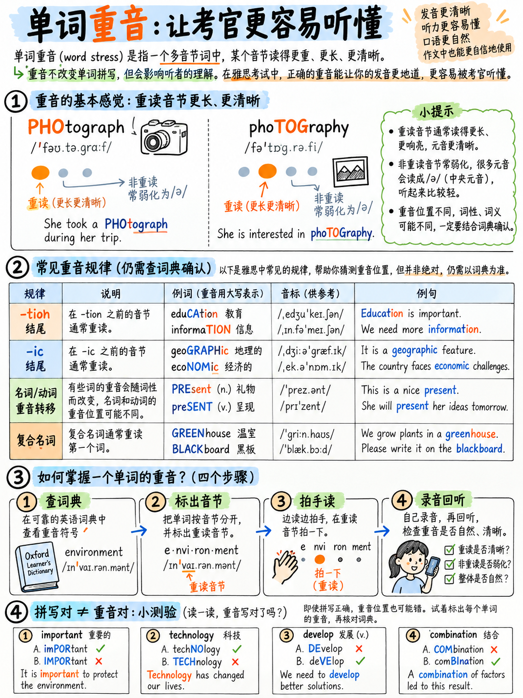

# 04. 单词重音法则：音节强弱对比与重音位置规律 (Word Stress)



> **战略定位**：如果整个发音模块你只打算抽时间攻克一个知识点，**请毫不犹豫地选择“单词重音”**！掌握重音规则的学习成本极低，但它的提分回报率却最高。把重音读错，是导致考官“瞬间听不懂单词”的最直接元凶——哪怕你把单词里的每一个元音和辅音都发得字正腔圆！

---

## 4.1 单词重音的物理本质：不是加大音量，而是三维立体突显

在包含两个或更多音节的英语单词中，**必定有且仅有一个音节承受主重音（Primary Stress）**。

与中文四声平稳的方块字不同，英语的重读音节具有以下**三大物理特征**：
1. **音高更高 (Higher Pitch)**：音调明显上扬；
2. **时长更长 (Longer Duration)**：发音时间是弱读音节的 1.5 到 2 倍；
3. **元音极度饱满 (Full Vowel Quality)**：元音清晰舒展；而周围的所有非重读音节元音，则被极度压缩坍塌为中央弱元音 Schwa `/ə/` 或 `/ɪ/`！

```
                     同一词根的三种不同重音位移奇观

     词形          音节划分与重音位置             IPA 音标        强弱节奏波形
   ─────────     ────────────────────────      ─────────────   ────────────
   PHOTOGRAPH     PHO - to - graph              /ˈfəʊtəɡrɑːf/     ██  ▁  ▁
                  (重音在首音节，后两音坍塌)

   PHOTOGRAPHER   pho - TO - gra - pher         /fəˈtɒɡrəfə/      ▁  ██  ▁  ▁
                  (重音移至第二音节，首音弱化为/ə/)

   PHOTOGRAPHIC   pho - to - GRA - phic         /ˌfəʊtəˈɡræfɪk/   ▁  ▁  ██  ▁
                  (重音移至第三音节，前两音弱化)

   【核心启示】：
   词根完全相同，但重音一转移，全词每一个音节的元音彻底洗牌！
   只有戴上重音皇冠的那个音节才能享受饱满待遇，其余音节全部“隐形”为轻飘飘的 /ə/。
```

:::{important}
**考官评分量表的明文裁决：**  
在雅思官方发音量表核心指标中，排在最前列的即为：**“单词与音素级别的发音输出（例如：单词重音 word stress），以及听者理解这些词汇所需的费力程度（degree of effort required of the listener）”** `[11]`。  
同时，Band 6 明文规定语流节奏不得受到“缺乏重音等时性（stress-timing）”的破坏 `[9]`。

在考场真实交锋中：  
如果你说 *"my **FA**vourite **SUB**ject was e-**CO**-no-mics"*，考官的大脑瞬间毫不费力地识别；  
如果你说 *"my fa-**VOU**-rite sub-**JECT** was e-co-**NO**-mics"*，考官的大脑在 0.5 秒内被迫死机停顿去反向解码。**这 0.5 秒的解码痛苦，就是考官把你的发音和流利度直接压在 Band 5 的最直接依据！**
:::

---

## 4.2 迅速锁定单词重音的三大途径

1. **查阅权威词典的重音符 `ˈ`（100% 准确）**：词典音标中，高位坚线 `ˈ` 标注在**哪个音节前面，哪个音节就必须重读**。例如 `/ˈfəʊtəɡrɑːf/` 重读 PHO，`/fəˈtɒɡrəfə/` 重读 TO。
2. **掌握常见学术词缀的派生规则（覆盖 80% 雅思核心词）**：掌握下文归纳的三大词缀定律，见词就能推导。
3. **击掌拍桌测试法 (The Clap Test)**：一边朗读单词，一边跟随音节拍手。在身体本能感到用力最自然的音节处狠狠击掌，弱音节轻柔掠过。

---

## 4.3 雅思学术词汇词缀重音三大定律 (Suffix Rules)

学术类雅思考试充斥着多音节派生词（如名词化、形容词化）。掌握以下三组规律，即可掌握绝大多数复杂大词：

### 规律 A：倒数第二音节受力群（重音落在后缀紧邻的前一个音节上）
这一类后缀具有极强的“重力牵引力”，**一律把重音拉到后缀自身正前方的那个音节**：

| 后缀类别 | 重音位置与推演公式 | 权威实战例词剖析 |
|---|---|---|
| **-tion / -sion / -cian** | 落在紧邻前一个音节 | educa-**CA**-tion → edu**CA**tion<br>infor-**MA**-tion → infor**MA**tion<br>pollu-**TION** → pol**LU**tion<br>deci-**SION** → de**CI**sion<br>politi-**CIAN** → poli**TI**cian |
| **-ic / -ical** | 落在紧邻前一个音节 | eco**NO**mic (经济的)<br>spe**CI**fic (具体的)<br>demo**CRA**tic (民主的)<br>po**LI**tical (政治的)<br>geo**GRA**phical (地理的) |
| **-ity** | 落在紧邻前一个音节 | uni**VER**sity (大学)<br>oppor**TU**nity (机会)<br>possi**BI**lity (可能性)<br>responsi**BI**lity (责任)<br>a**BI**lity (能力) |
| **-ial / -ious / -eous** | 落在紧邻前一个音节 | fi**NAN**cial (金融的)<br>es**SEN**tial (至关重要的)<br>in**DUS**trial (工业的)<br>advan**TA**geous (有优势的)<br>**SE**rious (严肃的) |
| **-graphy / -logy / -nomy** | 落在紧邻前一个音节 | pho**TO**graphy (摄影)<br>tech**NO**logy (科技)<br>bi**O**logy (生物学)<br>e**CO**nomy (经济)<br>as**TRO**nomy (天文学) |
| **-ify / -itude** | 落在紧邻前一个音节 | i**DEN**tify (识别)<br>**CLA**rify (澄清)<br>**AT**titude (态度) |

---

### 规律 B：自带重音强磁场群（重音直接落在后缀自身上）
这些外来语源后缀自身拥有绝对力量，**重音直接砸在后缀本身**：

| 后缀类别 | 实战高频例词与重读示范 |
|---|---|
| **-ee** | employ**EE** (雇员), train**EE** (受训者), refug**EE** (难民), guarant**EE** (保证) |
| **-eer** | engin**EER** (工程师), car**EER** (职业生涯), volunt**EER** (志愿者) |
| **-ese** | Chin**ESE** (中国人/中文), Japan**ESE** (日本人/日语) |
| **-ique / -esque** | tech**NIQUE** (技巧), un**IQUE** (独一无二的), pictur**ESQUE** (如画的) |
| **-oon** | after**NOON** (下午), bal**LOON** (气球) |

---

### 规律 C：重音隐形中立群（后缀对原词重音没有任何影响）
这些日耳曼传统屈折或派生后缀非常轻柔，**词根原来重读哪里，加了后缀依然重读哪里**：

| 中立后缀清单 | 派生词重音稳固示范 (重音完全不变) |
|---|---|
| **-ment, -ness, -ful, -less, -ly, -er, -est, -ing, -ed, -able, -ise/-ize, -al** | de**VE**lop → de**VE**lopment<br>**HAP**py → **HAP**piness<br>**CARE**ful, **USE**less, **QUICK**ly<br>**TEACH**er, **COM**fortable<br>**OR**ganise, ar**RI**val |

---

## 4.4 雅思王牌提分项：名重前、动重后的词性移位律 (Noun/Verb Stress Shift)

在雅思学术听力和写作 Task 1（图表描述）中，有一组拼写完全相同、但**作为名词和动词时重音位置截然相反**的极高频核心词汇。

> **八字黄金口诀：【名词在前，动词在后】（Nouns at the front, verbs at the back!）**

| 相同英文拼写 | 作名词使用 (重音在首音节 1) | 作动词使用 (重音在第二音节 2) |
|---|---|---|
| **record** | a **RE**-cord (记录/唱片) | to re-**CORD** (录制/记录) |
| **increase** | an **IN**-crease (增幅) | to in-**CREASE** (增长) |
| **decrease** | a **DE**-crease (跌幅) | to de-**CREASE** (下降) |
| **present** | a **PRE**-sent (礼物) | to pre-**SENT** (呈现/展示) |
| **produce** | **PRO**-duce (农产品) | to pro-**DUCE** (生产) |
| **conduct** | **CON**-duct (品行/管理) | to con-**DUCT** (实施/执行) |
| **contrast** | a **CON**-trast (对比) | to con-**TRAST** (形成对比) |
| **import / export** | an **IM**-port / **EX**-port (进口/出口物资) | to im-**PORT** / ex-**PORT** (进口/出口货物) |
| **object** | an **OB**-ject (物体/对象) | to ob-**JECT** (反对) |
| **permit** | a **PER**-mit (许可证) | to per-**MIT** (准许) |
| **progress** | **PRO**-gress (进步) | to pro-**GRESS** (取得进展) |
| **protest** | a **PRO**-test (抗议) | to pro-**TEST** (提出抗议) |
| **rebel** | a **RE**-bel (叛逆者) | to re-**BEL** (反叛) |
| **refuse** | **RE**-fuse (垃圾/废弃物) | to re-**FUSE** (拒绝) |
| **suspect** | a **SUS**-pect (嫌疑人) | to sus-**PECT** (怀疑) |
| **transport** | **TRANS**-port (交通运输业) | to trans-**PORT** (运输) |

:::{tip}
**写作 Task 1 与口语表达的联动王炸：**  
在小作文图表描述或口语描述趋势时，将名动两式成对练习：
* *"Sales showed a sharp **IN**crease."* (名词，重音在 IN)
* *"Sales in**CREASED** sharply."* (动词，重音在 CREASE)
* *"There was a steady **DE**crease in the figure."* (名词，重音在 DE)
* *"The number de**CREASED** steadily."* (动词，重音在 CREASE)
:::

---

## 4.5 复合名词 vs “形容词+名词”的重音分水岭

这也是中国考生极易把语调读平的重灾区：

1. **复合名词（两个名词拼接为一个专有名词）**：**重读第一个词！**  
   * **BUS** stop（公共汽车站，不是 bus STOP）
   * **CREDIT** card（信用卡，不是 credit CARD）
   * **AIR**port（机场）
   * **POST** office（邮局）
   * **CLASS**room（教室）
   * **CAR** park（停车场）
   * **TRAFFIC** lights（红绿灯）
   * **MOBILE** phone（手机）
   * **CLIMATE** change（气候变化）
   * **HEALTH** care（医疗卫生保健）

2. **形容词 + 名词组合**：**重读后面的名词！**  
   * a hot **DAY**（炎热的一天）
   * a big **HOUSE**（大房子）
   * social **MEDIA**（社交媒体）
   * higher edu**CA**tion（高等教育）
   * public **TRANS**port（公共交通工具，注意 *transport* 自身仍重读首音节）

---

## 4.6 雅思 60 个核心学术高频词重音集训表

以下 60 个词汇均采自雅思真题阅读与口语高频题库。大写加粗部分代表**主重音音节**。建议每天朗读一遍，在读到大写音节时用力拍桌击掌：

| 单词 | 正确重音划分 | 单词 | 正确重音划分 |
|---|---|---|---|
| **advertisement** | ad-**VER**-tis-ment (英) | **management** | **MA**-nage-ment |
| **advantage** | ad-**VAN**-tage | **necessary** | **NE**-ces-sa-ry |
| **architecture** | **AR**-chi-tec-ture | **opportunity** | op-por-**TU**-ni-ty |
| **available** | a-**VAI**-la-ble | **parent** | **PA**-rent |
| **category** | **CA**-te-go-ry | **percentage** | per-**CEN**-tage |
| **certificate** | cer-**TI**-fi-cate | **photograph** | **PHO**-to-graph |
| **characteristic**| cha-rac-te-**RIS**-tic | **photographer** | pho-**TO**-gra-pher |
| **colleague** | **CO**-lleague | **policy** | **PO**-li-cy |
| **comfortable** | **COM**-for-ta-ble | **pollution** | po-**LLU**-tion |
| **committee** | co-**MMI**-ttee | **population** | po-pu-**LA**-tion |
| **comparison** | com-**PA**-ri-son | **preferable** | **PRE**-fe-ra-ble |
| **competition** | com-pe-**TI**-tion | **psychology** | psy-**CHO**-lo-gy |
| **computer** | com-**PU**-ter | **purchase** | **PUR**-chase |
| **development** | de-**VE**-lop-ment | **qualification** | qua-li-fi-**CA**-tion |
| **economy** | e-**CO**-no-my | **recipe** | **RE**-ci-pe |
| **economic** | e-co-**NO**-mic | **referee** | re-fe-**REE** |
| **education** | e-du-**CA**-tion | **research** (名) | re-**SEARCH** 或 **RE**-search |
| **employee** | em-ploy-**EE** | **resources** | re-**SOUR**-ces |
| **employer** | em-**PLOY**-er | **responsible** | res-**PON**-si-ble |
| **engineer** | en-gi-**NEER** | **restaurant** | **RES**-tau-rant |
| **environment** | en-**VI**-ron-ment | **secretary** | **SE**-cre-ta-ry |
| **equipment** | e-**QUIP**-ment | **significant** | sig-**NI**-fi-cant |
| **facility** | fa-**CI**-li-ty | **similar** | **SI**-mi-lar |
| **financial** | fi-**NAN**-cial | **statistics** | sta-**TIS**-tics |
| **government** | **GO**-vern-ment | **strategy** | **STRA**-te-gy |
| **industrial** | in-**DUS**-trial | **technology** | tech-**NO**-lo-gy |
| **infrastructure**| **IN**-fra-struc-ture | **temperature** | **TEM**-pe-ra-ture |
| **interesting** | **IN**-te-res-ting | **transport** (名) | **TRANS**-port |
| **laboratory** | la-**BO**-ra-to-ry (英) | **university** | u-ni-**VER**-si-ty |
| **maintenance** | **MAIN**-te-nance | **vegetable** | **VE**-ge-ta-ble |

:::{warning}
**本表中考官听觉雷区四大天王（几乎 90% 的初学者都会读错）：**
1. **de-VE-lop-ment**：绝对不是 *de-ve-LOP-ment*！重音在 VE，后续全部弱化。
2. **GO-vern-ment**：在母语者连贯口语中仅有三个音节 /ˈɡʌvənmənt/，绝不是字正腔圆的 *go-VERN-ment*！
3. **COM-for-ta-ble**：实际发音往往坍塌缩减为三个音节 /ˈkʌmftəbl/，不要硬读成四个音节。
4. **VE-ge-ta-ble**：实际发音只有三个音节 /ˈvedʒtəbl/，中间字母 e 完全不发音！
:::

---

## 4.7 掌握音节计数：消灭中式“硬加音节”

要准确定位重音，必须先具备精准数音节的能力。请记住核心铁律：**一个音节由且仅由一个元音“发音（Vowel Sound）”构成，而不是看单词里写了几个元音字母！**

英语在自然演化中，往往会把常用词中非重读的微弱元音**彻底脱落删除（Syncope / Elision）**。如果你机械地按照字母拼写把每个音节都读出来，听起来就会极其生硬怪异：

| 单词 | 元音字母书写个数 | 真实元音发音 (Vowel Sounds) | 真实物理音节数 | 典型错误发音提醒 |
|---|---|---|---|---|
| **through** | o-u 三个字母 | 仅有长元音 /uː/ 一个 | **1 个音节** | 切勿念成双音节 |
| **strength** | e 一个字母 | 仅有短元音 /e/ 一个 | **1 个音节** | 切勿在 th 后加“呃” |
| **business** | u-i-e 三个字母 | /ˈbɪznəs/ 仅有两个 | **2 个音节** | 切勿把 i 发出来读成三个音节 |
| **comfortable** | o-o-a-e 四个字母 | /ˈkʌmftəbl/ 仅有三个 | **3 个音节** | 中间 or 完全坍塌 |
| **interesting** | i-e-e-i 四个字母 | /ˈɪntrəstɪŋ/ 仅有三个 | **3 个音节** | 第一个 e 彻底脱落不发音 |
| **vegetable** | e-e-a-e 四个字母 | /ˈvedʒtəbl/ 仅有三个 | **3 个音节** | 第二个 e 彻底脱落不发音 |
| **chocolate** | o-o-a-e 四个字母 | /ˈtʃɒklət/ 仅有两个 | **2 个音节** | 中间 o 彻底脱落不发音 |
| **different** | i-e-e 三个字母 | /ˈdɪfrənt/ 仅有两个 | **2 个音节** | 中间 e 彻底脱落不发音 |
| **every** | e-e 两个字母 | /ˈevri/ 仅有两个 | **2 个音节** | 中间 e 彻底脱落不发音 |
| **probably** | o-a-y 三个字母 | /ˈprɒbəbli/ 仅有三个 | **3 个音节** | 切勿拖泥带水 |

---

**上一章：** {doc}`03-vowels-and-diphthongs` | **下一章学习指南：** {doc}`05-chunking-and-sentence-stress`
