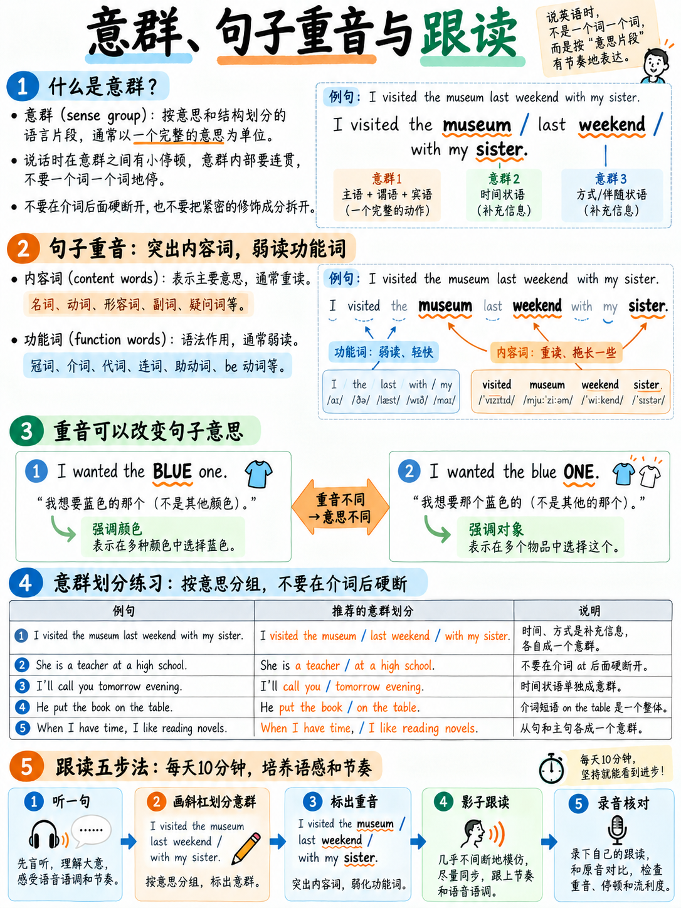

# 05. 意群切分与句子重音：口语流利度最高性价比习惯 (Chunking & Sentence Stress)



> **战略核心**：如果说发音是口语的骨架，那么**意群切分（Chunking）与句子重音（Sentence Stress）**就是口语的灵魂血液。在雅思官方发音量表的五项评估指标中，**意群切分高居第一位，甚至排在单个音素发音之前**！掌握意群切分，是抹平中式英语机械感、从 Band 4-5 跨越至 Band 6-7 的核心密码。

---

## 5.1 官方评分标准的金字塔层级

雅思官方《Speaking Key Assessment Criteria》公布的发音五大法定考核维度中，**官方排列顺序具有极强的指导意义** `[11]`：

1. **意群切分能力**：“能够将语流切分成有实际意义的表意单元或意群（the ability to divide speech into meaningful utterances or **chunks** within spoken sentences）”；
2. **节奏与等时节拍**：“恰当使用节奏与重音等时性（stress timing），并运用连读与省音形成连贯语流”；
3. **重音与语调辅助表意**：“使用重音（如强调重音/对比重音）与语调来升华语义”；
4. **单词与音位发音**：“单词及单音层面的发音准确度（如单词重音、元音辅音）”；
5. **母语口音整体影响**：“口音对整体可理解度的影响程度”。

```{mermaid}
graph TD
    subgraph OfficialPriority["官方发音量表核心层级 (Official Hierarchy)"]
        L1["第 1 顺位: 意群切分 (Chunking) & 呼吸停顿"]
        L2["第 2 顺位: 重音等时节奏 (Stress Timing) & 连读省音"]
        L3["第 3 顺位: 强调/对比重音 (Contrastive Stress) & 语调"]
        L4["第 4 顺位: 单个元音/辅音音准 (Phonemes)"]
        L5["第 5 顺位: 口音整体可懂度 (Intelligibility)"]
    end
    L1 --> L2 --> L3 --> L4 --> L5
```

看到没有？**单个音准排在第四位，意群切分排在第一位！**

再看官方分档描述（Band Descriptors）关于 4 分与 6 分的定义 `[9]`：
* **Band 4**：“能产出少量可接受的意群，但在整体节奏上存在**频繁的失误与混乱（frequent lapses in overall rhythm）**。”
* **Band 6**：“**意群切分大体恰当（Chunking is generally appropriate）**，但节奏可能偶受缺乏重音等时性或语速过快影响。”

:::{important}
**从 4 分跨越到 6 分的官方定义：**  
官方量表对 4 分到 6 分的界定，根本不是“少读错了几个音标”，而是**你的语流是从‘磕磕绊绊无节奏’进化到了‘意群切分基本合理’！** 这是一个纯粹的**断句与呼吸节奏问题**，两周的高强度训练足以彻底改写你的表现。
:::

---

## 5.2 什么是意群 (What is a Chunk?)

**意群（Chunk / Thought Group）**，是指由 **2 到 7 个紧密关联的单词** 组合而成的表意单位。在一个意群内，单词像一条平滑的河流一样连贯流淌；在两个意群之间，存在一个**极其微小但清晰的物理微停顿（Micro-pause）**，同时每个意群内部有且仅有一个**核心重音节拍**。

### 三种不同考场语流状态的强烈对比：

```
    【状态一：单字蹦词型 (典型 Band 4 泥潭)】
    I │ went │ to │ the │ university │ library │ yesterday │ because │ I │ needed │ a │ book
    ▲ 每一个词都像敲木鱼一样逐个顿开。考官听起来无比痛苦疲惫，“节奏频繁坍塌”。

    【状态二：一口气狂飙型 (假流利 · 也是 Band 4/5 灾难)】
    Iwenttotheuniversitylibraryyesterdaybecauseineededabookaboutarchitecture
    ▲ 从头到尾没有任何停顿与呼吸，像背诵打字机。考官无法在你的语流中抓取逻辑焦点。

    【状态三：自然意群切分型 (标准 Band 6-7 表现)】
    I went to the university LIbrary │ YESterday │ because I needed a BOOK │ about ARchitecture
    ▲ 四个清晰的意群。每个意群拥有一个高昂的核心重音，意群边界用微停顿 │ 优雅换气。
```

---

## 5.3 意群切分的黄金语法关节 (Where the Boundaries Go)

意群不是随心所欲乱停的。**随口乱停顿（如在动宾之间生硬打断）会被考官判定为语言组织受阻（hesitation）**。

意群边界天然生长在以下**七大语法关节处**：

| 意群切分法定关节 | 切分示例 (│ 代表微停顿与换气点) | 逻辑功能剖析 |
|---|---|---|
| **1. 较长的主语成分之后** | *The students in my class* │ *all come from different countries.* | 厘清主谓逻辑界限 |
| **2. 连词引导的从句之前**<br>(*and, but, because, so, although, which, that*) | *I enjoyed the course* │ *but it was quite expensive.* | 标明逻辑转折与因果衔接 |
| **3. 较长介词短语之前** | *She works in a hospital* │ *in the centre of the city.* | 划分地点与伴随状语 |
| **4. 句首引导状语/副词之后** | *In my opinion,* │ *the main problem is cost.* | 提示观点引出 |
| **5. 并列罗列项之间** | *I need bread,* │ *milk* │ *and some fruit.* | 清晰列举，避免含混 |
| **6. 定语从句之前** | *The man* │ *who lives next door* │ *is a teacher.* | 修饰语与中心词层次切分 |
| **7. 考场口语标志词 (Discourse Markers) 之后** | *Well,* │ *to be honest,* │ *I've never thought about it.* | 争取思考时间，极其地道 |

### 官方真实高分考生实战意群拆解
以下摘自雅思官方口语 Part 2 真实考生示范录音文本 `[13]`，仔细观察意群切分符号 `│`：

> *"One of the most important things I have │ is my piano │ because I like playing the piano. │ I got it from my parents │ to my twelfth birthday, │ so I have had it │ for about nine years, │ and the reason why it is so important for me │ is that I can go into another world │ when I'm playing piano."*

请大声朗读上述段落：**在每一个 `│` 处给声带留出 0.3 秒的极短微停顿并换气**。你会发现整段话瞬间变得无比舒展、从容而有条理！

:::{note}
**雅思 6-7 分的真实面貌：好节奏下的瑕疵包容度：**  
请注意上述官方样本中的真实小语法错误：考生口误说了 *"to my twelve birthday"*（应为 *for my twelfth birthday*）。但考官依然判定其处于良好分数区间！  
这印证了雅思 GRA Band 6 的核心定义：“复杂句中偶有错误，但**绝不阻碍正常交流沟通（errors rarely impede communication `[9]`）**”。**完美的语流节奏可以完全掩盖细小的语法瑕疵！**
:::

---

## 5.4 句子重音：实词强读，虚词缩成 Schwa (Content vs. Grammar)

在每个意群内部，并非所有单词平分秋色。英语句子重音的核心法定铁律是：

> **【实词重读打节拍，虚词弱读缩成 /ə/】（Stress content words, weaken grammar words!）**

| 实词类别 (必须重读，音高拉长饱满) | 虚词类别 (必须弱读，快速轻巧掠过) |
|---|---|
| **名词 (Nouns)**: *city, problem, student* | **冠词 (Articles)**: *a, an, the* |
| **实义动词 (Main Verbs)**: *study, build, increase* | **助动词/系动词**: *is, was, have, do, can, will* |
| **形容词 (Adjectives)**: *large, difficult, social* | **介词 (Prepositions)**: *of, to, for, in, at, from* |
| **副词 (Adverbs)**: *quickly, often, really* | **代词 (Pronouns)**: *I, he, it, them* |
| **疑问代词 (Question Words)**: *what, why, how* | **连词 (Conjunctions)**: *and, but, that, as* |
| **否定否定词 (Negatives)**: *not, never, don't, can't* | |

```
                       句子重音等时节拍律动图解

   原句：The STUdents from my COUntry usually STUdy ENGlish at SCHOOL for SIX YEARS.
   节拍：      ▲                 ▲       ▲      ▲       ▲          ▲       ▲    ▲
   说明：全句包含 8 个重击节拍点（大写加粗）。
         中间的所有虚词（the, from my, at, for）都被强行压缩为短促的 Schwa /ə/！
         英语听起来“语速快”，不是因为说话者嘴皮子快，
         而是因为他们把重音之间的虚词全部“踩扁压缩”了！
```

### 拍桌节拍器训练法 (Tap-the-Table Drill)
用手以每秒一下的匀速拍击桌面（类似节拍器）。每一次手掌拍桌，**必须且仅对应一个大写加粗的重读单词**，中间无论夹杂多少个虚词，都必须在手掌抬起落下的间隙中快速带过：

| 击掌次数 | 雅思高频实战强化句 |
|---|---|
| **4 拍** | **WHERE** did you **GO** on **HOL**iday last **YEAR**? |
| **4 拍** | I'd **LIKE** to **TALK** about my **HOME TOWN**. |
| **5 拍** | The **GRAPH** **SHOWS** the **NUM**ber of **VIS**itors to **LON**don. |
| **4 拍** | **PER**sonally, I **THINK** it's a **GOOD** i**DEA**. |
| **5 拍** | It **DE**pends on **HOW MUCH MON**ey you **HAVE**. |

---

## 5.5 对比重音 (Contrastive Stress)：直接撬动高分杠杆

在官方量表第三条中，特别列出了“**强调/对比重音（emphatic/contrastive stress）以升华意义**”`[11]`。这是考官判定考生是否具备“地道母语者语感”的重要标志。

同一个句子，只要移动重读的核心词，传达出的潜台词就发生天翻地覆的变化：

| 重音落脚点 | 句子表层 | 考官大脑捕捉到的深层潜台词 |
|---|---|---|
| **I** didn't say that. | 重读主语 **I** | “我可没这么说，是别人说的。” |
| I **didn't** say that. | 重读否定词 **didn't** | “我坚决否认我曾经说过这话！” |
| I didn't **say** that. | 重读动词 **say** | “我没亲口说过，我是写在信里/暗指的。” |
| I didn't say **that**. | 重读宾语 **that** | “我没说那件事，我说的是另一件事！” |

### 雅思口语 Part 1/3 中信手拈来的对比重音利器：
在考场上主动使用两到三次对比重音，考官会立刻在发音维度为你打上高分标签：
* *"I don't think it's a **financial** problem — I think it's a **cultural** one."*  
  （我不认为这是一个财政问题——我认为这是一个文化问题。）
* *"It's not that people **can't** recycle; it's that they **don't**."*  
  （并不是人们不能做垃圾回收，而是他们根本不做。）
* *"**Some** people prefer that, but **most** don't."*  
  （部分人偏好那样，但绝大多数人并不喜欢。）

---

## 5.6 语调掌控 (Intonation)：降调是你的安全底色

很多初学者容易将汉语的四声声调机械移植到英语上，或者盲目模仿所谓的“升调”。请牢记：**在雅思学术口语中，陈述句一律以“平稳坚定的降调 ↘”作为默认底色！**

| 语调轮廓 | 物理特征 | 适用考场语境与心理暗示 |
|---|---|---|
| **降调 (Falling) ↘** | 意群末尾音高明显下沉 | **陈述句、完整观点表达、特殊疑问句（wh-）。这是你的默认首选！** 展现自信、严谨与权威。 |
| **升调 (Rising) ↗** | 意群末尾音高轻微上扬 | 一般疑问句（Yes/No）、反问确认、列举未完成项。 |
| **降升调 (Fall-Rise) ↘↗** | 先降后轻提 | 保留态度、礼貌委婉、话中有话（"It was quite good ↘↗, but..."）。 |

:::{warning}
**中式口语最致命的失分语调陷阱：句尾无限升调（Uptalking）！**  
许多中国考生在表达不自信时，每个意群末尾都下意识地往上飘（↗）。在考官听来，这像是在不停地反问考官：“对不对？我这样说行吗？”  
这不仅会让陈述句听起来极不专业，还会直接触犯流利度评分中的“犹豫不决”扣分点。**刻意训练降调：说完一个意群，声音坚决果断向下砸定！**
:::

---

## 5.7 影子跟读法 (Shadowing)：口语韵律的最佳训练途径

**影子跟读（Shadowing）**，是指在播放原汁原味英语母语音频的同时，像影子一样以延迟 0.5 秒的极短间隔同步开口跟读，**不单跟读词汇，更全力模仿对方的意群切分、强弱拍与起伏语调**。

### 每日 7 分钟影子跟读标准化 SOP：
1. **精选 30 秒母语录音与文本**：最佳素材直接选用**剑桥雅思官方真题听力 Section 3/4 的原文录音** `[18]`。切勿选用语速过快的脱口秀或嘻哈歌曲。
2. **第一遍盲听与文本标记**：不开口，在文本上用铅笔划出意群分界线 `│`，并在每个意群的核心重读词上画圈。
3. **第二遍无声默读**：对照标记大声朗读文本 3 遍，确保口腔肌肉熟悉意群切分。
4. **第三步戴耳机同步跟读 4-5 遍**：播放音频，视线紧盯文本，声音与录音保持同步。**核心是捕捉其重音拍点，而不是一味比拼语速！**
5. **脱稿跟读与自录复盘**：移开文本，仅凭录音节奏记忆进行最后一次跟读，用手机录音并与原版音频对比找出差异。

---

## 5.8 四周意群与节奏进阶集训课表

| 备考周期 | 训练重心 | 每日 15 分钟必做动作 |
|---|---|---|
| **第 1 周** | **意群切分与呼吸定型** | 找一段 100 词口语范文，亲手切分 `│`，带停顿朗读 3 遍 |
| **第 2 周** | **句子重音与节拍等时性** | 拍桌节拍器训练 10 句；真题听力 30 秒影子跟读 |
| **第 3 周** | **虚词坍塌与弱读连读** | 结合下章连读技巧，在跟读中刻意弱读所有介词与冠词 |
| **第 4 周** | **对比重音与坚定降调** | 精练 10 组对比重音句型；确保口语模拟自测全部以坚定降调收尾 |

---

**上一章：** {doc}`04-word-stress` | **下一章学习指南：** {doc}`06-connected-speech`
