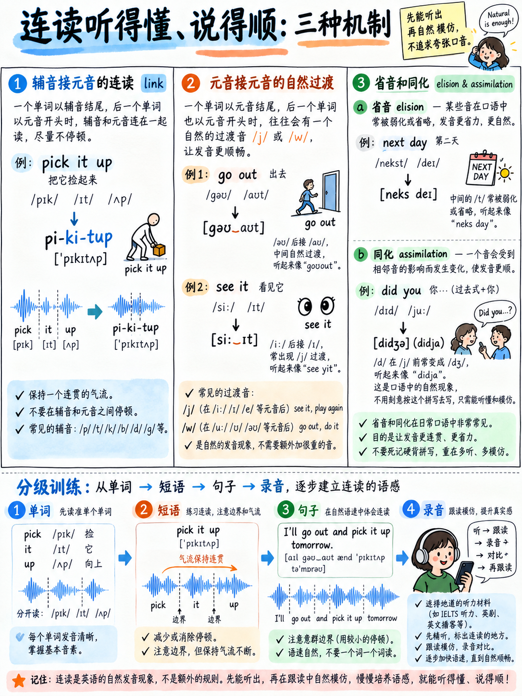

# 06. 连贯语流技巧：连读、弱读、同化与省音实战 (Connected Speech)

> **核心导读**：**连贯语流（Connected Speech）**，是指当单词在真实的连续口语中互相接触时，所发生的一系列自然的物理熔接、同化、脱落与弱化现象。搞懂连贯语流能同时实现两大致胜飞跃：第一，让你在口语表达中彻底摆脱生硬的机械拼读感；第二，在听力客观题中，能够瞬间听清那些曾被误以为是“语速太快”的弱化连读！

---

## 6.1 雅思官方评分量表的权威认可

许多初学者存在认知误区，误以为“把每个词念得一清二楚、清清楚楚地切开才是标准英语”。然而，雅思官方发音量表明确将连贯语流作为衡量高分考生的核心尺子：

* **官方第二大评估指标**：明确要求考查“运用音素连结（linking of sounds）与**省音脱落（elision）**等特征以输出连贯语流”`[11]`；
* **Band 9 发音最高等级描述**：明文规定考生必须展现“**在语流中自始至终高度灵活地运用连贯语流的所有特征（flexible use of features of connected speech sustained throughout）**”`[9]`。

连贯语流绝非“懒惰或含糊不清”，它是英语语言为了实现发音省力化与节奏等时性而进化出的最高效声学机制。

---

## 6.2 辅元连读：辅音遇上元音的无缝接力 (Consonant → Vowel)

**黄金法则**：当一个单词以**辅音音素结尾**，而紧随其后的单词以**元音音素开头**时，前一个词的词尾辅音会自动“移驾”成为后一个元音的声头，实现无缝平滑过渡！

| 纸面单词书写 | 连读后实际声学输出 | 连读 IPA 音标 | 中文发音感觉类比 |
|---|---|---|---|
| **an apple** | a-**napple** | /əˈnæpl/ | “额-拿剖” |
| **pick it up** | pi-**ki**-**tup** | /ˈpɪkɪtʌp/ | “批-踢-特普” |
| **look at it** | loo-**ka**-**tit** | /ˈlʊkətɪt/ | “路-卡-替特” |
| **not at all** | no-**ta**-**tall** | /ˌnɒtəˈtɔːl/ | “闹-特-套” |
| **turn it off** | tur-**ni**-**toff** | /ˈtɜːnɪtɒf/ | “特-尼-托夫” |
| **a lot of information** | a lo-**to**-**fi**nformation | — | “额-咯-托-芬…” |
| **in other words** | i-**no**ther words | — | “伊-拿得-沃兹” |
| **as a result of it** | a-**za** resul-**to**-**fit** | — | “额-砸-瑞泽-托-菲特” |
| **first of all** | fir-**sto**-**fall** | — | “佛-斯-托-佛” |
| **most of them** | mo-**sto**f them | — | “某-斯-脱夫…” |

### 阶梯拼读挑战句：
> *Most of the students in our class find it easier to understand English in a quiet room.*  
> 
> **连读拆解标注**：  
> Mo-**sto**f the studen-**tsi**-**nour** cla-**ssfin**-**di**-**tea**sier to understan-**dE**nglish in a quiet room.

请先一词一顿地读一遍，随后一口气把加粗连读标记顺畅滑过。感受声带不用中断起振的轻松快感。

---

## 6.3 元元滑音连读：架起元音之间的搭桥近音 (Vowel → Vowel)

当一个单词以元音结尾，下一个词也以元音开头时，人类的声带很难直接从一个元音瞬间跳跃到另一个元音（这会造成刺耳的声门塞音中断）。英语会自动在两个元音之间滑入一个微弱的搭桥音：

1. **滑入半元音 /w/（圆唇滑音）**：当前一个词以圆形收唇的后元音结尾（如 /uː/, /ʊ/, /əʊ/, /aʊ/）时，下颌微缩滑出轻微的 `/w/`：
   * *go on* → go-**w**-on
   * *do it* → do-**w**-it
   * *how old* → how-**w**-old
   * *two hours* → two-**w**-hours
2. **滑入半元音 /j/（扁唇滑音）**：当前一个词以前元音或扁唇双元音结尾（如 /iː/, /ɪ/, /eɪ/, /aɪ/, /ɔɪ/）时，嘴角自然滑出轻微的 `/j/`（类似微弱的“也”）：
   * *I am* → I-**y**-am
   * *she asked* → she-**y**-asked
   * *the end* → the-**y**-end
   * *my own* → my-**y**-own
3. **英音特有的 Linking /r/（搭桥 r）**：在不卷舌的标准英音中，如果前一个词以 /ə/, /ɑː/, /ɔː/, /ɜː/ 结尾，且后面紧跟元音，本不发音的字母 r 会复活，或凭空插入搭桥 `/r/`：
   * *far away* → far-**r**-away
   * *the idea of it* → the idea-**r**-of it
   * *law and order* → law-**r**-and order

---

## 6.4 省音脱落 (Elision)：声音从语流中彻底隐形

**省音（Elision）**，是指为了说话省力和流畅，某些辅音或非重读音节在自然语流中**完全消失**的现象。

最核心的规律是：**当齿龈爆破音 /t/ 或 /d/ 夹在两个辅音之间时，/t/ 和 /d/ 几乎 100% 被彻底吞掉省略！** 以及代词开头的弱化 /h/ 经常脱落。

| 规范书写文本 | 实际连贯发音 | 消失的物理音素剖析 | 听力考场陷阱提示 |
|---|---|---|---|
| **next day** | "neks day" | 中间的 **/t/** 彻底脱落 | 听力不要傻等 "t" |
| **last week** | "las week" | 中间的 **/t/** 彻底脱落 | 极高频日常语料 |
| **most common** | "mos common" | 中间的 **/t/** 彻底脱落 | 常见口语搭配 |
| **used to** | "yoos to" | **/d/** 彻底脱落融合 | 过去习惯标志 |
| **sandwich** | "sanwich" | 中间字母 d 的 **/d/** 消失 | 听力 Section 1 高频词 |
| **friendship** | "frenship" | 中间的 **/d/** 脱落 | 抽象名词 |
| **I don't know** | "I dunno" | **/t/** 与元音完全熔断 | 口语极其常见 |
| **give him a book** | "give-im a book" | 代词开头的 **/h/** 脱落 | 弱化极度严重 |
| **tell her** | "tell-er" | 代词开头的 **/h/** 脱落 | 日常对话标准发音 |
| **what's his name** | "wots-iz name" | 代词开头的 **/h/** 脱落 | 极快一掠而过 |
| **comfortable** | "comftable" | 一整个非重读音节脱落 | 实际仅 3 个音节 |
| **probably** | "probly" | 中间音节脱落 | 实际仅 2-3 音节 |
| **interesting** | "intresting" | 第一个 e 的音节脱落 | 实际仅 3 个音节 |
| **every** | "evry" | 中间 e 音节脱落 | 实际仅 2 个音节 |
| **different** | "difrent" | 中间 e 音节脱落 | 实际仅 2 个音节 |
| **temperature** | "tempricha" | 中间 e 音节脱落 | 听力 Section 4 常考 |
| **vegetable** | "vejtable" | 中间 e 音节脱落 | 实际仅 3 个音节 |

:::{important}
**这是一篇披着发音外衣的听力提分破局宝典：**  
中国考生在雅思听力中经常遇到“看文本全认识、听录音像天书”的致命困境。其核心根源，就是你在脑海中死死守着 *"last week"* 的那个 /t/，但录音母语者脱口而出的是 *"las-week"*！  
**一旦你能在自己的口语中主动发出省音，你的大脑对听力音频的解码容错率就会呈指数级攀升！**
:::

---

## 6.5 音的同化 (Assimilation)：邻近声音的相互同化

**同化（Assimilation）**，是指一个音受到紧邻后一个音的发音部位或清浊影响，主动发生音变以减少口腔移动距离。

| 书面文本 | 真实口语发音 | 同化机制物理剖析 |
|---|---|---|
| **ten minutes** | "tem minutes" | 前面的 /n/ 受后面双唇音 /m/ 吸引，舌位前移变为 /m/ |
| **in case** | "ing case" | 前面的 /n/ 受后面软腭音 /k/ 吸引，变成舌根鼻音 /ŋ/ |
| **good boy** | "goob boy" | 齿龈音 /d/ 受后面双唇音 /b/ 吸引，提前闭唇同化为 /b/ |
| **that person** | "thap person" | 齿龈音 /t/ 受双唇音 /p/ 吸引，提前闭唇同化为 /p/ |
| **would you** | "wuh-**joo**" | 齿龈音 /d/ 与半元音 /j/ 剧烈碰撞融合为破擦音 **/dʒ/** |
| **did you** | "di-**joo**" | /d/ + /j/ 剧烈碰撞融合为破擦音 **/dʒ/** |
| **don't you** | "don-**choo**" | 清辅音 /t/ 与半元音 /j/ 碰撞融合为清破擦音 **/tʃ/** |
| **want to** | "wanna" | 弱化极度缩减融合 |
| **going to** | "gonna" | 弱化极度缩减融合 |
| **got to** | "gotta" | 弱化极度缩减融合 |

:::{warning}
**口语中鼓励使用 wanna/gonna，但学术写作中严禁书写！**  
在雅思口语考试中，使用 *wanna*, *gonna*, *gotta* 属于完全合格的日常连贯口语表现，不会被扣分（官方考查的是语言在口语语境下的自然得体性 `[11]`）。  
**但是在学术类写作（Writing Task 1 和 Task 2）中，绝对不可写 wanna / gonna！** 必须书写完整形式 *want to*, *going to*。此外，学术写作中**一律严禁使用 don't, it's, can't 等口语缩写**，必须全拼为 *do not*, *it is*, *cannot*！
:::

---

## 6.6 连贯语流三级阶梯实战集训

每句朗读三遍：第一遍逐词核对，第二遍按照连读省音标记慢速打通，第三遍恢复自然语速自信输出！

### 第一阶：基础辅元连读（2-3 个连读点）
1. *I'd **li**ke **to** talk **a**bout **a**n **i**nteresting **pla**ce.*  
   （我想聊聊一个有趣的地方。）
2. *It's **o**ne **o**f **the** **mo**st **i**mportant **thi**ngs **i**n **my** **li**fe.*  
   （这是我人生中最重要的事情之一。）
3. *I've **li**ved **the**re **fo**r **a**bout **te**n **yea**rs.*  
   （我在那里住了大约十年。）
4. ***Th**at **de**pends **o**n **wha**t **yo**u **mea**n **by** "**su**ccess".*  
   （这取决于你所说的“成功”究竟指什么。）
5. ***O**ne **o**f **the** **mai**n **rea**sons **i**s **th**at **i**t's **chea**p.*  
   （主要原因之一就是它很便宜。）

### 第二阶：辅元连读 + /t/, /d/ 省音融合
6. *I don't know exactly, but I think it's the most common problem.*  
   （我不十分确切，但我认为这是最普遍的问题。）
7. *Last week I had to get used to a completely different timetable.*  
   （上周我不得不适应一个截然不同的时间表。）
8. *It's probably the first and most interesting part of it.*  
   （这大概是其中最初始也是最有趣的一部分。）
9. *I've got to admit, I'm not really interested in that kind of thing.*  
   （我必须承认，我对那种事情实在提不起兴趣。）
10. *In fact, next month we're going to visit a friend of mine.*  
    （事实上，下个月我们打算去拜访我的一位朋友。）

### 第三阶：全要素连贯语流极速实战（雅思口语万能高分框架）
11. *What do you think about the idea of banning cars in the city centre?*  
    （你如何看待在市中心禁止机动车通行的提议？）
12. *If I had a lot of money, I'd probably spend most of it on travelling.*  
    （如果我有很多钱，我可能会把绝大部分花在旅行上。）
13. *There are a couple of things I'd like to mention about this.*  
    （关于这一点，有两三件事我想在此提及。）
14. *It's not that I don't like it — it's just that I don't have time for it.*  
    （并不是我不喜欢它——只是我实在抽不出时间。）
15. *As far as I'm concerned, the advantages outweigh the disadvantages in the long run.*  
    （就我而言，从长远来看其利远大于弊。）

:::{tip}
**第 11 到 15 句是考场直接可用的提分句架！**  
将这 5 个句子练到形成不假思索的肌肉记忆。你不仅训练了连贯语流的顶尖技能，更顺带白捡了 5 个高含金量的口语破题起手式句架（Frames）！详见后续章节：{doc}`../20-speaking/05-fluency-engine`。
:::

---

## 6.7 各目标分梯队的学习优先级

切忌盲目追求高难度技巧。根据你的实际目标分科学调配精力：

| 雅思口语目标分 | 连贯语流执行战略与攻坚范围 |
|---|---|
| **5.0 – 5.5 分** | 仅专注 §6.2（基础辅元连读）与 §6.4（/t/, /d/ 常见省音）。其余同化跳过。 |
| **6.0 分** | 补充掌握 §6.3（元元滑音连读）与第一阶、第二阶训练句。重心死磕意群切分 {doc}`05-chunking-and-sentence-stress`。 |
| **6.5 – 7.0 分** | 全面掌握本章所有连读同化规律，完成第三阶训练，并保持每日听力录音影子跟读。 |
| **7.5 分及以上** | 连贯语流已不是你的卡分瓶颈；请将重心转移至词汇精准度与复杂句型逻辑展开。 |

---

**上一章：** {doc}`05-chunking-and-sentence-stress` | **下一章学习指南：** {doc}`07-first-language-interference`
