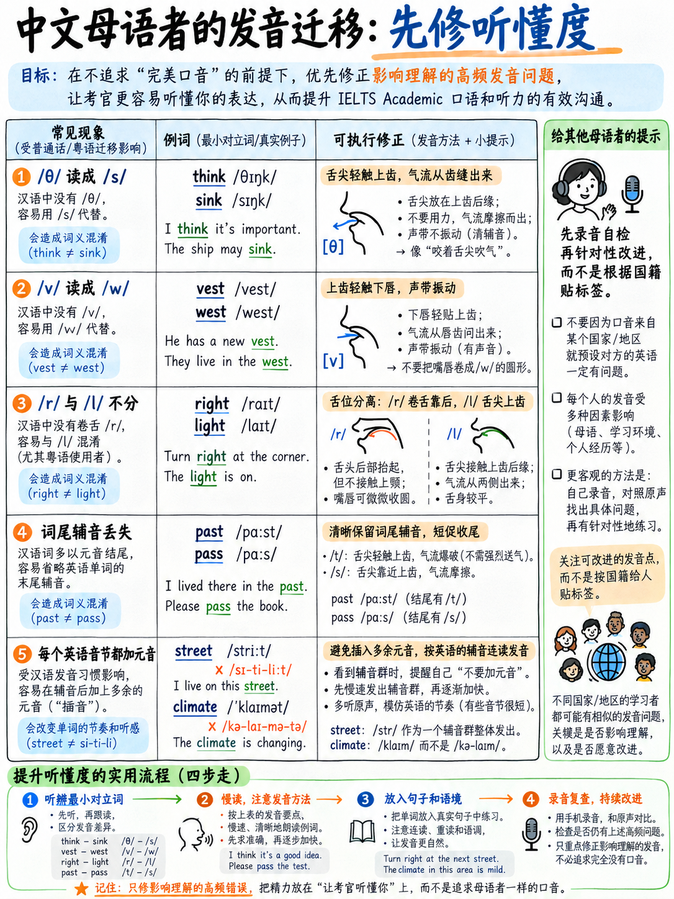

# 07. 母语负迁移阻断：根除中式英语典型发音顽疾 (L1 Interference)



> **核心导读**：**母语负迁移（First-Language Interference / L1 Transfer）**，是指学习者在习得第二语言时，下意识地套用母语的发音器官习惯、音节结构和声调韵律，从而产生系统性偏差的普遍语言学生理现象。  
> **好消息是：母语负迁移是 100% 可预测、有规律的，因此它也是 100% 可以被精准阻断并根治的！**

---

## 7.1 考官视角：口音并非罪过，可懂度与节奏才是红线

在深入剖析具体的负迁移陷阱之前，必须破除所有雅思考生普遍存在的心理焦虑：**你在雅思考试中绝不需要消灭你的“中国口音”！**

雅思官方评分标准在听力与口语维度的明文规定如下：
* 官方听力客观题中，刻意广泛采用英格兰、苏格兰、澳大利亚、新西兰、北美等多元口音 `[1]`；
* 口语发音评分维度考查的是：**“口音对整体可理解度的实际影响（the overall effect of accent on intelligibility）”** `[11]`，而非考查你是不是母语者；
* 哪怕在极高档位的 **Band 8** 中，官方给出的标准也仅仅是：“**口音对整体可懂度仅有极微弱影响（accent has minimal effect on intelligibility）**”`[9]`。

考官每个月都要面试数以百计来自不同省份和国家的考生。**考官从来不会因为你听起来像中国人而扣分！**  
真正让考官大笔扣分的只有三件事：
1. **单词被严重念错导致无法辨识（Unintelligible words）**；
2. **缺乏重读弱读对比的平直机器人语调（Lack of stress-timing）**；
3. **通篇没有意群停顿和呼吸断句（Absence of chunking）**。

---

## 7.2 普通话与粤语等汉语母语考生深度剖析 (Mandarin & Cantonese)

对于绝大多数中国考生而言，汉藏语系与印欧语系的根本物理差异造就了以下**典型负迁移陷阱**：

```{mermaid}
graph TD
    A["中式英语发音典型负迁移根源"] --> B["音节结构差异 (Phonotactics)"]
    A --> C["韵律节奏机制 (Prosody)"]
    A --> D["特定音位缺失 (Phoneme Gaps)"]
    
    B --> B1["汉语单字多无尾辅音<br/>• 习惯性吞掉词尾 /t/, /d/, /s/<br/>• 或词尾生硬加'呃'音"]
    B --> B2["汉语无辅音连缀 (Clusters)<br/>• strengths/asked 发生卡顿崩塌"]
    
    C --> C1["汉语是音节计时 (Syllable-timed)<br/>• 字字等长, 缺乏弱读 Schwa /ə/<br/>• 机器人般铁板敲木鱼听感"]
    
    D --> D1["缺失咬舌音 /θ/, /ð/<br/>• 错发为 /s/, /z/ 或 /f/, /d/"]
    D --> D2["普通话无齿咬下唇音 /v/<br/>• 错发为双唇撅起的拼音 'w'"]
```

| 中式英语常见发音顽疾 | 语言学生理成因剖析 | 考场破坏力级别 | 官方评分针对性规避对策 |
|---|---|---|---|
| **1. 吞吃词尾辅音或爆破不完全**<br>(*walked* 念成 "wo", *need* 念成 "nee") | 汉语普通话音节绝大多数以元音或鼻音 (n/ng) 结尾，**完全不存在尾塞辅音 (No Codas)** | **CRITICAL (致命绝杀)** | 直接摧毁过去时态标记与复数标志！考官判定语法时态混乱。必练：{doc}`02-consonants` §2.7 |
| **2. 辅音丛被硬生生拆解或加元音**<br>(*strong* 念成 "si-te-long", *strengths* 念成 "strend") | 汉语严格遵循“声母+韵母”架构，绝不允许两个以上辅音紧密挤压在一起 | **CRITICAL (致命绝杀)** | 导致多音节词结构瓦解，破坏听觉可辨度。必练：{doc}`02-consonants` §2.8 |
| **3. 铁板平直节拍：字字等长**<br>(每个音节如同方块汉字般饱满发音) | 汉语是典型的**音节计时语言 (Syllable-timed)**，依靠字调区分意义，无音节弱化机制 | **CRITICAL (致命绝杀)** | 彻底击穿 Band 6 发音标准底线（缺乏重音等时性）。必练：{doc}`01-start-here-sound-system` 的 Schwa /ə/ 与 {doc}`04-word-stress` |
| **4. 南方方言区 /l/ 与 /n/ 混淆**<br>(*night* 念成 *light*, *need* 念成 *lead*) | 部分西南及湖广方言区齿龈鼻音与边音未分化 | **HIGH (高度危险)** | 彻底改变单词词义，考官瞬间误解。必练：{doc}`02-consonants` §2.4 |
| **5. 咬舌音发成拼音 s/z 或 f/d**<br>(*think* 念成 "sink", *three* 念成 "free") | 汉语语音库中完全不存在齿间摩擦音 /θ/, /ð/ | **HIGH (高度危险)** | 高频词反复失真，破坏倾听流畅度。必练：{doc}`02-consonants` §2.3 |
| **6. 唇齿音 /v/ 发成双唇音 /w/**<br>(*very* 念成 "wei-ri") | 普通话辅音表中只有双唇滑音 w，无上齿咬下唇的 /v/ | **MEDIUM (中度失真)** | 带有显著中式口音烙印。必练：{doc}`02-consonants` §2.5 |
| **7. 汉语声调残留替代英语语调**<br>(陈述句句末经常不自主上扬飘高) | 声调语言母语者的音高习惯无意识迁移 | **MEDIUM (中度失真)** | 导致陈述句听起来像试探性反问，显得犹疑不决。必练：{doc}`05-chunking-and-sentence-stress` §5.6 |
| **8. 长短元音 /iː/ 与 /ɪ/ 混同**<br>(*leave* 与 *live* 发音时长与紧张度一样) | 汉语拼音韵母 "i" 兼具两者的折中特征，缺乏张弛对比 | **MEDIUM (中度失真)** | 影响听力填空准确性。必练：{doc}`03-vowels-and-diphthongs` §3.2 |

---

## 7.3 其他主要语种考生负迁移全景对照 (Global L1 Patterns)

了解全球考生的母语负迁移规律，能帮助你在跨文化交流与对比中更客观地审视语音共性：

### 1. 日语母语考生 (Japanese Speakers)
* **/r/ 与 /l/ 彻底混淆**（日语中仅有一个闪音 /ɾ/，介于两者之间）——**CRITICAL**
* **词尾强塞元音**（日语属于开音节语言，习惯在词尾塞 "u" 或 "o"，把 *desk* 念成 "desuku"）——**CRITICAL**
* **拍计时节奏（Mora-timed）**，完全不弱读 Schwa——**CRITICAL**
* /θ/ 和 /ð/ 替换为 /s/ 和 /z/；/si/ 念成 /ʃi/（把 *see* 念成 "she"）

### 2. 韩语母语考生 (Korean Speakers)
* **/r/ 与 /l/ 词尾倒置与混淆**（属于单个音位的不同变体）——**CRITICAL**
* **/p, t, k/ 与 /b, d, ɡ/ 清浊混淆**（韩语依靠送气强弱区分，而非声带清浊振动区分）——**CRITICAL**
* 辅音丛插入元音（把 *spring* 念成 "seu-pring"）
* 词尾塞音不爆破（No audible release）

### 3. 越南语与泰语母语考生 (Vietnamese & Thai Speakers)
* **词尾辅音大量吞吃或喉塞化**（音节尾辅音库严重受限）——**CRITICAL**
* **词尾 /s/ 和 /z/ 彻底丢失**（直接摧毁名词复数和动词第三人称单数）——**CRITICAL**
* 辅音丛精简为单音（把 *street* 念成 "seet"）——**CRITICAL**
* 严重音节计时与声调干扰英语语调

### 4. 西班牙语与葡萄牙语母语考生 (Spanish & Portuguese Speakers)
* **/b/ 与 /v/ 混淆不分**（西语中为一个音位的互补变体）——**CRITICAL**
* **词首 s 辅音丛前强行加 /e/**（如把 *Spain* 念成 "Espain", 把 *student* 念成 "estudent"）——**CRITICAL**
* /iː/ 与 /ɪ/ 混淆（西语仅有 5 个纯元音，缺乏松紧长短对立）——**CRITICAL**
* 双元音拍扁为单单元音（把 /əʊ/ 念成平直的 /o/）

### 5. 阿拉伯语母语考生 (Arabic Speakers)
* **/p/ 与 /b/ 彻底混淆**（阿拉伯语多数方言中完全缺乏清辅音 /p/，把 *pat* 念成 *bat*）——**CRITICAL**
* /v/ 念成 /f/（阿拉伯语无 /v/）
* 在辅音丛前后强插元音（由于阿拉伯语无复杂词首辅音丛）
* 学术多音节长词重音位置错位

### 6. 南亚印欧语系考生 (Hindi, Urdu, Bengali, Tamil, etc.)
* **/v/ 与 /w/ 混同不分**（印地语中仅有一个唇齿近音 /ʋ/）——**CRITICAL**
* **极度平直的音节计时节奏**（把 *development* 念成四个平平整整的节拍）——**CRITICAL**
* /t/, /d/ 发成强烈的卷舌音（Retroflex），带有浓郁口音但基本不影响可懂度
* 将单词中不发音的字母生硬念出（如把 *often* 的 t，*walk* 的 l 念出）

### 7. 俄语及斯拉夫语系考生 (Russian & Slavic Speakers)
* **词尾浊辅音一律清化 (Final Devoicing)**（把 *bad* 念成 *bat*, 把 *his* 念成 *hiss*）——**CRITICAL**
* /θ/, /ð/ 替换为 /s/, /z/；/w/ 念成 /v/
* 口语中频繁丢弃冠词 *a/an/the*（斯拉夫语无冠词体系，直接摧毁语法分）

### 8. 德语及荷兰语母语考生 (German & Dutch Speakers)
* **/w/ 错发为 /v/**（德语拼写 w 实际发音即为 /v/）——**CRITICAL**
* 词尾浊辅音清化（把 *bed* 念成 *bet*）
* 节奏方面天然贴近英语（同属重音等时语言，节奏失分极少）

---

## 7.4 阻断母语负迁移的科学作战 SOP

1. **精准对号入座**：在上述分析中，定位属于你的母语背景（中国考生请严格紧盯 §7.2）。
2. **只圈出带有 CRITICAL（致命绝杀）标记的条目**：绝不要试图同时解决 8 个问题！中国考生的三大绝杀项永远是：
   * 词尾辅音脱落（丢掉时态和复数）；
   * 辅音丛连缀卡顿；
   * 汉语四声平铺造成的机械无节奏。
3. **定向转化为微训练动作**：
   * 针对词尾辅音：每日强化 {doc}`02-consonants` §2.7 的 `-ed` 与 `-s` 三大铁律；
   * 针对平直语调：每日坚持拍桌朗读 {doc}`05-chunking-and-sentence-stress` 中的重音等时句型；
   * 针对弱读缺失：强迫自己在每一次口语练习中把 *to, for, a, of, and* 全部坍塌为 `/ə/`。
4. **每周录音盲听复盘**：朗读第一章 §1.8 给出的自测通用段落，回听时专门检查你的三大致命项是否有显著改善！

:::{important}
**全章结语：打破音节计时的枷锁，是雅思口语提分的最高杠杆！**  
如果你把英语当成方块汉字来念，你永远只能在 Band 5 的泥潭里打转；  
一旦你学会了**“该重读的实词高昂拉长、该弱读的虚词轻巧坍塌、意群之间自然呼吸”**，哪怕你偶尔伸不出咬舌音，考官也会在发音维度毫不犹豫地为你送上 **Band 6.5 到 7.0 的通行证**！
:::

---

**上一章：** {doc}`06-connected-speech` | **下一章学习指南：** {doc}`../20-speaking/01-how-speaking-is-scored`
