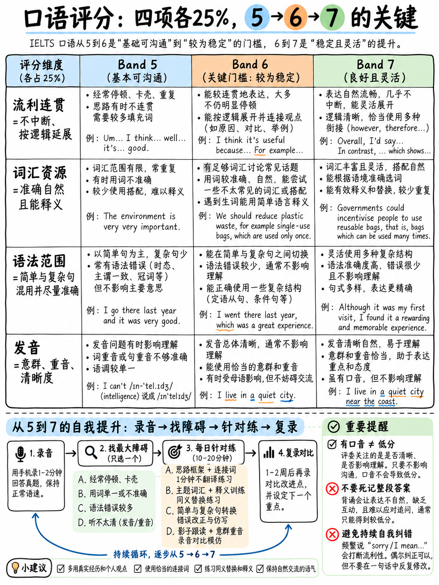

# 01. 雅思口语评分标准深度拆解：四大维度与考官打分量表 (How Speaking is Scored)



雅思口语是一场极具戏剧性的**人际学术交流考核**。许多中国考生在备考口语时充满误解：有人认为必须背诵大量冷门生僻词（Big Words）才能拿高分；有人认为一旦出现语法错误就会被判死刑；还有人认为只要发音带有中国口音就无法突破 6 分。

这些全部是严重偏离官方标准的**致命误区**。雅思口语考官手握严谨的《口语评分描述量表》（IELTS Speaking Band Descriptors）`[9]`，考官绝不按“个人喜好”打分，而是严格对照四大评分维度的条目进行行为特征勾选。本章将逐字拆解官方评分细则，为你建立清晰透彻的考官视角。

---

## 20.1.1 雅思口试考场机制与应试心理

雅思口语考试时间固定为 **11–14 分钟**，由一名官方认证的考官主持，全场包含三个连续递进的环节（Part 1、Part 2、Part 3）`[1]`。

```
   ┌────────────────────────────────────────────────────────────────────────┐
   │                         雅思口语 11–14 分钟全流程                        │
   ├───────────────────┬───────────────────┬────────────────────────────────┤
   │ Part 1 (4–5 min)  │ Part 2 (3–4 min)  │ Part 3 (4–5 min)               │
   │ 日常问答与破冰    │ 个人独白长陈述    │ 抽象深度讨论与思辨             │
   │ • 身份核对        │ • 1 分钟草稿准备  │ • 针对 Part 2 主题做社会延展   │
   │ • 3–4 个日常话题  │ • 2 分钟不间断独立│ • 考验宏观推演、归因与辩证能力 │
   │ • 节奏明快、8-12题│   表达故事与细节  │ • 6 分与 7 分的关键分水岭      │
   └───────────────────┴───────────────────┴────────────────────────────────┘
```

### 1. 考场形式：真人面考 vs 视频通话口试 (Video Call Speaking)
目前全球雅思考场（包括中国大陆考点）根据考点安排存在两种交互形式：
- **现场真人面对面（Face-to-Face）**：考生与外籍考官同处一间独立考室，面对面交谈。
- **考点机考视频通话（Video Call Speaking, VCS）**：考生在雅思机考中心专用考室内，头戴降噪耳机，通过高清显示屏与官方考官进行实时视频对话。

:::{important}
无论现场面考还是视频口考，**评分标准、题库范围、考官资质与流程规范完全一致**！
- **全程录音**：桌上的录音笔或机考软件会全程录制音频。录音不仅用于考官复核，更作为全球质检（Quality Control）与成绩复议（Remark/EOR）的官方依据。
- **考官记笔记与低头看表**：考官频繁低头看表是在精准控制每个环节的法定时间（例如 Part 2 必须说满 2 分钟）；考官在纸上画标记通常是在记录时间节点或换算评分维度，**绝不代表你在犯错**。
:::

### 2. 官方给分核心铁律：全场平均表现评分
官方评分守则明确规定：
> *"A candidate will be rated on their average performance across all parts of the test."*（考生的最终得分取决于其在全场所有环节中的平均综合表现）`[9]`。

这一官方原则对初学者有两大直接战略启示：
1. **Part 2 偶有失常完全可以翻盘**：如果在 Part 2 独白进行到 50 秒时突然卡壳或素材讲完，切记考试远未结束！Part 3 还有足足 4–5 分钟的充裕时间。只要在 Part 3 展现出扎实的逻辑展开与词汇表达，整体平均分依然可以稳稳锁定 6.0–6.5 分。绝不要因为一个答案的不完美而导致全场崩盘。
2. **节奏稳定性（Consistency）远胜单点高光**：在口语考试中，说出一句神仙级别的莎士比亚式句式不会让你直接飞升 7 分；但长达 10 秒的翻白眼卡壳沉默，却会立刻将你的流利度下拉至 Band 5。你的首要任务是保持**从头到尾平稳、连贯、意群清晰的稳定输出**。

---

## 20.1.2 官方四大评分维度横向对比矩阵 (Band 5 / 6 / 7)

雅思口语评分分为四大维度，各占 **25%** 权重 `[7]` `[9]`：
1. **流利度与连贯性 (Fluency and Coherence - FC)**
2. **词汇多样性与丰富度 (Lexical Resource - LR)**
3. **语法多样性与准确性 (Grammatical Range and Accuracy - GRA)**
4. **发音自然度与清晰度 (Pronunciation - PR)**

以下直接摘录官方《Speaking Band Descriptors》`[9]` 中中国考生最集中的 5、6、7 分段描述，为你直观剖析提分差距。

### 1. 流利性与连贯性 (Fluency and Coherence, FC)

| 分数 | 官方量表原文 (Official Descriptors) | 核心特征剖析与差距解读 |
|---|---|---|
| **Band 7** | "Able to keep going and readily produce long turns without noticeable effort. Some hesitation, repetition and/or self-correction may occur, often mid-sentence and indicate problems with accessing appropriate language. However, these will not affect coherence. Flexible use of spoken discourse markers, connectives and cohesive features." | **无明显费力地持续输出长句**。允许句中因寻找恰当用词出现偶发停顿或自我纠正，但**不破坏整体连贯性**。能灵活使用多种口语话语标记与连接手段。 |
| **Band 6** | "Able to keep going and demonstrates a willingness to produce long turns. Coherence may be lost at times as a result of hesitation, repetition and/or self-correction. Uses a range of spoken discourse markers, connectives and cohesive features though not always appropriately." | **展现主动输出长句的意愿（Willingness）**。能保持说话，虽因犹豫、重复或自我修正偶尔丧失连贯，但仍能使用一系列连接词与话语标记（即便偶尔使用不够得体）。 |
| **Band 5** | "Usually able to keep going, but relies on repetition and self-correction to do so and/or on slow speech. Hesitations are often associated with mid-sentence searches for fairly basic lexis and grammar. Overuse of certain discourse markers, connectives and other cohesive features. More complex speech usually causes disfluency but simpler language may be produced fluently." | **依赖刻意放慢语速、高频重复或自我修正才能维持作答**。频繁因检索**基础词汇与语法**而产生句中长时间卡顿。**过度重复使用某些特定的连接词**。 |

:::{tip} 提分杠杆：雅思口语性价比最高的分数提升在“主动多说”
对比 Band 5 与 Band 6 的官方红线：Band 5 叫 *"relies on slow speech"*（靠慢速说话保命），而 Band 6 叫 *"demonstrates a willingness to produce long turns"*（展现产出长陈述的主动意愿）`[9]`。  
这意味着：**只要你在 Part 1 不吐出三个词就闭嘴，而是主动用 2–3 句话展开；在 Part 2 努力填满 2 分钟，你就已经满足了 Band 6 的核心前提！**
:::

---

### 2. 词汇多样性与丰富度 (Lexical Resource, LR)

| 分数 | 官方量表原文 (Official Descriptors) | 核心特征剖析与差距解读 |
|---|---|---|
| **Band 7** | "Resource flexibly used to discuss a variety of topics. Some ability to use less common and idiomatic items and an awareness of style and collocation is evident though inappropriacies occur. Effective use of paraphrase as required." | 词汇能灵活应对多元话题；展现出使用**非核心小众词汇（Less common lexis）与习语搭配（Collocation）**的意识，并能在需要时**自如进行同义转述与迂回解释（Paraphrase）**。 |
| **Band 6** | "Resource sufficient to discuss topics at length. Vocabulary use may be inappropriate but meaning is clear. Generally able to paraphrase successfully." | **词汇储备足以支撑深入展开讨论**。尽管选词偶有不当，但**表达意图始终清晰明了**。在遇到词汇盲区时，**大体能够成功进行转述解释**。 |
| **Band 5** | "Resource sufficient to discuss familiar and unfamiliar topics but there is limited flexibility. Attempts paraphrase but not always with success." | 词汇可讨论熟悉与陌生话题，但**灵活性极其有限**。尝试转述但往往不成功，常因卡词而被迫中断句意。 |

:::{important} 词汇 6 分的核心不是生僻词，而是“遇到生词能兜圈子（Paraphrase）”
官方明确指出，Band 6 的标志是：*“Generally able to paraphrase successfully”*（大体能成功转述）以及 *“Vocabulary use may be inappropriate but meaning is clear”*（用词虽有不妥，但意思考官完全懂）`[9]`。  
如果你想说“听诊器（stethoscope）”但不会这个词，如果你直接哑火翻白眼，就是 Band 5；如果你脱口而出 *"It's a medical tool that doctors use to listen to heartbeats"*，考官会立刻在 LR 栏给你打勾记入 Band 6–7 的转述能力！
:::

---

### 3. 语法多样性与准确性 (Grammatical Range and Accuracy, GRA)

| 分数 | 官方量表原文 (Official Descriptors) | 核心特征剖析与差距解读 |
|---|---|---|
| **Band 7** | "A range of structures flexibly used. Error-free sentences are frequent. Both simple and complex sentences are used effectively despite some errors. A few basic errors persist." | 灵活运用多种语法结构；**高频产出零错误的句子（Error-free sentences）**；能够有效结合简单句与复合句，但仍允许存在少量顽固的基础错误。 |
| **Band 6** | "Produces a mix of short and complex sentence forms and a variety of structures with limited flexibility. Though errors frequently occur in complex structures, these rarely impede communication." | **产出简单短句与复合句的混合结构（A mix of short and complex forms）**。在尝试复杂结构时虽然错误频发，但**这些错误极少阻碍考官理解整体意思**。 |
| **Band 5** | "Basic sentence forms are fairly well controlled for accuracy. Complex structures are attempted but these are limited in range, nearly always contain errors and may lead to the need for reformulation." | 基础简单句能够较好控制准确率；虽尝试复杂从句，但范围非常狭窄，且**复杂句几乎每次都出错，频繁导致断句或不得不推倒重来（Reformulation）**。 |

:::{tip} 6 分实战语法配比：80% 稳妥短句 + 20% 基础复合句
Band 6 并不要求你满嘴全都是虚拟语气与倒装句。量表的核心关键词是 **"a mix of short and complex sentence forms"**（短句与复合句的合理交织）`[9]`。  
最高效的战术：以精准、无语法硬伤的简单句为主干，每说 3 句话自然融入一个由 **because**（原因）、**which**（定语从句）、**although**（让步状语）或 **if**（条件句）引导的从句。这就是标准的“混合结构”！
:::

---

### 4. 发音清晰度与节奏控制 (Pronunciation, PR)

| 分数 | 官方量表原文 (Official Descriptors) | 核心特征剖析与差距解读 |
|---|---|---|
| **Band 7** | "Displays all the positive features of band 6, and some, but not all, of the positive features of band 8." | 兼备 Band 6 的所有积极特征，并展现出部分 Band 8 的高分语音特征（如自如的语调沉降、对比重音、自然弱读等）。 |
| **Band 6** | "Uses a range of phonological features, but control is variable. Chunking is generally appropriate, but rhythm may be affected by a lack of stress-timing and/or a rapid speech rate. Some effective use of intonation and stress, but this is not sustained. Individual words or phonemes may be mispronounced but this causes only occasional lack of clarity. Can generally be understood throughout without much effort." | 能够使用多种语音手段，但控制稳定性不足。**意群断句（Chunking）大体合理**；节奏偶尔受中式等时节奏影响；个别单词发音虽有偏差，但**绝不影响考官轻松听懂**（*"without much effort"*）。 |
| **Band 4** | "Uses some acceptable phonological features, but the range is limited. Produces some acceptable chunking, but there are frequent lapses in overall rhythm. Attempts to use intonation and stress, but control is limited. Individual words or phonemes are frequently mispronounced, causing lack of clarity. Understanding requires some effort and there may be patches of speech that cannot be understood." | 语音手段狭窄；意群划分与节奏频繁失控；**大量单词发音错误导致考官理解吃力，甚至出现整段完全听不懂的盲区**。 |

:::{note}
官方发音评分量表中，Band 5 与 Band 7 属于“参照定义档位”（Defined by reference），其核心是在 Band 4 与 Band 6，或 Band 6 与 Band 8 之间进行平衡判定。详细的发音物理学规律与纠音训练见 {doc}`../10-pronunciation/05-chunking-and-sentence-stress`。
:::

---

## 20.1.3 考官判定分数的“四大通关门禁”

考官在倾听你作答的 14 分钟内，大脑内部实际上在执行以下四个 Yes/No 的关卡检验：

```{mermaid}
graph TD
    A["考生开始作答"] --> G1{"关卡 1: 流利度 (FC)<br/>是否展现主动展开意愿？<br/>是否避免检索词汇的长沉默？"}
    G1 -- "否: 频繁沉默、一问一答蹦字" --> F1["流利度落入 Band 4–5"]
    G1 -- "是: 积极延伸、自然垫话" --> G2{"关卡 2: 词汇转述 (LR)<br/>卡壳时能否成功迂回解释？<br/>用词能否清晰传达具体细节？"}
    
    G2 -- "否: 遇到生词翻白眼、直接放弃" --> F2["词汇灵活性卡死在 Band 5"]
    G2 -- "是: 自如用简单词解释复杂概念" --> G3{"关卡 3: 语法结构 (GRA)<br/>是否有长短句交织 (a mix)?<br/>复杂句错误是否妨碍考官理解？"}
    
    G3 -- "否: 全是单句，或复杂句彻底崩塌" --> F3["语法止步于 Band 5"]
    G3 -- "是: 简单句准确 + 从句达意" --> G4{"关卡 4: 发音可懂度 (PR)<br/>考官倾听是否毫无吃力感？<br/>意群划分与句子重音是否成立？"}
    
    G4 -- "否: 严重平调、吞尾音导致难懂" --> F4["发音滑落至 Band 4–5"]
    G4 -- "是: 意群清晰、考官毫不费力理解" --> PASS["稳固跨入 6.0–6.5+ 目标分梯队！"]
```

---

## 20.1.4 考场上“绝对不扣分”的 10 大行为

很多考生将精力浪费在担忧毫无意义的事情上。以下行为在官方标准中**完全合规，零扣分**：

| 考生行为 | 官方依据与真实考官反应 |
|---|---|
| **带有中式英语口音** | **不扣分**。官方明确要求考官评估口音对“可懂度（Intelligibility）”的影响，而非口音本身 `[11]`。全球考官熟悉各种口音，只要发音辨识度高即是高分。 |
| **说“我对这方面不了解”，随后依然给出分析** | **不扣分**。雅思是语言能力测试，不是百科全书问答。内容真实性不作评分指标。 |
| **临场虚构事例或编造经历** | **不扣分**。写作与口语均允许使用个人虚构案例支持论点，考官没有任何义务去核查事实真伪。 |
| **没听清提问时礼貌要求考官重复一遍** | **不扣分**。这是现实人际交流中极为正常的现象，使用 *"Sorry, could you repeat that please?"* 展现真实互动。 |
| **Part 2 讲满 2 分钟被考官举手打断** | **完全不扣分**。这是考官官方规程的规定动作（*"I will stop you when the time is up"*）`[13]`。被打断说明你刚好把时间填满，这是大获全胜的标志！ |
| **中途发现口误并自然自我纠正一次** | **不扣分**。Band 7 量表白纸黑字明确允许 *"Self-correction often mid-sentence"* `[9]`。一次干净利落的自我修正反而是语言监控能力的体现。 |
| **在 Part 3 中表达与考官相反的观点** | **不扣分**。Part 3 是双向学术思辨讨论（Two-way discussion），考官考查的是论证逻辑，而非你的政治或哲学立场。 |
| **使用自然的地道口语表达与简缩形式** | **完全合规**。口语考试属于 Spoken Discourse，使用 *gonna, wanna, flat, mate, pretty good* 比死搬书面硬套更得体。 |
| **因思考“观点本身”而进行 1–2 秒停顿** | **不扣分**。官方 Band 8 明确将“因思考内容而停顿（Content-related hesitation）”与“因寻找词汇语法而卡壳”区分开来。 |
| **承认词汇盲区并当场换用下位词解释** | **反而加分**！说出 *"I can't recall the specific term, but it's basically a device used to..."* 是官方 LR 极度推崇的转述技巧。 |

---

## 20.1.5 考场上“真正导致扣分”的致命雷区

以下操作属于明确写在官方量表扣分栏里的致命陷阱，必须绝对杜绝：

| 致命扣分操作 | 对应扣分维度 | 官方量表依据与严重后果 |
|---|---|---|
| **长时间翻白眼、脑中搜寻词汇导致全场寂静** | 流利度 (FC) | 官方指示器标明：*"pausing during which the test taker searches for words"* `[11]`，长停顿直接锁死 Band 5。 |
| **毫无意义的高频字词自我重复**<br>（*“I think... I think that... I think…”*） | 流利度 (FC) | 官方定义为无功能重复（Functionless repetitions）`[11]`，表明语言输出极度吃力。 |
| **Part 1 像挤牙膏一样只吐出一两个词**<br>（如问家乡回答 *"Beijing. Big."*） | 流利度 (FC) | 考官无法收集足够样本打分；Band 6 必须具备产生长句的主动意愿 `[9]`。 |
| **为了确保语法 100% 准确而极慢速念字** | 流利度 (FC) | Band 5 明确判定特征为 *"relies on slow speech"* `[9]`；语速过慢是低分指标。 |
| **整段背诵互联网上的万能机经范文** | 词汇 / 语法 | 机械背诵内容（Memorised utterances）直接被打入 Band 1–3 极低档位 `[8]` `[9]`。 |
| **滥用千篇一律的连接套话**<br>（每句必加 *To be honest, As far as I'm concerned*） | 连贯性 (FC) | **Band 5 核心特征**：*"Overuse of certain discourse markers"* `[9]`。过度使用口头套话直接降级至 5 分！ |
| **汉语音节等长平调朗诵（Flat rhythm）** | 发音 (PR) | 缺乏重音等时性（Stress-timing）与弱读弱化，直接导致发音落入 Band 4–5 `[9]`。 |
| **彻底卡死沉默（Going completely silent）** | 所有维度 | 没有任何语言产出，考官无法打分，直接判定 Band 0–2。 |

:::{danger} 考前警钟：“过度使用某些连接词”是 Band 5 的铁证！
很多初学者从网络攻略上学到所谓的“高分秘诀”，一开口每句话都带上 *Well, to be honest, as far as I'm concerned, having said that, at the end of the day*。  
请看官方 Band 5 原文：**"Overuse of certain discourse markers, connectives and other cohesive features"** `[9]`。在 14 分钟考试里，如果某种连接词被你用了三四次以上，考官会立刻判定你词汇与句法匮乏，直接下扣至 Band 5！
:::

---

## 20.1.6 考生不同起点的 3–4 周提分战略路线

针对备考时间紧迫的初学者，根据你当前的实际英语口语水平，制定现实的目标与发力重点：

| 当前现状与自我诊断 | 3–4 周现实提分目标 | 核心发力战略与突破模块 |
|---|:---:|---|
| **完全张不开嘴，几乎无法用完整英文句子作答** | **4.5 → 5.0** | 攻克发音与意群断句（{doc}`../10-pronunciation/05-chunking-and-sentence-stress`）+ 熟练掌握 Part 1 核心题目的“两句话答题框架”。 |
| **能回答简单生活问题，但频繁出现 5 秒以上词穷卡顿** | **5.0 → 5.5 / 6.0** | 全面装载流利度垫话引擎（{doc}`05-fluency-engine`），根除搜词卡顿；用买时间短语消灭考场死寂。 |
| **能持续说话，但语调平淡如机器，且复杂句频繁崩塌断流** | **5.5 → 6.0 / 6.5** | 练习单词重音与语调升降 + 掌握“80% 短句 + 20% 基础复合句”配比 + 强化 Part 2 的“四段式故事线”。 |
| **流利且语音节奏好，但词汇单一、Part 3 深度推演匮乏** | **6.0 → 6.5 / 7.0** | 专攻迂回转述训练（Paraphrase）+ 掌握 Part 3 的 AREQ 宏观社会推演公式（{doc}`04-part-3`）。 |

---

**上一章：** {doc}`../10-pronunciation/07-first-language-interference` | **下一章学习指南：** {doc}`02-part-1`
