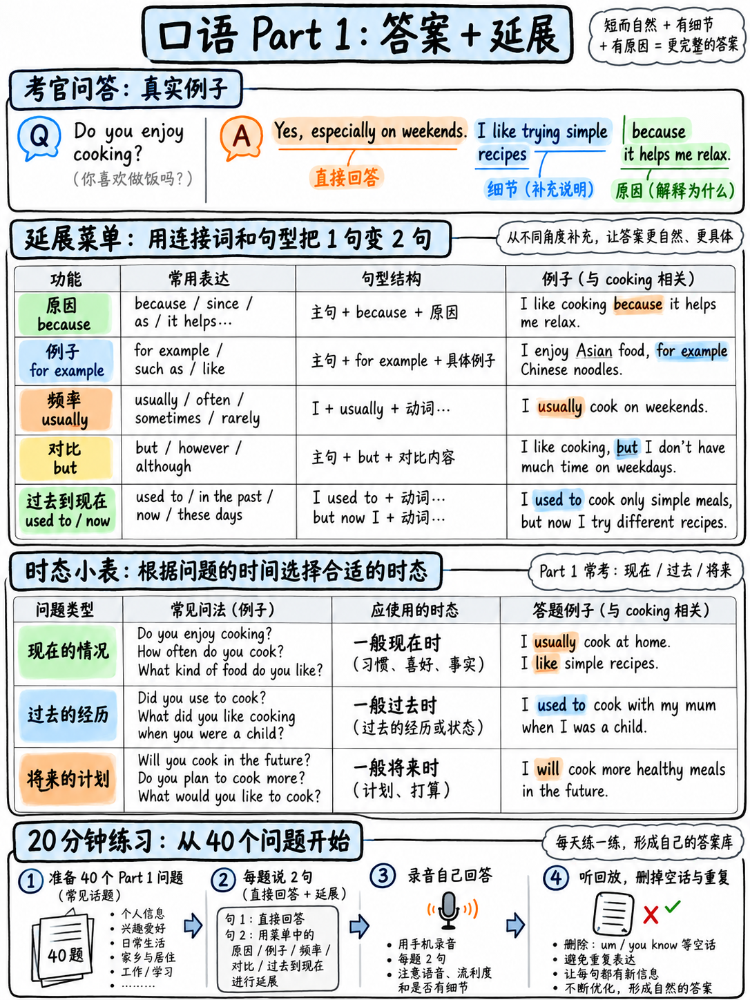

# 02. Part 1 日常问答破局：回答长度、展开结构与高分答题框架 (Part 1 Tactics)



雅思口语 Part 1 官方定义为“日常问答与自我简介（Introduction and Interview）”，耗时 **4–5 分钟**。官方大纲规定：“考官就考生的日常生活、背景及一系列熟悉的话题（如家庭、工作、学习、兴趣等）进行简短提问” `[1]`。

Part 1 是全场考试最轻松、话题最贴近生活的环节，但也是初学者最容易陷入两极分化误区的重灾区：**要么像挤牙膏一样只蹦两三个单词（导致考官无法评分判定为 Band 4），要么把它当成大演讲滔滔不绝抢话导致考官强制打断**。本章将为你拆解 Part 1 的最佳回答长度、万能展开结构与高频必考核心题库。

---

## 20.2.1 Part 1 真实考场全流程与节奏控制

在真实考场中，Part 1 的节奏非常紧凑且标准化。官方口语样题录音 `[13]` 展示了标准进行规程：

```
   ┌───────────────────────────────────────────────────────────────────────┐
   │                       Part 1 考场全流程三步曲                          │
   │                                                                       │
   │  第 1 步：身份核对 (30秒)                                             │
   │  • 考官打招呼 + 核对身份证件 ("Can I see your ID, please?")           │
   │  • 考生自然回应并递交证件，建立平稳的第一语音印象                    │
   │                                                                       │
   │  第 2 步：必考核心母题 (1–2分钟，3–4个问题)                           │
   │  • 考官切入三门神之一：工作/学业 (Work/Study)、住所 (Home) 或家乡 (Hometown)│
   │                                                                       │
   │  第 3 步：轮换日常话题 (2–3分钟，共 1–2 个话题，每个 3–4 题)          │
   │  • 转向具体生活细节：如音乐、烹饪、天气、手机应用、空闲爱好等         │
   └───────────────────────────────────────────────────────────────────────┘
```

### 1. 考场真实问答配速法则
在 4–5 分钟内，考官需要完成 **8–12 道简短问答**。
- 这意味着平均每道题的完整交互时间仅为 **20–30 秒**（包括考官念出题干）。
- **考生作答黄金时长**：**15–25 秒**（即自然语速下的 **2 至 3 句话**）。
- **严禁只答一个词**：考官问 *"Do you work or are you a student?"*，如果你只答 *"Student."*，考官无从判断你的连贯性与语法，直接锁死 Band 4–5。
- **切忌长篇大论演讲**：如果一个日常问题你说满 1 分钟，考官会直接礼貌举手打断以完成规定题量。

### 2. 官方题库“永恒核心金三角”
:::{important}
全球雅思考官的题库中，**Topic 1 永远抽选自以下四项之一：Work（工作）、Study（学业）、Home/Accommodation（住所）、Hometown（家乡）** `[13]` `[22]`。  
无论每季度的换题季（1月、5月、9月）如何风云变幻，这三大核心板块永远保持稳定！  
这意味着：**你可以在考前为你个人的工作背景、学业动机、租住公寓特色、家乡地理特征准备 100% 真实的事实性语料！** 这两分钟的开场完全在你的掌控之中。
:::

---

## 20.2.2 核心答题逻辑公式：Answer + Extend (AREC 轻量剪裁)

Part 1 答题的核心公式极为纯粹高效：**直接作答（Direct Answer）+ 展开支撑（Extend）**。

```
   ┌──────────────────────────────────────────────────────────────────────┐
   │                   Part 1 万能两段式答题框架                          │
   ├───────────────────────────────┬──────────────────────────────────────┤
   │ 1. Direct Answer (直接回答)   │ 用 1 句精炼主句直奔主题，直接回应题干│
   ├───────────────────────────────┼──────────────────────────────────────┤
   │ 2. Extension (展开维度)       │ 叠加 1–2 句支撑细节，从以下 6 条路径 │
   │                               │ 任意任选 1 种进行延展                │
   └───────────────────────────────┴──────────────────────────────────────┘
```

这个框架正是大作文与 Part 3 的 **AREC 论证公式（Answer + Reason + Example + Consequence）** 在日常口语中的轻量化剪裁版本：**Answer（正面回应）+ Reason/Example/Contrast（原因/案例/转折）**。

### 全真对比示范：低分回答 vs 高分拆解

#### 案例 1：关于家乡 (Hometown)
> **考官提问：** *"What kind of place is your hometown?"*（你的家乡是个怎样的地方？）

| 作答版本 | 考生回答文本 | 考官评分心理与逻辑透析 |
|---|---|---|
| ❌ **低分蹦字版 (Band 4)** | *"It's a big city in China."* | **仅有一句话，信息量极度匮乏**。考官无法提取复杂的语法或词汇样本，直接判定流利度不达标。 |
| ✅ **官方示范版 (Band 6.5–7)** | *"It's quite a large industrial city in the north of the country, with around two million people. **It's not particularly scenic, to be honest, but it's a very convenient place to live because public transport is so cheap.**"* | **【Answer】** 定位家乡性质与规模（工业城市、两百万人口）<br>**【Contrast + Reason】** 运用让步转折与因果从句（*to be honest, but... because...*）。全段耗时约 18 秒，语言丰富自然。 |

#### 案例 2：关于日常偏好 (Preference)
> **考官提问：** *"Do you prefer tea or coffee?"*（你更喜欢茶还是咖啡？）

| 作答版本 | 考生回答文本 | 考官评分心理与逻辑透析 |
|---|---|---|
| ❌ **极简版 (Band 4.5)** | *"Coffee. Because it is good."* | 句式幼态单薄，思维断层。 |
| ✅ **官方示范版 (Band 6.5–7)** | *"Coffee, definitely. **I usually drink two or three cups a day, especially in the morning, mainly because I find it really hard to focus without some caffeine.**"* | **【Answer】** 果断表明喜好态度（*Coffee, definitely.*）<br>**【Detail + Reason】** 给出具体生活频率（2-3杯/天）并给出归因（缺乏咖啡因难以集中注意力）。自然包含副词与条件限定。 |

#### 案例 3：关于居住时长 (Duration)
> **考官提问：** *"How long have you lived in your current apartment?"*（你在现在的住处住了多久？）

| 作答版本 | 考生回答文本 | 考官评分心理与逻辑透析 |
|---|---|---|
| ❌ **中式语病版 (Band 5)** | *"I live here five years."* | **犯下典型中式时态硬伤**！直接丢掉 GRA 6 分。 |
| ✅ **官方示范版 (Band 6.5–7)** | *"**About** five years now. **I originally moved there for university and just stayed on, although I'm actually thinking of relocating sometime next year.**"* | **【Answer】** 精准现在完成时含义（*About five years now.*）<br>**【Story + Contrast】** 过去搬家缘由（大学）与未来搬迁打算（*relocating next year*）。融合了过去时与现在进行表将来。 |

---

## 20.2.3 展开支撑的“六大路径菜单” (Extension Menu)

当你面对考官的问题给出直接回答后，大脑无需重新痛苦构思，只需从以下六种扩展方式中**任选其一**：

| 展开路径 | 核心提示词与句型框架 (Sentence Frames) | 实战示范表达 |
|---|---|---|
| **1. 解释原因 (Reason)** | *"…because / mainly because / the reason is that…"* | *"I prefer cooking at home, **mainly because it's much healthier and saves money**."* |
| **2. 列举实例 (Example)** | *"For instance, / Like last week, / A good example is…"* | *"I'm quite into sports. **For instance, last weekend I went hiking with my friends for six hours.**"* |
| **3. 对比转折 (Contrast)** | *"…although / but actually / having said that…"* | *"I enjoy reading fiction, **although these days I rarely find enough time to finish a whole book**."* |
| **4. 古今对比 (Time Reference)** | *"…these days compared to when I was younger… / used to…"* | *"I don't play video games much **these days, but when I was a teenager, I used to play almost every night**."* |
| **5. 客体比较 (Comparison)** | *"…much more / far less … than…"* | *"My current neighbourhood is **far quieter and safer than where I grew up**."* |
| **6. 个人感受 (Feeling / Reflection)** | *"…which I find quite… / which always makes me feel…"* | *"I listen to jazz in the evenings, **which I find incredibly relaxing after a stressful day**."* |

:::{tip} 软化词（Hedging Words）是考场“买时间 + 涨分数”的利器！
在开口回答时，善用软化与模糊限制词：  
**About, roughly, sort of, kind of, probably, I'd say, more or less, to be honest...**  
这些词汇具有双重功效：
1. **为你争取 1–2 秒的起步构思时间**，防止出现惊慌停顿；
2. 官方评分在高级语言特征中专门肯定这种“软化（Softening）”表述 `[12]`，展现出母语者般的审慎与真实交流感。
:::

---

## 20.2.4 Part 1 核心语法红线：时态掌控力 (Tense Control)

在 Part 1 中，考官有意识地通过不同的问句形式测试考生的**时态敏锐度（Tense Sensitivity）**。如果考官用过去时提问而你用现在时回答，考官会立刻在语法记录中标记“基础时态失控”。

以下是 Part 1 必考八大问法与时态对标表：

| 考官提问句型 | 锁定法定语法时态 | 标杆回答框架示范 |
|---|---|---|
| *"What **do** you do?"* | **一般现在时** (Present Simple) | *"I **work** as a software engineer at a tech firm."* |
| *"What **are** you studying?"* | **现在进行时** (Present Continuous) | *"I**'m currently studying** finance at university."* |
| *"How long **have** you **lived** there?"* | **现在完成时 + for/since** | *"I**'ve lived** there **for** around four years."* |
| *"**Did** you enjoy your primary school?"* | **一般过去时** (Past Simple) | *"I **did**, absolutely. I **had** some fantastic teachers back then."* |
| *"**Have** you ever travelled abroad?"* | **现在完成时** | *"Yes, I**'ve visited** Thailand once, back in 2019."* |
| *"**Would** you like to change your job?"* | **虚拟与条件语气** (*would* + 动词原形) | *"I**'d love to**, if the right opportunity came along."* |
| *"What **will** you do after graduating?"* | **将来时态** (*be going to / will / planning to*) | *"I**'m planning to** apply for a master's programme in the UK."* |
| *"What **did you use to** do as a child?"* | **used to + 动词原形** | *"I **used to spend** hours drawing cartoons every weekend."* |

:::{warning} 中国考生失分率最高的经典语法雷区
被问及 *"How long have you lived here?"* 时，千万不要说：  
❌ *"I live here five years."*（完全错误）  
正确表达必须牢牢锁定：  
✅ *"I've lived here for five years."* 或 *"I've been living here for about five years."*  
考前请反复强化训练这一句型，其在实战考场中的出场率高达 70%！
:::

---

## 20.2.5 遭遇大脑空白时的“六大救命应对锦囊”

口试现场常会遇到生僻偏门的话题（如考官突然问及机器人、收据、养花、镜子等），很多考生瞬间大脑一片空白。  
**记住原则：考官考查的是英语沟通能力，绝不是你的生活经验！** 面对盲区，绝对不要沉默，更不要只说一句 *"I don't know"*。

使用以下六大救急框架，将“无话可说”瞬间转化为“高分语言样本”：

| 考场突发状况 | 救命高分应答应答话术 | 评分效果与机制剖析 |
|---|---|---|
| **完全没有任何观点**<br>(No opinion) | *"To be honest, I've never really thought about that before. **I suppose if I had to choose, I'd say [X], mainly because…**"* | 展现真实口语思考状态，运用假设语气（*if I had to...*）展现高级语法。 |
| **完全没有任何经历**<br>(No experience) | *"I haven't actually experienced that myself, **but a close friend of mine did, and they told me that…**"* | 巧妙借用他人经历延续话题，规避自身经历空白。 |
| **对该话题毫无兴趣**<br>(Don't like the topic) | *"It's not really something I'm keen on, **to be honest — I'm much more interested in [Y], because…**"* | 礼貌坦白个人偏好，并自然切换至熟悉领域。 |
| **没听清考官提问**<br>(Didn't hear clearly) | *"Sorry, would you mind repeating the question, please?"* | 得体礼貌，合规请求重复，不扣分。 |
| **听清单词但不确定意思**<br>(Need clarification) | *"Sorry, do you mean [X], or are you referring to [Y]?"* | 展现主动求证的学术互动能力。 |
| **某个专业单词不会说**<br>(Vocabulary gap) | *"I can't remember the exact English word for it, **but it's basically a kind of [description]…**"* | **直接触发词汇转述（Paraphrase）加分项**！ |

---

## 20.2.6 Part 1 全真 40 题分类演练库

建议在考前用手机录音功能，针对以下 40 题进行**计时全真演练**。每道题强迫自己说出 **2–3 句话（15–25 秒）**，听回放检查是否符合“Answer + Extend”结构。

### 模块一：核心必考三大主题 (Work/Study, Home, Hometown)
1. *Do you work or are you a student?*
2. *What do you study? / What is your current job?*
3. *Why did you choose that subject / career?*
4. *What do you find most interesting about your studies or work?*
5. *Is there anything you would like to change about your job or course?*
6. *What are your future career plans over the next few years?*
7. *Could you describe the type of home you currently live in?*
8. *How long have you been living in your current accommodation?*
9. *What is your favourite room in your home, and why?*
10. *Do you prefer living in an apartment or a standalone house?*
11. *Would you like to move to a different home in the near future?*
12. *What kind of place is your hometown?*
13. *What is the most interesting or famous attraction in your hometown?*
14. *Has your hometown changed significantly since you were a child?*
15. *Would you recommend your hometown as a good place for young people to live?*

### 模块二：日常习惯与休闲偏好 (Routine & Leisure)
16. *What do you usually like to do during your weekends?*
17. *Do you prefer spending your free time alone or hanging out with others?*
18. *Have your personal hobbies changed much over the past few years?*
19. *Is there a new activity or skill you would like to take up in the future?*
20. *What kind of food do you enjoy eating the most?*
21. *Do you prefer cooking meals at home or dining out at restaurants?*
22. *Has your diet or eating habits changed recently?*
23. *What time do you usually wake up on weekdays?*
24. *Would you describe yourself as a morning person or a night owl?*
25. *How do you typically unwind and de-stress after a busy day?*

### 模块三：现代生活与数字科技 (Technology & Society)
26. *How much time do you spend using your smartphone each day?*
27. *What mobile apps do you find yourself using most frequently?*
28. *Do you ever feel that people spend too much time looking at screens?*
29. *How did you first learn how to use a computer?*
30. *Do you prefer shopping online or visiting brick-and-mortar stores?*
31. *Do you enjoy travelling to new destinations?*
32. *What has been the most memorable place you have visited so far?*
33. *What is the weather typically like where you live during this season?*
34. *Which season of the year is your favourite, and why?*
35. *How do you usually commute to school or work?*

### 模块四：社交与周边环境 (Social & Surroundings)
36. *Do you know many of your neighbours well?*
37. *Do you think it is important to maintain good relationships with neighbours?*
38. *What kind of music do you usually listen to?*
39. *Do you prefer listening to recorded music or attending live concerts?*
40. *Did you learn to play any musical instruments when you were younger?*

---

**上一章：** {doc}`01-how-speaking-is-scored` | **下一章学习指南：** {doc}`03-part-2-long-turn`
