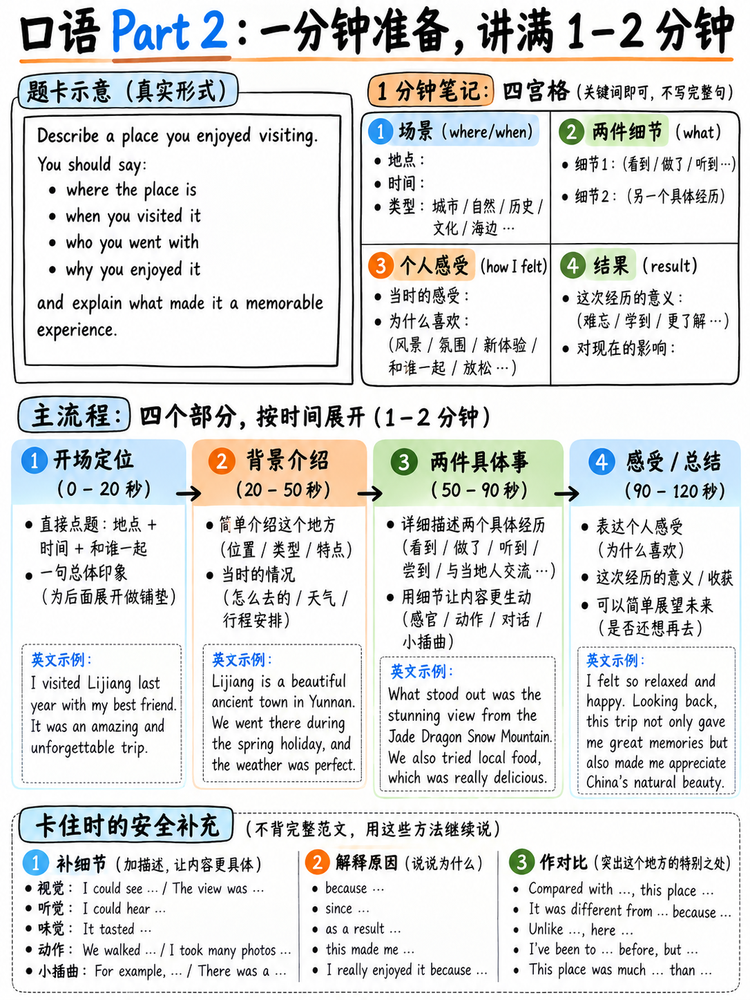

# 03. Part 2 个人长陈述：1分钟速记笔记法与2分钟故事线架构 (Part 2 Long Turn)



雅思口语 Part 2 官方称为“个人长陈述（Individual Long Turn）”，全程耗时约 **3–4 分钟**。官方考规规定：“考生会拿到一张题卡（Cue Card），要求就特定话题进行阐述。考生享有 **1 分钟的准备时间**，并在此期间可以在草稿纸上速记笔记；随后需要进行 **长达 2 分钟的不间断个人独立发言**。考官随后可能提出一至两个简短的收尾问题” `[1]`。

Part 2 是绝大多数中国考生最恐惧的“滑铁卢”：面对考官的注视，一个人在空荡荡的房间里持续说满 120 秒，许多人在第 45 秒就讲完所有素材，随后面面相觑陷入长达 15 秒的绝望死寂。

但真相恰恰相反：**Part 2 实际上是雅思口语中最容易通过科学结构化套路拿高分的环节！** 因为题卡本身已经替你写好了完美的演讲提纲。本章将为你传授 1 分钟草稿纸骨架速记法、四段式故事线架构与 70 秒卡壳急救技术。

---

## 20.3.1 官方题卡 (Cue Card) 深度拆解：现成的四段式提纲

考场上考官递给你的是一张塑料卡片、一支铅笔和一张草稿纸。这是官方真实样题题卡 `[13]` 的标准格式：

```
   ┌────────────────────────────────────────────────────────────┐
   │                                                            │
   │   Describe something you own which is very important       │
   │   to you.                                                  │
   │                                                            │
   │   You should say:                                          │
   │                                                            │
   │        • where you got it from                             │
   │        • how long you have had it                          │
   │        • what you use it for                               │
   │                                                            │
   │   and explain why it is important to you.                  │
   │                                                            │
   └────────────────────────────────────────────────────────────┘
```

仔细剖析这张卡片的内在逻辑：
1. **第一句是核心母题**：*"Describe something you own which is very important to you."*（描述一件对你非常重要的私人物品）。
2. **中间三行导引提示点 (Bullets)**：从事实维度引导你展开：来自何处、拥有多久、平时用来干什么。
3. **最后一行核心点 (The Explain Line)**：*"and explain why it is important to you"*（并详细解释它为何对你如此重要）。

:::{important} 题卡结构就是现成的 120 秒演讲提纲！
题卡上的 3 个子要点加上最后 1 个 "and explain" 核心点，**正好构成了整整 4 个自然段落**！  
- **Bullet 1**（来源与背景）：25–30 秒
- **Bullet 2**（持有时间与渊源）：25–30 秒
- **Bullet 3**（日常用途与场景）：25–30 秒
- **Explain Line**（深层原因与情感价值）：35–40 秒（**这是考官给分的核心决胜段落！**）  
4 个板块 × 30 秒 = **120 秒**。你根本不需要临场烧脑重新设计故事结构，题卡已经替你划分了节奏！
:::

---

## 20.3.2 1 分钟黄金速记笔记法 (Note-taking SOP)

考官说完指令并按下秒表后，你拥有 **整整 60 秒**。很多考生在这 1 分钟内盲目写完整的英语句子，结果刚写出两行考官就喊停，发言时低头念稿导致完全没有眼神交流，被考官判定为机械背诵。

### 1. 草稿纸极速排版模板：5 行骨架法
草稿纸上**绝对不要写整句，只写“名词 + 数字 + 动词缩写”**！如下所示：

```
   ┌────────────────────────────────────────────────────────────┐
   │                  草稿纸 1 分钟实战速记示范                 │
   │                                                            │
   │  WHAT:  Bicycle (old, 2nd-hand)                            │
   │  1) Where: shop near station, 4 yrs ago, €120              │
   │  2) How long: 4 yrs (repaired twice, tyres changed)        │
   │  3) Use for: commute (25 min), weekend along river (30km)  │
   │  WHY:   1. practical: no car, cheap                        │
   │         2. personal: escape work stress, no phone          │
   └────────────────────────────────────────────────────────────┘
```

### 2. 1 分钟准备时间四步执行准则
1. **前 10 秒果断定题，绝不纠结**：口语考试不评分内容的真实性。选择你**词汇储备最多、最容易展开细节**的对象，绝不要选真实但英文表达极其艰涩复杂的事物（例如不要去描述“一把明代紫砂壶”，而应果断选择“一辆旧自行车”或“一部旧手机”）。
2. **中间 40 秒快速填充中间 3 个 Bullets**：每行只写 2–3 个核心实词，外加 **1–2 个具体的数字或时间点**。
3. **最后 10 秒全部押注在 "Why" 核心段**：提前在草稿纸上写下两个层面的原因（如：1. 实用价值 Practical；2. 情感心理价值 Emotional），确保讲到最后 40 秒时有源源不断的素材输出。

:::{tip} 数字与时间戳是考场“零词汇成本”的时间填充神器！
“四年前（Four years ago）”、“大约两小时（Around two hours）”、“一百二十欧元（120 euros）”、“二十五分钟（25 minutes）”、“三十公里（30 kilometres）”……  
在发言中密集加入数字和时间参照，不仅无需消耗高难度词汇，还能自然充填数秒时间，更能给考官带来“极其具体、真实、有说服力”的语言精密度（Precision）！
:::

---

## 20.3.3 四段式故事线架构与考场配速表

发言时按照以下结构从容推进：

| 结构模块 | 建议时长 | 核心任务与表达内容 | 官方标准对标句型 (Sentence Frames) |
|---|:---:|---|---|
| **Block 0: 开场切题** | 5–10 秒 | 明确点名陈述主题，平稳起步 | *"I'd like to talk about [X], which is probably one of the most…"* |
| **Block 1: 导引点一** | 25 秒 | 交代背景、发生时间、地点与来源 | *"I actually got it about [time] ago from…, when I was…"* |
| **Block 2: 导引点二** | 25 秒 | 阐述持有时长、演变过程与难忘插曲 | *"So I've had it for roughly [time] now, and over that period…"* |
| **Block 3: 导引点三** | 25 秒 | 描述日常使用场景、频率与具体生活细节 | *"These days I mainly use it for… In fact, on average I…"* |
| **Block 4: 深度阐述 (Explain Why)** | 35–40 秒 | **全篇核心决胜局**：从实用与情感两个维度深入剖析价值 | *"As for why it matters so much to me, there are really two main reasons. The first is practical… But on a deeper personal level,…"* |
| **Block 5: 自然收尾** | 5 秒 | 简短总结，优雅停顿 | *"So looking back, that's essentially why it's so irreplaceable to me."* |

:::{note}
如果你说到第 2 分钟被考官举手打断，**这是极佳的标志**！这证明你的语速与内容完美填满了法定时间。考官打断后，请保持微笑，自然进入收尾简答环节。
:::

---

## 20.3.4 全真官方高分范文精析 (含意群断句与重音标注)

以下示范基于官方样题题卡 `[13]` 精心编撰，全文字数约 280 词，语速从容下恰好耗时 **1 分 55 秒**。  
文本中已用符号 `│` 标注意群切分边界（Chunking boundaries），**加粗部分**代表句子重音所在，供初学者体会地道节奏。

> I'd like to talk about my **bi**cycle, │ which is probably the thing I'd be most **sor**ry to lose.
> 
> I bought it about four years **a**go, │ from a small second-hand shop │ near the train **sta**tion in my home town. │ It wasn't particularly **ex**pensive — │ I think it cost around a hundred and twenty **eu**ros │ — and honestly it was already quite **old** │ when I got it. │ The man in the shop told me │ it had been **re**paired twice, │ which at the time worried me a **lit**tle.
> 
> So I've had it for roughly four **years** now, │ which makes it the **lon**gest I've ever kept anything like **that**. │ I've replaced the tyres **twice** │ and the brakes **once**, │ so in a way │ it's not really the same bicycle **an**ymore.
> 
> I use it mainly for getting to **work**. │ It takes me about twenty-five **min**utes, │ which is actually **fas**ter than taking the bus │ in the morning rush hour. │ At the weekend │ I sometimes ride out of the city │ along the **ri**ver, │ maybe covering thirty or forty **kil**ometres │ if the weather's **good**.
> 
> As for why it matters so much to **me** — │ there are two **rea**sons, really. │ The first is purely **prac**tical: │ I don't own a **car**, │ and I'd have to spend a lot more money on **trans**port without it. │ But the second reason is much more **per**sonal. │ When I'm cycling │ I stop thinking about **work** │ completely, │ and that's become quite **im**portant to me │ over the last couple of **years**, │ because my daily routine has got a lot more **stress**ful. │ It's basically the only time of day │ when nobody can **con**tact me.
> 
> So it's just a cheap second-hand bike, │ but I'd be genuinely upset │ if it were stolen.

### 范文高分维度与考官打分点解构

| 核心提分维度 | 范文对应语句表现 | 官方评分标准对标说明 `[9]` |
|---|---|---|
| **流利连贯 (FC)** | 严格按照题卡 3 个要点与 Explain 点层层推进；使用 *"As for why...", "So I've had it...", "The first is... But the second..."* 衔接词。 | **Band 7 核心指标**：*"Flexible use of spoken discourse markers, connectives and cohesive features."* |
| **精确细节支撑** | 密集嵌入 **10 处时间与数字锚点**：*four years ago, 120 euros, repaired twice, 25 minutes, thirty or forty kilometres, two reasons, etc.* | 通过数字极大充实了陈述密度，无需背诵生僻名词即可展现具体表达能力。 |
| **语法多样性 (GRA)** | 混合了简单句与高频从句：定语从句（*which worried me a little*）、现在完成时（*I've had it, I've replaced*）、虚拟条件句（*I'd be genuinely upset if it were stolen*）。 | **Band 6–7 语法基准**：*"Produces a mix of short and complex sentence forms"*，自然展现复合时态。 |
| **审慎软化用词 (LR)** | 恰当融入地道软化词：*probably, roughly, honestly, in a way, maybe, genuinely.* | 考官官方范文评语盛赞的“高级语言软化特征（Softening features）”`[12]`。 |

---

## 20.3.5 决胜神技：“两个原因（Two Reasons, really）”万能对比轴线

在第 4 段回答 "Explain why..." 时，最怕无话可说。此时必须立刻触发黄金句型：  
> **"As for why it matters so much to me, there are really two main reasons..."**

说出这句话能瞬间带来三大考场战略收益：
1. **争取构思时间**：念出这句长达 14 个单词的引子，稳稳为你争取 3 秒的思考缓冲；
2. **强制锁定展开结构**：你在口头上承诺了“两个原因”，大脑会立刻自发沿着 1 和 2 展开，强行确保你讲满后半程的 35 秒；
3. **展现高级话语连接结构**：属于官方量表重点肯定的连贯性标记。

### 三大万用对比轴线清单（适用于 99% 的题卡）

| 对比轴线 | 核心对比逻辑与中英句型框架 | 适用题卡类型 |
|---|---|---|
| **1. 实用价值 vs 情感价值**<br>(Practical vs Emotional) | *"Partly it's purely **practical** — [实用功能]. But on a deeper level, there's also a strong **emotional** connection, because [情感羁绊]."* | 物品、技能、手机软件、日常活动、金钱储蓄等 |
| **2. 过去认知 vs 如今反思**<br>(Then vs Now / Changing Perspective) | *"To be honest, back then I only cared about [过去的幼稚想法]. But looking back **these days**, I realise it taught me [如今的深刻领悟]."* | 难忘经历、困难决定、童年回忆、某次迟到、旅行等 |
| **3. 个人层面 vs 社会他人**<br>(Individual vs Others) | *"For me **personally**, it was important because [对我的意义]. But I think for **my family/others**, it was also significant since [对他人的影响]."* | 人物、聚餐、帮助他人、庆祝活动、公共地点等 |

---

## 20.3.6 70 秒突然讲完素材？“卡壳急救箱”六大延展话术

如果你语速过快，在 **70 秒** 左右发现题卡上的点全讲完了，考官依然直视着你没有喊停，**切记千万不要闭嘴！**  
立刻从以下 6 种“急救展开法”中抓取一条，强行充实后半程：

| 急救操作手法 | 考场急救高分接话框架 | 可争取时间 |
|---|---|:---:|
| **1. 补充刚才遗漏的一个小插曲** | *"Oh, one minor detail I should probably add is that…"* | **15–20 秒** |
| **2. 现场追加一个极具体的真实微案例** | *"Actually, a classic example of that happened just last month. What happened was…"* | **25–30 秒** |
| **3. 设立假设并对比另一种可能性** | *"I suppose I could have chosen [an alternative] instead, but looking back I'm really glad I didn't, because…"* | **20 秒** |
| **4. 展望该事物未来的演变与打算** | *"And thinking about the future, in a couple of years' time I imagine I'll probably…"* | **20 秒** |
| **5. 引入身旁朋友/亲人的相反态度** | *"It's quite funny, actually, because my roommate feels completely the opposite way about this. They always say…"* | **20–25 秒** |
| **6. 提出反向限定并自我修正** | *"I wouldn't go as far as saying it's the absolute best [X] in the world, but it's certainly had a huge impact on…"* | **15–20 秒** |

---

## 20.3.7 考官收尾提问 (Rounding-off Questions) 的应对原则

在说满 2 分钟后，考官叫停并可能顺势提出 1–2 个非常简短的小问题（Rounding-off questions）`[1]` `[13]`，例如：
> - *"Is it valuable in terms of money?"*（它在金钱上值钱吗？）
> - *"Would it be easy to replace?"*（它容易被替代吗？）

:::{warning} 收尾问题切忌长篇大论！
收尾问题的唯一目的，是作为从 Part 2 独白过渡到 Part 3 深度讨论的平稳桥梁。  
- **原则**：**只需回答 1 至 2 句话，耗时 5–10 秒即可**！
- 官方示范考生回答 `[13]`：  
  *"Not really in terms of cash, but emotionally it's completely irreplaceable because it was a gift from my parents."*  
回答完毕后自然停下，等待考官宣布开启 Part 3。
:::

---

## 20.3.8 六大核心母题库：用“3 个万能人生故事”破局 80% 题卡

每年雅思口语题库看似有上百道 Part 2 题目，但从深层分类学来看，所有题卡均严格归属于以下**六大母题板块**：

| 母题分类 | 题卡高频设问范围 | 核心备考资产准备建议 |
|---|---|---|
| **A. 人物类 (People)** | 钦佩的长辈、有创造力的人、好朋友、优秀的老师、勤奋的人、想结识的名人 | 准备 **2 位真实熟人**（如：一位严厉而睿智的老师、一位充满热情的创业朋友），储备 8 个性格品质形容词。 |
| **B. 地点类 (Places)** | 放松之地、想去的城市、历史建筑、优美自然风光、常去的餐馆或咖啡馆 | 准备 **2 个地点**：一个极其熟悉的生活常去处（家附近的河边公园），一个向往的旅行地。 |
| **C. 物品类 (Objects)** | 珍贵之物、手机软件、收到的礼物、一件难用的科技产品、常穿的衣服、老照片 | 准备 **2 件物品**：一件电子数码产品（手机或旧电脑），一件非电子纪念品。 |
| **D. 事件经历类 (Experiences)** | 难忘的旅程、一次迟到、艰难的决定、开心的时刻、帮助他人、计划被打乱 | 准备 **3 个亲身生活故事**（详见下文）。 |
| **E. 习惯活动类 (Activities)** | 健康的活动、下班后的放松方式、最近学到的技能、省钱的习惯、户外运动 | 准备 **2 个生活习惯**（慢跑或下厨）。 |
| **F. 媒体影视类 (Media)** | 喜欢的电影、读过的书、有用的网站/公众号、难忘的新闻、一条有价值的建议 | 准备 **1 部电影与 1 本书** 的核心剧情梗概与感悟。 |

:::{important} “万能故事置换法”：高性价比备考核心
在上述所有板块中，**精心准备 3 个带有具体时间、地点、波折与反思的人生故事，提分杠杆最高！**  
例如，准备一个“大雨天赶火车去异地参加竞赛，结果火车晚点，最后在陌生人帮助下涉险过关”的故事：
- 考到“难忘的旅程”：可以用它；
- 考到“一次迟到的经历”：可以用它；
- 考到“他人帮助你的时刻”：可以用它；
- 考到“计划突然改变的经历”：可以用它；
- 考到“一次困难的决定”：可以用它；
- 考到“学到新技能/解决问题的经历”：依然可以用它！  
**这就是为什么不建议背诵上百篇现成范文。沉淀 3 个属于你自己的真实故事骨架，临场灵活嫁接，才是真正的通关密码！**
:::

---

**上一章：** {doc}`02-part-1` | **下一章学习指南：** {doc}`04-part-3`
