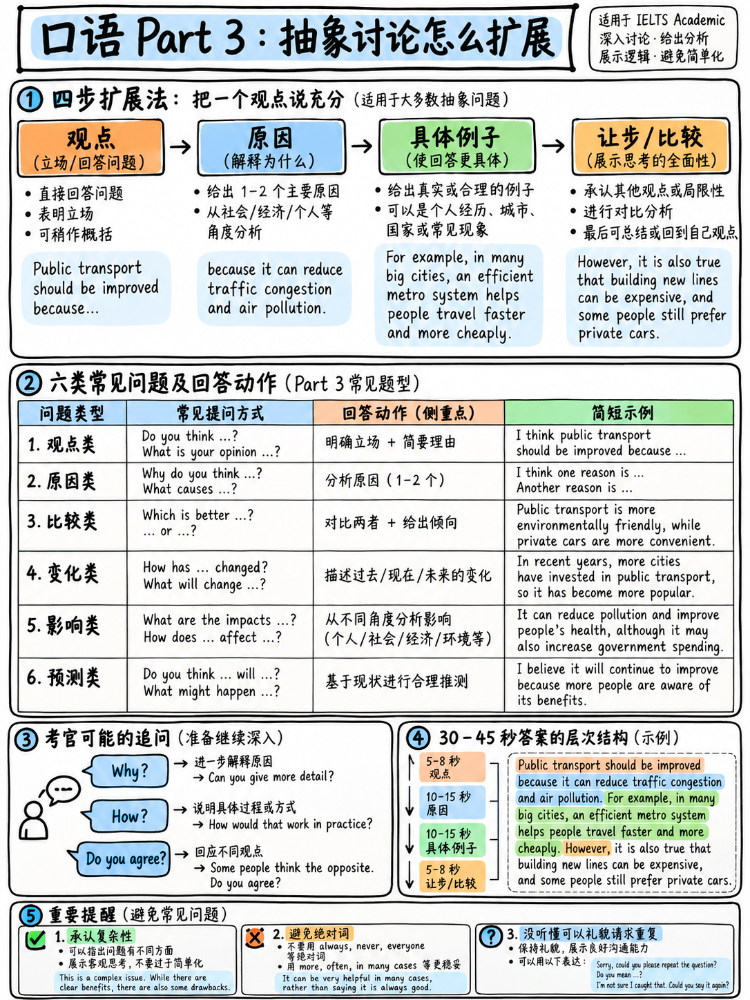

# 04. Part 3 深度讨论与思辨：从个人经验跃升到社会宏观视角的推演公式 (Part 3 Discussion)



雅思口语 Part 3 官方定义为“双向深度讨论（Two-way Discussion）”，持续时间为 **4–5 分钟**。官方大纲规定：“考官会提出一系列与 Part 2 话题密切相关的纵深问题。这些问题旨在为考生提供一个**探讨更为抽象的社会议题、观点与概念（Abstract issues and ideas）**的舞台” `[1]`。

如果说 Part 1 检验日常交流基本功，Part 2 检验独立独白组织力，那么 **Part 3 就是真正决定你拿到 6.0 还是突破 7.0+ 的决胜分水岭**！

许多考生在进入 Part 3 后频繁陷入中式思维陷阱：考官问及社会宏观问题，考生张口闭口依然是“我妈妈、我朋友、我上个月”，无法脱离个人琐碎经验。本章将为你传授从私人视角飞跃至社会宏观维度的推演公式、六大提问类型破解战术以及三大考场降维解题神技。

---

## 20.4.1 Part 3 考场实战机制：考官的攻防节奏

Part 3 不是机械问答，而是一场**渐进式的学术探讨（Two-way Discussion）**。官方真实样题录音 `[13]` 显示，考官在 Part 3 呈现出三大鲜明特征：

```
   ┌────────────────────────────────────────────────────────────────────────┐
   │                       Part 3 考官提问的递进逻辑                        │
   │                                                                        │
   │  第 1 阶：宏观定性 (Descriptive / Causal)                              │
   │  "First, let's consider values. In your country, what kinds of         │
   │   possessions give status to people?"                                  │
   │                                                                        │
   │  第 2 阶：顺藤摸瓜与追问 (Follow-up / Comparative)                     │
   │  "Is that a new development, or have people thought like that for      │
   │   a long time?"                                                        │
   │                                                                        │
   │  第 3 阶：观点挑战与价值评估 (Challenge / Evaluative)                  │
   │  "You don't think of it as a healthy way of thinking?"                 │
   │                                                                        │
   │  第 4 阶：未来推演与政策探讨 (Speculative / Policy)                    │
   │  "And do you think this will change in the future? What should         │
   │   governments do about it?"                                            │
   └────────────────────────────────────────────────────────────────────────┘
```

### 1. 考官提问越来越短，挑战性越来越高
考官的初始问题往往较完整，随后会根据你的即兴回答现场追问：*"Can you tell me a little bit more about that?"* 或 *"Why do you think that happens?"*甚至直接抛出反问挑战。这并不代表考官在为难你，**恰恰是因为你的上一句回答展现了高阶语言潜能，考官在主动为你创造冲刺 7 分的契机！**

### 2. 回答配速标准
- **建议时长**：每道题 **30–45 秒**（即自然语速下的 **3 至 5 句话**）。
- 全场 4–5 分钟内，考官通常会推进 **5–7 轮深度互动**。
- **过短后果**：只说一两句就戛然而止，考官会判定你缺乏“深入展开论述的能力（Willingness to produce long turns）”，止步 5.5 分。
- **过长后果**：一人独白超过 1 分钟会破坏双向互动的属性，考官必将打断。

---

## 20.4.2 宏观跃迁：从“个人微观”飞跃至“社会宏观”

中国初学者在 Part 3 最致命的失误是**视界过窄**。对比以下两段对同一问题的回应：

> **考官提问：** *"Why do people care so much about social status?"*（人们为什么如此在意社会地位？）

- ❌ **微观低分回答 (Band 5)**：  
  *"Because like my classmate, he bought a new iPhone last week, and he showed it to everyone. I think people want to show they have money."*  
  *(剖析：局限于个人同学的琐碎事件，缺乏抽象概括词汇，思维扁平。)*
- ✅ **宏观高分回答 (Band 7)**：  
  *"**I think there are two main driving forces here — one psychological and one social.** On a personal level, material status often brings a sense of security and validation. But socially, we live in a consumer-driven culture where people are frequently judged by outward appearances rather than character. **Having said that, I think younger generations are gradually shifting towards valuing personal experiences rather than pure possessions.**"*  
  *(剖析：站在心理机制与消费主义社会的宏观高度，词汇涵盖 validation, consumer-driven culture, outward appearances，并以 having said that 做出精妙辩证让步。)*

---

## 20.4.3 核心推演公式：AREQ / PREQ 宏观辩证架构

为了在 30–45 秒内输出结构严谨、逻辑层层递进的学术级回答，初学者应全面掌握 **AREQ 四段推演公式**：

```
   ┌───────────────────────────────────────────────────────────────────────┐
   │                    Part 3 宏观思辨 AREQ 答题公式                      │
   ├───────────────┬───────────────────────────┬───────────────────────────┤
   │ P / A: 观点   │ Position / Answer (1 句)  │ 一针见血直接亮明核心观点  │
   ├───────────────┼───────────────────────────┼───────────────────────────┤
   │ R: 归因       │ Reason (1 句)             │ 挖掘深层社会/经济/心理根源│
   ├───────────────┼───────────────────────────┼───────────────────────────┤
   │ E: 现象       │ Example / Evidence (1–2句)│ 给出广泛社会现象或行业常态│
   ├───────────────┼───────────────────────────┼───────────────────────────┤
   │ Q: 辩证       │ Qualify / Concession (1句)│ **高分胜负手**：审慎让步、│
   │               │                           │ 区分群体或指出未来变数    │
   └───────────────┴───────────────────────────┴───────────────────────────┘
```

### AREQ 实战范文剖析
> **考官提问：** *"What kind of possessions give people status in your country?"*（在你的国家，什么样的财产会带给人物质地位？）

- **【Position - 明确观点】**  
  *"I'd say luxury cars and prime real estate are still the most prominent status symbols, especially for the older generation."*  
  *(中文精义：我认为豪车和黄金地段的房产依然是最显著的地位象征，尤其是对老一辈人而言。)*
- **【Reason - 社会归因】**  
  *"Partly that's because these are highly visible assets — everyone in the street can immediately recognize what you drive, which isn't the case with someone's personal savings or investments."*  
  *(中文精义：部分原因在于这些是极具辨识度的显性资产——街上的每个人都能一眼看出你开什么车，而个人储蓄或金融投资则无法做到这一点。)*
- **【Example - 宏观现象】**  
  *"For instance, in many major cities, it's quite common to see people parking high-end SUVs in front of modest homes, simply to project an image of financial success to their neighbours."*  
  *(中文精义：例如在许多大城市，人们经常能看到在普通住宅楼前停放着高档SUV，其目的纯粹是为了向邻居彰显经济成功。)*
- **【Qualify - 辩证让步（决胜 7 分）】**  
  *"Having said that, this perception is definitely evolving among younger demographics. Many young professionals now prioritise international travel or digital nomadism over physical assets, which represents a fundamental shift in values."*  
  *(中文精义：话虽如此，这种观念在年轻群体中正在发生深刻转变。许多年轻白领如今更看重跨国旅行或数字游民生活方式，而非死守固定资产，这体现了价值观的根本重塑。)*

:::{tip} 为什么 Qualify（审慎让步）是 7 分的硬通标？
官方考官学术评述指出，Band 6 与 Band 7 的核心壁垒在于：**Band 6 只能单一陈述观点，而 Band 7 展现出“表达细微差别的观点（Express nuanced opinions）以及从多个角度展开论证的能力”** `[19]`。  
在一段回答的结尾加上 *"Having said that, it really depends on..."* 或 *"Although that might not be true for..."*，能瞬间给考官留下极具学术思辨深度的高分印象！
:::

---

## 20.4.4 Part 3 六大高频设问类型与对应应答公式

Part 3 考官无论提出什么领域的具体问题，其底层逻辑均严格归属于以下六大问法框架：

| 设问类型 | 考场高频代表问句 | 破局战略与答题步骤 | 黄金句型框架 (Sentence Frames) |
|---|---|---|---|
| **1. 描述归纳类 (Descriptive)** | *"What kinds of jobs are most respected in your society?"* | **拆为两类并择一深挖**：先指出存在两大主要类别，随后挑选其中最典型的一类展开。 | *"There are probably two broad categories — [X] and [Y]. The more prestigious ones tend to be [X], mainly because…"* |
| **2. 根源因果类 (Causal)** | *"Why do you think childhood obesity has increased?"* | **双重归因法**：提供一个“生活习惯/个体原因”，叠加一个“商业环境/社会原因”。 | *"I think this comes down to two interrelated factors. On the one hand,… But on a broader systemic level,…"* |
| **3. 古今变迁类 (Comparative)** | *"How has the way people communicate changed over the last two decades?"* | **今昔鲜明对比法**：以时间锚点对比“过去传统”与“现代变革”，突出效率或疏离感。 | *"It has transformed dramatically. A few decades ago, people relied heavily on… whereas nowadays, with the advent of…"* |
| **4. 价值评估类 (Evaluative)** | *"Do you think exams are a fair way to assess student ability?"* | **明确立场 + 承认局限**：先表达整体倾向，随后审慎指出其不可忽视的弊端。 | *"On balance, I'd say they are relatively effective, as they provide a standardised metric. However, an obvious downside is that…"* |
| **5. 未来预测类 (Speculative)** | *"Will artificial intelligence replace most human workers in the future?"* | **审慎预测 + 设定先决条件**：避免使用绝对化的 *will*，多用 *might / likely* 并给出假设前提。 | *"I'm inclined to believe it will significantly alter the job market, though not entirely eliminate humans. Assuming that… it's more likely that…"* |
| **6. 政策责任类 (Policy / Obligation)** | *"Should governments place heavier taxes on fast food?"* | **主体界定 + 行动方案 + 反对声音**：指出政府应当如何作为，并预先驳斥潜在反对意见。 | *"In my view, authorities definitely have a responsibility to intervene by… The main counterargument is…, but the long-term benefits far outweigh that."* |

---

## 20.4.5 难题降维打击：三大“化繁为简”实战神技

遇到极具哲学深度或宏大抽象的难题（如 *"Is globalisation always beneficial?"* 或 *"What defines true happiness in modern society?"*），切忌惊慌失措。  
运用以下三大技巧，将抽象难题瞬间降维为你能够从容掌控的日常论证：

```
   ┌────────────────────────────────────────────────────────────────────────┐
   │                       难题降维三大战术                                 │
   ├───────────────────────────────┬────────────────────────────────────────┤
   │ 1. 缩小地域/领域 (Narrowing)  │ "That's quite a broad question — I can │
   │                               │  really only speak about my home       │
   │                               │  country, where…"                      │
   ├───────────────────────────────┼────────────────────────────────────────┤
   │ 2. 拆分人群客体 (Splitting)   │ "I think the answer depends heavily on │
   │                               │  generation. For older demographics…   │
   │                               │  whereas for teenagers…"               │
   ├───────────────────────────────┼────────────────────────────────────────┤
   │ 3. 重构为利益权衡 (Reframing) │ "I'm not sure it's purely a black-and- │
   │                               │  white issue; it's really a classic    │
   │                               │  trade-off between convenience and…"   │
   └───────────────────────────────┴────────────────────────────────────────┘
```

1. **战术一：缩小范围（Narrowing）**：考官提出世界级议题时，主动承认问题宏大，并主动声明聚焦于自己最熟悉的中国社会或特定行业。这展现了严谨的学术定位能力，同时将考题带入熟悉领域。
2. **战术二：人群拆解（Splitting）**：将单一宏观结论拆解为“年轻人 vs 老年人”、“城市居民 vs 农村居民”、“高收入群体 vs 普通工薪阶层”。答案立刻拥有双重视角，轻松填满 40 秒。
3. **战术三：概念重构（Reframing）**：将简单的“好与坏”重构为“代价与收益的权衡（A trade-off between X and Y）”，瞬间升华回答的思想层级。

---

## 20.4.6 面对考官反驳挑战 (Examiner Challenge) 的接招策略

在官方真实考试中，考官经常会针对考生的回答抛出反驳追问：
- *"You don't think that could lead to unfairness?"*（你难道不认为这会导致不公吗？）
- *"Are you sure people really feel that way nowadays?"*（你确定现在的人真的是这么想的吗？）

很多考生被吓得当场认错（*"Oh sorry, yes, I am wrong."*），这是极大的失分行为！考官抛出反驳，纯粹是为了检验你**捍卫论点（Defend an argument）或修正观点的学术交际弹性**。

面对考官挑战，三大高分接招姿态：

| 你的真实态度 | 考场高分回应框架 | 逻辑机制剖析 |
|---|---|---|
| **坚持原有立场** | *"Actually, I'd still maintain my point, because if we look at…"* | 表现出坚定自信的论证韧性，摆出事实依据。 |
| **赞同考官反驳** | *"That's a very valid counterpoint. Thinking about it further, I'd agree that…"* | 展现开放成熟的倾听能力，并顺着考官逻辑补充论据。 |
| **折中辩证兼顾** | *"That's certainly true to some extent, but I think what I'm really trying to highlight is…"* | 既承认考官观点的合理性，又澄清并捍卫自身核心意图。 |

---

## 20.4.7 四大抽象万能分析视角与 20 个学术核心词

Part 3 的绝大多数抽象话题均可以投射至以下四大分析维度。掌握这 20 个高杠杆学术词汇，足以应对绝大多数 Part 3 话题的展开：

```
   ┌────────────────────────────────────────────────────────────────────────┐
   │                       Part 3 四大分析维度与核心词                      │
   ├───────────────────────────────┬────────────────────────────────────────┤
   │ 1. 跨代观念演变               │ generation gap (代沟), traditional vs  │
   │    (Change over Generations)  │ progressive (传统与激进), mindset     │
   │                               │ (思维模式), evolving expectations      │
   ├───────────────────────────────┼────────────────────────────────────────┤
   │ 2. 个人自由 vs 社会责任       │ civic responsibility (公民责任), state │
   │    (Individual vs Society)    │ intervention (国家干预), regulate      │
   │                               │ (监管), public awareness (公众意识)    │
   ├───────────────────────────────┼────────────────────────────────────────┤
   │ 3. 成本代价 vs 长期收益       │ trade-off (权衡取舍), at the expense of│
   │    (Cost-Benefit / Trade-off) │ (以…为代价), outweigh (胜过), in the   │
   │                               │ long run (长远来看), unintended consequence│
   ├───────────────────────────────┼────────────────────────────────────────┤
   │ 4. 资源获取与社会公平         │ affordability (可负担性), equitable    │
   │    (Access & Fairness)        │ access (均等获取), underprivileged     │
   │                               │ (弱势群体), digital divide (数字鸿沟)  │
   └───────────────────────────────┴────────────────────────────────────────┘
```

---

## 20.4.8 Part 3 八大主题高频实战演练题库

每组题目前两题为因果与现状题，后两题为未来预测与政策审辨题。练习时请严格遵循 **AREQ 公式** 进行 40 秒录音突破训练。

### 模块一：财富、消费与社会价值观 (Wealth & Values)
1. *In what ways do material possessions define social status in your country?*
2. *Has the concept of success changed between your parents' generation and your own?*
3. *Do you believe aggressive advertising manipulates consumer spending habits?*
4. *Should governments impose strict restrictions on commercial advertising targeting young children?*

### 模块二：职场生态与未来就业 (Employment & Work)
5. *Why are certain professions, such as doctors or lawyers, paid significantly higher salaries than others?*
6. *In the long term, is job satisfaction more critical to personal well-being than high remuneration?*
7. *How has remote working technology transformed corporate culture and daily life?*
8. *Do you foresee a future where artificial intelligence completely replaces repetitive human labor?*

### 模块三：教育公平与评估机制 (Education & Growth)
9. *What qualities distinguish an inspirational teacher from an ordinary one?*
10. *Should university tuition be entirely subsidised by the government, or paid by individual students?*
11. *Is virtual online learning truly as pedagogically effective as traditional in-person classroom instruction?*
12. *Do standardised examinations provide an entirely fair assessment of a student's real capabilities?*

### 模块四：生态环境与公众责任 (Environment & Climate)
13. *Whose obligation is it to lead the green transition — individual citizens or central governments?*
14. *Why do so many people find it difficult to adopt environmentally friendly daily habits?*
15. *Should consumers pay substantial green taxes on goods that generate heavy carbon footprints?*
16. *Are international climate treaties actually effective in curbing global warming?*

### 模块五：身心健康与现代城市 (Health & Lifestyle)
17. *Why has sedentary living and lifestyle-related illness become so widespread in modern urban areas?*
18. *Should public authorities impose special taxes on sugary beverages and ultra-processed food?*
19. *Is mental health awareness accorded sufficient priority in schools and workplaces today?*
20. *How can urban architects design modern cities to promote physical activity and emotional wellbeing?*

### 模块六：社交媒体与数字伦理 (Media & Digital Life)
21. *Do you think public trust in mainstream news outlets has eroded compared to the past?*
22. *What psychological and social risks are associated with early smartphone usage among teenagers?*
23. *Has instant digital communication reduced human patience and attention spans?*
24. *How might automated algorithms shape or polarise public opinion on social matters?*

### 模块七：城市化发展与公共交通 (Urbanisation & Transit)
25. *What are the most pressing urban challenges confronting mega-cities today?*
26. *How can municipal authorities encourage commuters to abandon private cars in favour of public transit?*
27. *Is living in countryside environments inherently healthier than living in dense metropolitan centres?*
28. *Should non-electric vehicles be completely banned from entering downtown city centres?*

### 模块八：家庭纽带与老龄化社会 (Family & Demographics)
29. *Are extended family relationships becoming less cohesive in contemporary society?*
30. *Who should bear the primary responsibility for elderly care — families or public welfare systems?*
31. *Is it still important for residents in modern urban high-rises to maintain close ties with neighbours?*
32. *How has the socioeconomic role of grandparents in raising grandchildren changed over recent decades?*

---

**上一章：** {doc}`03-part-2-long-turn` | **下一章学习指南：** {doc}`05-fluency-engine`
