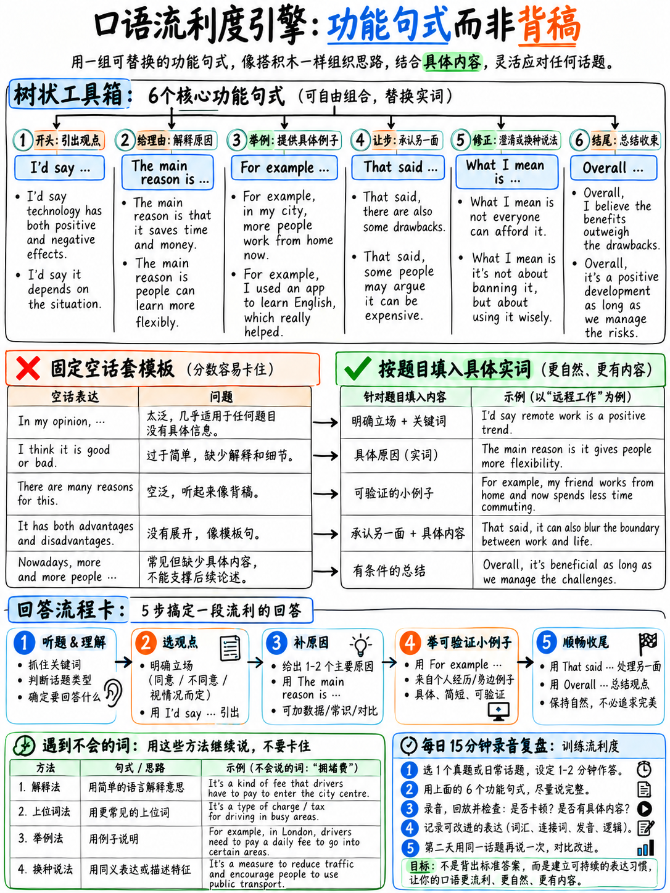

# 05. 流利度引擎：填补停顿、买时间句型与自然衔接技术 (Fluency Engine)



在雅思口语考场上，几乎所有中国考生都曾经历过这样的致命时刻：面对考官的提问，脑海中一片空白；或者明明知道中文意思，对应的英文高级词汇却死活卡在舌尖，全场陷入长达 5 秒令人窒息的死寂。

这种因为“找词、搜语法”而产生的句中长沉默，正是官方评分量表《Speaking Band Descriptors》中明确标示的 **Band 5 核心扣分指标**（*"pausing during which the test taker searches for words"*）`[11]`！

本章将为你装载一套经官方标准检验的**流利度引擎（Fluency Engine）**——掌握“买时间句型”、分类话语标记库、迂回转述（Paraphrase）技术以及 14 分钟全真考试体能分配策略，让你在考场上无论遇到任何难题都能像母语者一样自然、平稳、无卡壳地持续输出。

---

## 20.5.1 底层逻辑：为什么“句型框架”合规加分，而“机械模板”判极低分？

许多考生困惑：一方面网络上到处在卖“万能口语模板”，另一方面官方却三令五申“严惩背诵（Memorised answers）”。这两者之间的界限究竟在哪里？

请看官方评分标准中两条看似矛盾实则分明的硬性指标：

> **流利度 Band 6 官方标准**：  
> *"Uses a range of **spoken discourse markers, connectives and cohesive features** though not always appropriately."*（能使用一系列口语话语标记、连接词与衔接手段，虽偶有不当）`[9]`。

> **流利度 Band 7 官方标准**：  
> *"**Flexible use of spoken discourse markers, connectives and cohesive features.**"*（能够灵活、自如地使用口语话语标记、连接词与衔接手段）`[9]`。

由此可见，**官方不仅不反对连接手段，反而在 Band 6 和 Band 7 中白纸黑字地将其列为采分点！** 区别在于：

| 维度对比 | 官方采分的“话语标记与框架 (Discourse Markers)” | 官方严厉打击的“机械背诵模板 (Memorised Templates)” |
|---|---|---|
| **长度结构** | 极其简短，仅 **1 至 4 个单词**（如 *Having said that, In a way*）。 | 冗长刻板，包含**一整句甚至一整段完整陈述**。 |
| **承载内容** | **纯功能性语法骨架**，不承载任何实际事实，只负责串联逻辑。 | **直接承载虚假事实与论据**（如 *"In this modern fast-changing world..."*）。 |
| **主题适配** | 适用于任何话题（如讨论音乐、天气、经济均可使用 *I tend to think*）。 | 无法自然契合考题，出现明显的生搬硬套（Off-topic）。 |
| **官方档位判定** | **Band 6–7 明确加分项** `[9]`。 | **Band 1–3 极低分判定**（*"Memorised utterances"*）`[8]` `[9]`。 |

同时，请牢记官方对连接词的反向严厉警示：
> **流利度 Band 5 官方标准**：  
> *"**Overuse of certain discourse markers, connectives and other cohesive features.**"*（过度重复使用某些特定的连接词与衔接手段）`[9]`。

:::{danger} 数量铁律：每种连接词全场最多使用 1–2 次！
本章提供的所有高分短语，**在 14 分钟全场考试中，每一个短语最多只允许出现 1 到 2 次！**  
如果你在全场自如使用了 6 种不同的话语标记，考官会在量表上勾选 **Band 7 的“灵活性 (Flexible use)”**；但如果你把同一个 *To be honest* 连说了 6 遍，考官会立刻认定你词汇枯竭，直接把你打入 **Band 5 的“过度使用 (Overuse)”**！
:::

---

## 20.5.2 核心话语标记宝库：九大功能实战速查

以下精选母语者在日常与学术交际中最高频、最自然的短小话语标记（Discourse Markers），按交际功能分类整理：

### 1. 启动作答与争取起步思考（为你赢得前 2 秒无痛缓冲）
- **"Well, …"** —— 英语中最自然、毫无造作感的万能开场起手式。
- **"I suppose I'd say…"** —— 用于给出初步思考看法。
- **"Off the top of my head, …"** —— 用于回答没有预先准备的即兴列举题（意为“不假思索地凭第一感觉说”）。
- **"Yes and no, actually."** —— 当真实情况比较复杂、无法用单纯的好坏判定时使用。
- **"It depends, really."** —— 必须在后半句立刻紧跟它取决于什么（如 *It depends really on what kind of budget you have*），切忌只扔下这句空话就停下。

### 2. 观点表达与态度软化（高分审慎表达）
- **强硬观点（慎用）**：*"I'm fairly convinced that…" / "There's no question that…"*
- **中性观点**：*"In my view,…" / "I'd say that…" / "Personally speaking,…"*
- **高级软化观点（官方 Band 7.5+ 极力赞赏）**：  
  *"I tend to think that…"*（我倾向于认为……）  
  *"It seems to me that…"*（在我看来似乎……）  
  *"I'd probably argue that…"*（我大概会倾向于主张……）

### 3. 逻辑归因与原因推进
- *"mainly because…"*（主要在于……）
- *"which is why…"*（正因如此，所以……）
- *"that's partly down to the fact that…"*（这部分归因于……）
- *"the primary driver behind this is…"*（背后的核心驱动力是……）

### 4. 具象案例引入
- *"For instance,…"* / *"Take [X], for example."*（以……为例）
- *"In my own experience,…"*（就我个人的亲身经历而言……）
- *"Like last week, when…"*（比如上周发生的一件事……）
- *"I remember reading somewhere that…"*（我记得在某个报道里读到过……）

### 5. 辩证让步与高分转折（决胜 7 分核心标记）
- **"Having said that, …"**（话虽如此；尽管这么说）
- **"That said, …"**（话虽如此，更口语化精炼版）
- **"On the other hand, …"**（另一方面）
- **"To be fair, though, …"**（平心而论；客观公正地讲）
- **"It's not that [A], it's more that [B]…"**（并不是因为 A，更多是因为 B……）

### 6. 信息递进与补充
- *"On top of that, …"*（除此以外；更有甚者）
- *"What's more, …"*（而且更为关键的是……）
- *"Not only that, but…"*（不仅如此，而且……）
- *"Another thing worth mentioning is that…"*（另一个值得一提的是……）

### 7. 审慎客观概括（规避绝对化错误）
- *"Generally speaking, …"*（总体而言）
- *"As a rule, …"*（通常情况下；一般说来）
- *"In the vast majority of cases, …"*（在绝大多数情形下）
- *"People tend to… rather than…"*（人们往往会……而非……）

### 8. 口误修正与换词（展现语言监控力）
- *"Sorry, what I mean is…"*（抱歉，我的实际意思是……）
- *"Or rather, …"*（更准确地说是……）
- *"Let me put it another way: …"*（让我换一种更恰当的说法……）

:::{note}
官方量表 Band 7 明确允许句中自然的自我修正（*"Self-correction often mid-sentence"*）`[9]`。考场上偶然说错一个单复数或发音，使用 *"or rather"* 自然改口，绝不扣分，反而是自信语言监控能力的体现！
:::

### 9. 话轮自然收尾
- *"So yes, that's basically my take on it."*（所以，这基本上就是我对它的看法。）
- *"Anyway, that's why it stands out so much to me."*（不管怎么说，这就是它为何对我如此独特的缘由。）

---

## 20.5.3 考场“买时间 (Time-Buying)”段位金字塔

当考官抛出一个出乎意料的难题，你需要 3 至 5 秒组织语言时，你的应对策略直接决定了你的分数层级：

```
   ┌────────────────────────────────────────────────────────────────────────┐
   │                       考场“买时间”段位金字塔                           │
   │                                                                        │
   │  王者级 (Diamond Tier) —— 借题发挥，复述题干转化为陈述句               │
   │  • 考官: "Why do people care about social status?"                     │
   │  • 考生: "Why people care so much about status... I think that comes   │
   │           down to two quite distinct things."                          │
   │  ★ 耗时 4 秒，展现 100% 听力理解与从容气度，零多余词汇成本！           │
   │                                                                        │
   │  大师级 (Gold Tier) —— 软化评价 + 主动缩小问题范围                    │
   │  • 考生: "That's quite a broad question to tackle, actually. I suppose │
   │           I can really only speak about my own country..."             │
   │  ★ 耗时 5 秒，展现高阶学术严谨性，同时将题目降维到熟悉领域！          │
   │                                                                        │
   │  熟手级 (Silver Tier) —— 指明回答结构架构                              │
   │  • 考生: "There are probably two main perspectives on this..."         │
   │  ★ 耗时 3 秒，既争取了构思时间，又强行锁定了双向展开结构！            │
   │                                                                        │
   │  青铜级 (Bronze Tier) —— 运用简短自然话语标记                          │
   │  • 考生: "Well... let me think for a second."                          │
   │  ★ 耗时 2 秒，安全合规，但每场考试限用 1 次。                         │
   │ ────────────────────────────────────────────────────────────────────── │
   │  地狱级 (Toxic Tier) —— 致命失分扣分区 (千万杜绝)                     │
   │  ❌ 满嘴无意识无意义的低级喘息与叹声: "Er... ah... um... er..."         │
   │  ❌ 脑中痛苦搜词导致全场长达 5 秒的绝对死寂 (直接锁死 Band 5 FC)!      │
   │  ❌ 呆若木鸡只蹦出一句: "I don't know." 并彻底停滞!                   │
   └────────────────────────────────────────────────────────────────────────┘
```

:::{warning} 坚决用“填充词组 (Filler Words)”替代“填充声音 (Filler Sounds)”！
母语者在思考时也会停顿，但他们使用的是语义饱满的话语标记（如 *I suppose, in a way, you see*）。  
如果你的作答被连续的 *"Er... um... ah..."* 填满，考官会根据量表直接标记为 **Band 5 典型的“因检索基础词汇与语法而出现的无功能停顿”** `[9]` `[11]`！
:::

---

## 20.5.4 同义迂回转述 (Paraphrase) 集训：跨入词汇 6 分大门

官方标准中，词汇 5 分与 6 分的生死线几乎全部由这一条定义：
> **Band 5 LR**：*"Attempts paraphrase but not always with success."*（尝试迂回转述，但屡屡失败导致沟通断层）`[9]`。  
> **Band 6 LR**：*"Generally able to **paraphrase successfully**."*（大体能够成功实现迂回转述与解释）`[9]`。

**转述能力是一项可以被彻底刻意训练的实战技能，而不是玄学！**

### 迂回转述三大万能公式

| 转述公式 | 逻辑结构定义 | 实操范例：你不会说“听诊器 (stethoscope)” |
|---|---|---|
| **1. 功能描述法 (Function)** | *"It's a thing/device you use to [动词动作]…"* | *"It's a tool that doctors use to listen to your heartbeat or chest."* |
| **2. 类别 + 特征法 (Category + Feature)** | *"It's a kind of [上位词概念], with [物理特征]…"* | *"It's a kind of medical instrument with two earpieces and a metal disc."* |
| **3. 熟悉客体类比法 (Comparison)** | *"It's quite similar to a [常见物], except that…"* | *"It's like a special pair of headphones, but designed for physicians."* |

### 考场免死金句
当你遇到生词卡壳时，立刻自然说出：  
> **"I can't recall the precise English term for this, but it's basically a kind of [使用上述公式描述]…"**

说出这句话，考官绝不仅不会扣你的词汇分，反而会在打分纸上欣慰地为你勾选 **Band 6–7 的官方转述能力加分项**！

### 30 个考场高频实物与概念迂回转述挑战表
练习要求：看到下列中文词汇，假定你不会该单词，强迫自己在 **8 秒钟内** 用英语口头描述出其核心特征：

| 序号 | 目标概念 | 真实单词 | 万能迂回描述示范 (Paraphrase Model) |
|:---:|---|---|---|
| 1 | 热水壶 | a kettle | *"an electrical kitchen appliance used for boiling water quickly"* |
| 2 | 订书机 | a stapler | *"a small office tool used to pin paper sheets together with metal clips"* |
| 3 | 疫苗 | a vaccine | *"a medical injection that protects people from catching severe diseases"* |
| 4 | 垃圾分类回收 | recycling | *"the process of treating used plastic, glass or paper so they can be reused"* |
| 5 | 交通堵塞 | a traffic jam | *"a situation where vehicles are stuck on the road and barely moving"* |
| 6 | 郊区 | a suburb | *"a residential district located on the outer edge of a big city"* |
| 7 | 温室大棚 | a greenhouse | *"a glass building where delicate plants and vegetables are kept warm"* |
| 8 | 自动售货机 | a vending machine | *"a coin-operated machine on the street that dispenses drinks and snacks"* |
| 9 | 房贷 | a mortgage | *"a large long-term bank loan specifically used for purchasing a property"* |
| 10 | 截止日期 | a deadline | *"the final date or time by which a project or essay must be finished"* |
| 11 | 房东 | a landlord | *"the owner of a house or flat that other people pay rent to live in"* |
| 12 | 奖学金 | a scholarship | *"financial aid granted to students by universities based on high grades"* |
| 13 | 加班 | overtime | *"extra hours that an employee works beyond their standard contractual time"* |
| 14 | 个人简历 | a CV / résumé | *"a formal document detailing a person's education, work history and skills"* |
| 15 | 养老金 | a pension | *"a regular income paid by the state or company to people who have retired"* |
| 16 | 实习经历 | an internship | *"a temporary job taken by students to gain hands-on professional experience"* |
| 17 | 财政预算 | a budget | *"a detailed financial plan estimating income and planned expenditures"* |
| 18 | 通货膨胀 | inflation | *"the general rise in prices over time, which reduces the value of money"* |
| 19 | 每日通勤 | a commute | *"the regular journey that someone makes between home and their workplace"* |
| 20 | 退款 | a refund | *"money returned to a customer when they return unsatisfactory goods"* |
| 21 | 排队 | a queue | *"a line of people waiting patiently for their turn to buy or enter something"* |
| 22 | 发票收据 | a receipt | *"a printed slip of paper confirming that you have paid for a purchase"* |
| 23 | 房屋押金 | a deposit | *"a sum of money paid in advance to secure a rented flat against damage"* |
| 24 | 租房合同 | a lease | *"a legal contract signed between a tenant and a landlord setting rental rules"* |
| 25 | 大学辅导课 | a tutorial | *"a small-group discussion class led by a university tutor"* |
| 26 | 毕业论文 | a dissertation | *"a long piece of academic research written for a university degree"* |
| 27 | 销售提成 | a commission | *"an extra fee paid to an agent based on the percentage of sales achieved"* |
| 28 | 政府补贴 | a subsidy | *"money given by public authorities to keep the price of essentials low"* |
| 29 | 智能吸尘器 | a robot vacuum | *"an automated electronic cleaning gadget that sweeps floors by itself"* |
| 30 | 随行背包 | a rucksack / backpack | *"a large sturdy bag carried on your back, ideal for hiking and travelling"* |

---

## 20.5.5 考场“听不懂或没听清考官提问”时的官方应对 SOP

考场中因为考官口音、连读弱读或考室杂音导致没有完全捕捉到问题，是极其普遍的人际现象。官方真实考场录音中，高分考生也会自然向考官确认提问 `[13]`。

**遇到听力障碍，按以下四类场景得体应对：**

```
   ┌────────────────────────────────────────────────────────────────────────┐
   │                       考场听音障碍应对四锦囊                           │
   ├───────────────────────────────┬────────────────────────────────────────┤
   │ 场景 1: 完全没听清声音        │ "Sorry, could you repeat that please?" │
   │                               │ (完全合规，零扣分)                     │
   ├───────────────────────────────┼────────────────────────────────────────┤
   │ 场景 2: 某个具体单词不懂      │ "Sorry, what does the word [X] mean?"  │
   │                               │ (仅限 Part 1 和 3，考官有义务做同义释义│
   │                               │  千万不要不懂装懂盲目答非所问)         │
   ├───────────────────────────────┼────────────────────────────────────────┤
   │ 场景 3: 单词都听懂但题意抽象  │ "Do you mean [你的理解], or are you    │
   │                               │  referring to [另一层含义]?"           │
   │                               │ (展现主动求证与学术思辨互动)           │
   ├───────────────────────────────┼────────────────────────────────────────┤
   │ 场景 4: 题意听懂但极其生僻偏门│ "To be honest, it's not something I've │
   │                               │  considered before, but I'd guess..."  │
   │                               │ (坦白思考状态，随后给出假设推演)       │
   └───────────────────────────────┴────────────────────────────────────────┘
```

---

## 20.5.6 14 分钟全真考试体能与节奏管控 SOP

雅思口语是一场高强度的脑力与心理消耗战。许多考生在最后两分钟因为精力耗尽，语音语调完全塌陷，导致前功尽弃。

严格按照以下时间轴管控你的考场表现：

| 时间节点 | 考场环节 | 考生关键动作与体能纪律 |
|---|---|---|
| **0:00 – 0:30** | 考场破冰与证件核对 | 抬头挺胸，保持微笑与眼神接触。用洪亮清晰的声音回答 *"Good morning"* 与递交证件，**给考官留下自信发音第一印象**。 |
| **0:30 – 5:00** | **Part 1** 日常问答 (8–12题) | **严格执行“两句话原则（Answer + Extend）”**。每题控制在 15–20 秒，切忌单词作答，切忌喧宾夺主过长演讲。 |
| **5:00 – 6:00** | **Part 2** 题卡草稿准备 | 抓起铅笔，在草稿纸上画出 5 行骨架；**只记名词与数字**；最后 10 秒死磕 Why 段落的“实用 vs 情感”两点原因。 |
| **6:00 – 8:00** | **Part 2** 个人长独白 | 紧盯草稿纸上的数字与时间轴；**讲满整整 2 分钟直到考官叫停**。若 70 秒素材讲完，立刻触发“急救箱话术”延展。 |
| **8:00 – 8:30** | Part 2 收尾简短过渡题 | 极简回答，1–2 句话结束（5–10秒），优雅过渡，深吸一口气调整状态。 |
| **8:30 – 13:00** | **Part 3** 宏观深度讨论 (5–7题) | **全面进入 AREQ 宏观推演模式**！每题输出 3–5 句话（30–45秒）；运用人群拆分与利益权衡降维打击难题。 |
| **13:00 – 14:00** | 尾声与全场结束 | **绝对警惕体力崩塌**！考官打分依托“全场平均综合水平（Average across all parts）”`[9]`。最后 60 秒必须咬牙保持语音上扬与眼神交流。考官说 *"That's the end of the test"* 时礼貌致谢离开。 |

---

## 20.5.7 每日 15 分钟口语晨读与刻意训练清单

不需要每天花两个小时毫无目的地背题库。按照以下高度结构化的 SOP 每天刻意练习 15 分钟，四周内将建立强大的肌肉记忆：

- [ ] **第 1–3 分钟（发音与意群断句）**：选取第 03 篇中的高分范文一段，大声朗读，严格遵循标注的意群线 `│` 进行停顿，强化句子重音与弱读。
- [ ] **第 4–6 分钟（转述挑战）**：随机从 §20.5.4 中抽取 5 个生词，强迫自己在 10 秒内用英语功能法或类比法将其描述出来。
- [ ] **第 7–9 分钟（Part 1 极速反应）**：随机挑选 4 道 Part 1 问题，打开手机录音机，以“Answer + Extend”两句话模式作答，每题计时 20 秒。
- [ ] **第 10–12 分钟（Part 2 结构独白）**：挑选 1 张题卡，用 1 分钟草稿纸速记 5 行骨架，随后独立计时说满 2 分钟。
- [ ] **第 13–15 分钟（复盘诊断）**：回听 Part 2 录音，对照评分标准在错误笔记本（Error Log）中记录**一条**具体问题（如：时态不准、停顿过长或平调），次日专项突破！

---

**上一章：** {doc}`04-part-3` | **下一章学习指南：** {doc}`06-speaking-practice-bank`
