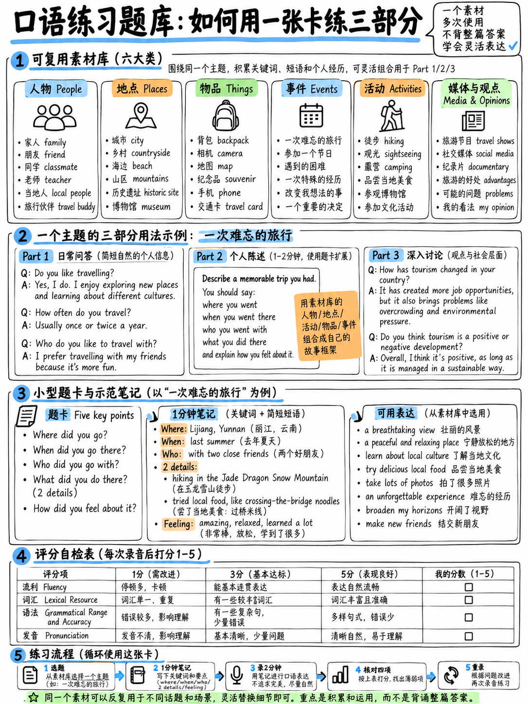

# 06. 口语高频题库全真演练与高分答题示范 (Speaking Practice Bank)



雅思口语备考最忌讳的两大歧途：一是“盲目收集上千页网络机经，试图把每道题的答案全背下来”，结果考场上一紧张全忘光，或者因为机械背诵被考官判定为 Band 3；二是“只背单词不开口，直到考前一天才第一次做全真模考”。

本章是本模块的**终极实战演练演兵场（Practice Bank）**。这里提供的内容绝非让你死记硬背的考场脚本，而是经过科学归纳的**题型语料库、官方示范标杆、40道核心题卡矩阵与阶梯训练法**。通过本章的系统训练，你将建立起一套能从容应对任何新题的肌肉记忆。

---

## 20.6.1 个人核心语料资产清单 (Core Content Inventory)

在开始任何刷题训练之前，请先打印或在笔记本上填写以下这份**个人专属核心语料资产表**。  
用你的**真实生活事实**来填写，并且**只写“名词、数字与短语”，绝对不要写整句**！一旦写出整句，就会在潜意识中退化为死记硬背。

```
   ┌────────────────────────────────────────────────────────────────────────┐
   │                  个人专属核心语料资产清单 (填写专用)                   │
   ├────────────────────────────────────────────────────────────────────────┤
   │ 1. 工作 / 学业 (Work / Study)                                          │
   │    • 身份与专业/岗位: _________________________________________________ │
   │    • 入行/入学时长: ___________ • 当初选择的原因: _____________________ │
   │    • 最喜欢的一点: _____________ • 最不喜欢的一点: ___________________ │
   │    • 未来 2–3 年的规划: ______________________________________________ │
   │                                                                        │
   │ 2. 现居所 (Home & Accommodation)                                       │
   │    • 居所类型与楼层: ___________________ • 居住时长: __________________ │
   │    • 最满意的特色 (如采光/近地铁): ______ • 略感不足之处: _____________ │
   │    • 同住人员 (独居/合租/家人): _______________________________________ │
   │                                                                        │
   │ 3. 家乡特征 (Hometown)                                                 │
   │    • 城市名称与地理区位: _______________ • 常住人口体量: ______________ │
   │    • 支柱产业或历史标签: _______________ • 最知名地标: ________________ │
   │    • 近年来最大的城市变化: ____________________________________________ │
   │                                                                        │
   │ 4. 核心人物档案 (准备 2 位你极熟悉的人)                                 │
   │    • 人物 A (如一位充满活力的导师): 3个品质形容词 _____________________ │
   │      一件他/她做过的具体小事: _________________________________________ │
   │    • 人物 B (如一位务实自律的挚友): 3个品质形容词 _____________________ │
   │      一件他/她做过的具体小事: _________________________________________ │
   │                                                                        │
   │ 5. 代表地点档案 (准备 2 个地点)                                         │
   │    • 地点 A (极度熟悉的生活常去处，如河边小公园): 3个细节描写 _________ │
   │    • 地点 B (向往的旅行地): 为什么想去 (1个原因): _____________________ │
   │                                                                        │
   │ 6. 私人物品档案 (准备 2 件物品)                                         │
   │    • 物品 A (电子数码，如旧笔记本电脑): 购买时间、费用、核心用途 ______ │
   │    • 物品 B (非电子纪念品，如二手自行车/旧吉他): 来源、持有时长、用途 _ │
   │                                                                        │
   │ 7. ★★★ 三大人生命运故事 (全表杠杆最高资产！)                           │
   │    • 故事 1 (一次充满波折的旅程/赶车迟到): 时间、地点、人物、意外与结局 │
   │      _________________________________________________________________ │
   │    • 故事 2 (一次解决突发困难/帮助他人的经历): ________________________ │
   │    • 故事 3 (一项从零突击掌握新技能/做艰难决定的经历): ________________ │
   │                                                                        │
   │ 8. 日常活动与习惯 (准备 2 种)                                           │
   │    • 活动 A (下班后的放松，如下厨): 频率、为何有效 ____________________ │
   │    • 活动 B (健康锻炼，如夜跑): 频率、感受 ____________________________ │
   │                                                                        │
   │ 9. 影视与书籍 (准备 1 部电影与 1 本书)                                  │
   │    • 电影: 片名、2句话剧情梗概、核心感悟 ______________________________ │
   │    • 书籍: 书名、核心启发 _____________________________________________ │
   └────────────────────────────────────────────────────────────────────────┘
```

:::{tip} 为什么说这 3 个故事是无价之宝？
仔细观察：故事 1（大雨天赶火车去异地参加竞赛，火车晚点，在陌生人帮助下涉险过关）可以同时迁移至：
1. 一次难忘的旅程；2. 一次迟到的经历；3. 他人帮助你的时刻；4. 计划被意外打乱的经历；5. 一个艰难的决定；6. 一件让你焦虑的事。  
只要备好这 3 个饱含细节的故事，题卡库中 **40% 以上的题目都可以瞬间套用**！
:::

---

## 20.6.2 Part 1 高频 12 题官方品质示范与逻辑精析

以下 12 道官方代表性示范均严格采用 **Answer + Extend** 结构，每题 2–3 句话（15–20 秒），并标注了具体的扩展维度与高分语言特征：

#### Q1. "Do you work or are you a student?" (工作还是学生？)
> **示范回答：** *"I'm working at the moment. I actually graduated with a degree in computer science about two years ago, and right now I'm working as a junior developer at an e-commerce company — it's fairly demanding, but I genuinely enjoy the challenge."*  
> **【逻辑剖析】** **Answer + Time + Contrast**。先直接给出现状，随后交代毕业时间（*two years ago*），最后以让步转折收尾（*demanding, but genuinely enjoy*）。

#### Q2. "Why did you choose that particular job or subject?" (为什么选择该领域？)
> **示范回答：** *"Honestly, it wasn't a carefully calculated plan. A close university friend was already working there and mentioned they had an opening, so I decided to apply on impulse, and it turned out to be a great fit."*  
> **【逻辑剖析】** **Answer + Story detail**。使用地道口语表达（*on impulse 凭一时冲动，turned out to be*），真实自然，彻底打破中式背书感。

#### Q3. "Tell me about the kind of accommodation you live in." (描述你的居所)
> **示范回答：** *"I live in a relatively compact two-bedroom apartment on the ninth floor of a modern residential block. It's nothing fancy, but it's only a five-minute walk from the nearest metro station, which makes my daily commute incredibly convenient."*  
> **【逻辑剖析】** **Answer + Detail + Result**。描述客观楼层（9楼两居室），运用定语从句（*which makes my commute incredibly convenient*）输出复合句。

#### Q4. "How long have you lived there?" (住了多久？)
> **示范回答：** *"For roughly three years now. I relocated there shortly after landing my current job, and although I've occasionally thought about finding a more spacious place, the location is simply too good to give up."*  
> **【逻辑剖析】** **Answer + Tense precision + Contrast**。精准使用现在完成时（*For roughly three years... I've thought about*），规避中式时态错误。

#### Q5. "What kind of place is your hometown?" (家乡是个怎样的地方？)
> **示范回答：** *"It's a medium-sized coastal city in the south-east, with a population of perhaps three or four million. It historically relied quite heavily on shipping and manufacturing, but in recent years it's reinvented itself as a major tech hub."*  
> **【逻辑剖析】** **Answer + Numbers + Then/Now Contrast**。给出大致人口规模（300-400万），形成“过去传统制造业 vs 如今科技中心”的古今鲜明对比。

#### Q6. "Would you say it's a good place to live?" (它是个宜居的地方吗？)
> **示范回答：** *"For young professionals, definitely yes — the job market is vibrant and there's a thriving dining scene. However, for retirees it might be less appealing, simply because the pace of life has become noticeably hectic."*  
> **【逻辑剖析】** **Answer + Population Splitting (人群拆分)**。将宜居性拆分为“年轻人喜欢”与“退休老人嫌喧闹”，展现 Band 7 的辩证思维深度。

#### Q7. "What do you usually do in your free time?" (业余时间做什么？)
> **示范回答：** *"Not anything exceptionally glamorous, to be fair. I cook quite a bit on weekends, and I've recently taken up distance running — usually three times a week around the local park, which helps clear my head after work."*  
> **【逻辑剖析】** **Answer + Numbers + Feeling**。使用习语搭配（*taken up distance running 开始长跑*），加入具体频率（每周三次）与身心益处（*clear my head*）。

#### Q8. "Do you prefer spending time alone or with other people?" (喜欢独处还是社交？)
> **示范回答：** *"Most of the time, I'd say alone. My day job involves constant meetings and client discussions, so by the evening I desperately need some quiet time to recharge, although I certainly enjoy catching up with friends on weekends."*  
> **【逻辑剖析】** **Answer + Reason + Qualify**。先表明独处倾向并给出职场疲劳归因（*need quiet time to recharge*），最后补上一句周末社交让步。

#### Q9. "What kind of food do you like most?" (最喜欢什么美食？)
> **示范回答：** *"I'm generally open to most cuisines, but if pressed to pick one, it would be spicy Sichuan food. There's an authentic little family-run restaurant just around the corner from my flat, and I find myself dining there almost every Friday."*  
> **【逻辑剖析】** **Answer + Specific Example**。使用高级虚拟句式（*if pressed to pick one 如果非要选一个*）并引入街角具体的家庭餐馆，细节饱满。

#### Q10. "Do you cook at home very often?" (经常在家做饭吗？)
> **示范回答：** *"Yes, almost every weekday evening without fail. It's obviously far more economical than ordering takeaways, and I find the whole process of prepping ingredients surprisingly therapeutic."*  
> **【逻辑剖析】** **Answer + Comparative + High-level vocab**。词汇包含 *economical（经济划算）、therapeutic（疗愈减压）*，句式简洁有力。

#### Q11. "How much time do you spend on your smartphone every day?" (每天玩手机多久？)
> **示范回答：** *"Embarrassingly enough, probably upwards of four to five hours. A significant chunk of that is occupied by work emails and messaging, but I definitely spend far too much time doom-scrolling short videos."*  
> **【逻辑剖析】** **Answer + Numbers + Self-reflection**。运用地道现代词汇（*doom-scrolling 刷短视频停不下来*），带有真实的幽默自省。

#### Q12. "What's the weather typically like where you live?" (当地天气如何？)
> **示范回答：** *"It's quite sharply seasonal. The summers are typically sweltering and humid, frequently exceeding thirty-five degrees, whereas winters can be biting and overcast, so the comfortable transitional seasons are rather brief."*  
> **【逻辑剖析】** **Answer + Contrast + Weather collocations**。词汇丰富度极高：*sweltering and humid（闷热潮湿）、biting and overcast（刺骨阴沉）*。

---

## 20.6.3 Part 2 经典题卡库 40 题分类索引

全部 40 道题卡均严格依照官方《IELTS Candidate Information》`[1]` `[13]` 的格式架构编撰，覆盖雅思口语六大核心母题：

### 类别 A：人物类 (People — 题卡 1–7)
1. **Describe a person who has had a strong influence on your life.**  
   *Say who they are / how you met / what they do* and explain **why they influenced you so deeply**.
2. **Describe a creative person you admire.**  
   *Say who they are / what creative things they produce / how they acquired this talent* and explain **why you find them so creative**.
3. **Describe a friend who helped you out of a difficult situation.**  
   *Say who they are / what the problem was / what assistance they offered* and explain **how you felt about their help**.
4. **Describe an elderly person whose wisdom you respect.**  
   *Say who they are / how old they are / how often you see them* and explain **what valuable life lesson you learned from them**.
5. **Describe an exceptionally hardworking person you know.**  
   *Say who they are / what their occupation is / how long you've known them* and explain **why you consider them so diligent**.
6. **Describe a famous person you would be fascinated to meet.**  
   *Say who they are / how you first heard about them / what questions you would ask* and explain **why you want to meet them**.
7. **Describe a memorable teacher from your school days.**  
   *Say who they were / what subject they taught / what their teaching style was* and explain **why their classes made such an impression**.

### 类别 B：地点类 (Places — 题卡 8–14)
8. **Describe a tranquil place you like to visit to unwind.**  
   *Say where it is located / how frequently you go / what you do there* and explain **why it helps you relax so effectively**.
9. **Describe a fascinating city you would love to travel to.**  
   *Say which city it is / how you discovered it / what attractions you want to explore* and explain **why you are drawn to it**.
10. **Describe a prominent historical building in your country.**  
    *Say where it stands / how old it is / what purpose it serves today* and explain **why it holds historical significance**.
11. **Describe a place of remarkable natural beauty you have visited.**  
    *Say where it was / when you visited / who accompanied you* and explain **what made the landscape so breathtaking**.
12. **Describe a restaurant or café you frequently visit.**  
    *Say where it is / what dishes or drinks it serves / who you go with* and explain **why you prefer it over other dining spots**.
13. **Describe an independent local shop you enjoy browsing in.**  
    *Say where it is / what goods it sells / when you usually visit* and explain **why you choose to support this shop**.
14. **Describe a quiet sanctuary away from city noise that you know.**  
    *Say where it is / how you first stumbled across it / what it looks like* and explain **why quiet environments matter to you**.

### 类别 C：物品类 (Objects — 题卡 15–21)
15. **Describe an important personal possession you own.**  
    *Say where you obtained it / how long you have kept it / what you use it for* and explain **why it has such personal significance**. *(官方公开样题卡 `[13]`)*
16. **Describe an indispensable mobile application on your smartphone.**  
    *Say what it does / how you discovered it / how often you use it* and explain **why it is so beneficial to your daily routine**.
17. **Describe a thoughtful gift you presented to someone special.**  
    *Say what the item was / who received it / why you picked it out* and explain **how they responded upon receiving it**.
18. **Describe a favourite piece of clothing you wear frequently.**  
    *Say what it looks like / where you bought it / on what occasions you wear it* and explain **why you feel so comfortable in it**.
19. **Describe an electronic gadget you found challenging to operate.**  
    *Say what the gadget is / what function it serves / how you attempted to use it* and explain **why it was so frustrating to navigate**.
20. **Describe an aging item in your home that you wish to replace.**  
    *Say what it is / how long it has been in use / what flaws it has developed* and explain **what modern item you would replace it with**.
21. **Describe a cherished photograph that holds special memories.**  
    *Say what is depicted in the image / who captured it / where it is displayed* and explain **why that image brings back strong emotions**.

### 类别 D：事件与经历类 (Experiences — 题卡 22–29)
22. **Describe a memorable journey you undertook.**  
    *Say where you travelled / what mode of transit you used / who joined you* and explain **why that journey remains so vivid**.
23. **Describe an occasion when you were late for an important event.**  
    *Say what the event was / what caused the delay / how you resolved it* and explain **how you felt when you finally arrived**.
24. **Describe a tough decision that took you a long time to make.**  
    *Say what the choice involved / what options were available / who advised you* and explain **whether you made the right call in hindsight**.
25. **Describe an ecstatic celebration or happy milestone in your life.**  
    *Say what the event commemorated / where it took place / who was present* and explain **why that moment was so joyful**.
26. **Describe a time you volunteered or assisted someone in need.**  
    *Say who was involved / what difficulty they faced / what actions you took* and explain **why you felt compelled to help**.
27. **Describe an occasion when you had to master a new skill rapidly.**  
    *Say what the skill was / why urgency was required / how you practised* and explain **what strategy helped you learn fastest**.
28. **Describe an unexpected event that completely disrupted your plans.**  
    *Say what the original schedule was / what went wrong / how you adapted* and explain **how the situation turned out ultimately**.
29. **Describe an extraordinary meal you shared with friends or family.**  
    *Say what the occasion was / what dishes were prepared / where you ate* and explain **why the culinary experience was so memorable**.

### 类别 E：活动与习惯类 (Activities — 题卡 30–35)
30. **Describe a healthy lifestyle habit you maintain.**  
    *Say what the routine entails / how often you perform it / how you started* and explain **how it benefits your physical or mental health**.
31. **Describe a hobby you engage in to de-stress after work or study.**  
    *Say what the pastime is / when you do it / how long you spend on it* and explain **why it provides effective mental relief**.
32. **Describe a practical skill you recently acquired.**  
    *Say what the skill is / who instructed you / how challenging it was* and explain **why you were eager to learn it**.
33. **Describe an engaging outdoor recreational activity you enjoy.**  
    *Say what the sport or activity is / where it takes place / who participates* and explain **what you find appealing about the open air**.
34. **Describe a daily habit you would genuinely love to eliminate.**  
    *Say what the habit is / when you developed it / why it is disadvantageous* and explain **what positive routine you would substitute**.
35. **Describe an effective strategy you employ to save money.**  
    *Say what method you use / when you initiated it / how much savings it generates* and explain **whether the frugality is worth the effort**.

### 类别 F：媒体、影视与思想类 (Media & Ideas — 题卡 36–40)
36. **Describe a thought-provoking film that left a lasting impression.**  
    *Say what genre it was / when you watched it / what the central storyline was* and explain **why the film resonated with you**.
37. **Describe an inspiring book you read recently.**  
    *Say who authored it / what themes it explored / how long it took to finish* and explain **whether you would recommend it to others**.
38. **Describe an informative website or online creator you follow.**  
    *Say what platform it is / what topics are covered / how often you check it* and explain **why you find the content educational**.
39. **Describe a major piece of breaking news you vividly remember hearing.**  
    *Say what the event was / how the news reached you / who you discussed it with* and explain **why the report made such an impact**.
40. **Describe a crucial piece of advice you were given by an elder.**  
    *Say who gave you the counsel / what the situation was / what words they shared* and explain **how that advice guided your subsequent actions**.

---

## 20.6.4 两篇全真 Part 2 官方标杆范文深度剖析

### 范文 A（事件经历类）：题卡 22 —— 一次难忘的旅程 (A Memorable Journey)
**全文约 270 词，从容语速下耗时 1 分 50 秒。**

> I'd like to talk about a scenic train journey I took roughly two years ago, travelling from my home city up to the rugged north-east coast.
> 
> I went with two close friends from my university days. The entire trip was completely spontaneous — we suddenly had a four-day bank holiday weekend in early May, and on Thursday evening one of my friends casually suggested heading to the seaside. We booked the train tickets online the very next morning and packed our bags within hours. They were the cheapest second-class tickets available, which meant we had to change trains twice, turning what should have been a four-hour trip into a seven-hour trek.
> 
> We travelled strictly by rail the whole way, which was naturally much slower than flying, but infinitely more affordable — I think the return tickets cost around forty euros each. The final stretch of the railway ran directly along the coastal cliffs for nearly an hour. The carriage was completely packed with local commuters, so we ended up standing by the open window the entire time, watching the waves crash against the rocks.
> 
> As for why that journey remains so exceptionally memorable, it really boils down to two things. The first is simply how carefree and unfiltered the experience was. None of us had booked any accommodation in advance, we had zero itinerary, yet somehow everything fell into place — we managed to find a cosy guesthouse around ten at night. Looking back, I think I'd be far too anxious to embark on a trip like that today, which highlights how my mindset has evolved.
> 
> But the second reason is much more sentimental. One of those two companions relocated to Canada the following year, and we've only managed to meet up once since. So that impromptu coastal journey turned out to be our last proper road trip together as a trio.
> 
> So while it wasn't a luxurious holiday, it's definitely the journey I look back on most fondly.

#### 考官视角深度评估与评分指标对标
1. **结构完整度**：完美覆盖三大要点（同行人与时间、交通方式、沿途细节）以及核心 "Explain" 段落。
2. **时间与数字密度**：密集嵌入 **12 处精准时间与数字细节**（*two years ago, two friends, four-day weekend, May, Thursday evening, next morning, twice, seven-hour trek, forty euros, nearly an hour, ten at night, the following year*），展现出极高的叙事精密度（Narrative precision）。
3. **时态自然交织**：巧妙穿插过去一般时（*booked, packed, ran*）、过去进行时（*carriage was packed*）、现在完成时（*has evolved, we've only managed*）以及虚拟推演（*I'd be far too anxious*），满足 GRA 6–7 的结构多样性要求。
4. **两点归因结构**：利用 *"boils down to two things... The first is carefree... But the second is sentimental"* 实现自然的逻辑衔接。

---

### 范文 B（物品类 · 逆风局破局）：题卡 19 —— 一件难用的科技产品 (Difficult Technology)
**很多考生遇到不感兴趣且缺乏专业词汇的科技题容易哑火。本篇展示如何凭借生活化细节、幽默自嘲与对比轴线撑满 2 分钟！**

> I'd like to describe the automated coffee machine installed in our office breakroom, which I genuinely struggle to operate.
> 
> It's one of those oversized, commercial-grade espresso machines — the kind you'd typically encounter in a hotel lobby rather than a private kitchen. It was installed maybe five or six months ago, replacing an old-fashioned machine that literally had just a single power switch. In contrast, this new contraption features a sleek digital touchscreen displaying perhaps fifteen or twenty different beverage options, many of which are represented by abstract icons rather than plain text.
> 
> In theory, it's designed to prepare any hot beverage on demand, from double espressos to oat-milk lattes, and apparently it grinds whole roasted beans internally and steams the milk automatically. I say "apparently" because every single time I've attempted to use it, I've either ended up with boiling water or a lukewarm cup of pure black coffee. I generally try my luck once or twice a day, and at least once a week it dispenses something completely different from what I selected.
> 
> The reason this machine is so notoriously difficult comes down to two factors. First, the user interface design is remarkably unintuitive — there's no printed instruction manual anywhere in sight, and the touchscreen icons are thoroughly confusing. There's one cryptic symbol that I'm reasonably confident represents a cappuccino, but it could just as easily depict a cup of hot chocolate.
> 
> The second reason is admittedly my own impatience. I've never been someone who reads user manuals, and out of sheer frustration I've fallen into the habit of pressing the same green button on the left, simply because I know it reliably delivers something caffeinated. So I haven't really made a sincere effort to master the technology, which isn't entirely fair to the machine.
> 
> Nevertheless, our office tech specialists seem to adore it, so the problem clearly lies with my tech literacy rather than the appliance itself.

#### 逆风局高分破局技巧解构
1. **成功绕过生词（Paraphrase）**：全篇没有出现任何高深机械专业词汇，而是用 *commercial-grade espresso machines（商用级浓缩咖啡机）、sleek digital touchscreen（流线型数码触屏）、abstract icons（抽象图标）* 轻松绕过专业壁垒。
2. **幽默自嘲作为内容资产**：将个人的挫败感与不耐烦（*impatience, fallen into the habit, sheer frustration*）作为充实的故事细节，生动鲜活。
3. **两点归因轴线（外部设计 vs 自身习惯）**：第 4 段和第 5 段完美契合“客观界面反人类 + 主观缺乏耐心”，逻辑闭环严密。

---

## 20.6.5 Part 3 五阶递进极限拉练法 (The 5-Step Escalation Drill)

很多考生卡在 5.5 分，核心原因在于回答 Part 3 时只能输出 1–2 句话，无法形成多层次推进。  
通过以下**五阶极限拉练法**，在同一道题目上反复递增训练，亲身体会从 Band 4 到 Band 7 的结构质变：

> **训练试题：** *"Do you think people spend too much money on consumer goods nowadays?"*（你认为当今人们在消费品上的开销过多吗？）

```
   ┌────────────────────────────────────────────────────────────────────────┐
   │                       Part 3 五阶递进阶梯演练                          │
   │                                                                        │
   │  第 1 阶 (Band 4 水平 — 极简蹦词):                                     │
   │  "Yes, I think so. People buy too many things they don't need."        │
   │  • 仅有 1 句话，语法词汇极度单薄，无法给分。                           │
   │                                                                        │
   │  第 2 阶 (Band 5 水平 — 观点 + 基础原因):                              │
   │  "Yes, definitely. People spend too much money because of social       │
   │   media advertising. Influencers make people buy new clothes."         │
   │  • 给出 2 句话，加入广告原因，但依然缺乏细节与从句。                   │
   │                                                                        │
   │  第 3 阶 (Band 6 水平 — 观点 + 深入归因 + 宏观案例):                   │
   │  "Yes, I'd certainly say so. Driven by constant digital marketing,     │
   │   many consumers purchase items primarily for status rather than       │
   │   utility. For example, people frequently upgrade to the latest phone  │
   │   every single year, even when their current device functions fine."   │
   │  • 引入 status/utility 对比，结合换手机典型宏观案例，满足 Band 6。     │
   │                                                                        │
   │  第 4 阶 (Band 6.5 水平 — 叠加 Qualify 辩证审慎让步):                  │
   │  "(在第 3 阶基础上追加让步) Having said that, it largely depends on   │
   │   individual financial literacy. A growing number of people are        │
   │   actually adopting minimalism and cutting back on impulse buys."      │
   │  • 引入 minimalism 与理财意识，体现辩证思辨。                          │
   │                                                                        │
   │  第 5 阶 (Band 7–7.5 水平 — 叠加群客体拆解与跨代反思):                 │
   │  "I tend to think this phenomenon varies considerably across           │
   │   generations. While younger demographics are undoubtedly susceptible   │
   │   to fast fashion and trend cycles, older generations, having lived    │
   │   through leaner times, remain exceptionally prudent with spending.    │
   │   So it's less about human nature as a whole, and more about how       │
   │   modern marketing targets specific age brackets."                     │
   │  • 词汇精湛 (susceptible, prudent, demographics)，视角宏大，妥妥 7+ 分！│
   └────────────────────────────────────────────────────────────────────────┘
```

---

## 20.6.6 官方标准模考全维度自我诊断量表 (Self-Scoring Checklist)

完成 14 分钟全真模考录音后，回放音频，逐条严格对照以下官方量表特征打勾自查。凡是无法勾选的项目，请立刻在错题本（Error Log）中记录并进行专项重练：

### 1. 流利性与连贯性 (Fluency & Coherence)
- [ ] 全场没有出现超过 4 秒因检索词汇而导致的绝对死寂卡顿。
- [ ] Part 1 每一个问题都至少回答了 2–3 句话（15–20 秒），没有出现单个单词挤牙膏现象。
- [ ] Part 2 严格依据草稿纸推进，平稳说满整整 2 分钟直到考官叫停。
- [ ] Part 3 每一个论述均维持在 30–45 秒（3–5 句话），包含完整的观点推演。
- [ ] 全场使用了 4 种以上不同的话语标记（如 *having said that, partly because, in a way*），且没有过度单一重复某一个短语。
- [ ] 彻底杜绝了无功能的低级单词重复（如连续念叨 *"I think, I think, I think"*）。

### 2. 词汇丰富度 (Lexical Resource)
- [ ] 当卡壳在某个生词时，成功运用功能描述法（*It's a device used to...*）进行了迂回转述，而非直接放弃。
- [ ] 避免在全篇中使用同一种基础形容词超过 3 次（如 *good, bad, happy, big* 均被精准同义词替换）。
- [ ] 针对考题具体情境产出了至少 5 个专属领域的精准实词（如描述城市使用了 *suburb, transit, congested, infrastructure* 等）。
- [ ] 适度运用了地道软化词（*tend to, I suppose, more or less, roughly*）。
- [ ] 没有任何生搬硬套互联网机械模板段落的痕迹。

### 3. 语法多样性与准确性 (Grammatical Range & Accuracy)
- [ ] 全场准确切换使用了至少三种不同时态（一般现在时、过去时、现在完成时）。
- [ ] 涉及居住时长时，正确使用了 *have lived here for X years*，杜绝了 *I live here X years* 的中式硬伤。
- [ ] 产出了至少 4 个由 *because, although, which, if* 引导的自然复合句。
- [ ] 80% 的简单短句保持了主谓一致与单复数无语法硬伤。
- [ ] 复杂从句中的语法小错误未阻碍考官理解整体句意（符合 Band 6 核心准则）。

### 4. 发音与节奏控制 (Pronunciation)
- [ ] 语流依照意群切分（Chunking）自然停顿，未在单词中间或从句主谓之间发生无序断气。
- [ ] 实词重音突出，虚词（如 *to, of, a, the, that*）自然弱化为央元音 /ə/。
- [ ] 陈述句句尾语调自然沉降，避免了句句上扬的犹豫疑问感。
- [ ] 在对比段落中至少使用了一次对比强调重音（Contrastive Stress）。
- [ ] 整体清晰度达到“考官听懂毫不费力（without much effort）”的 Band 6+ 门槛。

---

**上一章：** {doc}`05-fluency-engine` | **下一章学习指南：** {doc}`../30-writing/01-how-writing-is-scored`
