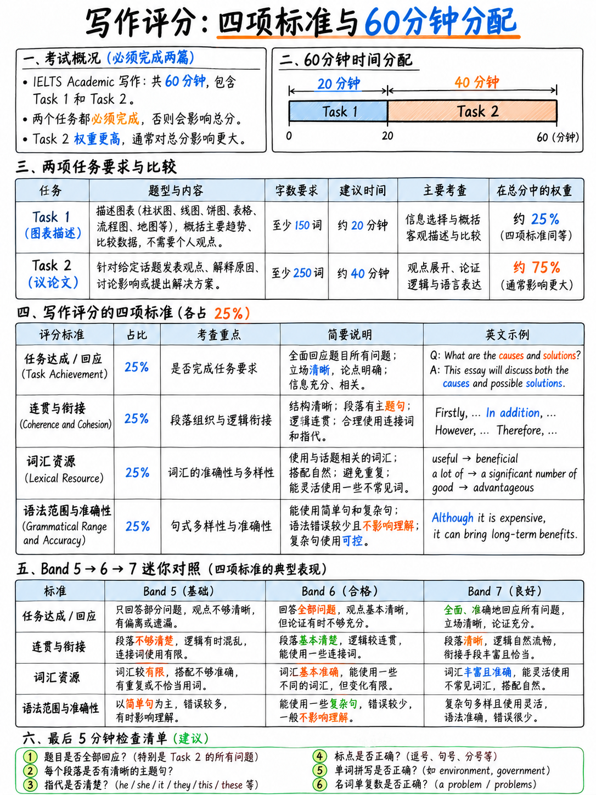

# 01. 雅思写作评分标准拆解：四项维度、字数红线与反模板避坑 (How Writing is Scored)



:::{admonition} 雅思写作核心参数一览 (At a Glance)
:class: tip
| 核心指标 | 官方标准要求 | 备考战术定位 |
|---|---|---|
| **考试总时长** | **60 分钟**，两项任务合并计时，无中场休息 `[1]` | 需严守时间分配：Task 1 占 20 分钟，Task 2 占 40 分钟 |
| **题量与形式** | **Task 1（图表/报告）** + **Task 2（议论文）**，两题均为必考 `[1]` | 2026 年全面机考，屏幕分栏实时字数统计，键盘键入 |
| **字数红线** | Task 1 **≥ 150 词**；Task 2 **≥ 250 词** `[1]` `[10]` | 低于红线直接扣除任务完成度分值；推荐安全区间：170-190 词 / 270-300 词 |
| **计分权重** | **Task 2 分值权重是 Task 1 的整整 2 倍**（占分比约 67% : 33%）`[10]` `[12]` | 绝不可在 Task 1 拖延超过 20 分钟；Task 2 是总分决定盘 |
| **考评机制** | 4 个独立评分维度均等加权，取算术平均后以 0.5 档四舍五入 `[7]` `[12]` | 由剑桥全球认证考官双盲批改，采用严苛的“短板锁死”准则 |
:::

---

## 1. 考官判分机制与致命的“短板锁死法则” (The Mechanics)

很多考生苦练多年，考场上写出了满纸华丽辞藻，出分却依然是刺眼的 5.5 或 6.0。其根本原因不在于词汇量，而在于**没有理解考官手上的判分尺子**。

根据官方评分准则（IELTS Writing Band Descriptors）`[8]` 的核心评阅规则：
> "A script must **fully fit the positive features** of the descriptor at a particular level; **bolded text in the descriptors indicates negative features that will limit a rating**." `[8]`

:::{important} 深度解码：“Fully Fit”与短板效应
官方评分采用的是**向下对齐的门槛制**，而非各项优点的加权中和制：
1. **你的每个单项得分取决于该维度中最薄弱的特征（Weakest Feature）**：如果你的大作文立论深刻、词汇高级，但全文只有一大段未分段，你的连贯与衔接（CC）将直接被锁死在 **Band 5**（因为 Band 6 明确要求“段落安排必须合乎逻辑，中心主题必须明确”）。
2. **修复致命短板的提分效益，远远大于拔高已有优势**：将一个 5 分的语法硬伤（如通篇逗号粘连、连接词泛滥）修复到 6 分标准，比把词汇从 6 分拔高到 7 分要容易十倍，但对最终写作总分的拉动力却完全一致！
:::

---

## 2. 两个与英语水平无关、却会直接招致扣分的致命死线

很多考生在没有展现任何语言能力之前，就已经在格式与审题上触碰了扣分红线。官方《Key Assessment Criteria》`[10]` 与官方真实样卷批注 `[12]` 明确警告：

> "Candidates should note that scripts may be penalised if they are:  
> **a) partly or wholly plagiarised (部分或全部抄袭/死记硬背),**  
> **b) not written as full, connected text (未写成完整连贯的文本，例如出现列点清单或提纲笔记形式).**" `[10]` `[12]`

### 禁忌一：严禁使用 Bullet Points、数字列表或提纲格式
- **考场绝对禁区**：无论时间多么紧迫，**绝不能使用任何圆点符号（Bullet points）、阿拉伯数字标号（1. 2. 3.）、箭头（→）或笔记简记**。
- **扣分性质**：雅思考试测试的是“学术连贯篇章写作”。出现列表直接破坏 Coherence & Cohesion，并将被考官判定为未完成的草稿，评分上限遭遇毁灭性封顶。

### 禁忌二：严禁直接抄写题干原句（Copied Rubric）
- 官方评分标准 Band 1 Task Achievement/Response 明确规定：**"Any copied rubric must be discounted"（所有直接抄自题目指令的文字，在统计有效字数时一律扣除）** `[8]`。
- **灾难连锁反应**：如果你在开头段照抄了 25 个词的题目，系统或考官在统计字数时会将这 25 词直接剔除。原本写了 255 词的文章瞬间跌破 250 词死线，直接触发字数不足的惩罚！
- **唯一解法**：用你自己的语言进行同义改写（Paraphrasing），详见后文实战方法。

---

## 3. 官方四大评分维度横向解密 (Band 5 vs 6 vs 7 逐字对比)

2023 年 5 月，雅思官方对写作公开评分量表进行了重要修订 `[8]`。绝大多数中国考生的出分区间都集中在 5.0 到 7.0 之间。透彻看清这三档之间的字面分水岭，是极速提分的关键。

### 维度一：Task Response (Task 2 大作文审题与立论)

| 档位 | 官方量表原文 (Official Descriptors) `[8]` | 中文深度剖析与核心分水岭 |
|---|---|---|
| **Band 7** | "The main parts of the prompt are appropriately addressed. A clear and developed position is presented. Main ideas are extended and supported but there may be a tendency to over-generalise or there may be a lack of focus and precision in supporting ideas/material." | **全面回应题干所有部分，且立场清晰展开。**<br/>每个核心观点都配有逻辑推导或例证（Extended and supported）；允许少数概括略显宽泛或论据不够精准，但论证链条完整。 |
| **Band 6** | "The main parts of the prompt are addressed (though some may be more fully covered than others). An appropriate format is used. A position is presented that is directly relevant to the prompt, although the conclusions drawn may be unclear, unjustified or repetitive. Main ideas are relevant, but some may be insufficiently developed..." | **回应了所有要点，提出了直接相关的立场，但展开不均。**<br/>可能某些要点写得多，某些写得仓促；立论基本明确，但结论可能略带重复或缺乏有力证明；观点切题，但缺乏深度推演。 |
| **Band 5** | "The main parts of the prompt are **incompletely addressed**. The format may be inappropriate in places. The writer expresses a position, but the development is not always clear. Some main ideas are put forward, but they are limited and are not sufficiently developed and/or there may be irrelevant detail..." | **题干核心要点回应不完整（严重漏答）！**<br/>立场不清晰或展开逻辑混乱；观点流于表面、未做实质论证，甚至出现跑题的无关细节。 |

:::{tip} 5分跨越到 6分的生命线：绝不漏答双核任务
中国考生在 Task Response 拿到 5 分的最常见死因，**不是论证深度不够，而是审题遗漏**！  
例如题目要求：“Discuss both views and give your own opinion”，包含**三大法定任务**：讨论正方观点、讨论反方观点、给出自己的鲜明立场。很多考生全文只讨论了正方，反方一笔带过，并且全文没有亮出自己的态度——这直接触发了 Band 5 的“incompletely addressed”。  
**考场动作**：动笔前先在草稿纸上数清楚题干到底问了几个问题，确保每个问题在正文里都有独立的段落承载！
:::

---

### 维度二：Task Achievement (Task 1 小作文图表完成度)

| 档位 | 官方量表原文 (Official Descriptors) `[8]` | 中文深度剖析与核心分水岭 |
|---|---|---|
| **Band 7** | "The response covers the requirements of the task... Key features which are selected are covered and clearly highlighted... **It presents a clear overview, the data are appropriately categorised, and main trends or differences are identified.**" | **必须呈现清晰的宏观概述 (Clear Overview)！**<br/>对数据进行了合理的分组归类，准确提炼出了核心趋势或主要差异；选取的关键特征得到了明确强调并有精确数据支撑。 |
| **Band 6** | "The response focuses on the requirements of the task... Key features which are selected are covered and adequately highlighted. **A relevant overview is attempted.** Information is appropriately selected and supported using figures/data. Some irrelevant, inappropriate or inaccurate information may occur..." | **尝试了概述 (Overview is attempted)，但不够清晰或放置位置不当。**<br/>能挑选主要特征并用数据支撑；可能存在少量无关细节或微小数据不准确，但总体完成了信息转述。 |
| **Band 5** | "The response generally addresses the requirements of the task... Key features which are selected are **not adequately covered**. The recounting of detail is **mainly mechanical**. There may be **no data to support the description**... There may be a tendency to focus on details (without referring to the bigger picture)." | **机械式流水账（极其致命）！**<br/>没有总结宏观大势（缺失 Overview），陷入孤立数字的机械罗列；或者只有主观描述而完全没有引用图表中的实际数字。 |

:::{important} 小作文斩获 6–7 分的三大机械硬指标
1. **宏观概述段 (Overview) 必须存在**：5 分无 Overview，6 分有尝试，7 分清晰准确。Overview 是小作文的灵魂，必须占据独立段落！
2. **必须引用具体数据支撑**：不能只写“A 比 B 高，随后剧烈上升”，必须跟上具体数字（“rose sharply from 20% to 55%”）。无数据直接掉入 5 分。
3. **拒绝流水账，必须分组与对比**：官方痛恨“mainly mechanical”——按年份从 1990 年流水账报数字报到 2020 年是典型的 5 分下场。必须提炼“谁增谁降”、“谁是领跑者”。
:::

---

### 维度三：Coherence and Cohesion (CC, 连贯与衔接)

| 档位 | 官方量表原文 (Official Descriptors) `[8]` | 中文深度剖析与核心分水岭 |
|---|---|---|
| **Band 7** | "Information and ideas are logically organised, and there is a clear progression throughout... A range of cohesive devices including **reference and substitution** is used flexibly... Paragraphing is generally used effectively..." | **信息组织合乎逻辑，全篇推演层次分明。**<br/>能灵活多样地使用衔接手段，尤其是高阶的**代词指代与词汇替代**；分段清晰自然，段内句际逻辑紧密。 |
| **Band 6** | "Information and ideas are generally arranged coherently and there is a clear overall progression. Cohesive devices are used to some good effect but **cohesion within and/or between sentences may be faulty or mechanical due to misuse, overuse or omission**. The use of reference and substitution may lack flexibility..." | **整体逻辑连贯，但在句内或句间衔接上存在机械化毛病。**<br/>常出现**衔接手段误用、过度使用（Overuse）或遗漏**；指代和替换不够灵活导致局部重复；分段可能偶尔不够精准。 |
| **Band 5** | "Organisation is evident but is not wholly logical... There may be **limited/overuse of cohesive devices** with some inaccuracy... The writing may be repetitive due to inadequate and/or inaccurate use of reference and substitution. **Paragraphing may be inadequate or missing.**" | **逻辑推进不明确，段落划分不足或混乱。**<br/>衔接词极端贫乏或**机械泛滥**；指代混乱导致句子高度重复，阅读体感生硬跳跃。 |

:::{danger} 彻底打破中国考生的最大迷思：滥用连接词（Overuse of Cohesive Devices）
许多辅导机构教导考生“每句话开头都要放一个连接词”：  
*Firstly, ... Moreover, ... Furthermore, ... In addition, ... Besides that, ... Last but not least, ...*  
**这是官方评分标准明确痛击的 Band 5 / Band 6 限制特征（Negative Limiting Feature）！**  
- 考官一眼就能识破这种机械填词的模板痕迹。
- **正确的连接词密度**：**全篇 250-280 词中，显性路标词总量控制在 6–8 个即可（平均每 2–3 句话才出现一个）**。
- 高分文章依靠的是**逻辑语义的内在流动**，以及下面介绍的“指代与替代”。
:::

---

### 维度四：Lexical Resource (LR, 词汇丰富度)

| 档位 | 官方量表原文 (Official Descriptors) `[8]` | 中文深度剖析与核心分水岭 |
|---|---|---|
| **Band 7** | "The resource is sufficient to allow some flexibility and precision. There is some ability to use **less common and/or idiomatic items**. An awareness of style and collocation is evident... There are only a few errors in spelling and/or word formation..." | **词汇灵活精准，能自如使用非常规词汇（Less common lexis）与地道搭配。**<br/>展现出良好的文体意识与搭配习惯（Collocation）；拼写与构词错误极少，且完全不影响理解。 |
| **Band 6** | "The resource is generally adequate and appropriate for the task... **If the writer is a risk-taker, there will be a wider range of vocabulary used but higher degrees of inaccuracy or inappropriacy.** There are some errors in spelling..." | **词汇基本充足；具有里程碑意义的“敢于冒险者条款”！**<br/>官方公开指出：如果考生敢于挑战高难度词汇，即使存在一定程度的不准确或不恰当，只要不阻碍交流，依然认可其 Band 6 词汇表现。 |
| **Band 5** | "The resource is limited but minimally adequate... Simple vocabulary may be used accurately but the range does not permit much variation in expression. There may be frequent lapses in the appropriacy of word choice, and a lack of flexibility is apparent in **frequent simplifications and/or repetitions**..." | **词汇极其受限，陷入“简化与重复”的死循环。**<br/>通篇不断重复 good, bad, many, people, important 等基础词汇；拼写错误频现，给读者理解造成阻碍。 |

:::{important} 官方“敢于冒险者条款 (Risk-taker Clause)”的实战指导价值
Band 6 官方描述中这段震撼的表述：  
*"If the writer is a risk-taker, there will be a wider range of vocabulary used but higher degrees of inaccuracy or inappropriacy."* `[8]`  
这直接宣告：**在考场上，尝试使用更高级、更学术的词汇，哪怕搭配略显生硬，也比通篇保守重复 20 遍简单词要好得多！**  
把你死死卡在 5 分的，绝不是拼错了一个复杂学术词，而是全篇毫无词汇变化的平庸重复。
:::

---

### 维度五：Grammatical Range and Accuracy (GRA, 语法多样性与准确性)

| 档位 | 官方量表原文 (Official Descriptors) `[8]` | 中文深度剖析与核心分水岭 |
|---|---|---|
| **Band 7** | "A variety of complex structures is used with some flexibility and accuracy. Grammar and punctuation are generally well controlled, and **error-free sentences are frequent**. A few errors in grammar may persist, but these do not impede communication." | **能灵活准确地使用多种复杂句式；无错句频繁出现（Error-free sentences are frequent）！**<br/>语法与标点符号控制良好；可能偶有小错，但丝毫不影响语义传递。 |
| **Band 6** | "A mix of simple and complex sentence forms is used but flexibility is limited. Examples of more complex structures are not marked by the same level of accuracy as in simple structures. Errors in grammar and punctuation occur, but **rarely impede communication**." | **能混合使用简单句与复合句，复杂句准确度稍逊，但极少妨碍沟通。**<br/>官方明确承认：在 Band 6 水平下，考生在写从句、分词短语等复杂结构时犯错是完全可接受的，只要读者能读懂即可！ |
| **Band 5** | "The range of structures is limited and rather repetitive. Although complex sentences are attempted, they tend to be faulty, and the greatest accuracy is achieved on simple sentences... **Punctuation may be faulty.**" | **句式单一且单调重复；复杂句尝试往往全面溃败。**<br/>只能写简单的主谓宾单句；语法错误频繁导致读者理解困难；标点符号错误频发。 |

---

## 4. 标点符号直接计入语法分 (Punctuation is a Grammar Mark)

在官方标准中，标点符号（Punctuation）被直接归入 **GRA（语法维度）** 进行严苛考核 `[10]`。Band 5 GRA 明确将“标点符号错误 (Punctuation may be faulty)”列为封顶红线 `[8]`。

中国考生必须牢记的五大标点绝对法则：

| 规则名称 | 错误示范 (Wrong) | 正确改写 (Right) | 核心原理解析 |
|---|---|---|---|
| **严禁逗号粘连 (No Comma Splice)** | Cars cause pollution, they should be banned. | Cars cause pollution**, so** they should be banned.<br/>*或* Cars cause pollution**. They** should be banned. | **雅思最常见的语法车祸！** 两个独立完整句子绝对不能只用一个逗号相连。必须加并列连词 (and, but, so) 或拆为句号。 |
| **前置状语后必须加逗号** | In many developing countries public transport is poor. | In many developing countries**,** public transport is poor. | 时间、地点、条件等状语短语置于句首时，必须用逗号与主句主语隔开，建立停顿层次。 |
| **that 引导的宾语从句前绝不加逗号** | Some people argue**, that** university should be free. | Some people argue **that** university should be free. | that 引导宾语从句或同位语从句时，与主句主谓关系紧密，严禁插入逗号。 |
| **定语从句逗号规则** | The policy which was introduced in 2020 has failed. *(若为非限定)* | The policy**, which was introduced in 2020,** has failed. *(非限定修饰)*<br/>The policy **that** was introduced has failed. *(限定修饰)* | which 引导非限制性定语从句（作补充说明）两端必须加逗号；that 引导限制性从句前面绝不加逗号。 |
| **专有名词首字母强制大写** | many english students study in australia in july | many **E**nglish students study in **A**ustralia in **J**uly | 国籍、语言、月份、星期、地名等专有名词必须大写，机考中大小写混淆会被扣除语法准确度分。 |

:::{tip} 逗号粘连（Comma Splice）的一秒急救公式
如果你发现自己把两个完整的单句用逗号串在了一起，请立刻套用四连词公式：**so, but, because, although**。  
例如：*Tuition fees are high, many students borrow money.*  
急救为：*Tuition fees are high, **so** many students borrow money.* 或者 *Because tuition fees are high, many students borrow money.*
:::

---

## 5. 指代与替代：被严重低估的 CC 提分黑马 (Reference and Substitution)

Band 6 和 Band 7 的连贯度描述中均高度强调 **"reference and substitution"（指代与替代）** `[8]` `[10]`。这是考官评估学术成熟度的关键标志，也是摆脱简单连接词滥用、避免词汇重复的最高级手段。

| 替代与指代手法 | 错误/机械重复示范 | 高阶学术改写示范 | 考官评分收益 |
|---|---|---|---|
| **人称与代词指代 (Pronouns)** | The government should invest in green energy. The government must also... | The government should invest in green energy. **It** must also... | 避免主语生硬重复，建立顺畅句际承接 |
| ***This / These* + 概括名词** | Many commuters cycle to work. Cycling to work reduces... | Many commuters cycle to work. **This habit** reduces emissions... | **学术写作王牌！** 用 this trend / this approach / these figures 高度概括前句 |
| ***Such* + 抽象名词** | Cities suffer from noise, pollution and traffic. Noise, pollution and traffic are... | Cities suffer from noise, pollution and traffic. **Such issues** are... | 将并列细节一网打尽，推进论述层级 |
| ***The former / The latter*** | Online courses and traditional degrees both have merits. Online courses are cheaper... | Online courses and traditional degrees both have merits. **The former** are cheaper... | 精确对比前后两项，展现严谨论述逻辑 |
| ***Do so / Doing so*** | Governments could raise fuel taxes. Raising fuel taxes would discourage... | Governments could raise fuel taxes. **Doing so** would discourage... | 完美避免动名词短语在相邻句中的刻板重复 |
| ***One / Ones*** | This measure is a practical solution, and another solution is... | This measure is a practical solution, and another **one** is... | 代替前文出现的单复数可数名词 |
| **定冠词定指 (The + noun)** | A recent survey showed that... A recent survey found that... | A recent survey showed that... **The study** also indicated that... | 从不定引入过渡到确定指向，学术感跃升 |

在通篇大作文中自然融入 3–4 次此类替代结构，你的 CC 评分将直接跃上 Band 7，同时彻底消除触发 Band 5 LR 的词汇重复危机！

---

## 6. 题目同义改写四大必杀技 (Paraphrasing the Prompt)

无论是 Task 1 还是 Task 2，开头段第一句都必须改写题目要求。以下是四种最稳定可靠的改写招式：

```
                    ┌── 1. 词性转换 (Word Class Shift: 动词变名词)
                    ├── 2. 语态重组 (Voice Shift: 主动变被动)
改写四大利器 ────────┼── 3. 核心名词同义替换 (Synonym / Umbrella Shift)
                    └── 4. 句式结构重构 (Structural Frame Shift)
```

| 改写方法 | 原题干语句 (Original Prompt) | 高分改写范式 (Paraphrased Version) | 技法精析 |
|---|---|---|---|
| **1. 词性转换** | Some people believe **governments should invest** in public transit. | **Government investment** in public transit is considered essential by many. | 将动词短语 invest in 转换为名词短语 government investment，语法层级瞬间提升 |
| **2. 语态重组** | Many countries **have banned** single-use plastics. | Single-use plastics **have been banned** across numerous nations. | 将主动语态换为被动语态，将焦点转移至客观事物上，符合学术客观文体 |
| **3. 核心名词替换** | The chart compares **cars, buses and trains**... | The chart compares three modes of **private and public transport**... | 不逐一硬背同义词，而是提炼其**上位概括词（Umbrella Category）** |
| **4. 句式框架重塑** | To what extent do you agree or disagree? | This essay will argue that such a measure is entirely justified... | 彻底重写引言主句框架，直接无缝引出作者中心论点 |

:::{warning} 严禁“强迫症式全词替换”
很多考生误以为改写必须把题目中的每一个单词都换掉，结果强行把 *children* 换成 *offspring*（极度不地道），把 *government* 换成不恰当的词汇。  
**学术核心词无需替换**：像 *government, education, environment, technology, healthcare* 这些高度精炼的专门领域名词，全世界都在通用，强行替换只会触发 Band 5 的“选词不当（inappropriacy of word choice）”。**只需改换 2 个实词搭配 + 翻转句子语法结构，就是标准的满分改写！**
:::

---

## 7. 考场 60 分钟黄金时间分配与心流节奏 (The 60-Minute Schedule)

```
   ┌──── TASK 1 学术图表报告 (严格锁定 20 分钟 · 约 170-190 词) ────────┐
   │  00–03 分钟  【极速审题与全局透视】看清图表类型、坐标单位、时间跨度；提炼宏观大势 (Overview) │
   │  03–05 分钟  【数据科学分组】严禁流水账；规划 Body 1 与 Body 2 的分组依据 (增 vs 降/高 vs 低) │
   │  05–17 分钟  【高速成文撰写】开头改写(1句) + Overview(1-2句) + Body 1(3-4句) + Body 2(3-4句) │
   │  17–20 分钟  【精准死线自查】检查时态一致性、数据抄录准确度、名词单复数与词数下限 (≥150词)  │
   └───────────────────────────────────────────────────────────────────────┘
                                      ▼ 20 分钟物理熔断，无论写到何种程度，立刻转入大作文
   ┌──── TASK 2 议论文大作文 (严格锁定 40 分钟 · 约 270-300 词) ────────┐
   │  20–25 分钟  【严谨审题与思维导图】圈出所有提问与限制词；确立鲜明核心立场；列出两段分论点与具体例证 │
   │  25–55 分钟  【逻辑深度推进】引言段(改写+亮立场) + 主体1(PEEL推演) + 主体2(PEEL推演) + 结论段  │
   │  55–60 分钟  【终极高危排雷】通篇扫描逗号粘连、冠词丢失、动词三单、连词密度、段落清晰度    │
   └───────────────────────────────────────────────────────────────────────┘
```

:::{important} 考场铁律：Task 1 实行 20 分钟物理熔断
如果在考场上 Task 1 耗费了 30 分钟，你的 Task 2 就只剩 30 分钟。  
**Task 2 占据写作总成绩的 2/3 权重**！一篇字数不足、仓促结尾的 Task 2，对总分的毁灭性打击是完美 Task 1 无论如何也无法弥补的。到 20 分钟时，哪怕 Task 1 漏写了一组数据，也必须立刻保存并强行切换到 Task 2！
:::

---

## 8. 考场交卷前 5 分钟极速排雷清单 (The 5-Minute Checklist)

写作最后 5 分钟，不要再去尝试构思更宏大的新论点。**专注于捕捉这七项低级但昂贵的语法与格式漏洞**，每抓出一个就能为你抢回 0.5 分：

1. **名词复数 -s 遗漏**：快速扫描可数名词，检查 *Many student → Many students*，*different country → different countries*。
2. **第三人称单数 -s 遗漏**：检查现在时主谓一致，*The chart show → The chart shows*，*The policy encourage → The policy encourages*。
3. **冠词 a / an / the 缺失**：检查单数可数名词前是否都有冠词或限定词修饰。
4. **逗号粘连排查**：扫视全文所有逗号，凡是逗号两侧都是完整主谓句的，立刻补上 *and / but / so* 或改为句号。
5. **小作文数据核对**：检查写进文章里的每一个数字，是否与题目图表坐标轴完全一致，单位是“千”、“百万”还是“百分比”。
6. **字数红线自查**：机考界面底部实时显示字数，确认 Task 1 ≥ 150 词，Task 2 ≥ 250 词。
7. **视觉段落空行**：段落之间是否有明显的换行空行（机考推荐双回车空一行），确保考官一眼看清四段式骨架。

---

**上一章：** {doc}`../20-speaking/06-speaking-practice-bank` | **下一章学习指南：** {doc}`02-task-1-academic`
