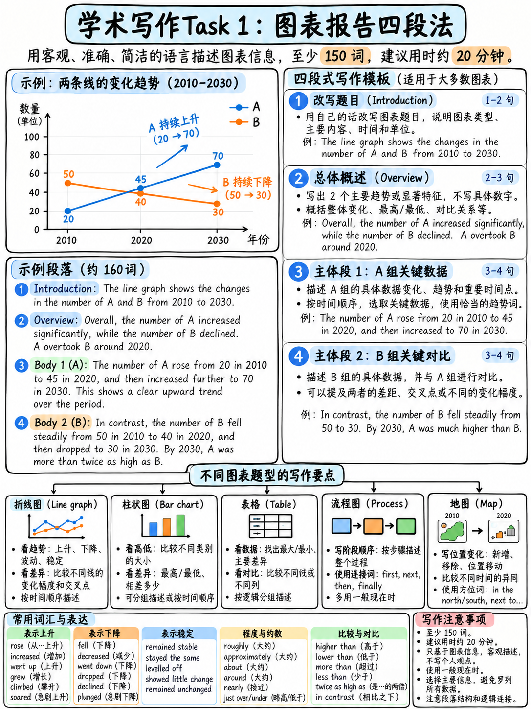

# 02. Task 1 学术类图表报告：四段式结构、Overview 核心法则与数据选取 (Task 1 Academic)



:::{admonition} Task 1 核心参数与任务性质一览
:class: tip
| 核心指标 | 官方标准要求 | 备考战略与考场定位 |
|---|---|---|
| **建议用时** | **严格限制在 20 分钟内** `[1]` | 20 分钟必须强制交卷/切换至大作文，绝不恋战 |
| **最低词数** | **至少 150 词 (≥ 150 words)** `[1]` | 建议黄金词数区间：**170–190 词**，既充分覆盖又防超时 |
| **分值占比** | 约占整个 Writing 卷面分的 **1/3** `[10]` | 属于典型的“投入产出比极高、靠套路即可稳拿 6.5–7.0”的题型 |
| **题目性质** | **客观学术信息转述任务 (Information-transfer task)** `[10]` | 严禁任何个人主观臆断、原因脑补或评价抒情 |
| **考查题型** | 线图、柱图、饼图、表格、地图、流程图、混合图 | 掌握一套通用的四段式逻辑，万变不离其宗 |
:::

---

## 1. 为什么 Task 1 是雅思考试中最容易拿高分的单项？

官方《Key Assessment Criteria》`[10]` 对学术类 Task 1 的定义，值得每一位考生反复精读：

> "This Writing task has **a defined input and a largely predictable output**. It is basically an **information-transfer task**, which relates narrowly to the factual content of a diagram, graph, table, chart, map or other visual input, **not to speculative explanations that lie outside the given data**." `[10]`

这段官方定调揭示了 Task 1 的核心秘密：
1. **输出高度可预测（Predictable Output）**：Task 2 大作文要求考生构建论点、提供论据，依赖考生的思维广度与学术语言组织；而 Task 1 仅仅是一项**“客观信息转述任务”**——图表把所有事实都摊在桌面上，你需要做的只是**“按既定学术规程挑选重点、分组数据并进行对比”**。
2. **只要方法正确，人人皆可在短时间内掌握**：它不考验你的创造力，纯粹考验你是否掌握了标准化的报告结构与精准的数据对比语言。

:::{danger} 绝对禁区：严禁为数据变动脑补客观原因！
官方标准明确标红：**"not to speculative explanations that lie outside the given data"** `[10]`。  
很多中国考生在看到图表中“自行车使用率上升、汽车使用率下降”时，会情不自禁地写上一句：  
*“This was probably because fuel prices increased and people wanted to live a healthier lifestyle.”*  
**这是极其严重的失分行为！** 任何脱离图表数据本身的因果猜测，考官都无法给予任何分数认可，反而白白浪费宝贵的答题字数与时间。你的唯一职责就是：**客观陈述趋势，精确对比数字**。
:::

---

## 2. 任务完成度 (Task Achievement) 官方五大考核准则

从官方 TA 维度的官方量表细则 `[8]` `[10]` 中，我们可以提炼出五项硬性执行动作：

| 官方硬性要求 | 考场具体落地操作 (Actionable Execution) | 避坑警示 |
|---|---|---|
| **1. 提炼关键特征 (Select key features)** | 选取图表中 **3–5 个最显著的特征**（起点终点、最高最低值、急剧反转、显著交叉点）。 | 绝不要像报账一样把图中的 15–20 个数字逐一罗列，那属于 Band 5 机械描述。 |
| **2. 详实数据支撑 (Sufficient detail)** | 文中提及的每一个核心趋势或主要特征，都必须绑定**具体的数值或百分比**。 | 空泛谈论“A 远高于 B 且大幅上涨”而通篇不写数字，直接被降级至 Band 5。 |
| **3. 准确报告数据 (Report accurately)** | 仔细核对坐标轴单位（如千人、百万、百分比）及时间跨度，数字誊抄分毫不差。 | 把百分比写成绝对数值，或把 2010 年的数据抄错，属于严重事实准确度缺陷。 |
| **4. 深度对比与对照 (Compare or contrast)** | **全文必须包含至少 4–5 个对比句**！突出数据之间的相对差距、倍数关系与排名变动。 | 只单独写各组数据走势却不做横向对比，是绝大多数考生被扣在 5.5 分的元凶。 |
| **5. 采用合规报告文体 (Appropriate format)** | 引言改写 + 独立宏观概述段 + 两个逻辑主体段；**严禁使用任何列表或笔记格式**。 | 杜绝第一人称主观抒情（如 I think, in my view），保持学术报告的客观第三人称。 |

---

## 3. 官方满分四段式报告架构与 Overview 黄金法则

Task 1 最稳妥、最高效的行文骨架是**“四段式报告法”**。全文约 170–190 词，无需单独写结尾段。

```
   ┌──────────────────────────────────────────────────────────────────┐
   │ 1. INTRODUCTION (题目改写) — 1 句话，约 20–25 词                  │
   │    同义改写图表题干，清晰交代：图表类型、研究主题、地点范围、时间跨度与数据单位。│
   ├──────────────────────────────────────────────────────────────────┤
   │ 2. OVERVIEW (宏观概述段) — 1–2 句话，约 35–45 词                  │
   │    【核心灵魂】提炼图表的“宏观全局特征 (The Big Picture)”！             │
   │    • 总体趋势：谁一路狂飙？谁持续萎缩？                                  │
   │    • 极值与格局：谁全程领跑占据绝对主导？谁始终垫底？                     │
   │    ★ 黄金铁律：概述段内【严禁出现任何具体数字】！只讲大势，数字留给主体段。    │
   ├──────────────────────────────────────────────────────────────────┤
   │ 3. BODY PARAGRAPH 1 (主体段一：第一分组) — 3–4 句话，约 55–65 词   │
   │    聚焦第一组逻辑数据（如所有上升的项目，或体量最大的龙头），给出具体数值与比较。│
   ├──────────────────────────────────────────────────────────────────┤
   │ 4. BODY PARAGRAPH 2 (主体段二：第二分组) — 3–4 句话，约 55–65 词   │
   │    聚焦第二组逻辑数据（如下降/平稳项目，或中下游项目），与第一段数据展开对比。   │
   └──────────────────────────────────────────────────────────────────┘
                      全文总计 ≈ 175–195 词（安全充实且高效）
```

:::{important} 为什么 Overview（概述段）必须放在第二段，而不是文章末尾？
官方评分标准 Band 5 无 Overview，Band 6 尝试概述，Band 7 呈现清晰的 Overview `[8]`。把 Overview 放在第二段拥有两大绝对战术优势：
1. **防止超时猝死**：如果在考场上时间紧迫，20 分钟耗尽时你只写完前两段，**这篇作文依然拥有一段完美的 Overview**，保底锁定 Band 6/7 的 TA 核心得分点；如果放在末尾，一旦时间耗尽没来得及写结尾，该项直接暴跌至 Band 5！
2. **逻辑框架先行**：符合正统学术报告先总后分的逻辑（Executive Summary 先行），考官能率先了解大局，极大地助力 Coherence & Cohesion（连贯度）得分。
:::

---

## 4. 数据科学分组决策树 (How to Group the Data)

小作文审题的前 3 分钟内，**唯一需要动脑做出的重大决策就是“如何科学分组”**。分组是否合理，直接决定了你的连贯度与对比质量。

| 图表类型 | 核心分组策略 (How to Group) | 考场具体分组切分点 |
|---|---|---|
| **动态多线图 (Line Graph)** | **按走势形态 (Direction & Shape) 分组** | **Body 1**：所有呈上升趋势的线条（含起止点与峰值数据）<br/>**Body 2**：所有呈下降或平稳波动的线条，加上两者交叉对比 |
| **动态双线图 (Two Lines)** | **按主体对象分别描述，重在交织对比** | **Body 1**：线条 A 的全周期演变<br/>**Body 2**：线条 B 的全周期演变，重点描写超越/落后于 A 的时刻 |
| **静态柱状图/表格 (Single Point)** | **按体量规模 (Size & Dominance) 分组** | **Body 1**：排名前二或前三的领跑主力（占绝大多数份额）<br/>**Body 2**：中下游排名的梯队与尾部少数派，突出倍数差距 |
| **双饼图/多饼图 (Pie Charts)** | **按变迁规律或结构主次分组** | **Body 1**：份额显著扩大的板块<br/>**Body 2**：份额急剧缩水或保持不变的板块，对比结构性重组 |
| **流程图 (Process Diagram)** | **按自然生产阶段 (Phases) 切分为两半** | **Body 1**：前期阶段（原材料采集、清洗、预处理）<br/>**Body 2**：后期阶段（深度加工、成型、质检与包装分发） |
| **双期地图题 (Maps)** | **按“显著变化”与“保持原貌”分组** | **Body 1**：拆除、扩建、新建等所有剧烈改动的区域<br/>**Body 2**：道路格局微调，以及全程保留未变的区域（如林地） |
| **组合图 (Mixed Charts: 如柱+表)** | **一图一段，段末联动** | **Body 1**：第一幅图的核心特征与数据<br/>**Body 2**：第二幅图的特征与数据，最后一句指出两图关联 |

:::{tip} 绝对避开的下策：严禁按“时间轴前一半与后一半”强行切割！
在描写 1990–2020 年的多线图时，绝不能 Body 1 写 1990–2005 年的所有数据，Body 2 写 2005–2020 年的数据！这种切法将完整的趋势生生打断，不仅逻辑割裂，还会产生极其严重的机械化罗列，直接被考官判定为 Band 5 的流水账。
:::

---

## 5. 小作文时态决策雷达图 (Tense Radar)

时态错误属于 GRA（语法维度）最刺眼的低级失误。开篇动笔前花 5 秒钟扫一眼横坐标时间：

```
                    ┌── 1. 全程发生在过去年份 (如 1990–2015) ────────► 绝大部分：过去一般时 (Past Simple: rose, fell)
                    ├── 2. 预测涉及未来年份 (如 2030, 2040) ─────────► 预测句式：is projected to / will / is expected to
时态选择决策雷达 ───┼── 3. 无任何时间标注 (单一年份现状切片) ──────► 全程：一般现在时 (Present Simple: accounts for, is)
                    ├── 4. 工业生产/自然生命流程图 (Process) ────────► 全程：一般现在时被动语态 (is washed, are melted)
                    └── 5. 过去至今的历史变迁地图 (Maps) ────────────► 变迁用现在完成时被动 (has been built) 或 过去时
```

| 图表时间背景 | 推荐时态体系 | 规范示范例句 |
|---|---|---|
| **过去既定历史数据** | **过去一般时 (Past Simple)** | Car production **increased** significantly between 2000 and 2010. |
| **未来预测与展望** | **将来时态 / 预测被动语态** | Renewable energy **is projected to account for** 45% of total supply by 2040. |
| **单一切片静态快照** | **一般现在时 (Present Simple)** | Mobile phones **represent** the largest proportion of electronic waste. |
| **流程图 (Process)** | **一般现在时被动语态** | The cocoa beans **are fermented** and then **dried** in the sun. |
| **历史至今日地图 (Maps)** | **现在完成时被动语态 + 现在时** | The old dock **has been converted into** a marina, which **now attracts** tourists. |

---

## 6. 动态与静态小作文必背核心语料库 (The Lexical Toolkit)

### (1) 动态变动动词与名词矩阵 (Verbs & Nouns of Change)

| 变化方向 | 动词 (Past Simple) | 对应名词形式 (Noun Form) | 替换例句演示 |
|---|---|---|---|
| **大幅上升** | rose / jumped / climbed / surged | a sharp rise / a significant jump | Sales **rose sharply**. → There was **a sharp rise** in sales. |
| **持续增长** | increased / grew | a steady increase / gradual growth | The figure **increased steadily**. → The figure showed **steady growth**. |
| **急剧下降** | fell / plummeted / plunged / dropped | a steep fall / a dramatic drop | Profits **plummeted** in 2020. → There was **a dramatic drop** in profits. |
| **缓慢下滑** | decreased / declined | a slight decline / a gradual decrease | Numbers **declined gradually**. → The data experienced **a gradual decrease**. |
| **维持平稳** | remained stable / levelled off / plateaued | a period of stability / a plateau | The rate **levelled off** at 40%. → It reached **a plateau** at 40%. |
| **剧烈波动** | fluctuated / varied | wide fluctuations / substantial variation | Prices **fluctuated wildy**. → Prices experienced **wide fluctuations**. |
| **达到峰值** | peaked at / reached a peak of | a historic peak | Production **peaked at** 5,000 units in August. |
| **触及谷底** | bottomed out at / hit a trough | a record low | Revenue **bottomed out at** $1.2 million. |

:::{tip} 句式丰富度速成法：动词与名词句式的“镜像交替”
考官在 GRA 维度考察考生是否具备灵活转换句式的能力：  
- **句型 A (动词+副词)**：*Tourist arrivals **grew substantially** to reach 10 million in 2015.*  
- **句型 B (There be + 形容词 + 名词)**：*There was **a substantial growth** in tourist arrivals, reaching 10 million in 2015.*  
- **句型 C (主语 + saw / witnessed / experienced + 形容词 + 名词)**：*The year 2015 **witnessed a substantial growth** in tourist arrivals.*  
在主体段中交替使用这三种形态，语法多样性分数立竿见影。
:::

---

### (2) 程度与速度修饰词库 (Adverbs & Adjectives)

| 程度级别 | 形容词 (用于修饰名词) | 副词 (用于修饰动词) | 语感与使用场景 |
|---|---|---|---|
| **幅度巨大/剧烈** | dramatic, sharp, steep, substantial | dramatically, sharply, steeply, substantially | 适用于短期内爆发性增长或断崖式下跌 |
| **幅度显著/可观** | significant, considerable, marked | significantly, considerably, markedly | 适用于肉眼可见的明显阶梯式变动 |
| **幅度平缓/平稳** | steady, consistent, gradual | steadily, consistently, gradually | 适用于长周期内匀速平稳的上升或下降 |
| **幅度微弱/轻微** | marginal, slight, negligible | marginally, slightly, negligibly | 适用于几乎没有太大变化的细微浮动 |
| **变动速度极快** | rapid, swift, sudden | rapidly, swiftly, suddenly | 适用于突发性的急速变化 |

---

### (3) 静态对比与占比高分表达库 (Comparison & Proportions)

| 对比功能 | 推荐高分句式与表达 | 考场实战例句 |
|---|---|---|
| **远高于 / 远低于** | far higher than / substantially lower than | Coal consumption was **far higher than** that of solar energy. |
| **倍数关系** | twice as high as / three times the figure for | The budget for healthcare was **more than twice as high as** education. |
| **几乎相同** | roughly equal to / comparable to / almost identical to | Expenditure on food was **comparable to** that on housing. |
| **最大份额** | accounted for the largest share / made up the bulk of | Private vehicles **accounted for the largest share** of daily journeys. |
| **占比多重替换** | comprise / represent / make up / constitute | Renewable sources **constituted** approximately 25% of total output. |
| **二者对比转折** | whereas / while / by contrast / compared with | Sales in Asia surged, **whereas** those in Europe remained unchanged. |
| **数据反超** | overtook / surpassed / eclipsed | Online sales **overtook** high-street purchases in 2018. |

:::{danger} 严禁混淆：Percentage 与 Percentage Points
当两个百分比数字进行相减时，其差值必须使用 **Percentage Points（百分点）**，绝对不能写百分比！  
- **错误示范**：*The rate rose from 40% to 50%, which was an increase of 10%.* （40% 增加 10% 是变成 44%，这是重大的逻辑与数学错误！）  
- **正确规范**：*The rate rose from 40% to 50%, an increase of **10 percentage points**.*
:::

---

### (4) 极其重要的安全估算词汇 (Approximation)

雅思图表往往刻度粗糙，不可能精确读出“23,812”这样的数字。**胡乱编造精确数字会被判定为事实不准确 (Inaccuracy)**！必须大量使用严谨的学术估算词：

| 估算区间 | 权威估算表达 |
|---|---|
| **略多于...** | just over, slightly above, marginally higher than |
| **略少于...** | just under, a little below, slightly less than |
| **大约 / 左右** | approximately, roughly, about, around, in the region of |
| **接近 / 将近** | nearly, almost, approaching, well over |

---

## 7. Task 1 全题型高分可替换弹性句架库 (Sentence Frames)

### 引言段改写 (Introduction Frames)
- **图表通用**：`The [line graph / bar chart / table] [shows / illustrates / compares] [核心变量] in [地点] over a [X]-year period between [年份] and [年份].`
- **静态多项**：`The [pie charts / table] give information about the proportion of [研究对象] categorized by [分类标准] in [年份].`
- **流程图**：`The diagram illustrates the sequential process by which [产品/自然物] is [produced / manufactured / recycled].`
- **地图变迁**：`The two maps delineate the main infrastructural transformations that took place in [地点] between [年份] and [年份].`

### 宏观概述段 (Overview Frames — 严禁任何具体数字！)
- **趋势反差**：`Overall, it is immediately apparent that while [项目A] experienced a sustained upward trend, [项目B] exhibited the opposite trajectory.`
- **主导地位**：`It is clear that [项目A] remained the dominant category throughout the entire period, despite a narrowing gap towards the end.`
- **反超现象**：`Overall, the most striking feature is that [项目A] overtook [项目B] around midway through the timeline to become the most prevalent choice.`
- **流程总括**：`Overall, the production cycle consists of [数字] distinct stages, commencing with [首个工序] and culminating in [最终分发/包装].`
- **地图总括**：`Overall, the landscape was modernized significantly, shifting from a predominantly rural setting to an extensively developed residential hub.`

### 主体段核心数据描写与对比句式 (Body Frames)
- `In [年份], the figure for [A] stood at [数字], before [climbing / dropping] to [数字] by [年份].`
- `[项目A] accounted for [数字]%, which was more than double the corresponding proportion for [项目B] (just [数字]%).`
- `The most dramatic divergence occurred between [年份] and [年份], when [A] surged by [数字], whereas [B] plateaued at [数字].`
- `Although [A] and [B] began at virtually identical levels (roughly [数字] each), their paths diverged substantially thereafter.`

---

## 8. Task 1 八大最高频暴扣分雷区速查清单

| 常见死穴 | 扣分归属维度 | 致命后果分析 | 考场一秒纠偏 SOP |
|---|---|---|---|
| **完全漏写 Overview** | Task Achievement | 直接封顶于 **Band 5** | 强制在开头改写后另起一行，用 "Overall, it is clear that..." 写出宏观大势 |
| **在 Overview 塞入具体数字** | Task Achievement | 混淆宏观趋势与微观细节 | 概述段里把所有阿拉伯数字一律删除，只谈趋势方向与相对主次 |
| **通篇报账式罗列数字** | Task Achievement / CC | 触发 "mainly mechanical" 惩罚 | 挑选 3–5 个核心数据点，至少加入 4 句包含 whereas / compared to 的对比句 |
| **整篇作文没有任何数字支撑** | Task Achievement | 触发 "no data to support description" | 主体段中每个主要趋势后面必须紧跟括号或破折号标注具体数值 |
| **给图表擅自脑补主观原因** | Task Achievement | 偏离题干，消耗有效字数 | 只要脑海中出现 "because", "due to lack of money"，立即删除 |
| **开头句直接抄写题目原话** | Task Achievement / LR | 抄写文字被考官用横线划掉不计字数 | 运用“动词变名词”和“主动变被动”进行 100% 同义改写 |
| **时态前后混乱穿插** | Grammar (GRA) | 严重损害语法准确度 | 开考先圈出年份，过去的年份通篇锁定过去时，绝不随意跳跃 |
| **把绝对数值与百分比混淆** | Task Achievement / GRA | 事实准确性重大翻车 | 审题第一眼先盯紧纵坐标刻度单位（是 % 还是 thousands） |

---

**上一章：** {doc}`01-how-writing-is-scored` | **下一章学习指南：** {doc}`03-task-1-worked-examples`
