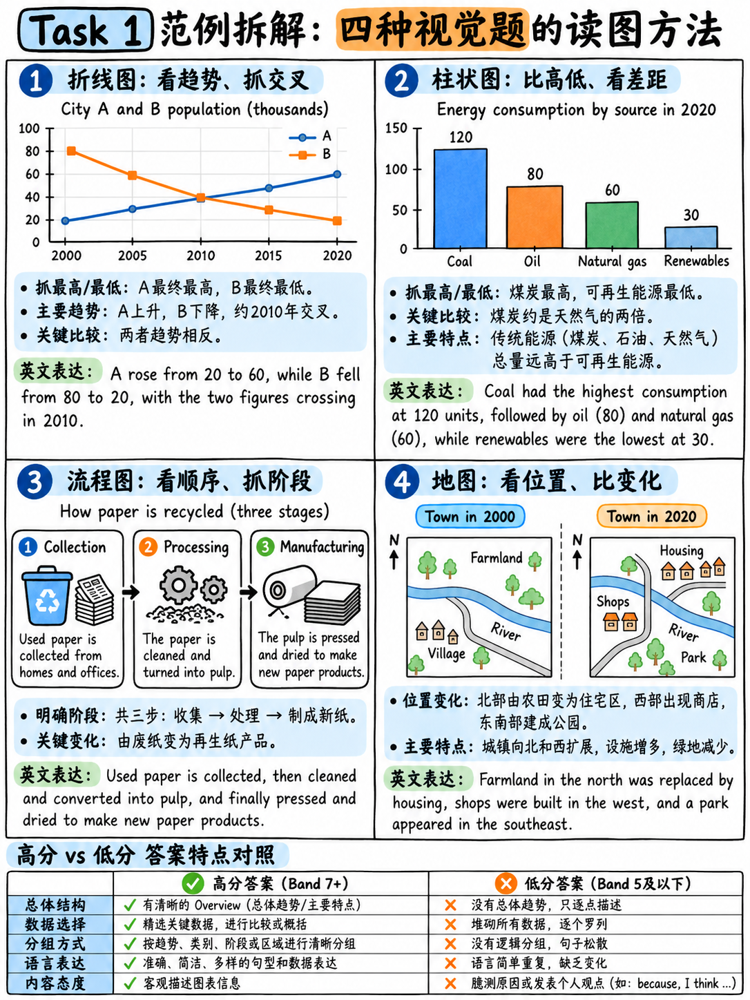

# 03. Task 1 全题型高分范文与精细拆解：线图、柱图、饼图、表格、地图与流程图 (Task 1 Worked Examples)

:::{admonition} 本章研读战略导读
:class: tip
学习小作文最忌讳“生吞活剥死记硬背”。本章精选**官方真实考生答卷（Band 6 与 Band 4 官方考官逐字评析）**，并呈献**涵盖学术类 Task 1 六大题型（线图、柱图、饼图、表格、流程图、地图）的高分标准范文**。每篇范文均严格执行“四段式结构 + 无数据 Overview + 科学数据分组 + 深度多维对比”，配有详尽的逻辑拆解与词汇语法批注。
:::

---

## 1. 官方真实考卷与考官逐字评析精读 (Official Examiner Feedback)

在研读自研范文前，必须先看雅思官方发布的唯一真实带分公开样卷 `[12]`。  
**原题任务**：对比 1990 年与 2010 年英国儿童上学出行方式的变化（步行、私家车、自行车、公交车、步行加公交）。

### (1) Band 6 真实考卷：考官赞赏了什么？又扣了什么分？

官方认证考官评语原文（Examiner Comments）`[12]`：
> "The key features which are selected are covered and clearly highlighted, but **reporting is somewhat mechanical** and **data is provided to support only some of the descriptions**. There is **a relevant overview in the final paragraph**, with a summary of the main changes. Information and ideas are generally arranged coherently, though **there is some repetition [number of trips]**. Cohesive devices are used effectively and there is a clear progression overall.  
> The range of vocabulary is sufficient to allow some flexibility, with some less common items. For a higher band, a wider range of vocabulary could be used, within the scope of the task. There is a mix of simple and complex sentence structures, used fairly accurately, but again, **there is not a wide enough variety of structures to achieve a higher band**." `[12]`

**从考官原话中提炼的四大提分玄机：**

| 考官评语核心词 | 官方潜台词与深层诊断 | 你的实战纠偏动作 |
|---|---|---|
| *"reporting is somewhat mechanical"* | 考生只是按部就班地描述数字，缺乏高级的**动态关联与横向对比**。 | 杜绝单线报账，务必使用 *whereas, compared with, surpassed* 进行多维比较。 |
| *"data is provided to support only some of the descriptions"* | 考生有些地方只写了趋势，却**忘记给具体数字**。 | 凡是提到主干特征，必须用括号或小分句跟上精确数据。 |
| *"there is a relevant overview in the final paragraph"* | 即使概述段放在最后一段，考官依然予以承认，但放到**第二段**更为清晰且防超时。 | 强制将 Overview 锁定在第二段，开篇确立宏观基调。 |
| *"there is some repetition [number of trips]"* | 通篇反复出现同一专有名词短语，直接拉低了词汇丰富度（LR）和连贯度（CC）。 | 善用代词和概括词进行指代替代（如 *this figure, these journeys, such travel*）。 |

---

### (2) Band 4 真实考卷：导致毁灭性扣分的死穴

官方认证考官评语原文（Examiner Comments）`[12]`：
> "This response does generally try to address the requirements of the task but the key features are not adequately covered. Limited detail is provided, for example, **there is no reference to the 'walking and bus' categories**. Information is presented, but it is **difficult to identify organisation** and there is no clear progression within the response. There are some cohesive devices but these are mostly inaccurate.  
> The range of vocabulary is not minimally adequate for the task, it is basic and used repetitively. There is limited control over spelling, and **errors cause confusion [tripe mad / trips made]**. A limited range of sentence forms is used and although some structures are produced accurately, errors are frequent and this does impede meaning." `[12]`

该考生整篇作文仅有 **119 词**（远低于 150 词死线）。其 Band 4 的三大致命病因：
1. **完全遗漏图表的一大类数据**：图表包含 5 个交通类别，考生完全没提 "walking and bus"。在 Task Achievement 维度，**遗漏关键类别直接遭到毁灭性降级**！
2. **毫无逻辑分段**：全篇糊成一团，没有区分引言、概述和主体。
3. **造成阅读误解的严重拼写错误**：把 *trips made* 错拼成 *tripe mad*，完全破坏了语义传递。

---

## 2. 范例 1：动态多线图 (Line Graph over Time)

:::{admonition} 题目要求 (The Task)
:class: note
The graph below shows the number of visitors (in millions) to four European cities between 2000 and 2020.

| City | 2000 | 2005 | 2010 | 2015 | 2020 |
|---|---|---|---|---|---|
| **Barcelona** | 3.2 | 5.1 | 6.8 | 9.0 | 4.1 |
| **Prague** | 2.8 | 4.0 | 4.6 | 5.9 | 2.0 |
| **Vienna** | 4.0 | 4.4 | 4.9 | 5.5 | 2.3 |
| **Lisbon** | 1.1 | 1.6 | 2.9 | 5.2 | 2.6 |

*Summarise the information by selecting and reporting the main features, and make comparisons where relevant. Write at least 150 words.*
:::

### 构思与审题过程 (Planning: 3 Minutes)
1. **时态与单位**：时间跨度为 2000–2020（全在过去）→ **过去一般时 (Past Simple)**。纵坐标单位：**百万人次 (millions)**。
2. **宏观大势 (Overview)**：2000 到 2015 年间，四座城市游客量全线显著上升；但到 2020 年，所有城市均出现断崖式暴跌。巴塞罗那全程增长最为迅猛，而维也纳则从最初的领跑者跌落为末流。
3. **数据分组逻辑**：
   - **Body 1 (迅猛增长梯队)**：巴塞罗那与里斯本（增长倍数最高）。
   - **Body 2 (温和增长梯队与 2020 暴跌)**：布拉格与维也纳，以及四座城市在 2020 年的共同收拢走向。

### 高分示范范文 (Model Answer · 181 词)

> The line graph compares the number of visitors, in millions, received by four European cities at five-year intervals between 2000 and 2020.  
>  
> **Overall, all four cities attracted steadily more visitors up to 2015, after which every figure fell sharply. Barcelona experienced by far the strongest growth over the period, whereas Vienna, which began as the most popular destination, ended as one of the least visited.**  
>  
> Barcelona and Lisbon showed the most dramatic increases during the first fifteen years. The figure for Barcelona rose from 3.2 million in 2000 to a peak of 9.0 million in 2015, almost tripling over this timeframe. Lisbon's increase was proportionally even greater, climbing from just 1.1 million to 5.2 million over the same period, although it remained the lowest of the four until 2015.  
>  
> By contrast, Prague and Vienna expanded at a much more moderate pace. Vienna, the leader in 2000 at 4.0 million, added only 1.5 million visitors by 2015 and was overtaken by Barcelona before 2005. By 2020, however, tourist numbers had collapsed across the board: all four destinations received between 2.0 and 4.1 million, with Prague falling furthest to drop below its initial 2000 level.

### 考官视角深度批注与提分亮点
- **Overview 绝对纯净**：第二段概括了大趋势与极值对比，**未出现任何阿拉伯数字**，完全符合 Band 7+ 标准。
- **杜绝主观因果臆测**：范文面对 2020 年的断崖暴跌，客观使用 *collapsed across the board*，**绝对没有主观脑补“due to the COVID-19 pandemic”**。
- **丰富的对比与非谓语结构**：*almost tripling over this timeframe* (现在分词作结果状语)、*proportionally even greater* (副词修饰比较级)、*was overtaken by* (被动比较)。

---

## 3. 范例 2：静态柱状图 (Bar Chart · Single Time Point)

:::{admonition} 题目要求 (The Task)
:class: note
The chart below shows the percentage of households in one country that owned selected items of technology in 2024.

| Item | % of households |
|---|---|
| **Smartphone** | 94% |
| **Laptop or desktop computer** | 78% |
| **Smart TV** | 71% |
| **Tablet** | 52% |
| **Smart speaker** | 38% |
| **Games console** | 34% |
| **Smart doorbell** | 11% |

*Summarise the information by selecting and reporting the main features, and make comparisons where relevant. Write at least 150 words.*
:::

### 构思与审题过程 (Planning)
1. **时态与单位**：2024 年单一年份现状快照 → **一般现在时 (Present Simple)**。单位：**住户百分比 (% of households)**。
2. **宏观大势 (Overview)**：各类设备的普及程度差异巨大。传统屏幕与移动通信设备占据压倒性主流（超七成）；而新兴智能家居设备仍处于绝对少数。
3. **数据分组逻辑**：
   - **Body 1 (高普及主流设备)**：普及率超过 70% 的三款产品（智能手机、电脑、智能电视）。
   - **Body 2 (中低普及设备)**：平板电脑（过半数）、智能音箱与游戏主机（约三分之一），以及垫底的智能门铃（仅一成出头）。

### 高分示范范文 (Model Answer · 163 词)

> The bar chart illustrates the proportion of households in a particular nation that possessed seven different categories of technology in 2024.  
>  
> **Overall, device ownership varies enormously across the items surveyed. Communication and screen-based devices are found in a clear majority of households, whereas specialized smart-home accessories remain in the minority.**  
>  
> Three items are owned by more than seven out of every ten households. Smartphones are virtually ubiquitous, standing at 94% and making them by far the most prevalent technology. Personal computers follow at 78%, while smart televisions account for 71%. The disparity between smartphones and computers, at 16 percentage points, represents the single largest gap within this upper tier.  
>  
> By comparison, the remaining four items record considerably lower figures. Tablets are present in slightly over half of all residences (52%), whereas smart speakers and gaming consoles are owned by roughly a third each, at 38% and 34% respectively. Smart doorbells rank lowest by a substantial margin at only 11% — roughly one-ninth of the figure recorded for smartphones.

### 考官视角深度批注与提分亮点
- **百分比的高级同义替换**：用分数表达百分比，如 *seven out of every ten* 代替 70%，*slightly over half* 代替 52%，*roughly a third* 代替 34%，*one-ninth* 代替 11%。词汇多样性极其出彩。
- **严格区分 percentage 与 percentage points**：在描写差距时精准使用 *at 16 percentage points*，展现扎实的学术严谨性。
- **副词 respectively 的标准示范**：在同一句中将两组数据对应两项事物，句式精炼干练。

---

## 4. 范例 3：动态双饼图 (Two Pie Charts · Two Time Points)

:::{admonition} 题目要求 (The Task)
:class: note
The two pie charts below show the sources of income for a university in 2005 and 2025.

**2005 Sources of Income:**
- Government grant: 62%
- Tuition fees: 24%
- Research contracts: 9%
- Donations: 5%

**2025 Sources of Income:**
- Government grant: 31%
- Tuition fees: 44%
- Research contracts: 18%
- Donations: 7%

*Summarise the information by selecting and reporting the main features, and make comparisons where relevant. Write at least 150 words.*
:::

### 构思与审题过程 (Planning)
1. **时态与单位**：2005 与 2025（过去年份对比）→ **过去一般时 (Past Simple)**。单位：**收入占比百分比 (%)**。
2. **宏观大势 (Overview)**：该大学的资金结构在这二十年间发生了根本性颠覆：对政府公共财政拨款的依赖大幅减半，而学生的学费与外部商业科研合同收入则迅猛激增，跃居主导地位。
3. **数据分组**：
   - **Body 1 (扩张板块)**：学费（成为最大来源）与科研合同（翻倍）。
   - **Body 2 (缩水与边缘板块)**：政府资助（从绝对主导到腰斩）与校友捐赠（基本维持边缘比例）。

### 高分示范范文 (Model Answer · 172 词)

> The two pie charts delineate how a university's financial revenue was distributed across four distinct sources in 2005 and 2025.  
>  
> **Overall, the institution experienced a fundamental restructuring of its finances over the twenty-year period. Reliance on public funding halved, while commercial revenue—specifically student tuition fees and research contracts—expanded dramatically to form the core of the budget.**  
>  
> Tuition fees and research contracts witnessed the most substantial gains. In 2005, tuition fees accounted for less than a quarter of total revenue (24%), but this share surged to 44% by 2025, eclipsing all other sources to become the university's primary income stream. Concurrently, earnings from research contracts doubled from 9% to 18% over the same timeframe.  
>  
> In stark contrast, government subsidies saw a steep contraction. Public grants, which constituted the overwhelming majority of funding in 2005 at 62%, plummeted to precisely 31% in 2025. Finally, philanthropic donations remained the smallest contributor throughout, registering only a marginal increase from 5% to 7%.

### 考官视角深度批注与提分亮点
- **占比动词极大丰富**：*accounted for, eclipsing all other sources, constituted the overwhelming majority, registering only a marginal increase*。
- **Overview 高屋建瓴**：直接定性为 *fundamental restructuring*（根本性重组）和 *reliance on public funding halved*，展现卓越的提炼概括能力。

---

## 5. 范例 4：两变量数据表格 (Table with Two Variables)

:::{admonition} 题目要求 (The Task)
:class: note
The table below shows the percentage of people in four age groups who used three types of social media platforms in 2024.

| Age group | Short-form video (%) | Instant messaging (%) | Professional networks (%) |
|---|---|---|---|
| **16–24** | 91 | 96 | 22 |
| **25–39** | 68 | 94 | 61 |
| **40–59** | 34 | 81 | 48 |
| **60+** | 12 | 54 | 11 |

*Summarise the information by selecting and reporting the main features, and make comparisons where relevant. Write at least 150 words.*
:::

### 构思与审题过程 (Planning)
1. **时态与单位**：2024 年单一年份现状 → **一般现在时**。单位：**用户百分比 (%)**。
2. **分组维度抉择**：表格包含 4 个年龄组和 3 个平台。**按平台类型分组（列维度）远优于按年龄拆分**！
   - 即时通讯是全民基本配置；
   - 短视频呈现极端的“越年轻越普及”反比阶梯；
   - 职业社交网络则呈现“青壮年中年高、两头低”的钟形分布。
3. **Overview 提炼**：即时通讯在所有年龄段均最受欢迎；年轻人狂热沉溺于短视频，而职场平台则主要由 25–59 岁的中坚力量占据。

### 高分示范范文 (Model Answer · 175 词)

> The table details the adoption rates of three types of social media services among four demographic age brackets in 2024.  
>  
> **Overall, instant messaging is by far the most universally utilized platform across all generations. Furthermore, engagement with short-form video correlates negatively with age, whereas professional networking is heavily concentrated among working-age adults.**  
>  
> Instant messaging records high participation across the board. It is virtually universal among the 16–24 and 25–39 cohorts, at 96% and 94% respectively. Even among elderly users aged 60 and above, a clear majority (54%) use messaging tools, outstripping all other formats for that demographic.  
>  
> In sharp contrast, short-form video shows the most pronounced generational divide. A striking 91% of individuals aged 16–24 watch short videos, yet this proportion drops steadily to 68% for those aged 25–39, 34% for the 40–59 bracket, and just 12% among seniors. Lastly, professional networks exhibit a different trajectory: utilization peaks among 25-to-39-year-olds at 61%, followed by the 40–59 group (48%), while youth and retirees register minimal engagement (22% and 11%).

### 考官视角深度批注与提分亮点
- **学术概念提炼**：使用 *demographic age brackets, correlates negatively with age, working-age adults*，词汇精准地道。
- **避免机械报数**：在描写短视频的一组阶梯数据时，用 *drops steadily to... for... and just... among...* 一句话丝滑带出 4 个数字，节奏极佳。

---

## 6. 范例 5：工业回收流程图 (Process Diagram)

:::{admonition} 题目要求 (The Task)
:class: note
The diagram below shows how glass bottles are recycled.

**Key stages shown:**
1. Used bottles placed in a collection bank by consumers;
2. Transported by lorry to a glass processing plant;
3. Washed in hot water to remove labels and residue;
4. Sorted by colour (clear, green, brown);
5. Crushed into small fragments known as "cullet";
6. Cullet melted in a furnace at 1,500 °C;
7. Molten glass poured into moulds to shape new bottles;
8. New bottles cooled, inspected and despatched to bottling factories.

*Summarise the information by selecting and reporting the main features. Write at least 150 words.*
:::

### 构思与审题过程 (Planning)
1. **时态与语态**：工业循环流程 → **全篇一般现在时被动语态 (Present Simple Passive)**。
2. **逻辑切分两阶段**：
   - **Phase 1 (回收与清洗预处理)**：阶段 1 至 4（从居民投递到按颜色分拣）。
   - **Phase 2 (重熔再造与出厂)**：阶段 5 至 8（从破碎、高温熔化到吹瓶质检与发货）。
3. **Overview 核心法则**：点出工序总数（8 个步骤）、两大核心阶段，并指出首尾闭环（始于消费者投递，终于灌装厂投产）。

### 高分示范范文 (Model Answer · 176 词)

> The diagram illustrates the sequential eight-stage procedure through which discarded glass bottles are recycled and manufactured into new containers.  
>  
> **Overall, the operation is a cyclical process divided into two main phases: the preliminary collection and cleansing of used glass, followed by industrial remelting and reformation. The cycle begins with public disposal and culminates in the distribution of new bottles to beverage factories.**  
>  
> In the initial stage, empty bottles are deposited by consumers into designated collection banks. These containers are gathered periodically and transported via lorries to a recycling facility. Upon arrival, the bottles undergo high-temperature washing with hot water, a step designed to strip away paper labels and internal impurities. Once cleaned, they are separated by automated systems into three distinct color streams: clear, green, and brown.  
>  
> The subsequent phase involves physical re-fabrication. The sorted glass is first crushed into fine fragments termed cullet, which are subsequently fed into a high-temperature furnace and melted at 1,500 °C. The resulting molten glass is poured into specialized moulds to form brand-new bottles. Finally, after cooling and rigorous quality inspection, the finished containers are despatched to commercial bottling plants for refilling.

### 考官视角深度批注与提分亮点
- **工序衔接自然克制**：使用 *In the initial stage, Upon arrival, Once cleaned, The subsequent phase involves, subsequently, Finally*，严控连接词数量，避免机械罗列。
- **被动语态纯熟掌控**：*are deposited, are gathered, is poured, are despatched*，完美契合客观学术说明文的语体色彩。

---

## 7. 范例 6：历史变迁地图题 (Two Maps · Then and Now)

:::{admonition} 题目要求 (The Task)
:class: note
The two maps below show a coastal village in 1985 and the same village in 2025.

**1985 Layout:**
- Small village of about 30 houses clustered along a single north–south road;
- Primary school located at the northern terminus of the road;
- Agricultural farmland situated to the east;
- Small fishing harbour and boatyard on the western shoreline;
- Natural woodland preserved in the south.

**2025 Layout:**
- Main road widened, and a new eastern bypass highway constructed through the former farmland;
- Farmland entirely replaced by an expansive housing estate (roughly 200 residences);
- Primary school extended, with an adjacent sports centre built;
- Fishing harbour converted into a leisure marina; boatyard redeveloped into a hotel;
- Southern woodland completely unchanged.

*Summarise the information by selecting and reporting the main features, and make comparisons where relevant. Write at least 150 words.*
:::

### 构思与审题过程 (Planning)
1. **时态体系**：1985 至 2025 年间发生的变化 → **过去被动语态 / 现在完成时被动**；现状描述 → **一般现在时**。
2. **地图核心词汇储备**：方位词（in the eastern sector, along the western shoreline）；改建词（was converted into, replaced by, gave way to）。
3. **数据与空间分组**：
   - **Body 1 (东部与主要道路建设)**：农田变居民区（扩张近 7 倍）、新建东侧旁道、主干道拓宽。
   - **Body 2 (西部商业化转型与南部保留地)**：渔港变游艇码头、船厂变酒店、学校扩建体育馆；**最后必写：南部树林完全未变**。

### 高分示范范文 (Model Answer · 188 词)

> The two maps delineate the infrastructural and commercial transformations that occurred in a coastal settlement between 1985 and 2025.  
>  
> **Overall, the village was modernized from a modest fishing and agricultural hamlet into a significantly expanded residential and tourist resort. While the eastern and western sectors were extensively redeveloped, the natural woodland to the south was preserved entirely intact.**  
>  
> The most conspicuous changes took place on the eastern side of the original main road. The expansive farmland was completely eradicated to accommodate a modern residential estate of approximately 200 houses—nearly seven times the village's original capacity in 1985. To support this population influx, the primary north–south road was widened, and a new bypass was constructed along the eastern perimeter.  
>  
> Meanwhile, the western coastline transitioned from industrial fishing toward leisure hospitality. The traditional fishing harbour was converted into a recreational marina for yachts, while the adjacent boatyard gave way to a multi-storey hotel. At the northern end, the primary school was expanded, accompanied by a brand-new sports complex. By contrast, the woodland in the south remained completely unchanged throughout the forty-year period.

### 考官视角深度批注与提分亮点
- **“未变之物 (Unchanged Features)”的高价值体现**：特别指出 *the natural woodland to the south was preserved entirely intact* 和 *remained completely unchanged*。这向考官证明了你进行了全盘对比，绝非孤立描述第二幅图！
- **精准的学术地产与变迁动词**：*eradicated, accommodate, transitioned from... toward..., gave way to, recreational marina*，展现地道母语级词汇搭配。

---

## 8. Task 1 十天通关训练计划与四项极速自评清单

在考前两周，建议每天限时 20 分钟完成 1 篇 Task 1。写完后**无需请外教批改，对照以下 4 项机械硬指标打分**：

| 自检维度 | 扣分自问 | 自检标准与通过标志 |
|---|---|---|
| **1. Overview 是否独立存在且无数字？** | 第二段是否是 Overview？里面有没有误塞进具体的阿拉伯数字？ | 必须独立成段，且只有宏观趋势与极值对比，0 阿拉伯数字。 |
| **2. 关键特征是否均绑定数字？** | 主体段提到的每一个趋势/极值，是否都有图表中的数字支撑？ | 至少有 6–8 个来自图表的精准数字或百分比。 |
| **3. 全文是否有至少 4 处对比表达？** | 是否通篇只是各说各的，缺少横向比较？ | 必须检索出 *while, whereas, compared with, far higher than, surpassed*。 |
| **4. 时态与单位是否完全统一准确？** | 有没有把过去的年份写成一般现在时？有没有把百分点写成百分比？ | 过去年份全用过去时；差值全用 percentage points。 |

---

**上一章：** {doc}`02-task-1-academic` | **下一章学习指南：** {doc}`04-task-2-essay-types`
