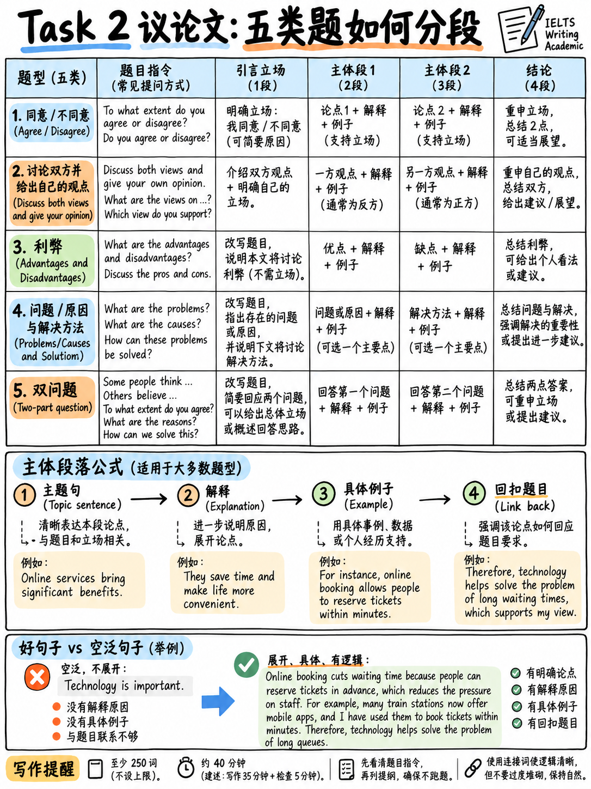

# 04. Task 2 大作文五大题型审题、四段式论证框架与段落展开法 (Task 2 Essay Types)



:::{admonition} Task 2 核心参数与定海神针法则
:class: tip
| 核心指标 | 官方标准要求 | 战术意义与考场法则 |
|---|---|---|
| **建议用时** | **40 分钟**（整个写作考试的 2/3 时间）`[1]` | 写作总分的大头，决定最终成绩的胜负手 |
| **最低词数** | **至少 250 词 (≥ 250 words)** `[1]` | 推荐安全区间：**270–300 词**，少于 250 词将遭遇机械扣分 |
| **计分权重** | **占 Writing 总分权重的整整 67%** `[10]` | 写作能否冲上 6.5 / 7.0+，完全由 Task 2 拍板 |
| **考核核心** | **确立立场并逻辑推演 (Formulate and develop a position)** `[10]` | 拒绝虚假华丽模板，考核学术思辨与段落论证深度 |
| **例证来源** | **个人经历、观察或身边常识均完全合规** `[10]` | 严禁编造荒谬的“哈佛大学权威调查”，真实常识最有说服力 |
:::

---

## 1. 任务回应度 (Task Response) 的官方本质要求

官方《Key Assessment Criteria》`[10]` 中对大作文提出了清晰的评判原则：

> "Candidates are required to **formulate and develop a position** in relation to a given prompt in the form of a question or statement, using a minimum of 250 words. **Ideas should be supported by evidence, and examples may be drawn from a candidate's own experience.**" `[10]`  
>  
> "The TR criterion assesses:  
> - how fully the candidate responds to the task.  
> - how adequately the main ideas are **extended and supported**.  
> - how **relevant** the candidate's ideas are to the task.  
> - how clearly the candidate **opens the discourse, establishes their position and formulates conclusions**.  
> - how appropriate the **format** of the response is to the task." `[10]`

:::{important} 打破中国考生的“权威数据强迫症”
许多考生在写作文时习惯编造假数据：  
*“According to a recent survey conducted by Harvard University in 2024, 85.6% of people agreed that...”*  
**考官对此类假数据极度反感！**  
官方大纲白纸黑字明确写道：**"examples may be drawn from a candidate's own experience"** `[10]`。  
你完全可以使用自己所在城市、自己的工作或求学经历作为例证（例如：“In my own city, a subway extension was completed last year...”）。真实的个人与身边案例不仅完全契合官方标准，而且更具可信度，绝对不会引发逻辑断层。
:::

---

## 2. 大作文五大官方题型审题决策树 (The 5 Prompt Types)

所有雅思大作文题目，必定属于以下五种题型之一。**开考前 3 分钟内精准辨识题型、数清楚指令（Count the Obligations），是避免 Band 5 的生死防线**。

```
                     ┌── 1. 观点态度题 (Opinion: Agree or Disagree) ──────► 必须有始终如一的鲜明立场 + 2个核心理由
                     ├── 2. 双边讨论题 (Discussion: Discuss Both Views) ──► 必须涵盖【正方 + 反方 + 个人观点】三大任务
大作文五大核心题型 ──┼── 3. 利弊权衡题 (Advantages & Disadvantages) ──────► 必须分析正反双刃剑；若含 outweigh 必须定夺胜负
                     ├── 4. 问题对策题 (Problem/Cause & Solution) ────────► 必须分析【原因/危害 + 针对性举措 (明确施策主体)】
                     └── 5. 复合直问双问 (Two-Part Direct Questions) ─────► 题干有几个问号，正文就对应几个主体段，逐一回答
```

| 题型名称 | 官方典型提问措辞 | 考场必答任务清单 (Mandatory Obligations) | 常见 Band 5 翻车死穴 |
|---|---|---|---|
| **1. 观点态度题 (Opinion)** | "To what extent do you agree or disagree?" / "Do you agree?" | 必须在引言段与结尾段给出**清晰一致的个人立场**（完全同意/完全不同意/让步折中），并在主体段进行充分论证。 | 全文骑墙摇摆，或者通篇在说现象，没有明确表明自己是赞成还是反对。 |
| **2. 双边讨论题 (Discussion)** | "Discuss both these views and give your own opinion." | **三大法定任务，缺一不可！**<br/>1. 充分展开第一方观点及其合理性；<br/>2. 充分展开第二方观点及其合理性；<br/>3. **给出自己的明确立场**。 | 只讨论了一方观点，或者虽然讨论了双方，但**通篇忘记给出自己的立场**（直接被判 Band 5 TR）。 |
| **3. 利弊权衡题 (Adv / Disadv)** | "What are the advantages and disadvantages?" / "Do advantages outweigh disadvantages?" | 分析积极影响（Advantage）与消极影响（Disadvantage）。若题干包含 **outweigh**，必须明确指出哪一方更具压倒性。 | 只写好处不写坏处；或者在 outweigh 题目中未能评判谁大谁小。 |
| **4. 问题对策题 (Problem & Solution)** | "What problems does this cause and what measures could be taken?" / "Why is this... What can be done?" | 均衡覆盖两大板块：<br/>• 主体 1：核心根源或严重危害；<br/>• 主体 2：可行性解决方案（必须指明谁来做，如政府、学校、个人）。 | 只写了 3 个大问题，解决方案仓促写了一句话甚至漏写；或对策假大空、无法落地。 |
| **5. 复合直问双问 (Two-Part Questions)** | "Why is this happening? Is it a positive or negative development?" | **一个问号对应一个主体段**：<br/>• 主体 1：回答第一个问题（原因/现象）；<br/>• 主体 2：回答第二个问题（价值评判）。 | 漏答其中一个问号，直接触发 Band 5 “Incompletely addressed”。 |

:::{danger} 审题第一黄金动作：圈出题干里的每一个疑问与祈使动词
审题时务必用笔圈出指令词：  
- 如果题目是 *"Discuss both views and give your own opinion"*，你在草稿纸上标出 **【1. View A】 【2. View B】 【3. My Opinion】** 三大框，动笔前核对正文是否全有对应。  
- 遗漏任何一项，Task Response 立即遭遇断崖式扣分！
:::

---

## 3. 经典四段式宏观骨架模型 (The 4-Paragraph Macro Architecture)

无论面对五大题型中的哪一种，最成熟、最抗风险的学术架构就是**“四段式结构”**。

```
   ┌─────────────────────────────────────────────────────────────────┐
   │ 1. INTRODUCTION (引言段) — 约 40–45 词，2–3 句话                │
   │    • 句 1：同义改写题目背景事实 (Paraphrase the prompt)         │
   │    • 句 2-3：开门见山声明个人核心立场 (Direct Thesis Statement)   │
   │    ★ 考官在读完引言段时，就必须 100% 清楚你的答案是什么！       │
   ├─────────────────────────────────────────────────────────────────┤
   │ 2. BODY PARAGRAPH 1 (主体段一：第一个核心论点) — 约 90–100 词    │
   │    采用 PEEL 论证法：中心论点 → 逻辑机制推导 → 具象案例 → 小结回扣 │
   ├─────────────────────────────────────────────────────────────────┤
   │ 3. BODY PARAGRAPH 2 (主体段二：第二个核心论点) — 约 90–100 词    │
   │    采用 PEEL 论证法：中心论点 → 逻辑机制推导 → 具象案例 → 小结回扣 │
   ├─────────────────────────────────────────────────────────────────┤
   │ 4. CONCLUSION (结论段) — 约 35–45 词，2 句话                    │
   │    • 句 1：换用全新词汇重新确认中心立场 (Restate Thesis)        │
   │    • 句 2：引申前瞻性建议或施策前提 (Forward-looking / Caveat)   │
   │    ★ 严禁在结论段引入任何未经正文论证的全新论点！               │
   └─────────────────────────────────────────────────────────────────┘
                      全文总计 ≈ 265–290 词（字数黄金区间）
```

### 为什么坚决写“两个主体段”，而不是写三个或四个？
- **时间与深度的不可调和矛盾**：在 40 分钟内写 280 词左右的文章，如果写三个主体段，每个段落只能分配不到 50 词，你只能罗列观点，根本没有空间展开因果推演。
- **官方标准的明确指引**：Band 6 TR 的核心缺陷是 *"some main ideas may be insufficiently developed"*（观点虽切题但展开不足）；而 Band 7 要求 *"main ideas are extended and supported"*（观点充分延伸并有论据支撑）`[8]`。**深入透彻地论证两个观点，得分永远远高于浅尝辄止地罗列四个观点！**

---

## 4. 单个主体段展开黄金法则：PEEL 闭环论证法

这是雅思大作文提分最高效的段落展开发动机。每一个主体段，严格由这四层递进结构组成：

```
   1. P (Point - 主题句)           单句点题，清晰提出本段的核心分论点。
   2. E (Explanation - 机制解释)   深入推导：为什么该论点成立？其内在逻辑与因果链条是什么？(2句话)
   3. E (Example - 具象例证)       具象案例：身边的实际案例、政策落地、具体生活常识。(1-2句话)
   4. L (Link - 回扣小结)          提炼升华：该论据如何支撑题目立场，建立逻辑闭环。(1句话)
```

:::{tip} 5.5 分与 7.0 分在段落展开上的本质区别（真实例子剖析）
**论题：公共交通是否应当由政府免费提供？**

**【Band 5.5 的展开方式（观点碎片罗列堆砌）】：**
> *Public transport should be free. This would reduce traffic on the road. Also it would help poor people save money. Moreover, it is good for the environment because there is less pollution. So governments should make it free.*  
> ❌ **考官诊断**：4 句话提出了 4 个新观点（减少拥堵、帮穷人、环保、少污染），但没有任何一句话解释了“为什么免费就能减少拥堵”，没有任何例证，属于典型的 *"inadequately developed"*。

**【Band 7.0 的展开方式（PEEL 严密闭环推演）】：**
> **(Point)** The primary argument for free public transport is that it fundamentally shifts commuter behaviour at the financial margin. **(Explanation)** Most daily travellers choose between driving and taking a bus based on a marginal calculation of time and monetary cost; eliminating transit fares completely tips this balance for thousands of borderline commuters, encouraging them to leave their cars at home. **(Example)** In my own city, for instance, a two-month trial of fare-free tram services last year led to a 20% surge in transit ridership and a noticeable decline in rush-hour congestion on major arteries. **(Link)** Consequently, the policy effectively pays for itself by reducing the enormous economic losses caused by urban gridlock.  
> ✅ **考官诊断**：单个论点，配以深刻的心理决策机制解释，辅以带具体数字的本地试运行案例，最后推导出经济价值。论证充分延伸，达成标准的 Band 7+ Task Response！
:::

---

## 5. 各题型高分引言段与结论段弹性句架库 (Sentence Frames)

### 引言段开篇与立论框架 (Introduction Frames)
杜绝 *"With the rapid development of modern society"* 这类被考官判为毫无信息量的陈词滥调！直接用 2 句话直击核心：

| 题型 | 高分引言段结构示范 |
|---|---|
| **观点题 (全赞成/全反对)** | *It is often argued that [题目核心论断]. In my view, this is [entirely justified / an untenable claim], largely because [原因核心词 A] and [原因核心词 B].* |
| **观点题 (让步折中)** | *While it is understandable why some advocate [观点A], I would argue that [观点B] represents a far more balanced and sustainable approach.* |
| **双边讨论题** | *Whether [争议焦点] remains a subject of intense debate. While proponents of [观点A] cite [核心理由], I align with those who argue that [个人倾向的观点B].* |
| **利弊权衡题** | *The trend towards [社会现象] has sparked considerable debate. While there are undeniable drawbacks, I am convinced that the long-term benefits substantially outweigh the risks.* |
| **问题对策题** | *The issue of [社会问题] poses an increasingly grave threat to modern urban life. This essay will examine its primary drivers and put forward viable remedies.* |

### 结论段升华框架 (Conclusion Frames)
结论段必须包含：换词重申立场 + 提炼前瞻性条件（避免机械重复引言段）：

- **框架 1 (平衡归纳)**：`In conclusion, while [承认某一合理前提], I firmly maintain that [重申核心立场]. Ultimately, success depends on whether [实现该目标的关键前提条件].`
- **框架 2 (前瞻升华)**：`To sum up, the evidence clearly demonstrates that [重申主旨]. Moving forward, policymakers should focus not merely on [消极限制], but rather on [积极构建更有利的社会支持机制].`
- **框架 3 (权衡定夺)**：`On balance, therefore, although [某一局部缺陷] cannot be ignored, the overall advantages of [核心事物] are decisively more substantial.`

---

## 6. 连接词的克制使用与高阶衔接替换表 (Cohesive Toolkit)

再次重申官方铁律：**全篇大作文的显性逻辑路标词，严格控制在 6–8 个即可！**  
考官严禁在每一句话句首机械填塞连接词。

| 逻辑关系 | 考官青睐的学术连词 (Pick ONE, not all) | 绝对禁止使用的低端/错误模板词 (DELETE!) |
|---|---|---|
| **递进补充** | furthermore, moreover, in addition | ~~besides that, what is more, furthermore every sentence~~ |
| **转折对比** | however, by contrast, whereas, conversely | ~~on the contrary (常被误用), but at sentence start~~ |
| **让步承认** | admittedly, while it is true that, despite this | ~~although... but... (严禁连用), even though... but...~~ |
| **因果推导** | consequently, as a result, therefore, thereby | ~~so at sentence start, that is why...~~ |
| **举例佐证** | for instance, to illustrate, a case in point is | ~~for example in every paragraph, such as like...~~ |
| **总结归纳** | on balance, in summary, to conclude | ~~in a nutshell (极其口语化), last but not least (烂俗套话)~~ |

:::{danger} 考场必须永久删除的三句“自杀式模板套话”
1. ❌ **"Last but not least"**：极其老套口语化，考官阅卷看到直接在心理上扣连贯分。请替换为 *Finally* 或直接融入句内。
2. ❌ **"In a nutshell"**：这是口语非正式俚语，绝不能出现在学术议论文中！
3. ❌ **"This essay will discuss both the advantages and disadvantages and then give my own opinion."**：典型的“报幕式废话”，不包含任何实质思想。直接删掉，换成包含你真实观点的论述句！
:::

---

## 7. 十二大常考社会母题词汇与现成论据库 (12 Recurring Topic Banks)

雅思 Task 2 的考题全部脱胎于 12 个极其稳定的社会命题领域。备考大作文最省力的方式：**每个领域掌握 8 个核心学术实词，并准备 1 个真实的个人/身边生活论据**。

| 母题领域 | 8 大高分学术核心词汇 | 现成真实生活论据角度 (Ready-to-use Example) |
|---|---|---|
| **1. 教育 (Education)** | curriculum, compulsory, vocational training, tuition fees, literacy, holistic assessment, dropout rate, pedagogical | 自己在中学或大学的实际体验（例如：学校曾开设的某门实用技能课或职业指导对就业的巨大帮助）。 |
| **2. 科技与人工智能 (Tech & AI)** | automation, algorithm, surveillance, digital divide, productivity, data privacy, algorithmic bias, remote collaboration | 亲身体验：远程办公/在线会议软件（如 Zoom/Teams）彻底颠覆了通勤模式与跨国团队协作效率。 |
| **3. 环境生态 (Environment)** | greenhouse emissions, renewable infrastructure, single-use plastics, biodiversity, carbon footprint, municipal subsidy, eco-friendly alternatives | 身边生活：所在城市推出的“塑料袋收费令”或垃圾分类强制措施，显著减少了生活垃圾填埋量。 |
| **4. 公共健康 (Health)** | sedentary lifestyle, preventive healthcare, life expectancy, obesity epidemic, mental well-being, dietary habits, public health initiatives | 亲身经历：公司或学校推行“工间站立办公”或健康跑计划后，慢性疲劳和亚健康状态显著改善。 |
| **5. 工作与职场 (Work & Life)** | job security, minimum wage, work–life balance, professional burnout, gig economy, telecommuting, career advancement | 身边观察：自由职业者和网约车司机的平台零工经济，虽时间自由但缺乏社保养老保障。 |
| **6. 城市与交通 (Urban & Transport)** | traffic congestion, pedestrianise, public transit subsidy, urban sprawl, affordable housing, cycle lanes, transit-oriented development | 城市观察：某主干道实施“早晚高峰拥堵收费 (Congestion Charge)”后，私家车流量立竿见影下降。 |
| **7. 家庭与人口 (Family & Society)** | ageing population, nuclear family, generation gap, elderly care facilities, birth rates, civic responsibility, social cohesion | 家族生活：祖父母一辈大家庭同住与当代核心小家庭在老人照料、代际观念上的剧烈分歧。 |
| **8. 犯罪与法律 (Crime & Law)** | penal system, deterrent effect, rehabilitation programs, custodial sentences, recidivism rates, community service, juvenile delinquency | 社会常识：对青少年轻微过失实行“社区义务劳动”而非监禁，能有效降低二度犯罪率。 |
| **9. 媒体与传统文化 (Culture & Media)** | cultural heritage, globalization, mass commercialization, indigenous traditions, state subsidies, algorithm curation, censorship | 本地观察：传统非遗手工艺在商业旅游化后得以保留，但失去了原本纯正的民俗仪式感。 |
| **10. 财政与政府拨款 (Government Spending)** | fiscal budget, tax revenue allocation, public infrastructure, welfare safety net, return on investment, prioritize | 公共决策：政府将财政预算优先投向医疗基建还是当代艺术馆建设的社会回报率对比。 |
| **11. 旅游业 (Travel & Tourism)** | overtourism, seasonal employment, cultural commodification, local economy, carbon footprint, ecological vulnerability | 景点体验：某一著名自然景区因过度旅游导致环境承载力过载，随后推行每日限流预约制。 |
| **12. 消费主义 (Consumerism)** | disposable culture, planned obsolescence, consumer indebtedness, brand prestige, sustainable consumption, repairability | 个人习惯：数码产品“计划性报废”促使人们频繁更换手机，二手交易与以旧换新平台的兴起。 |

---

## 8. 英式与美式拼写规范 (British vs. American Spelling)

雅思官方明确规定：**英式拼写与美式拼写均完全被认可接受**。但是，**同一篇作文内必须保持拼写体系的前后一致性**！

| 规范类别 | 英式拼写 (British) | 美式拼写 (American) | 避坑提醒 |
|---|---|---|---|
| **-ise / -ize 后缀** | organise, recognise, realise | organize, recognize, realize | 两者均可，但不要前一段写 organise 后一段写 realize |
| **-our / -or 后缀** | behaviour, labour, favour | behavior, labor, favor | 学术词汇中务必统一 |
| **-re / -er 后缀** | centre, theatre, metre | center, theater, meter | 坐标轴与度量衡注意统一 |
| **双写辅音字母** | travelled, cancelled, modelling | traveled, canceled, modeling | 过去式与分词拼写保持一致 |
| **名词与动词区分** | practice (名词) / practise (动词)<br/>licence (名词) / license (动词) | practice (兼作名/动)<br/>license (兼作名/动) | 若使用英式，注意名动词尾区分 |

---

**上一章：** {doc}`03-task-1-worked-examples` | **下一章学习指南：** {doc}`05-task-2-worked-examples`
