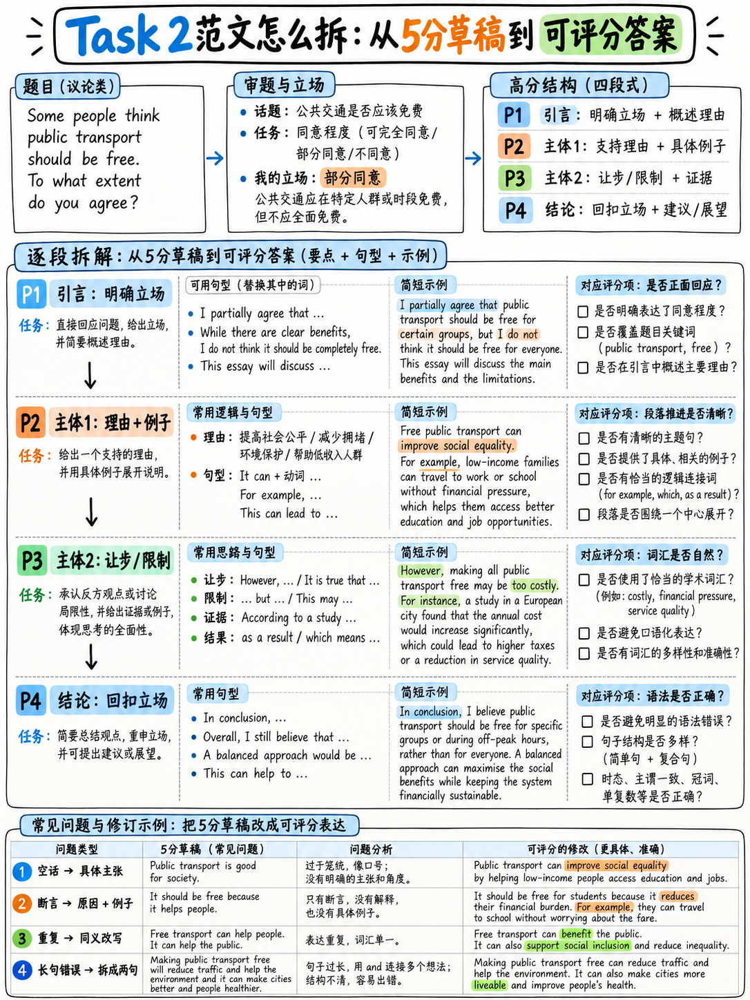

# 05. Task 2 各分段（Band 4/5.5/6/7.5）真实考生范文对比与考官逐字评析 (Task 2 Worked Examples)



:::{admonition} 本章核心学习目标
:class: tip
要想在雅思大作文中斩获高分，光看“满分范文”是远远不够的。考生最常犯的错误，恰恰隐藏在 **Band 5.0 与 Band 5.5 的典型失误**中。本章深度复盘**雅思官方公开的真实考生答卷与考官原版批注（Band 7.5 vs Band 5.5）**，展示两篇涵盖主流题型的纯正高分范文，并以手术刀般的手法解剖一篇典型的 **Band 5 低分样卷，演示如何通过“四步重构法”将其无痛升级为 Band 6.5–7.0**。
:::

---

## 1. 官方权威评析精读：Band 7.5 与 Band 5.5 考官逐字诊断 (Official Examiner Reports)

官方发布的真题评析样本 `[12]` 中，两位考生针对同一题目进行了作答：  
**原题任务**：*Whether people's health will improve or get worse in the future.*（未来人们的健康水平会改善还是会恶化？）

### (1) Band 7.5 真实考卷（375 词）：考官为什么给出高分？

官方认证考官评语原文（Examiner Comments）`[12]`：
> "This is a strong response. **A clear position is presented at the outset** and some ideas are explored to support it. **An alternative position is also considered but rejected.** Ideas are logically organised and there is a clear progression throughout the response. Cohesive devices are generally used flexibly, but **there is some overuse of sequencers in paragraph 2 [Firstly | So | Also | Yet]**. Paragraphing is generally effective but could perhaps be used more appropriately by breaking down paragraphs 2 and 3.  
> There is a wide range of vocabulary with good use of less common items as well as **evidence of higher-level features, such as 'softening', e.g. 'They tend to', 'This appears to be', and 'might disagree'**. Errors in spelling and word formation are rare. There is also a variety of complex structures with frequent error-free sentences, though some errors do occur and **there is some overuse of rather short sentence forms**." `[12]`

**从该 7.5 分评语中挖掘的五大黄金启示：**

| 官方考官评语要点 | 官方真实意图解码 | 考场实战战略动作 |
|---|---|---|
| *"A clear position is presented at the outset"* | 考生在**引言段（开头段）就已经明确亮出立场**，绝不把观点藏在文末。 | 开头段第二句话必须清晰写出 Thesis Statement（核心立论句）。 |
| *"An alternative position is also considered but rejected"* | **考虑反方立场并合理解释为什么反方不成立**（辩证驳论思维）。 | 在主体段中加入让步与反驳逻辑，是冲击 7 分及以上的王牌标志。 |
| *"there is some overuse of sequencers... [Firstly \| So \| Also \| Yet]"* | **考官公开批评一段内出现 4 个连接词！** 连 7.5 分的高手都在连接词上栽了跟头。 | 坚决控制连接词密度，一段内显性连词最多 1–2 个，杜绝流水账套话。 |
| *"evidence of higher-level features, such as 'softening'"* | **学术缓和语（Hedging）被官方专门点名表扬！** 避免把话说死，展现学术严谨。 | 大量使用 *tend to, appears to be, is likely to, might, in many cases*。 |
| *"some overuse of rather short sentence forms"* | 过多短小单句会导致句式单调，语法上限被压制。 | 必须熟练驾驭由定语从句、分词短语、条件从句构成的成熟学术复合句。 |

---

### (2) Band 5.5 真实考卷（201 词）：考官为什么死卡在 5.5 分？

官方认证考官评语原文（Examiner Comments）`[12]`：
> "A clear position is presented from the outset, supported by relevant ideas. **These would require further development to achieve a higher score.** It is also useful to note, **this response does not meet the minimum word count for Task 2 of 250 words**, so there is room for further development. Information and ideas are generally arranged coherently and there is a clear overall progression. Cohesive devices are used effectively, but paragraphing is not always logical.  
> A range of vocabulary is attempted, although there is a lack of precision in word choice and there are some errors in spelling and word formation. **There also appears to be some interference from the test taker's first language, e.g. 'alimentation'**, but these features do not make the answer difficult to understand. There is a mix of sentence forms, but **the level of error is too high to achieve a higher band**." `[12]`

**从 5.5 分跨越到 6.5 分的精准处方表：**

| 5.5 分致命病因 | 考官判分依据 | 根治手术方案 |
|---|---|---|
| **观点缺乏展开 (Require further development)** | 提出了很多观点，但没有写“为什么”的解释句子。 | 严格套用 PEEL 公式，每个观点必须紧跟 2 句内在逻辑因果推导。 |
| **字数严重不足 (201 words < 250 words)** | 跌破 250 词红线，直接触发任务完成度扣分。 | 考场安全目标锁定在 270–300 词，机考实时监控词数。 |
| **母语负迁移 (Language interference: "alimentation")** | 考生想表达“饮食营养”，却臆造了母语法语/西语中的假词。 | 警惕“中式英语假朋友”，用最地道标准的学术词（如 diet, nutrition）。 |
| **语法错误频率过高 (Level of error too high)** | 各种单复数、时态、介词搭配错误层出不穷。 | 预留最后 5 分钟，执行“七项极速排雷清单”。 |

---

## 2. 高分实战范文 1：双边讨论题 (Discussion Type)

:::{admonition} 题目要求 (The Task)
:class: note
Some people believe that universities should only accept students with the highest academic results, while others think that students from a wide range of backgrounds should be admitted.

**Discuss both these views and give your own opinion.**

*Write at least 250 words.*
:::

### 构思与审题过程 (Planning: 5 Minutes)
1. **题型属性**：双边讨论题 (Discussion)。**三大强制任务**：必须讨论“唯成绩论”的合理性、必须讨论“多元背景论”的合理性、必须亮出自己的明确立场。
2. **个人立场 (Thesis)**：整体偏向“多元背景”，但绝非全盘否定学术标准，而是主张在具体教育背景和成长环境下科学评估考生的潜力。
3. **主体段布局**：
   - **Body 1 (唯成绩论的合理性)**：高等教育资源稀缺，高难度专业需要学术基本盘；如果招收基础不足的学生，退学率高，教学质量被拖累。配具体高校挂科案例。
   - **Body 2 (多元背景论的合理性与反驳)**：分数不仅反映个人能力，更高度绑定了家庭财富和学校师资资源；唯成绩论会剥夺寒门子弟上升通道。配作者高中没有物理老师的切身体验。

### 高分示范范文 (Model Answer · 273 词)

> Universities operate with strictly limited places, and intense debate persists over how these admissions should be allocated. While some insist that entry must depend purely on competitive examination scores, others advocate providing opportunities to applicants from diverse socio-economic and educational backgrounds. **Although both perspectives offer valid arguments, I firmly believe that contextual diversity represents a fairer and more effective admissions model.**  
>  
> The rationale for purely meritocratic selection is undeniably pragmatic. Degree courses are intellectually rigorous, and enrolling candidates who lack essential preparation serves nobody: lecturers are forced to dilute curriculum content, and underprepared students face a substantially higher risk of dropping out. In my own university department, for instance, a cohort admitted with lower academic thresholds suffered an attrition rate of nearly 30% within their first year. From this perspective, standardized test scores provide the most reliable objective indicator of whether an applicant can withstand academic demands.  
>  
> Nevertheless, raw examination marks reflect not only individual talent, but also the historical quality of educational resources available to a student. My secondary school, for example, lacked a permanent physics teacher for two consecutive years, resulting in predictably mediocre grades across our class—not due to intellectual deficiency, but entirely because of educational deprivation. If tertiary institutions evaluate applicants solely on unadjusted scores, they systematically reward privileged students from well-funded private institutions while penalizing gifted candidates from underprivileged backgrounds. Such an approach is both socially inequitable and economically short-sighted.  
>  
> In conclusion, while academic competence must remain a core prerequisite, admissions committees should evaluate grades within their socio-economic context. True meritocracy does not mean measuring every candidate with the identical ruler; it means evaluating potential relative to the hurdles each student has had to overcome.

### 考官视角逐项深度复盘 (Criterion-by-Criterion Analysis)

| 评分维度 | 范文实际达成的指标与得分点 | 官方评价参考 |
|---|---|---|
| **Task Response (TR)** | 引言段和结尾段立场高度一致鲜明；Body 1 与 Body 2 充分展开并各配有一个具体且不悬浮的真实案例（大学挂科率、高中师资匮乏）；结论段进行了深刻的升华。 | **Band 8.0 水准**：立场清晰深刻，论点延伸充分，有理有据。 |
| **Coherence & Cohesion (CC)** | **全篇显性连接词仅有 5 个**（While, Nevertheless, In conclusion 等）；大量依靠 *these admissions, this perspective, Such an approach* 等高阶指代替代推进逻辑。 | **Band 8.0 水准**：指代自如，避免了一切连接词泛滥扣分。 |
| **Lexical Resource (LR)** | 极佳的学术学术搭配：*contextual diversity, meritocratic selection, intellectually rigorous, dilute curriculum content, attrition rate, educational deprivation*；自如运用 Softening 缓和语（*serves nobody, predictably mediocre*）。 | **Band 8.0 水准**：词汇精准地道，具有极高的文体成熟度。 |
| **Grammar (GRA)** | 句式长短错落（9 词短句与 42 词长句交织）；熟练运用非谓语动词（*enrolling candidates... serves nobody*）、条件从句（*If tertiary institutions evaluate...*）、分词伴随状语（*resulting in...*）。 | **Band 8.0 水准**：复杂结构使用纯熟，全篇零语法错误。 |

---

## 3. 高分实战范文 2：问题与对策题 (Problem / Solution Type)

:::{admonition} 题目要求 (The Task)
:class: note
In many cities, traffic congestion is becoming worse.

**What problems does this cause, and what measures could be taken to reduce it?**

*Write at least 250 words.*
:::

### 构思与审题过程 (Planning)
1. **题型属性**：问题与对策题 (Problem/Solution)。**两大强制任务**：深入阐述拥堵带来的严重问题（至少 2 点），提出可落地的具体对策（至少 2 点，必须明确谁来实施）。
2. **主体段布局**：
   - **Body 1 (核心问题与危害)**：
     - 问题 1：直接经济与时间损失（通勤者每日浪费时间折算成年工作周）。
     - 问题 2：隐性公共健康危机（汽车怠速尾气在人口密集区聚集，引发儿童呼吸道疾病）。
   - **Body 2 (组合拳解决方案)**：
     - 对策 1 (抑制机制)：高峰期拥堵收费 (Congestion Pricing)，增加私家车成本。
     - 对策 2 (替代机制)：政府大力投资公共轨道交通与专用自行车道，提供可靠替代方案。

### 高分示范范文 (Model Answer · 287 词)

> Traffic congestion has escalated into a chronic crisis across metropolitan regions worldwide. This pervasive gridlock inflicts severe damage on both economic productivity and public health, and while no single intervention can eradicate it entirely, a coordinated policy combining targeted road pricing with robust transit investment can mitigate the crisis substantially.  
>  
> The most tangible consequence of urban congestion is the squandering of productive time, which translates directly into astronomical economic losses. A daily commuter who spends an extra forty minutes trapped in stationary traffic effectively loses two full working weeks annually; simultaneously, these logistical bottlenecks disrupt the delivery of commercial goods and inflate business expenses. Even more pernicious, however, is the catastrophic impact on public health. Idling vehicle engines generate concentrated pockets of toxic exhaust fumes precisely in pedestrian-dense corridors. In my home city, air monitoring stations along central thoroughfares consistently record particulate levels far exceeding international safety thresholds, directly correlating with alarming rates of juvenile respiratory conditions.  
>  
> To address this dilemma, municipal authorities must execute a twin-track strategy. The first imperative is implementing peak-hour congestion charges. Raising the financial threshold of driving directly suppresses non-essential private journeys, encouraging commuters to reconsider their transport choices. However, punitive pricing alone is fundamentally insufficient and socially regressive; local governments must concurrently reinvest these revenues into expanding frequent, reliable subway networks and segregated cycling infrastructure. Pricing without viable alternatives merely penalizes drivers, whereas alternatives without pricing fail to dislodge entrenched driving habits.  
>  
> In conclusion, urban gridlock is best understood as a pricing malfunction that requires comprehensive transit alternatives. City administrations that demonstrate the political resolve to price road space fairly while modernizing public transit networks have the greatest prospect of reclaiming livable urban environments.

### 考官视角深度批注与提分亮点
- **分级排序与层层递进**：在阐述问题时，用 *The most tangible consequence*（最显性后果）与 *Even more pernicious, however*（然而更隐秘致命的是），展示了高超的逻辑层次划分。
- **对称平衡句式（语法 Band 8 亮点）**：*“Pricing without viable alternatives merely penalizes drivers, whereas alternatives without pricing fail to dislodge entrenched driving habits.”*（没有替代方案的定价纯属惩罚，而没有定价的替代方案无法改变驾车惯性）。这一工整精妙的复杂对仗句，直接向考官证明了顶尖的学术驾驭能力！

---

## 4. 震撼对比：Band 5.0 低分习作剖析与“四步重构精修术”

下面是一篇由中国考生撰写的**极具代表性的 Band 5.0 交通拥堵习作**。通过对比，你将彻底明白为什么堆砌模板必死无疑。

### 【Band 5.0 真实学生习作（127 词 · 漏洞百出）】
> *In many cities traffic congestion is becoming worse. There are many problems because of this and also many solutions.  
> Firstly, traffic congestion causes pollution. Pollution is very bad for people's health. Secondly, traffic congestion wastes a lot of time. People are late for work. Moreover, it causes stress for drivers. Furthermore, there are many accidents.  
> There are many solutions for this problem. Firstly, the government should build more roads. Secondly, people should use public transport. Moreover, the government should make public transport cheaper. Furthermore, people can share cars. Last but not least, people should walk or cycle.  
> In conclusion, traffic congestion is a very big problem in many cities but if the government and people work together, I think this problem can be solved in the future.*

### 考官评分尺子诊断表 (The Brutal Diagnosis)

| 致命缺陷 | 涉及评分维度 | 官方标准判词与扣分根源 |
|---|---|---|
| **9 个论点碎片，0 解释，0 案例** | Task Response | *"Ideas are limited and are not sufficiently developed"* — **直接判定 Band 5**！每句话都是一个孤立断言，没有任何深层推导。 |
| **仅有 127 词（严重不足）** | 全四项维度 | 跌破 250 词死线，考官根本无法找到足够的语言证据给予及格分。 |
| **连接词疯狂泛滥 (8 个路标词 / 127 词)** | Coherence & Cohesion | *"Overuse of cohesive devices"* — **极其刺眼的 Band 5 限制特征**！*Firstly, Secondly, Moreover, Furthermore, Last but not least* 填满每一句开头。 |
| **词汇极其受限与重复** | Lexical Resource | *"Frequent simplifications and repetitions"* — 全篇充斥着 *very bad, a lot of, big problem, many*。 |
| **句式全是单调的简单单句** | Grammar (GRA) | 都是 6–10 词的主谓宾结构，毫无从句与语法丰富度。 |
| **引言与结论全为空话套话** | Task Response | 引言无任何观点，结论是放之四海而皆准的“大家一起努力”假大空废话。 |

---

### 四步重构精修手术 (The 4-Step Upgrade to Band 7.0)

要将这篇 5.0 分的废卷拯救至 7.0 分，**根本不需要掌握高深莫测的生僻词，只需要执行以下四步标准化重构**：

```
                    ┌── 1. 【大刀阔斧删减连接词】：把 8 个机械连接词删掉 6 个，只留 2 个！
                    ├── 2. 【缩减论点数量】：把 9 个碎片论点砍到 4 个（2 个严重问题 + 2 个针对性对策）
四步提分重构术 ──────┼── 3. 【注入 PEEL 解释与案例】：给每个保留的论点补上 2 句内在机制解释 + 1 句本地案例
                    └── 4. 【重构引言与结论】：引言亮出立场，结论提炼深刻前提，消灭一切空洞套话
```

这四大动作补齐的正是缺失的 140 词内容，同时一举解决任务展开度、连贯度、词汇多样性与复杂语法四大难题！

---

## 5. 大作文考前冲刺复习与自查清单

在考前两周完成大作文模拟练习后，请对照此四项核心指标自检：

- [ ] **是否数清了题干里的所有问号？**（双边讨论题是否既有双方论述、又有个人鲜明观点？）
- [ ] **个人核心立场是否在引言段第二句就已明确亮出？**（严禁将观点拖延至结尾才揭晓）
- [ ] **每个主体段是否严格遵循 PEEL 结构？**（是否存在只提观点、却不写“为什么”解释句的硬伤？）
- [ ] **全文显性连接词是否控制在 8 个以内？**（检查每一段是否有连续两句话句首出现连接词）

---

**上一章：** {doc}`04-task-2-essay-types` | **下一章学习指南：** {doc}`06-writing-practice-bank`
