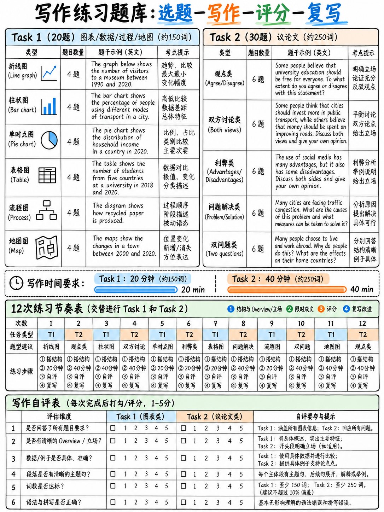

# 06. 雅思写作全真题库实战演练与分题型写作提纲 (Writing Practice Bank)

:::{admonition} 本题库使用原则与考场防押题声明
:class: tip
**真实考试中绝不可押题或机械背诵范文！**  
官方在 2023 年改版评分标准中明确指出，整篇死记硬背的作文将直接判定为 Band 0 `[8]`。  
本题库严格按照雅思官方《Guide for Test Takers》`[1]` `[10]` 的学术语体与设问规范编撰，汇集了**20 道涵盖所有题型的 Task 1 仿真图表数据集**，以及**30 道覆盖 12 大常考母题的 Task 2 大作文高频题目**。每道题均配以英文题干要求与深度中文审题、逻辑拆解思路，供考生进行高强度限时模拟练习。
:::

---

## 1. Task 1 全真模拟题库 (20 套全题型数据集与分组指引)

所有题目均包含文字化数据表格或工艺流程清单，无需看图即可在屏幕上随时展开限时 20 分钟作答。

### 动态趋势线图与柱状图 (Tasks 1–7)

#### T1-1. 四国国际留学生数量变迁 (表格型动态趋势)
**The table below shows the number of international students (in thousands) enrolled in higher education in four countries between 2010 and 2025.**

| Country | 2010 | 2015 | 2020 | 2025 |
|---|---|---|---|---|
| **USA** | 690 | 975 | 1,075 | 1,020 |
| **UK** | 405 | 435 | 540 | 760 |
| **Australia** | 270 | 295 | 445 | 400 |
| **Canada** | 145 | 240 | 500 | 625 |

- **破局指引**：时间全在过去（过去时）。**Overview**：四国留学生人数总体均大幅上升；美国全程高居榜首但后期轻微回落；加拿大增幅最为惊人（狂飙超 4 倍）。**分组策略**：Body 1 写美、英（体量前两强）；Body 2 写澳、加（后起之秀，对比加拿大反超澳洲的交织点）。

#### T1-2. 家庭能源消费结构演变 (多数据动态变迁)
**The data below details household electricity consumption (kWh per household per year) in one European country by energy source between 2005 and 2025:**
- **Gas**: 11,200 (2005) → 9,400 (2015) → 6,100 (2025)
- **Electricity**: 3,300 (2005) → 3,800 (2015) → 4,900 (2025)
- **Solar**: 20 (2005) → 240 (2015) → 1,650 (2025)
- **Oil**: 1,100 (2005) → 500 (2015) → 150 (2025)

- **破局指引**：**Overview**：传统化石燃料（天然气与燃油）大幅缩水；清洁电力与太阳能呈爆发式扩张（太阳能激增逾 80 倍）。**分组**：Body 1 写化石能源萎缩组；Body 2 写清洁电力激增组。

#### T1-3. 四座城市房价收入比变迁 (Multiples of Annual Income)
**The graph outlines average house prices expressed as a multiple of average annual income across four cities between 2000 and 2024:**
- **City A**: 4.1 (2000) → 7.8 (2012) → 11.2 (2024)
- **City B**: 3.9 (2000) → 5.1 (2012) → 5.4 (2024)
- **City C**: 6.2 (2000) → 5.8 (2012) → 4.9 (2024)
- **City D**: 2.8 (2000) → 4.0 (2012) → 8.1 (2024)

- **破局指引**：**Overview**：除城市 C 逆势下滑外，其余三市购房负担均显著加重；城市 A 购房难度翻近三倍并成为最难承受的城市。

#### T1-4. 城市公共出行方式客运量 (两时期柱状对比)
**The bar chart displays passenger journeys (millions) across three transport modes in a metropolis in 2015 and 2025:**
- **Bus**: 182 million (2015) → 141 million (2025)
- **Tram**: 64 million (2015) → 128 million (2025)
- **Bicycle hire**: 3 million (2015) → 29 million (2025)

- **破局指引**：**Overview**：公交车仍维持客运总量第一但唯一出现萎缩；有轨电车客流翻倍，共享单车呈现接近十倍的爆发式增长。

#### T1-5. 纸媒与网络新闻阅读率消长 (长跨度走势)
**The graph compares the percentage of adults reading print newspapers vs. online news at least weekly between 2000 and 2025:**
- **Print newspapers**: 68% (2000) → 59% (2005) → 44% (2010) → 29% (2015) → 18% (2020) → 11% (2025)
- **Online news**: 4% (2000) → 17% (2005) → 38% (2010) → 61% (2015) → 74% (2020) → 81% (2025)

- **破局指引**：抓住 2012 年前后的关键**交叉点 (Crossover Point)**。纸媒断崖下滑，网络新闻强势崛起。

#### T1-6. 三个地区五十年降水量走势 (Annual Rainfall in mm)
**Average annual rainfall (mm) across three geographical zones over five decades:**
- **Northern**: 940 → 905 → 880 → 835 → 790
- **Central**: 610 → 640 → 600 → 655 → 620
- **Southern**: 310 → 280 → 240 → 195 → 160

- **破局指引**：北部与南部持续干旱化下降，中部平稳波动。

#### T1-7. 三大产业劳动力占比演变与远期预测 (1980–2040)
**Proportion of workforce in three economic sectors, with future projections to 2040:**
- **Agriculture**: 22% (1980) → 9% (2010) → 4% (2040)
- **Industry**: 41% (1980) → 28% (2010) → 19% (2040)
- **Services**: 37% (1980) → 63% (2010) → 77% (2040)

- **破局指引**：注意 2040 年的时态处理（运用 *is projected to / is anticipated to*）。服务业跃升为绝对主导产业。

---

### 单一切片静态图表与双饼图 (Tasks 8–11)

#### T1-8. 成年人每周闲暇时间分配 (单一年份柱状图)
**Weekly hours spent by adults on leisure activities in 2024:**
Screen-based media: 14.2h; Socialising: 5.1h; Exercise & sports: 3.4h; Reading books: 2.6h; Hobbies: 2.2h; Volunteering: 0.8h.
- **破局指引**：一般现在时。屏幕媒介占据绝对碾压优势，志愿服务敬陪末座。

#### T1-9. 居民选址购房核心考量动机 (单表格比例)
**Survey of 1,000 residents on primary reasons for choosing their home:**
Proximity to workplace: 31%; Property affordability: 27%; Quality schools: 14%; Closeness to family: 12%; Property size: 9%; Other: 7%.
- **破局指引**：通勤与价格是前两大支配性动机（合占近六成）。

#### T1-10. 首都单身成年人五项基本月度支出 (生活成本快照)
**Average monthly cost (local currency) of five living essentials for a single adult in a capital city:**
Rent: 1,150; Food & groceries: 320; Utilities: 140; Public transit: 95; Broadband & mobile: 55.
- **破局指引**：租金成本是其他所有生活支出总和的两倍以上。

#### T1-11. 大学两时期经费收入结构 (双饼图对比)
**Sources of university funding in 2005 vs. 2025:**
- **2005**: Government grants 62%, Tuition fees 24%, Research contracts 9%, Private donations 5%.
- **2025**: Government grants 31%, Tuition fees 44%, Research contracts 18%, Private donations 7%.
- **破局指引**：公费拨款减半，学费跃居最大资金支柱。

---

### 双变量综合表格 (Tasks 12–14)

#### T1-12. 四个年龄段社交媒体偏好 (两变量大表)
**Percentage of users across age groups utilizing three social media categories in 2024:**

| Age bracket | Short-form video (%) | Instant messaging (%) | Professional networks (%) |
|---|---|---|---|
| **16–24** | 91 | 96 | 22 |
| **25–39** | 68 | 94 | 61 |
| **40–59** | 34 | 81 | 48 |
| **60+** | 12 | 54 | 11 |

#### T1-13. 五国人均垃圾产生量与循环回收量 (对照表)
**Annual municipal waste generated and recycled per capita (kg) in five countries:**
- Country A: 530 generated / 185 recycled
- Country B: 410 generated / 240 recycled
- Country C: 780 generated / 160 recycled
- Country D: 290 generated / 95 recycled
- Country E: 610 generated / 430 recycled
- **破局指引**：对比垃圾总量与回收转化率（Country E 回收率超 70%，而 Country C 垃圾最多但回收率极低）。

#### T1-14. 三国学生学段家庭作业时长对比 (跨学段表)
**Weekly homework hours across three school levels:**
- Primary: Country A (3.1h), Country B (1.2h), Country C (5.8h)
- Lower Secondary: Country A (6.4h), Country B (3.9h), Country C (12.1h)
- Upper Secondary: Country A (9.0h), Country B (7.2h), Country C (18.5h)

---

### 流程图与工业周期 (Tasks 15–17)

#### T1-15. 市政自来水净化处理八步工序 (Drinking Water Treatment)
1. Water pumped from reservoir → 2. Coarse screening removes debris → 3. Chemical coagulation clumps particulates → 4. Sedimentation tank settling → 5. Sand filtration → 6. Chlorination disinfection → 7. Covered storage reservoir → 8. Municipal delivery to homes.
- **破局指引**：全篇一般现在时被动语态。分物理过滤与化学消毒两阶段。

#### T1-16. 智能手机循环生命周期 (Mobile Phone Life Cycle)
Raw mineral extraction → Component manufacturing → Factory assembly → Global retail distribution → Consumer use (avg 2.5 years) → Disposition (trade-in / hoarding / landfill) → Refurbishment / Raw material recovery → Re-entering manufacturing stream.

#### T1-17. 商业面包流水线烘焙工艺 (Commercial Bread Baking)
Ingredient mixing (flour, water, yeast, salt) → First proving (1 hour at 27 °C) → Mechanical dividing & moulding → Second proving (45 min) → Oven baking (30 min at 230 °C) → Rack cooling (2 hours) → Automated slicing & packaging → Dispatch to supermarkets.

---

### 地图变迁与城市空间规划 (Tasks 18–20)

#### T1-18. 大学校园三十年规划变迁 (1995 vs. 2025)
- **1995**: West: Library; Centre: Science block; East: Admin; South: Open surface car park; North: Playing fields.
- **2025**: Car park replaced by student halls & landscaped plaza; Science block doubled; Sports centre occupies east playing fields; Library unchanged; Pedestrian walkway connects all units.

#### T1-19. 老城商业中心步行化改造 (Before vs. After Redevelopment)
- **Before**: East–west throughway carrying heavy traffic with shops on both sides; North: Market square; Southeast: Abandoned textile factory.
- **After**: Main street pedestrianised; Traffic redirected to new southern bypass; Derelict factory converted to cinema & parking complex; Four retail stores converted to cafés; Market square preserved.

#### T1-20. 热带岛屿旅游综合体开发前后 (Natural Island vs. Tourist Resort)
- **Before**: Small fishing village on north shore; Single dirt track; Pristine west beach; Dense interior forest.
- **After**: Village expanded threefold; Large hotel resort behind west beach; Boat pier on north coast; Paved circular ring road; Forest area halved.

---

## 2. Task 2 全真大作文高频母题库 (30 道精选题及审题指引)

### 题型 1：观点态度类 (Opinion: Agree / Disagree) — 题号 1–6

1. **公共文化投入**：Some people think that governments should spend money on public libraries rather than on digital services. To what extent do you agree or disagree?  
   *• 核心提纲：探讨数字鸿沟、社区实体文化空间的不可替代性 vs 数字化资源的高效普及。*
2. **人工智能与就业**：Artificial intelligence will do more harm than good to the job market. Do you agree or disagree?  
   *• 核心提纲：自动化带来的阵痛与岗位替代 vs 新兴高阶岗位的诞生与整体生产力释放。*
3. **实用技能入课堂**：Children should be taught practical skills such as cooking and personal finance at school rather than additional academic subjects. To what extent do you agree?  
   *• 核心提纲：成年生存基本素养 vs 学术基础对高等教育的基石作用（平衡折中立论）。*
4. **轻罪惩戒与改造**：The best way to reduce crime is to give young people education and employment rather than longer prison sentences. Do you agree or disagree?  
   *• 核心提纲：溯源治理与消灭犯罪温床 vs 严刑峻法的社会威慑作用与受害者正义。*
5. **全民高等教育免费**：Universities should charge no tuition fees at all. To what extent do you agree or disagree?  
   *• 核心提纲：促进社会公平阶层流动 vs 财政过载导致大学科研教学质量下滑与文凭通胀。*
6. **现代健康危机**：People today are less healthy than people were a hundred years ago. To what extent do you agree?  
   *• 核心提纲：现代医学与人均寿命飞跃 vs 久坐生活方式、加工食品与心理焦虑慢性病。*

---

### 题型 2：双边讨论类 (Discussion: Both Views + Opinion) — 题号 7–12

7. **远程居家办公**：Some people believe that working from home benefits both employees and employers, while others think it damages productivity and workplace relationships. Discuss both views and give your own opinion.  
   *• 核心提纲：灵活性与通勤成本消除 vs 团队协同损耗、企业文化缺失与员工职业倦怠。*
8. **公共博物馆门票**：Some argue that museums should be free for everyone; others say visitors should pay an entry fee. Discuss both views and give your own opinion.  
   *• 核心提纲：文化普及与公众教育权益 vs 维护珍贵文物馆藏的巨额资金需求。*
9. **治堵手段之争**：Some people think the most effective way to reduce car use is to improve public transport; others believe it is to make driving more expensive. Discuss both views and give your own opinion.  
   *• 核心提纲：正向激励（便利公交）vs 负向经济惩罚（拥堵费/高油税），得出“双轨并行”结论。*
10. **文理科目价值**：Some believe history should be a compulsory school subject; others think the time would be better spent on science and technology. Discuss both views and give your own opinion.  
    *• 核心提纲：历史塑造人文批判性思维与文化认同 vs 科技工程是现代经济核心驱动力。*
11. **社交网络言论监管**：Some people think social media companies should be held responsible for the content on their platforms; others believe users themselves should be responsible. Discuss both views and give your opinion.  
    *• 核心提纲：算法助推与企业把关人责任 vs 个人法律责任与言论表达自由。*
12. **减贫路径分歧**：Some argue that economic growth is the only way to reduce poverty; others say that income redistribution matters more. Discuss both views and give your own opinion.  
    *• 核心提纲：“做大蛋糕”（增长创造就业）vs “切好蛋糕”（税收二次分配与社会安全网）。*

---

### 题型 3：利弊分析类 (Advantages & Disadvantages) — 题号 13–18

13. **青年独居风潮**：More and more people are choosing to live alone in modern cities. What are the advantages and disadvantages of this trend?  
    *• 核心提纲：个人生活自由度、专注度 vs 孤独感增加、社会连带减弱与单人住房成本高企。*
14. **雇主线上监控员工**：Many companies now monitor their employees' online activity and keystrokes. Do the advantages of this outweigh the disadvantages?  
    *• 核心提纲：防范数据泄露与确保工时合规 vs 摧毁劳资信任、制造心理压力与侵犯隐私。*
15. **全球大众旅游扩张**：Tourism has become one of the largest industries in the world. Do its benefits outweigh its drawbacks?  
    *• 核心提纲：创汇就业与跨文化交流 vs 脆弱生态破坏、过度旅游导致的物价飞涨与文化异化。*
16. **跨国留学热潮**：An increasing number of students pursue their higher education abroad. Do the advantages outweigh the disadvantages?  
    *• 核心提纲：全球视野与语言学术沉浸 vs 昂贵开销、文化休克与发展中国家人才流失。*
17. **市中心全面禁车**：Some municipal governments have banned private motor vehicles from city centres. What are the advantages and disadvantages of such a policy?  
    *• 核心提纲：空气清新、慢行友好与事故锐减 vs 商户物流受阻、郊区居民通勤不便。*
18. **幼儿拥有智能手机**：Many children now have their own smartphone before the age of ten. Do the advantages outweigh the disadvantages?  
    *• 核心提纲：紧急联系与启蒙教育应用 vs 屏幕沉迷、注意力涣散、网络欺凌与近视率激增。*

---

### 题型 4：问题与对策类 (Problem / Cause & Solution) — 题号 19–24

19. **城市核心区住房危机**：Many city centres are becoming unaffordable for ordinary workers. What problems does this cause, and what could be done about it?  
    *• 核心提纲：职住分离、长途通勤加剧拥堵、关键公共服务人员流失 vs 兴建保障性公租房、地价管控。*
20. **发达国家食物浪费**：The amount of food wasted in developed countries is increasing alarmingly. Why is this happening, and what measures could reduce it?  
    *• 核心提纲：超市严苛外观分级、过度采购冷链不当 vs 临期食品捐赠立法、普及公众按需消费教育。*
21. **青少年缺乏体育锻炼**：Levels of physical activity among young people are falling sharply. What are the causes, and what can be done?  
    *• 核心提纲：电子屏幕诱惑、学业压力过大、活动场地匮乏 vs 强制课间锻炼、社区建设免费体育运动设施。*
22. **濒危语言加速消亡**：Many indigenous languages are disappearing at an unprecedented rate. Why is this happening, and does it matter?  
    *• 核心提纲：全球化与主流通用语同化 vs 语言承载着独特的非物质文化遗产与人类认知多样性。*
23. **城市空气质量恶化**：Air pollution remains a critical health threat in many large urban centres. What are the main causes, and how could it be reduced?  
    *• 核心提纲：燃油汽车尾气排放与工业外溢 vs 淘汰老旧燃油车、补贴新能源与搬迁重污染工业。*
24. **青年心理焦虑蔓延**：Rates of anxiety and depression among young adults have surged. What do you think are the causes, and what solutions can you suggest?  
    *• 核心提纲：职场内卷无常、社交媒体虚荣攀比 vs 建立校园心理咨询绿色通道、提倡健康工作制。*

---

### 题型 5：复合直接提问类 (Two-Part Direct Questions) — 题号 25–30

25. **社交媒体成新闻主渠道**：Many people now get their daily news from social media rather than traditional outlets. Why is this happening? Is it a positive or negative development?  
    *• 核心提纲：算法即时推送与互动便利性 vs 信息茧房、虚假新闻泛滥与公信力崩塌。*
26. **部分国家生育率断崖**：In some countries, birth rates have dropped to historic lows. What are the reasons for this? What effects might it have on society?  
    *• 核心提纲：育儿成本高企与女性职业追求 vs 老龄化严重、养老金缺口与劳动力枯竭。*
27. **二手消费热潮**：More people are choosing second-hand goods over brand-new ones. Why do you think this is happening? Do you consider it a positive trend?  
    *• 核心提纲：环保意识觉醒与消费理性回归 vs 减少碳足迹与促进循环经济发展。*
28. **延迟法定退休年龄**：Some governments encourage citizens to work beyond the official retirement age. Why might a government do this? Is it a good idea?  
    *• 核心提纲：缓解养老财政亏空与应对劳动力短缺 vs 挤占年轻人上升通道，需视工种灵活自愿。*
29. **电商冲击实体街区**：Online shopping has replaced a vast number of traditional brick-and-mortar stores. What are the reasons for this, and what effects has it had on communities?  
    *• 核心提纲：足不出户的比价便利与极速物流 vs 实体街区衰败、邻里纽带瓦解与线下就业萎缩。*
30. **政府全额补贴托育服务**：Some governments now provide completely free early-years childcare. Why might they do this? Who benefits most?  
    *• 核心提纲：释放女性劳动力与提振生育意愿 vs 双职工家庭与低收入群体受益最为深远。*

---

## 3. 考前冲刺 12 课时写作集训日程表 (The 12-Session Programme)

| 训练单元 | 训练任务与题号 | 核心突破技能点 | 严苛自查红线 |
|---|---|---|---|
| **第 01 课** | T1-1 (留学生变迁表) | 四段式骨架与无数据 Overview | Overview 中绝对不能包含任何阿拉伯数字 |
| **第 02 课** | T1-4 (客运柱状对比) | 动态增长与缩水对比句式 | 包含至少 4 个横向对比句 (whereas/compared to) |
| **第 03 课** | 大作文 Prompt 1 (观点态度题) | 引言段 Thesis Statement 开门见山 | 读完开头段考官即可获知作者明确立场 |
| **第 04 课** | T1-15 (自来水流程图) | 一般现在时被动语态与工序推进 | 所有工序动词均为被动语态；克制使用连接词 |
| **第 05 课** | 大作文 Prompt 13 (利弊题) | 两大主体段篇幅对等与 PEEL 闭环 | 每个主体段至少包含 2 句内在逻辑因果解释 |
| **第 06 课** | T1-5 (纸媒与网络走势) | 科学分组（形态分组而非截断时间） | 绝不能按“前十年一段、后十年一段”强行切断 |
| **第 07 课** | 大作文 Prompt 7 (双边讨论题) | **三大法定任务闭环** | 正方观点、反方观点、个人立场均有充分展开 |
| **第 08 课** | T1-18 (大学地图变迁) | 方位词与“未改变之物”对比 | 必须明确指出南部树林完全未变的客观事实 |
| **第 09 课** | 大作文 Prompt 19 (问题对策题) | 对策落地与明确施策主体 | 对策必须明确指出是政府、学校还是社区来做 |
| **第 10 课** | T1-12 (社交媒体复杂表) | 从 12 个数据中挑选 4 个核心特征 | 杜绝流水账报账，提炼年龄反比与全民普及特征 |
| **第 11 课** | 大作文 Prompt 25 (复合双问) | 严格对应：一个问号一段正文 | 两个主体段分别回答“为什么”与“是好是坏” |
| **第 12 课** | **任意 Task 1 + 任意 Task 2** | **全真 60 分钟高压双卷实战模考** | **Task 1 严格在第 20 分钟强行交卷！绝不拖延** |

---

## 4. 考生独门利器：考场 11 项机械自评分打分表 (The 11-Point Rubric)

完成模拟练习后，不要依赖虚无缥缈的主观感觉。对照以下 **11 项客观硬指标**进行打分（每项满足得 1 分）：

| 序号 | 机械硬指标检验项 | 得分 (0/1) |
|:---:|---|:---:|
| 1 | **字数达标**：Task 1 ≥ 150 词，Task 2 ≥ 250 词（无抄写题目原话充数） | [ ] |
| 2 | **段落清晰**：严格分为四段，且段落之间有明显的空行 | [ ] |
| 3 | **小作文 Overview**：第二段是宏观概述段，且**没有包含任何具体数字** | [ ] |
| 4 | **小作文数据绑定**：主体段提及的每一个趋势均有真实数字支撑 | [ ] |
| 5 | **大作文开头亮明立场**：引言段第二句清晰写出了 Thesis Statement | [ ] |
| 6 | **大作文任务全覆盖**：数清了所有问号与指令，没有任何漏答 | [ ] |
| 7 | **大作文 PEEL 闭环**：每个主体段均有“观点 + 机制解释 + 具象案例 + 回扣” | [ ] |
| 8 | **连接词克制**：大作文全篇显性连接词总量在 8 个以内，绝无连环套话 | [ ] |
| 9 | **文体格式纯正**：全篇无任何 Bullet points、数字列表或箭头笔记 | [ ] |
| 10 | **标点零车祸**：无任何 Comma splice（逗号串联两单句），专有名词大写 | [ ] |
| 11 | **语法三要素复核**：可数名词单复数、现在时动词三单、冠词 a/an/the 均核对无误 | [ ] |

- **得分 9–11 分**：机械维度已全面达到 **Band 6.5–7.0+** 的高分标准！
- **得分 6–8 分**：处于 **Band 5.5–6.0** 徘徊区，暴露出部分机械性坏习惯。
- **得分低于 6 分**：问题不在于英语词汇水平，而在于写作纪律涣散，请立即重读 {doc}`01-how-writing-is-scored`！

---

**上一章：** {doc}`05-task-2-worked-examples` | **下一章学习指南：** {doc}`../40-reading/01-scoring-and-section-tactics`
