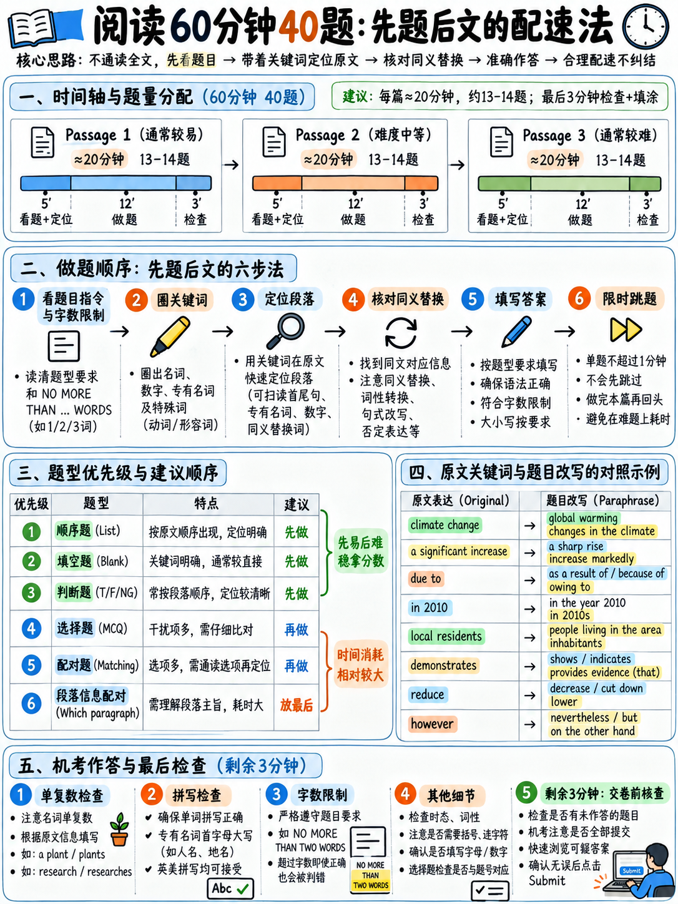

# 01. 雅思学术类阅读评分体系、时间管控与三篇文章通关节奏 (Reading Scoring & Tactics)



> **本章核心定位**：雅思学术类阅读（Academic Reading）绝非单纯考查考生的词汇量与英语文学修养，其实质是一场**在严苛时间熔断机制下的工业化信息检索与逻辑比对测试**。60 分钟、3 篇学术长文、2,150–2,750 词、40 道题目——平均每道题仅留给考生 90 秒（包含所有检索、精读、比对与录入时间）。绝大多数考生并非败在“读不懂”，而是死于“时间赤字引发的全面雪崩”。本章将拆解官方底层评分规则、确立不可逾越的三篇文章时间硬限，并建立以“降维打击”为导向的篇章内进攻序列。

---

## 40.1.1 雅思学术类阅读官方核心数据与底层考情

在制定任何技战术之前，必须首先建立对雅思阅读考务规则与客观评分机制的精确认知。根据剑桥大学考评部（Cambridge Assessment English）及官方考生指南规范 `[1]` `[3]` `[6]` `[7]`，其关键参数如下：

### 官方关键考务数据一览

| 维度 | 官方标准与规范详情 | 战略备考启示 |
|---|---|---|
| **考试总时间** | **60 分钟整** `[3]` | **无任何额外誊写/检查时间！** 听力在纸笔时代有10分钟誊写，而阅读历来是“分秒不给”；机考环境下屏幕倒计时归零系统立即强制交卷锁定。 |
| **篇章数量** | **3 篇独立学术长文 (Passages 1–3)** `[3]` | 每篇文章长度为 700–950 词，文章难度与句法复杂度呈**阶梯式递增**。 |
| **总阅读词量** | **2,150–2,750 词** `[3]` | 试图逐词逐句“通读并翻译全文”在生理上注定超时。必须进行靶向定位阅读。 |
| **题目总数** | **40 道客观题**，每答对一题得 1 分 `[3]` | 每题分值完全均等（无论是第1篇的送分填空还是第3篇的高难乱序匹配，皆为 1 分）。 |
| **倒扣分机制** | **零倒扣分 (No Negative Marking)** | 答错不扣分！考场交卷前**绝对不允许留空任何一道题**，未做题必须全部理性蒙猜。 |
| **题型总库** | **11 种官方题型** `[3]` | 覆盖填空、判断、多选、人名配对、标题配对等，详见 {doc}`../00-foundations/02-question-type-inventory`。 |
| **文章题材** | 来自书籍、期刊、学术杂志、报纸及科普网络资源 `[6]` | 专为非专业读者撰写（Written for a non-specialist audience），无需任何前置学科专业知识背景。 |
| **难度进阶** | "At least one text contains detailed logical argument." `[6]` | 至少有一篇文章（通常为 Passage 3）包含多方博弈的深层学术逻辑论辩与修辞反驳。 |
| **生僻专业词** | "Technical vocabulary is accompanied by a simple dictionary definition." `[6]` | **官方不以生僻词卡人**：真正的专业罕见术语在文末或文内必定附有简明英文释义 (Glossary)。 |

:::{important}
**官方考情揭示的两大底层红利与实战心法：**

1. **生词脱敏原则**：官方明确承诺专业生僻术语附带注释 `[6]`。这意味着当你遇到一个未见过的生词时，它只有两种可能：**(a) 属于背景细节，在题目之外，完全不影响作答**；或者 **(b) 属于考点核心词，但文内必有同义词替换、同位语解释或下定义句子**。考生切忌因单个生词停滞卡顿，必须毫不犹豫跳过。
2. **A 类（学术类）相对 G 类（培训类）的算分宽松红利**：在相同的原始得分（Raw Score）下，学术类阅读的换算 Band Score 远高于培训类 `[7]`。A 类拿到 6.0 分仅需答对 23 题（容错率高达 17 题）；冲刺 7.0 分也仅需 30 题（容错率 10 题）。你不需要追求 40 题全对，你的核心任务是**稳稳锁定前 30 道高确定性题目的得分**！
:::

### 雅思学术类阅读原始分与目标 Band 换算基准

根据官方公布的成绩锚点表 `[7]`，学术类阅读的原始分分布如下：

```
   原始答对题数 (Raw Score / 40) 与目标分对应阶梯：
   
   40 ───┐ 
         │ 39-40 题 ────── Band 9.0 (专家水平 Expert)
   35 ───┼── 35-36 题 ─── Band 8.0 (优秀水平 Very Good)
         │ 
   30 ───┼── 30-32 题 ─── Band 7.0 (良好水平 Good - 绝大多数名校门槛)
         │ 
   25 ───┼── 27-29 题 ─── Band 6.5 (英联邦高校主流要求)
   23 ───┼── 23-26 题 ─── Band 6.0 (及格合格线 Competent)
         │ 
   15 ───┼── 15-18 题 ─── Band 5.0 (基础薄弱 Modest)
    0 ───┘
```

从上图可以清晰看出：**23 题与 30 题是两条决定命运的关键分水岭**。达到 6.0 分只需要 57.5% 的正确率，达到 7.0 分只需要 75% 的正确率。备考的核心战略决不是“地毯式无遗漏做完全卷”，而是**在 60 分钟内以最高效率斩获最有保障的 30 个分值**。

---

## 40.1.2 考场头号杀手：时间赤字与三篇文章严格控时战术

60 分钟内面对近 2,800 词的外刊长文和 40 道密集题目，考生最致命的习惯是将时间“平分”为每篇 20 分钟，或者在 Passage 1 纠缠不休。

```{mermaid}
graph TD
    subgraph Trap["致命传统误区: 均分时间或前松后紧"]
        T1["Passage 1 (求全责备) -> 耗时 26-28 分钟<br/>追求完美, 反复抠生词"] --> T2["Passage 2 (节奏打乱) -> 耗时 20-22 分钟<br/>心跳加速, 仓促作答"]
        T2 --> T3["Passage 3 (全面雪崩) -> 仅剩 10-12 分钟!<br/>完全无法精读, 14道题胡乱蒙猜, 最终惨败 5.0"]
    end

    subgraph Discipline["专业战术节奏: 阶梯式熔断时间分配"]
        P1["Passage 1 (入门级事实说明文)<br/>严格限时 17 分钟 (倒计时 43:00 前交卷)"] --> P2["Passage 2 (进阶级论述分析文)<br/>严格限时 20 分钟 (倒计时 23:00 前交卷)"]
        P2 --> P3["Passage 3 (高阶多方博弈论辩文)<br/>严格限时 20 分钟 (倒计时 03:00 前交卷)"]
        P3 --> Check["最后 3 分钟: 战略扫尾与全卷排查<br/>清空空白填空, 检查单词抄录拼写与大小写"]
    end
```

### 考场硬性时间熔断戒律 (Hard Time Caps)

无论是在纸笔答题纸还是机考草稿纸上，开考瞬间必须立即记下三个**绝对时间截断点**：

```
┌────────────────────────────────────────────────────────────────────────┐
│               考场硬性时间熔断时间表 (HARD TIME CAPS)                   │
│                                                                        │
│  Passage 1  ──────────  17 分钟以内   (机考剩余时间显示 43:00 时必须结束) │
│  Passage 2  ──────────  20 分钟以内   (机考剩余时间显示 23:00 时必须结束) │
│  Passage 3  ──────────  20 分钟以内   (机考剩余时间显示 03:00 时必须结束) │
│  Final Sweep ─────────   3 分钟排查   (消灭任何未填项，核对字数限制)       │
│                                                                        │
│  铁律准则：                                                            │
│  当倒计时到达截断点时，无论当前题目是否纠结完毕，必须立即停止当前文章！ │
│  将未完成的题目以最优概率蒙上答案，毫不留恋直接切换至下一篇文章！       │
│  Passage 3 里的每一道简单填空题，分值与 Passage 1 的难题完全对等（1分）。│
└────────────────────────────────────────────────────────────────────────┘
```

:::{danger}
**考场死穴警示**：许多本有 6.5 分实力的考生最终只拿到 5.0 分，根本原因就是在 Passage 1 花了 28 分钟。他们总觉得“第 1 篇简单，我一定要争取全对”，结果将原本充裕的脑力与时间耗尽在边际收益最低的纠结中。导致难度最高的 Passage 3 只剩不到 12 分钟，14 道题目连题干都无法读完。**记住：放弃一道耗时 3 分钟的纠结题，能为你换来后续两道基础题的稳稳命中！**
:::

---

## 40.1.3 破除“通读全文”的致命误区：三层递进定位阅读法

很多考生在备考初期习惯像做大学英语四六级或考研英语一样，先花 8-10 分钟将全文从头到尾仔细读一遍，然后再去看题目。在雅思学术阅读中，这是**自杀式做法**。

```
❌ 传统低效慢读法（时间严重超标）：
   通读全文长文 (耗时 8-10 分钟) 
   → 阅读题目 (2 分钟) 
   → 发现记不住细节，重新回文找定位 (8 分钟) 
   → 单篇耗时超 18-20 分钟，全文反复读了两遍，脑力严重疲劳！

✅ 雅思官方工业化极速定位法（16 分钟高效破局）：
   1. 读文章主标题 (Title) 与副标题 (Subtitle) ────────── 15 秒
      → 迅速激活该学术领域的主题认知与背景图式。
   2. 扫描各段首句及首段尾句 (Skimming Topic Sentences) ── 60 秒
      → 掌握全文篇章展开逻辑线（背景引入→实验方法→矛盾发现→理论争鸣）。
   3. 审阅第一组题型指令与题干要求 ─────────────────────── 20 秒
      → 划定字数上限（如 NO MORE THAN TWO WORDS），标记核心定位词。
   4. 依据题型性质定位靶心句子，实施“定向狙击式精读” ────── 逐题推进
      → 只精读靶心句及其前后支撑句（3 句窗口）。
   5. 完成该题型后，顺次推进下一题型。总耗时约 15–16 分钟！
```

### 为什么这套方法能稳定提分？
因为雅思阅读的设计具有高度的**题目顺序性（Sequential Order）**。绝大多数题型（细节填空、是非判断 TFNG/YNNG、单选题、首尾句配对）都严格遵循**原文段落推进顺序**。题目本身就是带你按部就班游览整篇文章的“导游图”。你根本不需要预先背诵全文，题目自会带你在最关键的段落精准停靠。

:::{tip}
**唯一的特例：段落标题配对（Matching Headings）**  
如果一篇文章的第一道大题是 Matching Headings，该题型考查的是对各段落主旨的概括，不可单靠细节词定位。此时你在步骤 2 中，就需要将每段的首句、转折句（However/But/Yet）及尾句认真勾画，提炼各段的核心功能（段落是提出理论、陈述弊端还是展开案例？）。详见 {doc}`04-matching-tasks`。
:::

---

## 40.1.4 篇章内题型进攻序列与黄金做题次序

在考场上，试卷上印刷的题型顺序是随机排布的，**绝不代表你的做题次序**！如果你盲目按照试卷印刷顺序，一上来就啃耗时最长、性价比最低的题型，你的考场节奏将瞬间崩溃。

必须根据我们创立的 **题型性价比优先级（Priority Triage）** 进行战术重组：

```{mermaid}
graph LR
    Step1["第 1 顺位: Tier S 填空与简答<br/>• 句子/表格/图表/流程图填空<br/>• 答案是原文原词, 极速拿分, 顺带熟悉文章"] --> Step2["第 2 顺位: Tier A 判断题<br/>• TFNG / YNNG 逻辑判断<br/>• 严格遵循原文顺序, 规则明确"]
    Step2 --> Step3["第 3 顺位: Tier B 局部配对与单选<br/>• 人名/特征匹配 (专有名词速定)<br/>• 单项选择题 (4选1)"]
    Step3 --> Step4["第 4 顺位: Tier B- 段落标题配对<br/>• Matching Headings<br/>• 此时已读过大部分段落, 主旨已然清晰"]
    Step4 --> Step5["第 5 顺位: Tier C 段落信息包含题<br/>• Matching Information ('Which paragraph contains...')<br/>• 乱序+微观细节, 性价比极低, 留至最后或战略性猜题"]
```

### 黄金做题次序的深层逻辑
1. **先做填空题**：不仅得分率最高（原词摘抄），而且在定位填空题的过程中，你的眼睛被迫扫过了大半个篇章，等于**免费帮你预热并精读了关键段落**。
2. **后做宏观与乱序题**：当你把填空题和判断题做完时，你对这篇文章的核心主旨、各段讲了什么早已了然于胸。这时再去攻克段落标题（Headings）或人名匹配（Matching Features），往往能一目了然，耗时缩短一半！
3. **段落信息匹配（MI）果断垫底**：段落信息匹配题（"Which paragraph contains following information"）是全卷公认的“时间黑洞”。它无序、无规律、极度隐蔽。将其留到最后，即使只剩 3 分钟，也能根据对文章的整体印象迅速对应，做不完直接均匀蒙选，绝对不让它拖累前序基础题！

---

## 40.1.5 机考与答题规范：绝不可踩的机械失分红线

雅思学术阅读是纯客观评分，多一个空格、少一个字母、多一个单词，机器直接判为 0 分。官方评分标准及规范答题守则 `[3]` `[25]` 明确规定了以下红线：

| 官方规则 | 规范执行细节 | 致命踩坑示例 |
|---|---|---|
| **严格遵守字数上限** | 指令为 "NO MORE THAN TWO WORDS" 时，答案最多 2 个词；写 3 个词直接 0 分。 | 答案写 `a significant increase` (3词) 判 0 分！必须删去非必要冠词，写 `significant increase` (2词)。 |
| **连字符词算一个词** | 官方明确："Hyphenated words such as 'check-in' count as single words" `[3]`。 | `large-scale` 算 1 个词；`high-tech` 算 1 个词。 |
| **缩写词绝不会成为考点** | 官方明确："Contracted words such as 'they're' won't be tested" `[3]`。 | 考场上切勿自己臆造或缩写，一律书写完整拼写。 |
| **原词照抄原则** | 填空题只要指令要求 "from the passage"，一律**原词摘抄**！不要擅自改变词性或单复数。 | 原文为 `refrigeration`，擅自改写为动词 `refrigerate` 直接判错。 |
| **拼写绝对正确** | 哪怕仅错一个字母也得 0 分。英式拼写（British）与美式拼写（American）均被认可。 | `colour` 与 `color` 均对；但抄错字母如 `enviroment` (漏写n) 判 0 分。 |
| **审清 TRUE/FALSE 与 YES/NO** | 题型指令要求 TRUE/FALSE/NOT GIVEN，不得写 YES/NO；反之亦然。 | 在 TRUE/FALSE 题型中输入 `YES`，官方标准判错。 |
| **绝无空白题原则** | 没有任何倒扣分机制。猜错不扣分，留空 100% 丢分。 | 考前 2 分钟检查全卷，凡遇空白一律根据常识或概率填满。 |

:::{warning}
**全面机考时代实战防坑贴士（Computer-delivered Quirks）**：
- **选中与高亮快捷键**：机考界面支持鼠标划词右键 `Highlight`（高亮）和 `Notes`（便签），善用高亮标记段落关键人名、年代与转折词；
- **填空题防误触多余空格**：在填空框输入单词时，切忌在单词前后误按多余的空格（Leading/Trailing spaces）；
- **拖拽题（Drag & Drop）确认吸附**：匹配题部分题目支持鼠标拖拽，务必确认选项已稳妥吸附在目标框内，避免虚放。
:::

---

## 40.1.6 考场“生词脱敏”与论证逻辑核心词库

在雅思考场上，遇到生词是 100% 会发生的常态。即便是本土母语者，面对地质学、古生物学或天体物理学的文章也会遇到冷僻术语。决定你分数的不是生词的数量，而是你**对待生词的反应机制**：

### 遇到生词的三步分类处理 SOP

```
   遇到了一个完全不认识的生词？
                │
         Is it in the Question? 
         这个生词是否出现在题目题干中？
                ├──────────────────────────────────────────────┐
               YES                                            NO
                │                                              │
         Is it a Key Anchor?                          Is it in the Answer Sentence?
         是否为关键不可替换定位词？                     这个词是否在靶心定位句内部？
          ├── 是专有名词/物种名 ──> 直接当图形符号回文找    ├── 否 (在文章其他位置) ──> 彻底无视！100%与得分无关！
          └── 是普通动词/形容词 ──> 关注其同义替换与句子逻辑└── 是 (在答案关键句内) ──> 判定其“逻辑功能”：
                                                                 • 词性 (名词/动词/修饰语)
                                                                 • 感情色彩 (积极+/消极-)
                                                                 • 逻辑指向 (促进还是阻碍)
                                                                 依靠上下文逻辑填补语义，切忌停顿！
```

### 真正决定理解的不是专业名词，而是“论证逻辑骨架词”
在学术阅读中，动植物名称（如 *Streptopelia decaocto*）、地质年代（如 *Pleistocene*）只是论据的载体；真正承载考题（尤其是 TFNG 与单选题）考点的，是**学术论辩骨架词**。掌握以下高频逻辑词汇，便能看穿 80% 的出题意图：

| 逻辑维度 | 考场高频学术逻辑核心词 | 逻辑功能解析与出题考点 |
|---|---|---|
| **主张与断言** | `assert`, `claim`, `contend`, `hypothesize`, `postulate`, `allege` | 标明某位学者的个人假说，**切忌当作既定客观事实**（常考 TFNG 陷阱）。 |
| **反驳与转折** | `contradict`, `refute`, `undermine`, `dispute`, `challenge`, `counter` | 标志对传统观点的颠覆或理论冲突，是考题极度密集的出题靶心。 |
| **让步与限定** | `albeit`, `notwithstanding`, `insofar as`, `concede`, `grant that` | 标志逻辑让步（虽然……但是），答案往往藏在让步从句之后的主句中。 |
| **因果与推导** | `thereby`, `consequently`, `derive from`, `stem from`, `precipitate` | 标志学术结论与因果链条，填空题与因果判断题的核心定位点。 |
| **证据与实证** | `empirical`, `anecdotal`, `corroborate`, `substantiate`, `verify` | 区分是“实证数据支撑”（empirical）还是“道听途说经验”（anecdotal）。 |

---

## 40.1.7 零基础冲刺：三周极限阅读提速训练计划

对于阅读速度低于 120 wpm（Words Per Minute，词/分钟）的考生，瓶颈往往不在于视力移动速度，而在于两大坏习惯：**默读（Sub-vocalising，在大脑中逐词发音）** 与 **回视（Re-reading，目光反复倒退重读同一行）**。

### 科学提速三周进阶周历

| 周期阶段 | 专项训练科目 | 每日训练任务 | 达标检验标准 |
|---|---|---|---|
| **第 1 周：视线指引与克服回视** | **手指/光标引读法 (Pacing Drill)** | 每天选取任意 1 篇 800 词学术外刊或雅思原文，使用笔尖或鼠标光标平稳划过行间，强制视线向前，**坚决不允许视线倒退**。持续 15 分钟。 | 克服默读，实现流畅按行抓取意群（Chunking），阅读速度提升至 140 wpm。 |
| **第 2 周：首末句宏观骨架速读** | **结构提炼速读法 (Backbone Skimming)** | 打印或打开 1 篇完整长文（900 词）。**只读各段首尾两句**，限时 75 秒。合上文章，在草稿纸上写出文章由哪几个逻辑板块构成（如：现象引入-历史沿革-经济分析-未来挑战）。持续 15 分钟。 | 75 秒内准确把握全文 80% 的论证结构与段落功能。 |
| **第 3 周：全真单篇极限控时** | **17 分钟极限高压模考 (Strict Timed Test)** | 严格使用官方真题，每天单练 1 篇。**倒计时设定为严格的 17 分钟**（Passage 1）或 19 分钟（Passage 2/3）。闹钟一响立刻停笔，核对答案并复盘。 | 建立考场生物钟感知，形成“见截断点即转场”的战术肌肉记忆。 |

### 官方阅读速度与目标分对应基准测算

| 阅读有效速度 | 考场真实生理状态 | 预估阅读成绩区间 |
|---|---|---|
| **< 100 wpm** | 无法做完全卷，Passage 3 几乎全盲猜，心理高度焦虑。 | Band 4.5–5.0 |
| **120–150 wpm** | 能扎实做完 Passage 1 和 Passage 2，Passage 3 能抢做 5–6 道简单题。 | **Band 5.5–6.0** |
| **180–200 wpm** | 能全流程完整推进三篇文章，且留有 2–3 分钟排查未作答项与拼写。 | **Band 6.5–7.0** |
| **240+ wpm** | 极度从容，阅读速度不再是提分瓶颈，胜负取决于逻辑辨析深度。 | Band 7.5–8.5 |

:::{important}
**离考试仅剩 3 周且语速偏慢者的“田忌赛马”战略**：  
如果目前阅读速度测算低于 120 wpm，**切忌在考前强行尝试做完所有 40 道题**！因为仓促做全卷的结果往往是三篇文章都粗制滥造，正确率全线崩盘。  
最理性的战略是：**主动放弃 Passage 3 中最难的 6-8 道乱序配对题**。将宝贵的 60 分钟集中投放在 Passage 1 与 Passage 2，确保前 27 题获得 23 题以上的正确率；Passage 3 仅攻克 4-5 道细节填空题，其余题目全部理性蒙猜。这样总对题数稳定在 24–27 题，稳稳斩获 **Band 6.0–6.5**！
:::

---

## 40.1.8 考场实战极速通关检核卡 (Pocket Tactics Card)

将以下检核表刻印在脑海中，作为进入考场的行动指南：

```
┌────────────────────────────────────────────────────────────────────────┐
│               雅思学术阅读考场实战 SOP 必胜检核清单                      │
│                                                                        │
│  【开考前 30 秒】                                                      │
│    □ 在草稿纸顶部写下三道绝对截断时间：43:00 / 23:00 / 03:00             │
│                                                                        │
│  【面对每篇文章 (Passage Execution)】                                   │
│    □ 读标题 + 扫描各段首句建立结构地图 (75 秒内)                       │
│    □ 仔细研读第一组题目要求，重点圈划字数限制 (NO MORE THAN X WORDS)   │
│    □ 调整进攻次序：先做【填空/简答】(Tier S) ──> 后做【判断】(Tier A)    │
│    □ 再做【单选/人名配对】(Tier B) ──> 最后处理【段落信息匹配】(Tier C) │
│    □ 划定不可替换定位词 (专有名词/年代/大写/术语)，回文锁定靶心 3 句窗口│
│    □ 遇到生词不卡壳：判定语法功能与情感色彩，绝不迟疑                   │
│    □ 时间截断点一到：立即停笔，未完成项选最佳直觉蒙上，果断跳入下一篇   │
│                                                                        │
│  【最后 3 分钟收网扫尾 (Final 3 Minutes)】                              │
│    □ 全面排查机考界面底部 1–40 题导航条，确认零空题 (Zero Blanks)       │
│    □ 检查所有填空题拼写：是否超字数？单复数是否完全契合原文？          │
│    □ 检查所有判断题：是否将 FALSE 误填为 NO？                           │
└────────────────────────────────────────────────────────────────────────┘
```

---

**上一章：** {doc}`../30-writing/06-writing-practice-bank` | **下一章学习指南：** {doc}`02-true-false-not-given`
