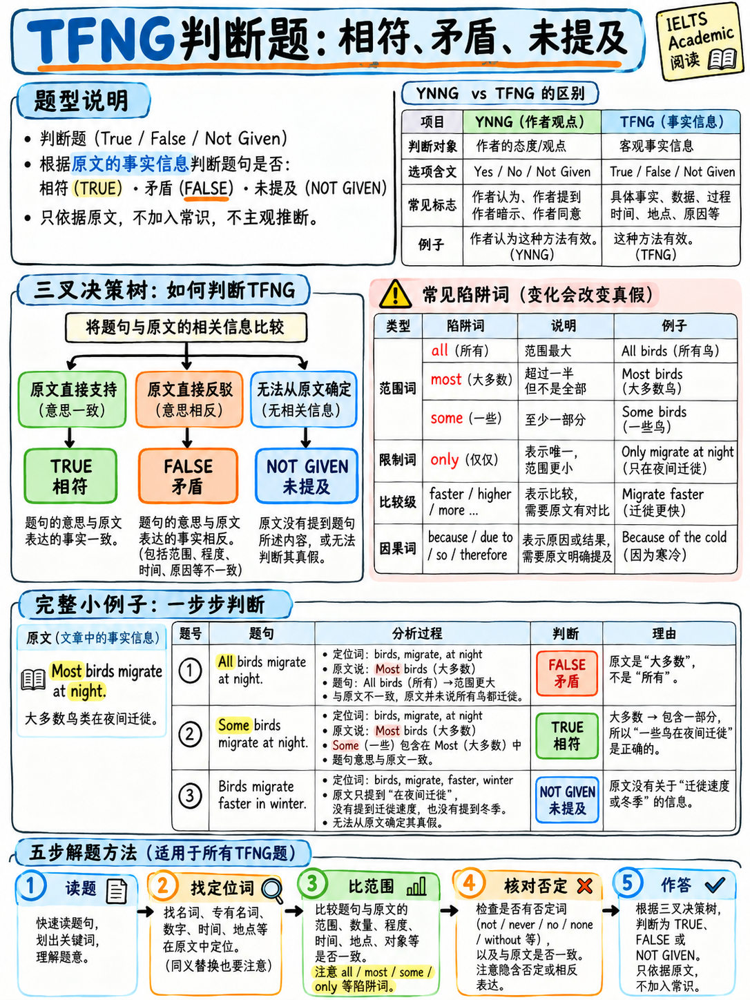

# 02. 判断题（TFNG / YNNG）逻辑判断决策漏斗与秒杀技巧 (True/False/Not Given)



> **本章核心定位**：判断题是雅思学术类阅读中题量最大、出现频率最高、同时也是中国考生最容易“纠结内耗”的核心题型。官方将其划分为两类：**TRUE / FALSE / NOT GIVEN**（针对客观事实判定）与 **YES / NO / NOT GIVEN**（针对作者观点与主张判定）`[3]`。判断题属于本课程划定的 **Tier A 核心必得分板块**：题目严格遵循原文顺序、答案仅有三选一，且完全依循严密的布尔逻辑与规则约束。只要掌握“三步逻辑决策漏斗”与“限制修饰词识别法”，判断题将从失分重灾区蜕变为全卷最稳定、拿分最快的提分引擎。

---

## 40.2.1 题型本质与两类判断题的官方界限

官方考试大纲明确将判断题分为两种独立题型 `[3]`：

| 官方题型名称 | 考查核心维度 | 题目指令用词 | 判定对象与题眼 |
|---|---|---|---|
| **Identifying Information** | **客观事实 (Factual Information)** | **TRUE / FALSE / NOT GIVEN** | 题干是对客观事实的描述，需比对原文事实记录是否吻合。 |
| **Identifying Writer's Views or Claims** | **作者观点或主张 (Opinion & Claims)** | **YES / NO / NOT GIVEN** | 题干反映的是作者的主观态度、论断或理论假说。 |

:::{warning}
**机考与答题卡格式绝对红线：**  
两类判断题的逻辑判定机制完全相同，但**录入的单词绝对不可混淆**！
- 如果题目指令要求填写 **TRUE / FALSE / NOT GIVEN**，考生若输入 `YES` 或 `NO`，在官方评分标准中直接判为 **0 分**！
- 反之，指令要求 **YES / NO / NOT GIVEN** 时，输入 `TRUE` 或 `FALSE` 亦无分！
- 在机考界面中，通常为单选圆钮（Radio Button）点击；但若是填空文本框，必须严格按照题目指令单词输入，切勿混淆。
:::

---

## 40.2.2 终极破局：三大判定的逻辑决策漏斗 (The Decision Funnel)

中国考生在判断题中失误率高达 80% 的根源，在于**混淆了 FALSE 与 NOT GIVEN**，以及**习惯用自己的现实常识脑补推导**。必须建立标准化的形式逻辑决策漏斗：

```{mermaid}
graph TD
    Start["读题干，提取核心断言 (Claim) 并锁定原文 3 句窗口"] --> Q1{"原文是否提及题干中的核心主语与关联属性？"}
    Q1 -- "完全未提及 / 属性缺失" --> NG["NOT GIVEN (未提及 / 无法推知)"]
    Q1 -- "明确提及相关事实/论断" --> Q2{"原文表述与题干断言是否完全一致？<br/>(同义替换, 逻辑等价)"}
    Q2 -- "一致 / 逻辑等值" --> TrueAns["TRUE / YES (符合原文)"]
    Q2 -- "不一致" --> Q3{"原文是否明确驳斥/抵触题干？<br/>(是否存在直接矛盾，两者不可能同时为真？)"}
    Q3 -- "白纸黑字直接矛盾 (Direct Contradiction)" --> FalseAns["FALSE / NO (明确相反/冲突)"]
    Q3 -- "仅提到部分事实，未反驳也未证实<br/>(或仅为他人观点、无端比较)" --> NG
```

### 三大定义的严谨判定准则

```
┌────────────────────────────────────────────────────────────────────────┐
│                        三大判断维度的黄金判定法则                      │
│                                                                        │
│  【TRUE / YES】                                                        │
│    • 原文表述与题干断言传达的是“同一件事” (Same Meaning)。              │
│    • 题干必定是对原文信息的高度【同义替换】(Paraphrase)，意思完全等值。 │
│                                                                        │
│  【FALSE / NO】                                                        │
│    • 原文白纸黑字陈述了与题干【截然相反】或【不可调和的矛盾事实】。      │
│    • 两者在逻辑上属于【互斥关系】(Mutually Exclusive)，不可能同时为真！ │
│    • 黄金检验法则：你必须能在原文中明确划出“证明题干说错了”的证据句！   │
│                                                                        │
│  【NOT GIVEN】                                                         │
│    • 原文没有给出足够信息以供判定。既未明确证实，也未白纸黑字反驳。    │
│    • 包含三种情形：                                                    │
│      1. 核心信息完全缺失（文章根本没提过该事物）；                    │
│      2. 题干各要素文中有提及，但【要素之间的关系未提及】（如无端比较）；│
│      3. 题干是断言事实，而原文仅为某位学者单方面的【主观假说/观点】。   │
└────────────────────────────────────────────────────────────────────────┘
```

:::{danger}
**区分 FALSE 与 NOT GIVEN 的唯一黄金问句：**  
当你在 FALSE 和 NOT GIVEN 之间犹豫不决时，在心里严厉拷问自己：  
> **“我能否在原文中找到白纸黑字的证据，指着它说‘这句话明确证明题干说假话/说反了’？”**

- **如果能找到这句反驳证据** ──> 判定为 **FALSE**；
- **如果原文只是没说明白、你觉得现实中可能不对、或者需要通过‘如果……那么可能……’来脑补推导** ──> 坚决判定为 **NOT GIVEN**！  
**切记：雅思考试只考“文章里写了什么”，绝不考“现实世界里什么是真的”！**
:::

---

## 40.2.3 题干定位与五步秒杀实战 SOP (5-Step Procedure)

在实际做题中，盲目通读段落不仅极度耗时，而且极易丢失焦点。判断题必须严格执行以下工业化五步操作流：

```
   STEP 1 ──> 圈划题干核心断言 (The Claim)
              找出题干中真正被断言的核心内容（通常是：谓语动词 + 宾语 + 范围修饰词）。
              这是你待会儿用于核对真伪的“比对标尺”。

   STEP 2 ──> 圈定不可替换锚点 (Unparaphrasable Anchors)
              在题干中寻找无法被改写的特征词：人名 (Smith)、机构大写 (UNESCO)、
              年代时间 (1985)、数字 (3,000)、地理专有名词 (Europe) 或罕见学术专词。

   STEP 3 ──> 沿顺序原则区间扫描定位 (Scan Along Sequential Order)
              【核心规律】：判断题 100% 遵循文章展开顺序！
              如果第 5 题在第 C 段找到，第 6 题的答案必在第 C 段后半部分或 D 段，
              绝不可能倒退到第 A 段！利用前后题位置，将搜寻区间压缩在 1-2 个段落内。

   STEP 4 ──> 锁定 3 句窗口，实施靶向精读 (Target Sentence + 1 Before + 1 After)
              在定位段落找到锚点后，精读包含锚点的【目标句】，并审读【其前一句与后一句】。
              95% 的判断题考点与同义替换都完整封装在由这 3 句话构成的语境窗口内。

   STEP 5 ──> 漏斗比对并落子判定 (Funnel Evaluation)
              对照题干核心断言与原文实际意思：
              • 语义同义重合 ──────────────────> TRUE / YES
              • 出现直接排他矛盾 ──────────────> FALSE / NO
              • 找不到证伪证据 / 核心关系未提 ──> NOT GIVEN
              
   【超时急救】：若在 Step 3 搜寻锚点超过 45 秒仍未见踪影，大概率该题为 NOT GIVEN，
                 果断标记 NOT GIVEN，迅速进入下一题，绝不恋战！
```

---

## 40.2.4 命题陷阱大盘点：限制修饰词陷阱 (The Qualifier Trap)

雅思考官在设计 FALSE 和 NOT GIVEN 题型时，极少会写粗暴的直接颠倒，而是通过极其精巧的**限制修饰词（Qualifiers）微调**来设置陷阱。考生必须在读题干时主动圈划以下 7 类修饰词：

| 限制修饰词类别 | 题干高危考点词 (圈划重点) | 考官常见设坑模式 |
|---|---|---|
| **数量范围 (Quantity)** | `all`, `every`, `most`, `many`, `some`, `few`, `none`, `only`, `solely` | 原文是“多数”(most)，题干改写为“所有”(all) ──> **FALSE**；原文是“部分”，题干说“唯一”(only) ──> **FALSE**。 |
| **发生频率 (Frequency)** | `always`, `usually`, `often`, `sometimes`, `rarely`, `seldom`, `never` | 原文是“有时”(occasionally)，题干改写为“总是”(always) ──> **FALSE**。 |
| **确定性与情态 (Certainty)** | `definitely`, `certainly`, `probably`, `possibly`, `may`, `might`, `could` | 原文是推测（may indicate），题干断言为定论（definitely proves） ──> **FALSE**。 |
| **程度与范畴 (Degree)** | `completely`, `entirely`, `largely`, `partly`, `slightly`, `barely` | 原文是“局部受损”，题干改写为“彻底摧毁”(completely destroyed) ──> **FALSE**。 |
| **比较关系 (Comparison)** | `more than`, `less than`, `the most`, `the first`, `superior to`, `as...as` | **高危陷阱**：原文分别提到了 A 和 B，但从未横向比较谁更好 ──> **NOT GIVEN**！ |
| **时间与时态 (Time/Tense)** | `before`, `after`, `prior to`, `currently`, `until`, `will`, `future` | 原文描述的是过去的历史事实，题干预测未来将持续发生 ──> **NOT GIVEN**。 |
| **因果关系 (Causality)** | `because`, `due to`, `as a result of`, `lead to`, `cause`, `reason` | 原文两件事同时发生（相关性），题干强加因果连接（导致了） ──> **NOT GIVEN**。 |

### 限制修饰词真题微观逻辑演练矩阵

| 原文原话 (Passage Text) | 题干判断陈述 (Statement) | 官方答案 | 考点逻辑深度解析 |
|---|---|:---:|---|
| "Most researchers now accept the theory." | "All researchers accept the theory." | **FALSE** | `most`（绝大多数）≠ `all`（全部）。强加绝对化修饰词，直接与原文矛盾。 |
| "Most researchers now accept the theory." | "The theory is widely accepted." | **TRUE** | `most researchers accept` 与 `widely accepted` 构成完美同义替换。 |
| "The technique was developed in Japan and later adopted in Europe." | "The technique was invented in Europe." | **FALSE** | 原文明确指出发源地为 Japan，题干声称发源于 Europe，白纸黑字直接矛盾。 |
| "The technique was developed in Japan and later adopted in Europe." | "The technique is more popular in Europe than in Japan." | **NOT GIVEN** | 原文提到了日本和欧洲两个主体，但**从未比较过两者的受欢迎程度**（无端比较）。 |
| "Sales rose by 12% in 2020 and by 3% in 2021." | "Sales grew more slowly in 2021 than in 2020." | **TRUE** | 2021 年增速 3% < 2020 年增速 12%，`grew more slowly` 逻辑完全成立。 |
| "Sales rose by 12% in 2020 and by 3% in 2021." | "Sales fell in 2021." | **FALSE** | 2021 年仍在上升（增长 3%），题干说下降（fell），直接矛盾。 |
| "Sales rose by 12% in 2020 and by 3% in 2021." | "Sales will continue to rise in 2022." | **NOT GIVEN** | 原文仅阐述过去两年的统计数据，对 2022 年的未来走势只字未提（无端预测）。 |
| "The programme was funded by the government until 2015." | "The programme received no private funding." | **NOT GIVEN** | 原文证实了政府资助，但对于是否有民间私人资助（private funding）完全未作陈述。 |
| "Critics argued that the policy was too expensive, but it was implemented anyway." | "The policy was never implemented." | **FALSE** | 原文写明 `it was implemented anyway`（依然落实），题干说从未落实，直接矛盾。 |
| "Critics argued that the policy was too expensive, but it was implemented anyway." | "The policy was expensive." | **NOT GIVEN** | **最精妙陷阱**：原文仅陈述“批评家声称该政策昂贵”（Critics argued that...），并不代表客观事实真的昂贵！主观观点不可等同于客观事实。 |

---

## 40.2.5 考官设局：NOT GIVEN 的五大典型形态特征

牢记考官炮制 NOT GIVEN 题目的 5 大标准模板，考场上一旦识别，便可大幅提升决策速度：

```
1. 凭空捏造比较关系 (The Unmade Comparison)
   • 原文同时提及了 X 和 Y 两个事物（甚至在同一句话中），但题干使用了 more than / better / superior 等进行对比。
   • 判别法：原文是否有明确的比较级逻辑？若无，必为 NOT GIVEN。

2. 凭空强加因果联系 (The Unstated Cause)
   • 原文提到了现象 A（如物种减少），也提到了现象 B（如气候变暖），但两者在文中并无因果引导词。题干强行断言“B 导致了 A”。
   • 判别法：文中是否存在 because / result from / lead to 等明确因果驱动？若无，必为 NOT GIVEN。

3. 事实偷换为主观评价 (The Unstated Evaluation)
   • 原文客观列举了一项政策、一次科学探险的事实过程，题干却主观判定该项目是“一次巨大的失败”(a failure) 或“非常成功”。
   • 判别法：作者或文中专家是否下过该主观价值判断？若无，必为 NOT GIVEN。

4. 历史事实推演未来 (The Future Prediction)
   • 原文用过去时态描述了上世纪的工业发展趋势，题干断言“该趋势在未来数十年仍将保持”。
   • 判别法：原文是否有 will / predict / forecast 等未来导向词？若无，必为 NOT GIVEN。

5. 细节过度具体化 (Extraneous Specific Detail)
   • 原文说“开展了一项关于青少年的实验研究”，题干却加上了“共有 400 名来自英国的青少年参与了实验”。
   • 判别法：数字与具体归属地是否受原文支持？若原文仅为泛指，则为 NOT GIVEN。
```

---

## 40.2.6 全真长篇深度实战精析 (Practice Set & Deep Walkthrough)

请仔细研读以下完全按照雅思官方学术规格定制的阅读文章，限时 **8 分钟** 完成后附的 8 道判断题，随后深入研读逐题逻辑拆解。

:::{admonition} 学术阅读全真实战文章：城市有轨电车的复兴 (The Return of the Urban Tram)
:class: note

**A.** For much of the twentieth century, the tram was regarded as an obsolete form of transport. Between 1930 and 1962, almost every British city removed its tram network, and similar closures occurred across North America. Trams were slow, the argument ran, they obstructed motor traffic, and the rails were expensive to maintain. By the mid-1960s, only a handful of systems survived in Western Europe, most notably in Germany, Switzerland and the Netherlands, where several cities retained and quietly modernised their networks rather than dismantling them.

**B.** That judgement has been comprehensively reversed. Since 1980, more than 150 new tram or light-rail systems have opened worldwide, and the rate of new openings has increased in each subsequent decade. France alone has built systems in over twenty cities since 1985, having closed all but three of its original networks. Most transport economists now accept that the mid-century closures were premature, although there remains considerable disagreement about why the reversal happened when it did.

**C.** The conventional explanation is capacity. A modern tram of forty metres can carry around 300 passengers, roughly four times the capacity of an articulated bus, and it can do so on a single pair of rails requiring less road width than two bus lanes. Where passenger volumes along a corridor exceed approximately 3,000 people per hour in each direction, light rail is generally cheaper to operate per passenger than buses, despite construction costs that are typically five to ten times higher per kilometre.

**D.** Others argue that the decisive factor was not capacity but land value. Studies in several European and North American cities have found that property prices within 500 metres of a new tram stop rise more quickly than those elsewhere in the same city. Because a tram line is a visible, fixed and expensive commitment, developers treat it as a guarantee that the area will continue to be served — a guarantee a bus route, which can be rerouted overnight, cannot provide. On this account, cities build trams less to move people than to signal permanence.

**E.** Both explanations have been criticised for understating the political dimension. Tram projects are highly visible and photograph well, and they can be delivered within a single political cycle in a way that an underground railway cannot. Dr Helena Marsh, who has studied twelve French systems, argues that the sequence of decisions in most cities is the reverse of the official account: the decision to build is taken first, and the capacity and land-value arguments are assembled afterwards to justify it. Whether this makes the projects bad investments is, she notes, a separate question, and in most of the cases she examined the completed systems carried more passengers than had been forecast.
:::

### 实战试题 (Statements 1–8)

请根据文章内容，判定下列陈述的真实性。在答题处填入 **TRUE**、**FALSE** 或 **NOT GIVEN**：

1. Most British cities closed their tram networks between 1930 and 1962.  
   *(在 1930 到 1962 年间，大多数英国城市拆除了其有轨电车网络。)*
2. All French tram networks were closed before 1985.  
   *(所有法国有轨电车网络都在 1985 年之前被全部关闭。)*
3. Trams were criticised in the mid-twentieth century for being expensive to maintain.  
   *(在 20 世纪中叶，有轨电车曾因维护费用高昂而受到批评。)*
4. German cities modernised their tram networks earlier than Swiss cities did.  
   *(德国城市对有轨电车网络的现代化改造早于瑞士城市。)*
5. A modern forty-metre tram carries about four times as many passengers as an articulated bus.  
   *(一辆现代 40 米长有轨电车的载客量大约是一辆铰接式公交车的四倍。)*
6. Light rail is always cheaper to operate per passenger than buses.  
   *(轻轨在人均运营成本上始终比公交车更便宜。)*
7. Property prices near new tram stops rise faster than elsewhere in the same city.  
   *(新建有轨电车站点附近的房价上涨速度快于同城其他地段。)*
8. Dr Marsh concludes that most tram projects are poor investments.  
   *(马什博士总结得出结论：大多数有轨电车项目都是糟糕的投资。)*

---

### 逐题全真逻辑深度拆解与采分点映射

#### 第 1 题：Most British cities closed their tram networks between 1930 and 1962.
- **官方答案**：**TRUE**
- **定位锚点**：年代 `1930 and 1962`、专有名词 `British city`（回文锁定段落 A 第二句）。
- **原文核心证据句**：  
  > *"Between 1930 and 1962, almost every British city removed its tram network..."*
- **逻辑比对与同义替换**：  
  - 题干中的 `closed ... networks` 对应原文的 `removed its tram network`；
  - 范围限定词：原文为 `almost every`（几乎每一个），题干为 `most`（大多数）。在逻辑推导中，强命题必然蕴含弱命题（“几乎每个”成立，则“大多数”必然成立）。信息吻合且无冲突，判定为 **TRUE**。

---

#### 第 2 题：All French tram networks were closed before 1985.
- **官方答案**：**FALSE**
- **定位锚点**：专有名词 `French` / `France`、年代 `1985`（回文锁定段落 B 第三句）。
- **原文核心证据句**：  
  > *"France alone has built systems in over twenty cities since 1985, having closed all but three of its original networks."*
- **逻辑比对与考点陷阱**：  
  - 题干核心断言为绝对化词汇：`All`（全部关闭）；
  - 原文白纸黑字写明：`having closed all but three`（除了 3 条之外全部关闭，即**保留了 3 条原有网络**）。  
  - 3 条幸存事实与题干的“全部关闭”构成直接不可调和的互斥矛盾。考官设置了经典的**数量限定词陷阱**，直接判定为 **FALSE**。

---

#### 第 3 题：Trams were criticised in the mid-twentieth century for being expensive to maintain.
- **官方答案**：**TRUE**
- **定位锚点**：时间状语 `mid-twentieth century`（段落 A 讲的 1930-1962 历史时期）、核心考点 `expensive to maintain`。
- **原文核心证据句**：  
  > *"Trams were slow, the argument ran, they obstructed motor traffic, and the rails were expensive to maintain."*
- **逻辑比对与同义替换**：  
  - 原文明确指出当时的反对观点包含 `the rails were expensive to maintain`（轨道维护成本昂贵）；
  - 原文的 `the argument ran`（当时的反对论点认为）同义替换题干中的 `were criticised for...`。指称对象轨道与电车体系一致，判定为 **TRUE**。

---

#### 第 4 题：German cities modernised their tram networks earlier than Swiss cities did.
- **官方答案**：**NOT GIVEN**
- **定位锚点**：专有名词 `German` 与 `Swiss`（回文锁定段落 A 尾句）。
- **原文核心证据句**：  
  > *"By the mid-1960s, only a handful of systems survived in Western Europe, most notably in Germany, Switzerland and the Netherlands, where several cities retained and quietly modernised their networks rather than dismantling them."*
- **逻辑比对与考点陷阱**：  
  - 原文确实将德国（Germany）、瑞士（Switzerland）和荷兰并列提出，指出这些国家的城市保留并悄然对其网络进行了现代化改造；
  - 但是，原文**完全没有对德国和瑞士谁先谁后进行时间比较**！题干强加了比较级 `earlier than`，属于教科书级别的**“无端比较型 NOT GIVEN”**。

---

#### 第 5 题：A modern forty-metre tram carries about four times as many passengers as an articulated bus.
- **官方答案**：**TRUE**
- **定位锚点**：数字与量词 `forty-metre`、名词 `articulated bus`（回文锁定段落 C 首两句）。
- **原文核心证据句**：  
  > *"A modern tram of forty metres can carry around 300 passengers, roughly four times the capacity of an articulated bus..."*
- **逻辑比对与同义替换**：  
  - 原文 `around 300 passengers, roughly four times the capacity of...` 与题干 `about four times as many passengers as...` 结构完全契合；
  - 限制词 `roughly` 完美替换 `about`，事实完全一致，判定为 **TRUE**。

---

#### 第 6 题：Light rail is always cheaper to operate per passenger than buses.
- **官方答案**：**FALSE**
- **定位锚点**：比较级 `cheaper to operate`、名词 `light rail` 与 `buses`（回文锁定段落 C 尾句）。
- **原文核心证据句**：  
  > *"Where passenger volumes along a corridor exceed approximately 3,000 people per hour in each direction, light rail is generally cheaper to operate per passenger than buses..."*
- **逻辑比对与考点陷阱**：  
  - 题干使用了绝对化副词：`always`（在任何情况下始终更便宜）；
  - 原文给出了极其严格的**前置假设条件**：`Where passenger volumes ... exceed approximately 3,000 ...`（只有当客流量单向每小时超过约 3,000 人时），并且修饰词为 `generally`（通常情况下）。  
  - “附带严格条件的通常适用”与题干的“无条件始终适用（always）”发生实质逻辑冲突。有证据证伪，判定为 **FALSE**。

---

#### 第 7 题：Property prices near new tram stops rise faster than elsewhere in the same city.
- **官方答案**：**TRUE**
- **定位锚点**：名词 `Property prices`、空间距离 `near new tram stops`（回文锁定段落 D 前两句）。
- **原文核心证据句**：  
  > *"Studies in several European and North American cities have found that property prices within 500 metres of a new tram stop rise more quickly than those elsewhere in the same city."*
- **逻辑比对与同义替换**：  
  - 原文的 `within 500 metres of a new tram stop` 同义替换题干中的 `near new tram stops`；
  - 原文的 `rise more quickly` 同义替换题干的 `rise faster`。事实与比较关系完全契合，判定为 **TRUE**。

---

#### 第 8 题：Dr Marsh concludes that most tram projects are poor investments.
- **官方答案**：**FALSE**
- **定位锚点**：人名 `Dr Helena Marsh`（回文锁定段落 E 核心句）。
- **原文核心证据句**：  
  > *"Whether this makes the projects bad investments is, she notes, a separate question, and in most of the cases she examined the completed systems carried more passengers than had been forecast."*
- **逻辑比对与考点陷阱**：  
  - 题干声称马什博士得出结论：“大多数电车项目是糟糕的投资”；
  - 原文明确指出：项目是否为不良投资是一个**独立的问题（a separate question）**，且她指出现实中客流量超过预期。她**不仅没有得出此项负面结论，而且给出的证据恰恰相反**！因此直接与题干矛盾，判定为 **FALSE**（而非 NOT GIVEN）。

---

## 40.2.7 考场极限蒙猜概率学与三周提分规划

在实战考试中，如果因为时间极度紧迫（如 Passage 3 只剩 2 分钟），判断题必须以科学策略理性蒙猜，绝不留空：

```
┌────────────────────────────────────────────────────────────────────────┐
│                     考场判断题极限定位与蒙猜决断表                     │
│                                                                        │
│  场景 1：精准找到了定位句，但在 TRUE 和 FALSE 之间纠结                  │
│    ──> 重新审读题干中的【限定修饰词】（范围、程度、频率）！              │
│        十有八九差异就藏在某个极其细微的副词或情态动词上。              │
│                                                                        │
│  场景 2：扫视整段 45 秒，完全找不到题干的核心论点或比较关系             │
│    ──> 果断填写【NOT GIVEN】并立刻跳过！不要在一个不存在的信息上浪费时间。 │
│                                                                        │
│  场景 3：题干包含极其激进的极端词汇 (all, never, completely, solely)   │
│    ──> 在学术外刊中，学术学者极少使用绝对化字眼。此题大概率为【FALSE】。  │
│                                                                        │
│  场景 4：最后 30 秒，完全没时间看题，需要纯概率盲猜                    │
│    ──> 盲猜优先选择【NOT GIVEN】或依据前面做出的选项平衡分布。          │
│        官方虽然从未公开过固定的答案配比，但在统计学上，一个 4-5 题的   │
│        判断题题组通常三种选项都会出现，极少出现全是一类的情况。        │
└────────────────────────────────────────────────────────────────────────┘
```

### 判断题三周冲刺落地训练清单

- [ ] **定量精练**：在考前完成至少 **10 组高品质真题判断题**（约 60–70 道题）。
- [ ] **错题归因四分法**：准备一本错题本，对每道错题强制标注四类根因之一：
  1. **定位偏差**（找错了段落或找漏了后半句）；
  2. **忽略限制修饰词**（没注意到 most ≠ all 或 generally ≠ always）；
  3. **常识脑补过度**（用自身背景知识去弥补文中未提及的逻辑）；
  4. **混淆 FALSE 与 NOT GIVEN**（找不到证伪证据却强行判错）。
- [ ] **达标考核线**：第 1 周正确率达到 70%，考前模考稳定达到 **85%+**。判断题是雅思全卷最容易被攻克为“满分基本盘”的题型，必须将其打造成保分护城河！

---

**上一章：** {doc}`01-scoring-and-section-tactics` | **下一章学习指南：** {doc}`03-completion-and-short-answer`
