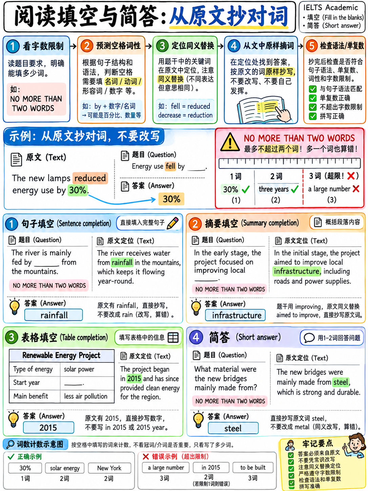

# 03. 填空与简答题（Summary/Table/Flow-chart/Sentence Completion）原词定位法 (Completion Tasks)



> **本章核心定位**：在雅思学术类阅读全卷 40 道题中，各类填空题与简答题通常占据 **12–18 道题（占比 30%–45%）**。它们是本课程毫无争议的 **Tier S（王炸主力·性价比最高）板块**。之所以将其列为第一得分基本盘，是因为其底层考查机制具有决定性的客观红利：**95% 的答案直接取自文章原文原词**！这意味着考生无需承担英语词汇创造与语法重组的风险，只要能“定准位置、看准词性、精准照抄”，就能稳稳拿下这近半壁江山的分数。

---

## 40.3.1 填空题家族全景梳理与为什么是 Tier S

官方考试大纲共定义了五种核心填空与简答变体 `[3]` `[25]`：

```
┌────────────────────────────────────────────────────────────────────────┐
│                        雅思阅读五大填空题型家族                         │
│                                                                        │
│  1. 单句填空 (Sentence Completion) ──────────────── 典型顺序题，单句提取│
│  2. 摘要填空 (Summary Completion) ───────────────── 段落浓缩，原词/选词 │
│  3. 笔记填空 (Notes Completion) ─────────────────── 树状层级，提纲挈领 │
│  4. 表格/流程图/图示 (Table / Flow-chart / Diagram) 结构化维度，按序推进│
│  5. 简答题 (Short-answer Questions) ────────────── 疑问句直接原词作答 │
└────────────────────────────────────────────────────────────────────────┘
```

### 为什么填空题是全卷性价比之王？

| 核心特征 | 考生直接受益的考场红利 | 战术应对法则 |
|---|---|---|
| **原词照抄 (Direct Lift)** | 答案 100% 存在于原文中，无需自己改写词形或变换时态。 | 抄写时保持原汁原味，杜绝擅自加减字母。 |
| **拼写零创造风险** | 单词就印在屏幕/试卷上，只要眼手一致，绝不会产生陌生词拼写错误。 | 抄完后一眼核对拼写，特别注意字母组合如 `ie/ei`。 |
| **高度遵循顺序原则** | 题目基本严格按照原文行文顺序排布（除少数跨段选词摘要外）。 | 顺水推舟，做完第 1 题顺着往下找第 2 题。 |
| **语法环境强力预判** | 空格前后的介词、冠词、主谓结构可提前锁定所需词性与单复数。 | 提前锁定词性，回文时自动过滤 90% 不合语法的干扰词。 |
| **做题顺带读懂文章** | 在定位填空题的过程中，你的视线已经地毯式扫过了文章核心段落。 | 为后续攻克高难度的 Matching 题型免费铺平道路。 |

:::{warning}
**唯一的高难度变体：词库选词型摘要填空 (Summary with a Box)**  
绝大多数填空题要求 "Choose words from the passage"，但有一种变体是文后附带一个供选择的词汇选项框（A–I 候选词）`[25]`。此时选项框里的单词通常是**原文对应词的深度同义改写词（Paraphrases）**，而非原文原词。遇到此题型时，其本质更接近多项选择题，需重点关注语义转换。
:::

---

## 40.3.2 审题三红线：字数限制与答题格式纪律

填空题是纯客观采分，只要超出字数限制，即便语义再准确，系统直接判定为 **0 分**。

### 官方字数限制指令对照表

| 题目指令文本 | 核心含义 | "a major breakthrough"<br>(3 词) | "eco-friendly"<br>(1 词) | "twenty-five percent"<br>(2 词) | "in 1985"<br>(1词+1数字) |
|---|---|:---:|:---:|:---:|:---:|
| **ONE WORD ONLY** | 仅限填 1 个词 | ❌ (0分) | ✅ | ❌ (0分) | ❌ (0分) |
| **NO MORE THAN TWO WORDS** | 最多填 2 个词 | ❌ (0分) | ✅ | ✅ | ✅ |
| **NO MORE THAN THREE WORDS AND/OR A NUMBER** | 最多 3 个词，可含 1 个数字 | ✅ | ✅ | ✅ | ✅ |

### 官方评分细则关于词数计算的三大铁律 `[3]`：
1. **连字符单词算一个词 (Hyphenated Words)**：官方明确规定，如 `check-in`、`well-being`、`eco-friendly` 均按 **1 个单词** 计算。
2. **数字的计数规则 (Numbers)**：阿拉伯数字（如 `2024`、`15%`）算作一个数字（a number），不占文字词数名额。
3. **冠词断舍离原则 (Drop the Articles)**：在字数受限时，`a`, `an`, `the` 几乎永远是多余的负担。如果答案是 `a rare mineral` 而字数限制是 TWO WORDS，直接去掉冠词填写 `rare mineral`，完全契合采分标准且杜绝超词暴毙风险！

:::{danger}
**超出一词即判 0 分，无任何同情分！**  
如果一道题的标准采分点是 `labour costs`（2 词），而考生多写了原文前面的动词写成 `cut labour costs`（3 词），在要求 "NO MORE THAN TWO WORDS" 的题型中，该题直接判为 0 分！宁可少写修饰性冠词，也绝不超出字数上限。
:::

---

## 40.3.3 破局利器：空格语法预判技术 (Grammar-of-the-Gap Prediction)

普通考生做填空题是“先看空格，再回文大海捞针”；专业考生的绝技是**在回文前，仅凭空格前后的语法结构，就已经锁定了目标词的词性、单复数乃至语义色彩**。

```{mermaid}
graph TD
    A["审读填空题题干句子"] --> B["分析空格所处语法插槽 (Syntactic Slot)"]
    B --> C1["空前有 a / an / the / 形容词"] --> N["锁定为名词 (Noun)，关注单复数"]
    B --> C2["空前有 can / will / to"] --> V["锁定为动词原形 (Base Verb)"]
    B --> C3["空前有 be / become / remain"] --> Adj["锁定为形容词 (Adj) 或过去分词 (V-ed)"]
    B --> C4["空前有 in / by / through / of 介词"] --> PrepN["锁定为名词或动名词 (-ing)"]
    C1 --> Scan["带着精准词性与定位锚点回文扫视"]
    C2 --> Scan
    C3 --> Scan
    C4 --> Scan
    Scan --> Result["快速剔除段落中所有不合语法的词，精准锁定靶心词！"]
```

### 考场常见语法预判速查与真题比对矩阵

| 题干空格所在语境 | 语法预判推导结果 | 原文真实对应句 | 正确提取词 (原词) | 典型错误 (语法不符/超词) |
|---|---|---|:---:|---|
| "The decline was caused mainly by a shortage of ______." | 介词 `of` 之后，必填**不可数名词或复数名词**（表短缺的对象） | "...largely because skilled workers were unavailable..." | **skilled workers** | *unavailable* (词性错为形容词) |
| "Researchers were surprised by how ______ the process was." | 连系动词 `was` 之后，表语必为**形容词** | "...the speed of the reaction astonished the team..." | **fast / rapid** *(需原文有原词)* | *speed* (词性错为名词) |
| "The material must be ______ before it is reused." | 被动语态 `must be` 之后，必为**动词过去分词** | "...it is first cleaned and then dried..." | **cleaned** | *clean* / *cleaning* (语态错误) |
| "Only ______ of the samples contained the compound." | `Only` 之后，表**具体数量或百分比** | "...just 12% of the samples showed any trace..." | **12%** | *a small proportion* (超词且非原词) |
| "The team worked at the site for ______ years." | `for ... years` 中间修饰数词，必为**基数词** | "...a four-year excavation..." | **four** | *four-year* (合成形容词，语法不合) |
| "The invention was intended to reduce ______." | 及物动词 `reduce` 之后，必为**抽象名词或宾语名词** | "...the aim was to cut labour costs..." | **labour costs** | *to cut labour costs* (多余小品词) |

:::{tip}
**黄金回读自检法 (Mental Reread Test)**：  
在机考框输入提取词后，**务必在脑海中将整句话连贯默读一遍**！如果读起来语序别扭、主谓不一致或介词冲突，那么这个答案 100% 找错了。雅思官方在命题时，严丝合缝地确保提取出的原词放入空格后能组成一个毫无语病的高级学术英文句子。
:::

---

## 40.3.4 摘要与单句的同义替换密码库 (The Synonym Paraphrasing Matrix)

填空题的题干是对原文信息的高度浓缩与改写。命题组绝对不会在题干中直接使用原文原词来提示答案，而是通过严密的**同义转换（Paraphrase）**进行伪装。

掌握以下高频同义替换模式，便能秒破命题组的改写障眼法：

| 语义逻辑维度 | 题干（Summary / Sentence）常见表达 | 原文（Passage Text）对应同义替换库 |
|---|---|---|
| **起源与开端** | `began`, `started`, `introduced` | `was initiated`, `originated`, `dates back to`, `pioneered` |
| **增长与扩张** | `increased`, `multiplied`, `surged` | `rose`, `grew`, `expanded`, `was augmented`, `escalated` |
| **削减与缓解** | `reduce`, `curtail`, `lower` | `cut`, `diminish`, `curb`, `mitigate`, `alleviate` |
| **关键与重要** | `important`, `essential`, `crucial` | `significant`, `vital`, `key`, `pivotal`, `indispensable` |
| **阻碍与困难** | `difficult`, `barrier`, `obstacle` | `challenging`, `problematic`, `impediment`, `hurdle` |
| **学界与研究** | `many researchers`, `scientists believe` | `a number of studies`, `much of the literature`, `experts contend` |
| **核心诱因** | `the main reason`, `primary cause` | `the principal cause`, `the chief factor`, `the driving force` |
| **资金与资本** | `money`, `financial support` | `funding`, `investment`, `capital`, `revenue`, `grants` |
| **恶化与衰退** | `get worse`, `decline`, `worsen` | `deteriorate`, `degenerate`, `undergo decline` |
| **意外与反常** | `unexpected`, `unanticipated` | `surprising`, `counterintuitive`, `contrary to expectations` |

---

## 40.3.5 全真长篇深度实战精析 (Practice Set & Deep Walkthrough)

请仔细阅读以下学术真题篇章，严格遵守字数限制：**NO MORE THAN TWO WORDS**（每空不超过两词），限时 **9 分钟** 完成 10 道笔记填空题，随后研读逐题全真剖析。

:::{admonition} 学术阅读全真实战文章：种子库的经济学 (The Economics of Seed Banks)
:class: note

Seed banks store the seeds of cultivated and wild plants at low temperature and low humidity so that genetic diversity is preserved against future loss. The largest is the Svalbard Global Seed Vault in Norway, which opened in 2008 and holds backup copies of collections held elsewhere. Seeds there are kept at minus eighteen degrees Celsius inside a mountain, a location chosen because the surrounding permafrost would keep the chamber cold for several weeks even if the refrigeration equipment failed completely.

The scientific case for such facilities is uncontroversial. Modern agriculture depends on a remarkably narrow genetic base: roughly two-thirds of global calorie intake comes from just nine crop species. When a pathogen adapts to a widely planted variety, the only rapid defence is to breed resistance into it from a related wild plant, and that wild relative must therefore still exist somewhere. In 1970 a fungus destroyed around fifteen per cent of the United States maize harvest; resistance was eventually located in a landrace collected in Mexico decades earlier.

The economic case is harder to make, because the benefits are both enormous and almost entirely hypothetical until the moment they are needed. Annual operating costs at Svalbard are modest — under a million dollars — but the global network of roughly 1,700 seed banks is estimated to cost several hundred million dollars a year, and the great majority of accessions will never be used. Economists describe such expenditure as an insurance premium, and the difficulty with insurance premiums is that they are always easy to cut in a bad year.

A second difficulty is duplication. Surveys suggest that as much as thirty per cent of material in the global system is held in more than one collection, often without either institution being aware of the overlap. Some duplication is deliberate and desirable, since a single fire or power failure should not destroy a unique sample. But unintended duplication consumes storage space and staff time that could be spent collecting the wild relatives that remain genuinely unrepresented. Coordinating this is the task of a small number of international bodies, whose authority is advisory rather than binding.
:::

### 实战试题 (Notes Completion 1–10)

**Complete the notes below. Write NO MORE THAN TWO WORDS for each answer.**  
*(完成以下笔记。每个空格填写不超过两个单词。)*

**Svalbard Global Seed Vault (斯瓦尔巴全球种子库)**
- Opened in: **(1)** ______  
  *(投入运营年份：)*
- Storage temperature: **(2)** ______ degrees Celsius  
  *(储存温度：摄氏度)*
- Built inside a mountain so that the **(3)** ______ would maintain low temperatures if the cooling system broke down  
  *(依山而建以确保在制冷设备故障时 ______ 仍能维持低温)*
- Yearly running costs: under one **(4)** ______  
  *(年度运营维护花销：少于一百万 ______)*

**Why diversity matters (为何物种多样性至关重要)**
- About two-thirds of the world's calories come from only **(5)** ______ crop species  
  *(全球约三分之二的热量摄入仅来源于 ______ 种农作物品种)*
- In 1970, a **(6)** ______ destroyed roughly 15% of the US maize crop  
  *(1970年，一种 ______ 摧毁了美国近15%的玉米收成)*
- Resistance was found in a **(7)** ______ previously collected in Mexico  
  *(抗病抗性最终在早前采集于墨西哥的一种 ______ 中被发现)*

**Problems with the global system (全球种子体系当前困境)**
- Economists compare the spending to an **(8)** ______  
  *(经济学家将这笔庞大支出形象地比作一笔 ______)*
- Up to 30% of stored material is held in more than one **(9)** ______, often unknowingly  
  *(高达30%的储藏资源被在不知情的情况下重复储存在不止一个 ______ 中)*
- International coordinating bodies have authority that is only **(10)** ______  
  *(国际协调机构所拥有的官方管理权威性质仅仅是 ______)*

---

### 逐题全真逻辑深度拆解与采分点映射

| 题号 | 官方正确答案 | 语法预判分析 | 原文精准出处与同义替换映射 | 考生高危失分根因警示 |
|:---:|:---:|---|---|---|
| **1** | **2008** | `Opened in:` 之后必填**年代年份** | 第一段第二句：`which opened in 2008`。原词提取，数字直接计入。 | 试图加上介词写 `in 2008` 导致与题干介词重复。 |
| **2** | **minus eighteen** | `______ degrees Celsius` 前必填**温度数字/读数** | 第一段第三句：`Seeds there are kept at minus eighteen degrees Celsius...` | 若贪多写 `minus eighteen degrees` 则为 3 词，**超词直接判 0 分**！ |
| **3** | **permafrost**<br>*(或 surrounding permafrost)* | `the ______ would maintain` 中间必填**具有保冷作用的名词主语** | 第一段尾句：`the surrounding permafrost would keep the chamber cold...`。其中 `maintain low temperatures` 同义替换 `keep the chamber cold`。 | 填 `freezer` 或非原文生造词判错。 |
| **4** | **million dollars** | `under one ______` 之后必填**货币单位名词** | 第三段第二句：`Annual operating costs ... are modest — under a million dollars`。题干 `Yearly running costs` 替换 `Annual operating costs`。 | 题干已印刷 `under one`，若抄写 `a million dollars` 将导致语法畸形（under one a million...）判错。 |
| **5** | **nine** | `only ______ crop species` 中间必填**基数词修饰语** | 第二段第二句：`roughly two-thirds of global calorie intake comes from just nine crop species`。`only` 替换 `just`。 | 误填为 `nine crop` 导致后方物种名词重复。 |
| **6** | **fungus** | 不定冠词 `a` 之后必填**单数名词（病原体/灾害类型）** | 第二段尾句：`In 1970 a fungus destroyed around fifteen per cent...`。`roughly 15%` 替换 `around fifteen per cent`。 | 填成复数 `fungi` 判错；抄成 `pathogen` 虽通顺但非该句原词。 |
| **7** | **landrace** | `in a ______ previously collected` 中间必填**单数名词（作物变种）** | 第二段尾句：`resistance was eventually located in a landrace collected in Mexico decades earlier`。`previously` 替换 `decades earlier`。 | 遇到 `landrace`（地方品种）以为是生词不敢填。**牢记原词照抄原则，不认识也照抄！** |
| **8** | **insurance premium** | 不定冠词 `an` 之后必填**元音开头的单数名词短语** | 第三段尾句：`Economists describe such expenditure as an insurance premium...`。`spending` 替换 `expenditure`。 | 漏抄 `premium` 仅写 `insurance` 不够精确。 |
| **9** | **collection** | `more than one ______` 之后必填**可数单数名词** | 第四段第二句：`as much as thirty per cent ... is held in more than one collection...`。 | 抄成复数 `collections` 导致语法与 `one` 冲突判错。 |
| **10** | **advisory** | 系动词 `is only ______` 之后必填**形容词或修饰语** | 第四段尾句：`whose authority is advisory rather than binding`。`authority that is only...` 完美契合。 | 抄写成名词 `advice` 破坏表语形容词语法结构。 |

---

## 40.3.6 核心戒律：原词照抄与词形变换的唯一合法边界

:::{important}
**原词照抄铁律（The Verbatim Principle）**：  
在真实的雅思学术阅读填空题中，考官在设计空格时，已经百分之百保证了：**直接从文章中提取出来的原词，放入空格后语法必定完全顺畅！**

因此，如果你发现自己为了契合空格语法，**必须手动改变单词词性**（例如把名词变成形容词、把动词原形改成主动 -ing、把名词变副词），那么：  
**你 99% 找错了句子！**  
请立刻停止在这个错误句子上浪费时间，重新回到文章中寻找真正对应的靶心句。

**考场上唯一被官方认可的极其微小的容错调整仅有两种：**
1. **单复数尾缀 `-s`**：在极少数语法严格受限的场合，官方评分标准接受加或减单复数（如官方样题答案注明 `scientist(s)` `[18]`）；
2. **剔除冗余冠词**：主动删除原文中的 `a / an / the` 以避免超出 TWO WORDS 或 THREE WORDS 的字数红线。
:::

---

## 40.3.7 填空题三周满分通关训练规划

- [ ] **完成 15 组全真填空专项集训**：填空题在雅思阅读中题量最庞大，刷题见效最快，是考前最值得投入精力的提分基本盘。
- [ ] **养成“读空必念词性”的肌肉记忆**：在日常刷题时，每遇到一个空格，必须强制在题干旁边用铅笔写下预判词性（如：`[n. pl.]` 表复数名词，`[adj.]` 表形容词）。
- [ ] **清零机械性失分**：每次批改后，重点统计因“超字数限制”和“抄漏抄错字母”导致的失分。这类机械性丢分必须在一周内**彻底压缩归零**！
- [ ] **达标线设定**：填空题的目标正确率必须定在 **85%–90%+**。只有守住填空题的绝对基本盘，冲击 7.0 分乃至 8.0 分才有扎实的底气。

---

**上一章：** {doc}`02-true-false-not-given` | **下一章学习指南：** {doc}`04-matching-tasks`
