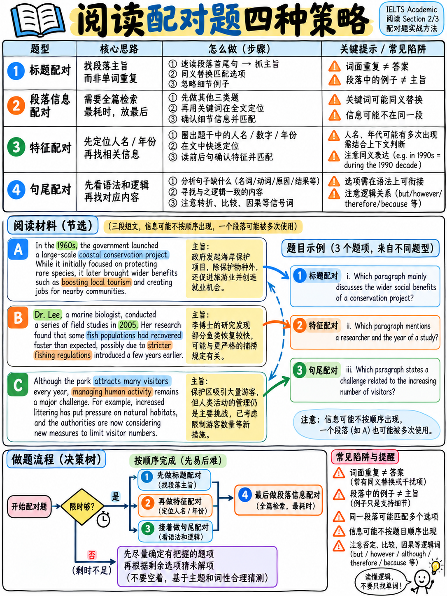

# 04. 配对题全攻略：人名/特征匹配、段落标题 (Headings) 与段落信息 (MI) 避坑 (Matching Tasks)



> **本章核心定位**：配对题（Matching Tasks）是雅思学术类阅读中“最耗时、最考验战略取舍、最容易造成考场时间大崩盘”的题型家族。很多考生在配对题上一耗就是 10 多分钟，导致后续题目全线崩溃。配对题内部各题型的难度与性价比天差地别：**句子首尾配对遵循严格顺序，是拿分甜区；人名匹配通过专有名词能够极速攻克；而段落信息匹配（MI）则是全卷公认的“时间黑洞”**。本章将对四大配对题型进行彻底解构，传授“先易后难排除法”、“逆向人名标记法”与“语法排他秒杀法”，并确立科学的止损与放弃策略。

---

## 40.4.1 配对题家族全景梳理与战略优先级矩阵

官方考试大纲共定义了四种配对题型 `[3]`，其在行文顺序性、耗时成本与提分杠杆上存在本质差异：

| 官方配对题型 | 核心考查任务 | 顺序原则 (Order) | 题型难度 | 战术优先级评级 |
|---|---|:---:|:---:|:---:|
| **完成句子首尾配对<br>(Matching Sentence Endings)** | 为给定的前半句从选项框中选出最恰当的后半句 | **严格按原文顺序！** | 中等 | **Tier A (优先攻破)**<br>具备顺序性与语法排他性双重红利 |
| **特征/人名理论匹配<br>(Matching Features)** | 将题干观点或发现匹配至对应学者、年代或机构 | 乱序 (无顺序) | 中等偏易 | **Tier A (高效突破)**<br>人名为不可替换专有名词，定位极快 |
| **段落标题配对<br>(Matching Headings)** | 为各段落从候选列表中挑选最能概括主旨的标题 | 乱序 (按段落推进) | 偏难 | **Tier B (通晓全篇后再做)**<br>考查宏观段落论证功能，先易后难排除 |
| **段落信息包含题<br>(Matching Information - MI)** | "Which paragraph contains the following information?" | **彻底乱序！** | **极高** | **Tier C (战略避坑·留到最后)**<br>单位分耗时最大，考场止损与猜题主力 |

```{mermaid}
graph TD
    subgraph GoldenOrder["配对题篇章内做题次序战略决策树"]
        Start["遇到包含配对题的阅读篇章"] --> Check1{"是否存在填空或判断题？"}
        Check1 -- "YES" --> DoEasy["先完成所有填空题与判断题！<br/>(建立全篇段落记忆与框架认知)"]
        Check1 -- "NO" --> P1
        DoEasy --> P1["处理【句子首尾配对 (MSE)】<br/>(按顺序推进, 利用语法排除法秒杀)"]
        P1 --> P2["处理【人名/特征匹配 (MF)】<br/>(原文逆向圈定所有人名, 集中比对)"]
        P2 --> P3["处理【段落标题配对 (Headings)】<br/>(先做结构鲜明的容易段落, 排除法收网)"]
        P3 --> P4["最后处理【段落信息包含题 (MI)】<br/>(单题限时60秒, 提取数字/生词定位; 剩余果断蒙猜)"]
    end
```

---

## 40.4.2 段落标题配对 (Matching Headings) 破题四步法

段落标题配对（List of Headings）要求考生为每个段落挑选一个总结性标题。选项数量（通常 6–10 个）永远多于段落数量（4–7 个），存在大量高迷惑性干扰项。

### 核心做题机制：功能阅读法 (Function Reading)
段落标题配对**绝对不能靠死搜细节关键词来做**，因为标题概括的是**全段的论证功能与主旨大意**。如果带着标题里的某个细节词去搜，必落入考官精心布置的“细节陷阱”。

```
   STEP 1 ──> 审读候选标题列表 (List of Headings)，进行【双胞胎分组】     (约 60 秒)
              标记出意思相近或结构对称的标题对（如：“X 的成因” vs “X 的后果”）。
              这类“双胞胎标题”往往一个是真答案，另一个是量身定做的干扰项！

   STEP 2 ──> 实施【首尾转折扫描法】精读段落骨架                         (每段约 45 秒)
              针对目标段落，精读：
              • 第一句 (Topic Sentence - 70% 的段落首句交代主旨)；
              • 第二句或段中转折句 (However / But / Yet / While - 颠覆上文)；
              • 尾句 (总结陈词或承上启下)。

   STEP 3 ──> 用中文在草稿纸上概括该段的【论证功能】
              不要试图翻译整段，用 2-4 个字提炼它在整篇文章中的角色：
              （如：“背景交代”、“列举弊端”、“学者争鸣”、“未来展望”）。

   STEP 4 ──> 对照标题列表，【先易后难，排除法收网】
              绝对不要硬抠最难的段落！先把结构最明显、最确定的 2-3 个段落选好并划掉标题。
              随着候选标题数量从 8 个锐减至 3-4 个，难题的选择范围被大幅压缩，真相大白。
```

### 考官布置的四大致命标题陷阱

| 标题陷阱模式 | 考官设计机理 | 破解防身战术 |
|---|---|---|
| **以偏概全细节陷阱 (The Detail Trap)** | 标题直接照搬了段落中某一句话的几个原词，但这仅是支持主旨的一个小例子或旁支细节。 | 问自己：**这个标题能否覆盖整段全部内容？** 如果只涵盖了前两行，断然排除！ |
| **近亲双胞胎干扰 (The Near-Twin)** | 两个标题极为相似，仅差一个限定词（如 *The causes of decline* vs *The effects of decline*）。 | 在 Step 1 提前标记差异词（原因 vs 影响），看段落落脚点是在前因还是后果。 |
| **跨段张冠李戴 (Wrong Paragraph)** | 标题确实符合文章内容，但对应的是相邻的下一段；当前段落只是在尾句引出了这个话题。 | 审清段落重心的展开部分，引言句不代表本段核心。 |
| **空洞宏大标题 (The Over-General)** | 标题范围极度宽泛（如 *The importance of modern scientific research*），看似放之四海而皆准。 | 纯属通用干扰项，学术文章倾向于精准、具体的概括。优先选择具体有针对性的标题。 |

### 学术段落常见论证功能词库 (Paragraph Functions)
在雅思学术文章中，各段落承担的功能通常高度规范：
- `Historical background / origins`（历史沿革与技术源流）
- `Defining a concept / terminology`（核心概念界定与术语澄清）
- `Outlining a problem / dilemma`（提出当前面临的现实矛盾或困境）
- `Conventional view vs new discovery`（传统认知与突破性新发现对比）
- `Experimental methodology / procedure`（实验过程与调研方法描述）
- `Empirical evidence / case study`（实证数据支撑或典型案例剖析）
- `Economic / environmental implications`（经济效应或生态环境深远影响）
- `Counter-arguments / objections`（反对意见、质疑与多方学术论辩）
- `Future outlook / remaining challenges`（未来发展趋势预判与遗留挑战）

---

## 40.4.3 人名与特征匹配 (Matching Features) 逆向速刷法

人名/理论/年代匹配题通常给出一组人名或概念列表（如 A–E 位科学家），要求将 4–6 个理论观点或实验发现分配给对应的人名。

:::{tip}
**核心必杀技：逆向搜寻，转“检索”为“集中比对”！**  
普通考生做人名匹配是“看一题题干，去全文漫无目的地找一次人名”，5 道题就要全篇翻阅 5 次。  
专业考生的做法完全相反——**文章逆向标记法（Mark Passage First）**：
1. **先不管题目**，直接看人名列表（如 Dr Smith, Prof Jones, Dr Lee）；
2. 迅速在文章中**把这几个人名每一次出现的位置全部用黄色高亮圈划出来**（机考选中 Highlight，耗时仅 45 秒）；
3. 此时你会发现：有些学者只出现过 1 次，有些学者在 B 段和 F 段出现了 2 次；
4. 随后直接前往被高亮的句子，阅读该学者发表观点的句子（寻找标志词如 `argued`, `proposed`, `suggested`, `found that`, `noted`）；
5. 集中将题干与该学者的观点进行批量比对！**全过程只遍历一次文章，做题速度提升 3 倍！**
:::

### 考场避坑要点
- **同一人多次出现的陷阱**：某位著名学者在文首提到了早期理论，在文尾又对新研究发表了评价。务必确保在 Step 2 把该人名的**所有出处全部标记齐全**，避免遗漏关键结论句。
- **NB（Notice Well）复选许可**：仔细审读题目指令是否含有 `"NB You may use any letter more than once"`。若有该提示，意味着至少有某一个学者会被选用两次以上；若无该提示，通常一一对应。

---

## 40.4.4 句子首尾配对 (Matching Sentence Endings) 顺序与语法双杀技

题干给出 4–6 个句子的前半部分（Sentence Beginnings），文后给出 A–G 多个后半部分选项（Endings）。

### 为什么该题型是隐蔽的“送分题”？
1. **题干严格遵循文章行文顺序**！第 1 个句子的开头在原文第 2 段，第 2 个句子的开头必定在第 2 段后半部或第 3 段，绝不乱序。
2. **存在极度强大的“语法排他性”（Grammatical Impossibility）**！前半句与后半句拼接在一起，必须构成一个**完全合法、时态统一、单复数吻合、介词搭配完美的高级语法句**。

### 考场秒杀：先用语法砍掉一半选项！
在回文寻找意义前，先对前半句的末尾词进行语法分类，通常仅凭语法就能直接排除 3–5 个干扰项：

| 前半句末尾核心结构 | 后半句（Ending）唯一合法的语法形态 | 绝对不可能的非法干扰项 (直接划掉) |
|---|---|---|
| `...researchers have shown that` | 必接一个**完整的主谓宾宾语从句** | 名词短语、动词不定式、介词短语 |
| `...the project was designed to` | 必接**动词原形 (Base Verb)** | 过去式动词、名词、-ing 形式 |
| `...which was directly caused by` | 必接**名词、代词或动名词 (-ing)** | 动词原形、形容词、完整独立主谓句 |
| `...the new material is more` | 必接**多音节形容词原形** 或 `...than` 比较结构 | 动词原形、已带有 -er 的比较级 |
| `...this discovery led to a` | 必接**辅音音素开头的单数可数名词短语** | 复数名词、元音开头单词（需an）、从句 |

:::{important}
**实操标准流程**：  
拿到 5 道句子首尾配对，先花 30 秒用语法排他法将每个题目的候选范围从 8 个压缩至 2–3 个；然后利用题干前半句的专有名词回文定位（顺次向下）；在锁定靶心句后，直接在这 2 个候选选项中核对语义替换。单题耗时可极限压缩至 45 秒以内！
:::

---

## 40.4.5 段落信息包含题 (Matching Information - MI) 避坑与时间止损铁律

题干格式："Which paragraph contains the following information? Write the correct letter, A–G."

### 为什么 MI 是雅思全卷公认最恶毒的题型？
- **彻底乱序 (Completely Random)**：第 1 题可能在 G 段，第 2 题在 A 段，第 3 题在 E 段；
- **全篇搜寻微观细节**：考查的不是全段主旨，往往是深埋在某个段落中间极其隐蔽的一句话；
- **同义替换极其晦涩抽象**：题干往往写成 `a reference to the financial impact of...` 或 `an explanation of why...`，极难提取直观的定位关键词；
- **多选与空选共存**：一个段落可能包含两道题的答案（有 NB 标记时），也可能某些段落完全不是任何题的答案。

### 战略性止损与放弃的数学期望 (The Expected Value of Triage)

很多考生死守“每题必做”的教条，在 Passage 2 或 Passage 3 的 MI 题型上死磕 9–10 分钟。最终勉强做对 3 道题，但导致整场考试时间熔断，后续 8 道简单的填空与判断题彻底没时间做，白白丢掉 6–7 分！

```{mermaid}
graph LR
    subgraph OptionA["死磕策略 (导致时间雪崩)"]
        A1["死磕 5 道 MI 题目<br/>耗时 8-10 分钟"] --> A2["对 3 题, 得 3 分"]
        A2 --> A3["后续 7 道简单填空题没时间看<br/>全蒙错, 净损失 5-6 分!<br/>最终实际净得: 3 分"]
    end

    subgraph OptionB["专业放弃与止损策略 (田忌赛马)"]
        B1["MI 题目留到篇章最后做<br/>有明显数字/专有名词的做 2 题<br/>耗时仅 2 分钟"] --> B2["剩余 3 题理性均匀蒙猜<br/>(依据已选段落排他性蒙题)"]
        B2 --> B3["省出 6-8 分钟充裕时间!<br/>全力攻克填空与判断题<br/>7 题稳稳拿下 6 题!<br/>最终实际净得: 7-8 分 (+4分优势!)"]
    end
```

:::{danger}
**考场 60 秒单题硬止损纪律**：  
1. **将 MI 题型永远放在该篇文章的最后做**！先做完填空、判断或人名配对后，你对文章各段写了什么已经有了 60% 的宏观印象，此时再回头看 MI，往往有 1–2 题能瞬间凭记忆锁定段落！
2. 对于无法凭记忆识别的 MI 题目，在题干中寻找**最不可替换的元素**（具体的数字、年份、极端专有名词）。有此元素的，回文扫搜；
3. **若一道 MI 题搜寻超过 60 秒仍毫无头绪，立即停止搜寻！** 顺手标记一个当前文章中尚未作为答案出现过的段落字母，毫不犹豫进入下一题！**记住：在雅思阅读中，学会体面地放弃，是斩获 7.0 分的核心修养！**
:::

---

## 40.4.6 配对题三周冲刺落地训练规划

- [ ] **段落标题 (Headings) 专项突破**：集中精练 6 组真题 Headings。强制要求自己**先不看标题，用 3 个中文词写出各段论证功能**，再看选项匹配。
- [ ] **人名匹配 (Features) 逆向标记训练**：集中精练 4 组人名匹配题。严格执行“先在文章中高亮标记所有人名，再回题干比对”的标准流程，记录做题耗时（目标：4 分钟内完成 5 题）。
- [ ] **句子首尾匹配 (Sentence Endings) 语法排他训练**：精练 4 组题目。在回文前，强制用红笔划掉所有在语法上无法与前半句衔接的干扰结尾，体验 30 秒秒杀快感。
- [ ] **段落信息匹配 (MI) 控时与止损训练**：精练 2 组 MI 题型，设定手机倒计时为**每题 60 秒**。闹钟响立刻停笔猜题，直观感受考场止损节奏，坚决杜绝在考场上因死磕 MI 而导致全盘崩溃的悲剧。

---

**上一章：** {doc}`03-completion-and-short-answer` | **下一章学习指南：** {doc}`05-multiple-choice-and-sentence-endings`
