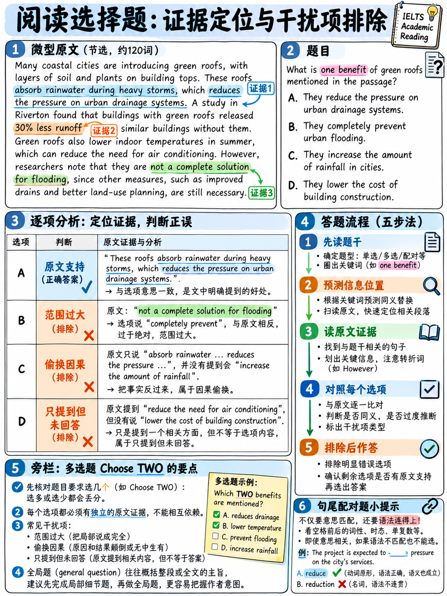

# 05. 单选题、多选题与完成句子首尾配对题破题法 (Multiple Choice & Sentence Endings)



> **本章核心定位**：选择题在雅思学术类阅读中常被考生误认为“最熟悉的题型”，然而它却往往是失分最隐蔽、耗时最惊人的陷阱。官方将其统称为 **Multiple Choice** `[3]`，但在实战中以三种不同形态呈现：**四选一单选题（Single-answer MC）**、**五选二/七选三多选题（Multiple-answer MC）** 以及 **全篇主旨/态度题（Global Questions）**。选择题之所以难以拿高分，是因为命题组设置了极其精妙的“原文提及但答非所问（True-but-irrelevant）”和“部分真实但限定词绝对化（Partly-true）”干扰项。本章将解构选择题的干扰项底层构造逻辑，传授“蒙眼预判法”与多选题“三标排除战术”，助你彻底斩断思维污染，秒杀选择题！

---

## 40.5.1 选择题家族三大形态与战术属性

官方大纲中选择题的形式及特征如下 `[3]`：

| 题型形态 | 题目指令与形式 | 顺序原则 | 耗时与成本 | 战术梯队评级 |
|---|---|:---:|:---:|:---:|
| **单项选择题 (4选1)** | "Choose the correct letter, A, B, C or D." | **严格遵循原文顺序** | 中等 | **Tier A (主攻拿分)**<br>有明确顺序与段落锚点，技巧性极强 |
| **多项选择题 (多选多)** | "Choose TWO letters" 或 "Choose THREE letters, A–E" | 答案分散于多段 | **偏高** | **Tier C (慎重攻坚)**<br>需通读大量选项与段落，按字母独立计分 |
| **全篇主旨/态度题** | "What is the writer's main purpose?" / "Choose the best title" | 考查整篇宏观 | 中等 | **Tier B (必须留到篇尾做)**<br>通晓全篇后才能准确把握全局基调 |

---

## 40.5.2 四选一单选题破局绝技：“蒙眼预判法” (Blind Prediction)

绝大多数考生做单选题的直觉做法是：**先看题干，接着把 A、B、C、D 四个选项全看一遍，然后再回原文去找**。  
在雅思考试中，这是极度危险的习惯！因为命题组设计的 3 个错误选项是**专门利用人类心理弱点量身定做的“认知迷药”**。一旦你提前看了选项，那些似是而非的高级词汇会立刻污染你的大脑，导致你带着先入为主的偏见回文，落入考官陷阱。

```{mermaid}
graph TD
    A["审读题干题眼 (The Question Stem)"] --> B["【核心动作】：遮住 ABCD 选项，绝对不看！"]
    B --> C["带着题干核心锚点，利用顺序原则回文定位靶心句"]
    C --> D["精读靶心 3 句窗口，【用自己的话口头回答题目】(Pre-phrase Answer)"]
    D --> E["此时再移开手掌，审读 ABCD 四个选项"]
    E --> F["直接挑选那个与你自己的预判意思最吻合的同义替换项！"]
    F --> G["若有两项犹豫：利用限制词与答非所问原则精准剔除！"]
```

### 为什么“蒙眼预判法”能实现降维打击？
1. **彻底免疫干扰项的思维污染**：考官精心设计的陷阱选项无法在你脑中生根；
2. **变“多向纠结”为“定向命中”**：你在看选项前已经知道了正确答案的核心意思，看选项只是在做“寻找同义改写”的简单视觉匹配，做题速度反而提升一倍！

---

## 40.5.3 考官命题密码：四大干扰项的底层构造逻辑

雅思学术阅读单选题的三个错误选项，绝不是胡乱拼凑的，它们具有极其精密的工业化设计模式。看穿以下四种原型，即可实现“透视眼”般的排除：

| 选项原型类别 | 考官设计机理与设坑手段 | 考场应对与破解心法 |
|---|---|---|
| **✅ 官方正解<br>(The Paraphrased Match)** | 严丝合缝地传达原文靶心句的核心意思，但**全方位进行同义替换**，绝不粗暴照抄原文原词。 | 意思完全一致，虽然长相与原文大相径庭，但逻辑等值。 |
| **❌ 原文提及但答非所问<br>(The True-but-irrelevant)** | **【最致命杀手】**：选项中的内容在原文中确有提及（甚至完全正确），但它**根本没有回答题干问的问题**！ | **重读题干题眼**：问自己“这句话虽然原文说了，但能回答题目的核心问题吗？” |
| **❌ 部分真实但偷换限定词<br>(The Partly-true)** | 核心概念符合原文，但悄悄植入了绝对化或错误的修饰词（如原文是 *partly* 变成了 *entirely*，或原文是 *some* 变成了 *all*）。 | 严密盯防选项中的数量词、频率词与极端程度词（*always, never, solely, must*）。 |
| **❌ 常识合情合理但原文未提<br>(The Plausible-but-absent)** | 符合日常生活常识与学术直觉，听起来非常深刻正确，但**在文章中根本找不到事实支撑**。 | 坚守雅思红线：**现实对不对不重要，原文没写就是错的！** 严禁脑补推导。 |

:::{tip}
**“原文提及但答非所问（True-but-irrelevant）”实战避坑案例**：  
题干问：*“Why was the construction of the bridge delayed?”（大桥为何延期开工？）*  
- 原文某段写道：*“The bridge had a revolutionary design that received international acclaim, but heavy winter storms halted all foundation work.”*  
- 干扰选项 A 赫然写着：*“It featured a revolutionary architectural design.”*  
很多考生一看到 `revolutionary design` 在原文中完全有一模一样的词，兴奋地秒选 A！然而，A 只是大桥的特征，**真正导致延期的原因是暴风雨（heavy storms）**！选择前，务必重读题干引导词（*Why / Because / Main purpose*）。
:::

---

## 40.5.4 经典真题实战精解：单选题深度拆解

回顾我们之前研读的权威学术篇章《城市有轨电车的复兴》（The return of the urban tram，详见 {doc}`02-true-false-not-given`），结合其中的核心段落进行全真单选拆解：

### 题目精练一：因果与条件单选

**Question 1. According to paragraph C, light rail is cheaper to operate than buses when**  
*(根据段落 C，轻轨在什么条件下比公交车的运营成本更低？)*

- **A** construction costs are kept low. *(建设成本保持在较低水平时)*
- **B** passenger numbers along a route are high enough. *(沿线客运流量足够高时)*
- **C** fewer than two bus lanes are available. *(可用的公交车道少于两条时)*
- **D** trams are longer than forty metres. *(有轨电车长度超过 40 米时)*

#### 全真破题思路剖析：
1. **题干定位**：段落 C，核心问题是轻轨比公交车运营更便宜的**条件（when...）**。
2. **回文锁定靶心句**：  
   > 段落 C 尾句：*"Where passenger volumes along a corridor exceed approximately 3,000 people per hour in each direction, light rail is generally cheaper to operate per passenger than buses, despite construction costs that are typically five to ten times higher per kilometre."*
3. **蒙眼预判**：原文说“当单向走廊上的客流量每小时超过约 3,000 人时，人均运营成本更便宜”。即：**客流量足够大/客流量达到一定门槛**。
4. **选项比对与干扰项判定**：
   - **B 选项**：`passenger numbers along a route are high enough` 完美同义替换了 `passenger volumes ... exceed approximately 3,000`。**官方正确答案！**
   - **A 选项**：**【常识合理但原文未提 (Plausible-but-absent)】**。常理认为成本低才便宜，但原文恰恰反驳了这点——原文明确写道“尽管每公里建设成本通常高出 5 到 10 倍”，故 A 荒谬。
   - **C 选项**：**【原文提及但答非所问 (True-but-irrelevant)】**。原文确实提到了两条公交车道的路宽，但那是讨论“占用道路宽度空间”，与人均运营成本毫无因果关联！
   - **D 选项**：**【部分真实但篡改条件 (Partly-true)】**。原文提到 40 米只是举例说明一辆现代电车的典型车长，并非运营便宜的触发门槛。

---

### 题目精练二：学者观点与论断单选

**Question 2. What does Dr Marsh argue about tram projects?**  
*(关于有轨电车项目，马什博士提出了什么主张观点？)*

- **A** They are usually bad investments. *(它们通常是不良投资)*
- **B** They carry fewer passengers than forecast. *(它们实际承载的乘客少于预测)*
- **C** The reasons given for building them are produced after the decision is made. *(为其修建所给出的理由是在决策做出之后才补凑出来的)*
- **D** They should be replaced by underground railways. *(它们应当被地下地铁所取代)*

#### 全真破题思路剖析：
1. **题干定位**：人名专有名词 `Dr Marsh`（回文锁定段落 E 中后部）。
2. **回文锁定靶心句**：  
   > 段落 E：*"Dr Helena Marsh ... argues that the sequence of decisions in most cities is the reverse of the official account: the decision to build is taken first, and the capacity and land-value arguments are assembled afterwards to justify it."*
3. **蒙眼预判**：原文说决策顺序颠倒了——“先做出了修建决定，随后才把运力和土地价值等理由拼凑起来为其辩护”。
4. **选项比对与干扰项判定**：
   - **C 选项**：`The reasons given for building them are produced after the decision is made` 严密改写了原文的 `decision ... is taken first, and ... arguments are assembled afterwards`。**官方正确答案！**
   - **A 选项**：**【直接与原文相悖】**。马什博士明确指出“这是否让项目成为不良投资是一个独立的问题”，她并未认定是不良投资。
   - **B 选项**：**【与原文完全相反】**。原文尾句白纸黑字写明 `carried more passengers than had been forecast`（运载量超过了预测），选项说 `fewer`，直接撞车。
   - **D 选项**：**【无端脑补与常识干扰】**。原文提到地铁（underground railway）仅仅是作为“建设周期跨越政治周期”的对比参照物，从未主张用地铁取代电车。

---

## 40.5.5 多项选择题 (Multiple-Answer MC) 的三标扫荡策略

多选题通常要求：“Choose TWO letters, A–E” 或 “Choose THREE letters, A–G”。

### 多选题的核心考务特征
- **独立计分机制**：选 2 个字母占 2 个考题编号（如 Questions 13–14），选对一个得 1 分；选对两个得 2 分；选错不倒扣分。
- **选项分散跨度大**：正确的两三个选项往往分散在全文的不同段落，无法通过单一靶心句一次性全收。

### 考场实战“三标扫荡法”SOP
面对 5 个或 7 个长选项，在草稿纸或机考笔记上执行以下流程：

```
   1. 审清指令数字：写下【2】或【3】，绝对防止看漏或多选！
   2. 快速通扫 5 个选项，提取各自的独立特征词（名词短语或学术动作）。
   3. 逐个回文核对，并在选项旁边标记三大状态符号：
        [✓] 确凿实锤：原文有明确同义替换与对应支撑。
        [✗] 确凿排除：与原文直接矛盾，或为绝对化修饰词陷阱。
        [?] 存疑待定：在原文中没找全，暂时无法断定。
   4. 若 [✓] 的数量刚好等于题目要求，直接填入，收工交卷；
   5. 若 [✓] 数量不足（例如要求选 2 个，目前仅确认 1 个）：
      绝不要空着！立刻在带有 [?] 的候选选项中，选择最不极端的选项蒙上！
      由于没有倒扣分机制，多选多题目中“蒙第二个选项”有高达 25%–33% 的纯捡分概率！
```

---

## 40.5.6 全局主旨题与作者态度题 (Global Questions & Tone) 破法

在文章的最后一两道题中，常出现整体评价题：“What is the writer's main purpose in this passage?” 或 “Which of the following would be the best title for the passage?”。

### 绝不丢分的实操准则
1. **永远留在该篇文章的所有题目之后最后做**！当你做完前序的细节填空、判断和单选后，你已经精读了该文章 70% 以上的段落。此时回答主旨题是水到渠成，切忌一上来第一题就做它。
2. **一条主线串联全篇论证逻辑**：在心里用一句话总结文章弧线：  
   *“作者首先回顾了过去的传统假说，随后列举了最新实证研究对其提出的挑战，最后指出了多方观点的分歧与未来应用前景。”*
3. **主旨题干扰项三大典型病症**：
   - **太狭隘 (Too Narrow)**：仅仅概括了文中某一个自然段的内容，无法统领全篇；
   - **太宽泛 (Too Broad)**：像教科书大标题一样宏大，脱离了本文的核心具体论证；
   - **基调偏离 (Wrong Tone)**：文章是中立客观的学术梳理，选项却用词极度激进偏激。

### 学术阅读作者态度词倾向谱系 (Tone Vocabulary)
学术外刊作者受制于严谨的学术规范，**极少表达极端情绪**。考场上看到以下态度词汇，其命中概率具有极强统计倾向：

```
   高概率正解态度词 (严谨、审慎、中立):
   • cautious / tentative (审慎的、谨慎试探的)
   • balanced / objective (客观公正的、权衡两面的)
   • measured approval (有保留的赞同)
   • critical yet constructive (批评但具建设性的)

   高概率干扰项态度词 (极端、情绪化、主观武断):
   • enthusiastic / ecstatic (狂热的、盲目热情的) ── ❌ 学者从不盲目狂热
   • totally dismissive / scornful (彻底蔑视的、嘲弄的) ── ❌
   • indifferent / uninterested (漠不关心的) ── ❌ 漠不关心就不会写这篇文章
   • furious / aggressive (愤怒攻击性的) ── ❌
```

---

## 40.5.7 考场极限蒙猜概率学与单选集训计划

当倒计时仅剩 60 秒，面对未完成的选择题，执行以下科学理性蒙猜决策：

```
┌────────────────────────────────────────────────────────────────────────┐
│                     考场单选与多选极速蒙猜法则                         │
│                                                                        │
│  法则 1：排二猜一 (50% 胜率)                                            │
│    能轻易排除 2 个明显荒谬的选项，在剩余两个选项中犹豫时：             │
│    ──> 优先选择【语气更加缓和、带有条件限定词】的选项；                │
│    ──> 坚决放弃带有【all, never, completely, solely】等绝对词的选项。   │
│                                                                        │
│  法则 2：全无头绪时的纯概率蒙猜                                        │
│    ──> 绝对不可留空！多选多题目必须填满所需字母数量！                  │
│    ──> 避免迷信网络谣传的“三长一短选最短”或“一律选B”。官方试题选项     │
│        分布经过严格统计均衡化，理性结合未选字母填涂即可。              │
└────────────────────────────────────────────────────────────────────────┘
```

### 选择题专项提分训练规划

- [ ] **单选题“蒙眼预判”刻意练习**：精选 8 组高品质学术单选题。做题时强制用草稿纸挡住选项，写出自己的预判答案后再核对，训练阻断思维污染的定力。
- [ ] **错题归因打标**：对做错的每道单选题，用荧光笔打标归因：是中了 `True-but-irrelevant`（答非所问）的圈套，还是倒在 `Partly-true`（修饰词偷换）之下？
- [ ] **多选题三标训练**：完成 3 组多选题，严格演练 `[✓] [✗] [?]` 标记法与不留空白答题纪律。
- [ ] **达标考核目标**：单项选择题正确率稳定达到 **70%–75%** 即可判定达标。选择题是考查深度学术逻辑辨析的题型，稳住 70% 的命中率，配合填空与判断的高分，足以确保阅读总分斩获 **7.0–8.0**！

---

**上一章：** {doc}`04-matching-tasks` | **下一章学习指南：** {doc}`06-reading-practice-set`
