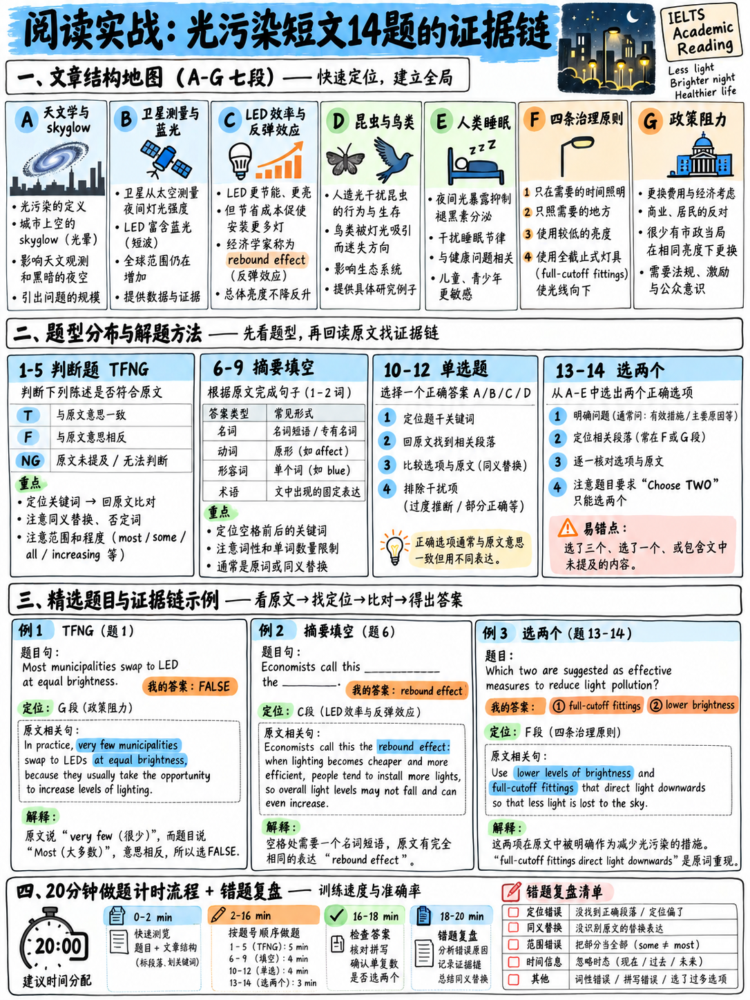

# 06. 阅读全真长篇学术文章实战演练与逐题解析 (Reading Practice Set)



> **本章核心定位**：本章是前五章技战术体系的**全真综合实战演练场**。所选文章《静默的光污染危机》（The quiet problem of light）严格按照雅思官方学术类长篇阅读规范研制：字数达 950 词、题材属于“多学科交叉与逻辑论辩（Discursive/Argumentative）”类、涵盖生态学、医学、经济学反弹效应与公共政策博弈 `[3]` `[6]`。试题组合包含 **TFNG 判断（5题）**、**摘要填空（4题）**、**四选一单选题（3题）** 与 **多选题（2题）**，共计 14 道高仿真试题 `[25]`。请考生准备好计时器，严格倒计时 **20 分钟** 完成实测，并在文末进行全景双语复盘！

---

## 40.6.1 全真实战模拟演练测试规范 (20-Minute Real Simulation)

在开始阅读前，请严格遵守以下考场纪律：
1. **启动计时器，设定倒计时 20:00 分钟**；
2. **在未完成所有题目之前，严禁翻看文末的答案与解析**；
3. **若 20 分钟时间到，立即停笔，并将剩余未完成题目用红笔打标蒙选**；
4. **测试结束后，使用文末的双语诊断量表进行深度归因复盘**。

---

## 40.6.2 全真长篇学术文章 (Reading Passage)

:::{admonition} Academic Reading Passage
:class: note

### The quiet problem of light (静默的光污染危机)

**A.** Of the major forms of environmental pollution, light is the one most people have never thought about. It has no smell, leaves no residue, and disappears the instant it is switched off. It is also, unusually among pollutants, something almost everyone actively wants. Street lighting is popular, hard to argue against in public, and closely tied to perceptions of safety. For most of the twentieth century the only serious objectors were astronomers, whose observatories were progressively driven further from cities by the spreading glow — a phenomenon known technically as *skyglow*, the diffuse brightening of the night sky caused by light scattered in the atmosphere.

**B.** The scale of the change is easy to underestimate because it happened gradually. A widely cited satellite analysis published in 2017 found that the artificially lit outdoor area of the Earth's surface grew by just over two per cent a year between 2012 and 2016, and that the brightness of already-lit areas grew at a similar rate. More recent work using observations made by amateur stargazers rather than satellites suggests the increase has been considerably faster — perhaps as much as seven to ten per cent a year in some regions. The discrepancy has a straightforward technical cause: the satellite sensors in widest use are largely blind to blue light, and the light-emitting diodes, or LEDs, that have replaced older street lamps emit a great deal of it. In other words, the instrument that was measuring the problem became progressively less able to see it at exactly the moment the problem changed character.

**C.** That change of character is central to the modern argument, and it is worth stating carefully, because it is widely misunderstood. LEDs are undeniably more efficient: they convert a much higher proportion of electricity into visible light than the orange sodium lamps they replaced, and a municipality that swaps one for the other at equal brightness will use substantially less energy. The difficulty is that very few municipalities swap at equal brightness. Because the running cost per unit of light has fallen, the rational response for a city with a fixed lighting budget is to install more light, not to bank the saving — a pattern economists have documented in many other contexts and generally call the *rebound effect*. The result is that a technology adopted largely on environmental grounds has in many places increased total light emission while reducing the electricity bill.

**D.** Meanwhile the evidence of biological harm has accumulated to the point where it is no longer seriously contested, although its magnitude certainly is. The best-documented effects concern insects. Street lamps act as traps: nocturnal insects are drawn to them, circle until exhausted, and are eaten or die. One frequently discussed German study estimated the mortality associated with street lighting in that country alone in the hundreds of billions of insects per summer. Figures of this kind should be treated with some caution — they rest on extrapolation from a small number of sampled lamps — but the direction of the effect is not in doubt, and insect abundance is declining steeply in precisely the regions where lighting has expanded fastest. Similar disruptions have been recorded in birds, which collide with illuminated structures during migration; in sea turtles, whose hatchlings orient themselves by the brightest horizon and are drawn inland rather than seaward; and in plants, whose flowering and leaf-fall timings respond to night length.

**E.** Human health effects are discussed more often and established less firmly. Light at night suppresses the production of melatonin, a hormone involved in regulating the sleep–wake cycle, and blue-rich light suppresses it more effectively than warmer light. The chain of reasoning from that fact to a claim about disease, however, is long. Studies comparing rates of certain illnesses with satellite-measured outdoor brightness have produced associations, but outdoor brightness is also a reasonably good proxy for living in a dense, polluted, high-income urban area, and separating these influences is genuinely difficult. The more defensible claim is the narrower one: that poorly designed outdoor lighting shining directly into bedroom windows measurably degrades sleep, and that degraded sleep has well-established consequences.

**F.** What makes light pollution unusual among environmental problems is how cheaply and how quickly it can be reversed. Carbon dioxide persists in the atmosphere for centuries; light stops the moment the switch is thrown. The recognised remedies are neither expensive nor technically demanding, and they are generally summarised in four rules: light only where it is needed, only when it is needed, only as brightly as it is needed, and only in the warmer part of the spectrum. Full-cutoff fittings, which direct all of their output downwards, cost little more than the alternatives and in many jurisdictions are already mandatory for new installations. Dimming or switching off lighting after midnight on roads with negligible traffic has been trialled widely.

**G.** The obstacle is therefore not technology but politics, and it is a particular kind of political obstacle: the benefits of reform are diffuse and largely invisible, while the costs are concentrated and easy to dramatise. A councillor who reduces lighting on a residential street will be asked, entirely predictably, whether they are prepared to take responsibility for the next crime committed there — a question to which the honest answer involves the phrase "the evidence on lighting and crime is mixed", which is not an answer that survives contact with a local newspaper. Reviews of the research have in fact found no consistent relationship between street lighting levels and recorded crime, with some studies finding reductions, some finding none, and a few finding increases. But a counter-intuitive, hedged, statistical finding is poor material for a public meeting, and this asymmetry, rather than any disagreement about the underlying science, is the best explanation of why reform has been so slow.

*(篇章词数：约 950 词)*
:::

---

## 40.6.3 全真试题集 (Questions 1–14)

### Questions 1–5: TRUE / FALSE / NOT GIVEN 判断题

**Do the following statements agree with the information given in the passage?**  
*In boxes 1–5 on your answer sheet, write:*  
- **TRUE** if the statement agrees with the information  
- **FALSE** if the statement contradicts the information  
- **NOT GIVEN** if there is no information on this  

1. Astronomers were the main group objecting to artificial light before the late twentieth century.  
   *(在 20 世纪晚期之前，天文学家是反对人造光线的主要群体。)*
2. The 2017 satellite study found that lit areas were expanding faster than existing lit areas were brightening.  
   *(2017 年的卫星研究发现，新增照明区域的扩张速度快于既有照明区域的变亮速度。)*
3. The satellite sensors referred to in paragraph B detect blue light poorly.  
   *(段落 B 中提及的卫星传感器对蓝光的探测灵敏度极差。)*
4. LEDs convert a higher proportion of electricity into visible light than sodium lamps.  
   *(相比钠灯，发光二极管（LED）能将更高比例的电能转化为可见光。)*
5. Most municipalities replace sodium lamps with LEDs of the same brightness.  
   *(大多数市政当局用相同亮度的 LED 替换了原有的钠灯。)*

---

### Questions 6–9: 摘要填空题 (Summary Completion)

**Complete the summary below. Choose NO MORE THAN TWO WORDS from the passage for each answer.**  
*(完成以下摘要。每个空格从文章中选择不超过两个单词。)*

The replacement of sodium lamps with LEDs was adopted largely for **(6)** ______ reasons. Because the cost of producing each unit of light has fallen, many cities install more lighting rather than keeping the saving, a pattern economists call the **(7)** ______. The outcome in many places is that total light emission has risen even though the **(8)** ______ has fallen. Meanwhile, the biological effects are best documented in **(9)** ______.

---

### Questions 10–12: 四选一单项选择题 (Multiple Choice)

**Choose the correct letter, A, B, C or D.**  
*(选择正确的选项字母，A、B、C 或 D。)*

**10.** What does the writer suggest about the German study of insect mortality?  
*(关于德国针对昆虫致死率的研究，作者暗示了什么？)*  
- **A** Its method makes its precise figure uncertain. *(其研究方法导致其具体精确数值存在不确定性)*  
- **B** Its conclusion has been contradicted by later work. *(其结论已被后续的研究工作所推翻)*  
- **C** It applies only to conditions in Germany. *(该研究结论仅适用于德国国内的具体环境)*  
- **D** It overlooked the effects on birds and turtles. *(该研究忽略了对鸟类和海龟的影响)*  

**11.** Why does the writer consider the link between outdoor brightness and disease difficult to establish?  
*(作者为何认为室外光照亮度与疾病之间的因果联系极难确立？)*  
- **A** Melatonin suppression has not been demonstrated. *(褪黑素的分泌抑制尚未得到实验证实)*  
- **B** Satellite measurements of brightness are inaccurate. *(卫星对亮度的测量数据存在偏差失真)*  
- **C** Brightness tends to coincide with other urban characteristics. *(室外亮度往往与城市其他环境变量高度重叠共存)*  
- **D** The relevant studies have not been repeated. *(相关的流行病学研究尚未得到可重复性验证)*  

**12.** According to paragraph G, the main reason reform has been slow is that  
*(根据段落 G，光污染治理改革推进缓慢的主要原因是：)*  
- **A** the necessary technology remains expensive. *(所需的技术装备成本依然极其高昂)*  
- **B** scientists disagree about whether lighting causes harm. *(科学家对光线是否造成危害尚存学术分歧)*  
- **C** the research on lighting and crime has not been carried out. *(关于照明与犯罪关联度的实证研究尚未开展)*  
- **D** the gains from reform are widely spread and hard to see. *(改革带来的公共收益分布弥散且极难直观感知)*  

---

### Questions 13–14: 多项选择题 (Multiple-Answer MC)

**Choose TWO letters, A–E.**  
*(选择两个字母，A–E。)*

Which **TWO** of the following are given in the passage as recognised remedies for light pollution?  
*(下列哪两项在文章中被列为公认的光污染治理解决方案？)*  
- **A** replacing LEDs with sodium lamps *(用传统的钠灯取代新型 LED 灯)*  
- **B** using fittings that direct light downwards only *(采用只将光线向下投射的全截光灯具)*  
- **C** reducing lighting late at night on quiet roads *(在车流稀少的道路上于深夜调暗或关闭照明)*  
- **D** relocating observatories away from cities *(将天文台迁移至远离城市的偏远地区)*  
- **E** requiring new buildings to have fewer windows *(强制要求新建建筑物减少窗户数量)*  

---

## 40.6.4 逐题全真深度双语剖析与考点映射 (Exhaustive Explanations)

测试完成后，请核对以下官方标准答案与深度逻辑解析：

| 题号 | 官方标准答案 | 考点题型 | 原文出处定位句 | 考点逻辑与同义替换全景解析 |
|:---:|:---:|:---:|---|---|
| **1** | **TRUE** | TFNG | 段落 A 尾句：<br>*"For most of the twentieth century the only serious objectors were astronomers..."* | 原文中的 `the only serious objectors`（唯一的严肃反对者）完全支撑题干中的 `the main group objecting`（主要反对群体）。题干陈述为弱命题，原文强命题必然蕴含弱命题，逻辑等价，判定为 **TRUE**。 |
| **2** | **FALSE** | TFNG | 段落 B 第二句：<br>*"...area ... grew by just over two per cent a year ... and the brightness of already-lit areas grew at a similar rate."* | 题干声称扩张速度快于变亮速度（`faster than`），但原文明确指出两者以“相似的速度（`at a similar rate`）”增长。考官布置了经典的**比较限定词矛盾陷阱**，直接抵触，判定为 **FALSE**。 |
| **3** | **TRUE** | TFNG | 段落 B 倒数第二句：<br>*"...the satellite sensors in widest use are largely blind to blue light..."* | 原文的 `largely blind to blue light`（对蓝光很大程度上失明/视而不见）与题干中的 `detect blue light poorly`（对蓝光探测能力极差）构成极度精妙的同义改写，判定为 **TRUE**。 |
| **4** | **TRUE** | TFNG | 段落 C 第二句：<br>*"LEDs are undeniably more efficient: they convert a much higher proportion of electricity into visible light than the orange sodium lamps..."* | 题干几乎原汁原味地同义转述了原文核心句，`convert a higher proportion ... than sodium lamps` 事实完全吻合，判定为 **TRUE**。 |
| **5** | **FALSE** | TFNG | 段落 C 第三句：<br>*"The difficulty is that very few municipalities swap at equal brightness."* | 题干声称“大多数市政当局以相同亮度更换（`Most ... at the same brightness`）”，而原文白纸黑字写明“极少有市政当局以相同亮度更换（`very few ... at equal brightness`）”。`Most` 与 `Very few` 发生实质互斥矛盾，判定为 **FALSE**。 |
| **6** | **environmental** | Summary | 段落 C 尾句：<br>*"...a technology adopted largely on environmental grounds has in many places..."* | 语法预判：`for ______ reasons` 空格需填**形容词**。原文 `environmental grounds` 同义替换 `environmental reasons`，原词提取为 `environmental`（1 词）。 |
| **7** | **rebound effect** | Summary | 段落 C 第四句：<br>*"...a pattern economists have documented in many other contexts and generally call the rebound effect."* | 题干锚点词为 `economists call the ______`，后接定冠词 `the`，原词直接提取专有名词术语 `rebound effect`（2 词），恰好在词数上限内。 |
| **8** | **electricity bill** | Summary | 段落 C 尾句：<br>*"...increased total light emission while reducing the electricity bill."* | 题干结构是并列转折：总排放上升，即使 ______ 下降。原文将排放上升（`increased total light emission`）与电费下降（`reducing the electricity bill`）对称呼应，提取 `electricity bill`（2 词）。 |
| **9** | **insects** | Summary | 段落 D 第二句：<br>*"The best-documented effects concern insects."* | 题干的 `best documented in ______` 与原文原词高度字面吻合，介词后接生物名词，原词精准提取 `insects`（1 词）。 |
| **10** | **A** | 单选题 | 段落 D 第三至四句：<br>*"Figures of this kind should be treated with some caution — they rest on extrapolation from a small number of sampled lamps..."* | 原文指出该数据“应谨慎对待，因其基于少量样本灯具的推算”，直接对应 **A 选项**（其方法导致精确数值存在不确定性）。**B 选项**为无中生有；**C 选项**混淆了研究发生地与结论普适性；**D 选项**直接与后文提到的鸟类和海龟事实相悖。 |
| **11** | **C** | 单选题 | 段落 E 第三句：<br>*"...outdoor brightness is also a reasonably good proxy for living in a dense, polluted, high-income urban area, and separating these influences is genuinely difficult."* | 原文明确指出：室外亮度本身也是高密度、污染、高收入城市环境的替代指标，极难剥离这些协同影响。完全对应 **C 选项**（亮度往往与其他城市特征高度重合）。**A 选项**与原文褪黑素已证实矛盾；**B 选项**张冠李戴了段落 B 的卫星测蓝光。 |
| **12** | **D** | 单选题 | 段落 G 首句及尾句：<br>*"...the benefits of reform are diffuse and largely invisible, while the costs are concentrated... and this asymmetry ... is the best explanation..."* | 原文强调“改革带来的益处是弥散且隐形的（`diffuse and largely invisible`）”，直接对应 **D 选项**（`gains ... are widely spread and hard to see`）。**A 选项**与段落 F“并不昂贵”矛盾；**B 选项**与尾句“绝非对底层科学的分歧”相悖。 |
| **13** | **B** *(可互换)* | 多选题 | 段落 F 第四句：<br>*"Full-cutoff fittings, which direct all of their output downwards, cost little more than the alternatives..."* | 原文明确推荐“全截光灯具（将所有光线向下投射）”，对应 **B 选项**。 |
| **14** | **C** *(可互换)* | 多选题 | 段落 F 尾句：<br>*"Dimming or switching off lighting after midnight on roads with negligible traffic has been trialled widely."* | 原文明确指出“在车流微不足道的道路上午夜后调暗或关闭照明”，对应 **C 选项**。**A 选项**颠倒是非（未建议换回钠灯）；**D 选项**是天文学家的被动迁徙而非主动治理手段；**E 选项**文中未提及。 |

---

## 40.6.5 篇章学术核心同义替换映射词表 (Paraphrasing Matrix)

深度研读本篇文章中高频涌现的“学术同义替换对”，将它们内化为考场直觉：

```
┌────────────────────────────────────────────────────────────────────────┐
│               全真文章学术同义替换高频映射矩阵 (必背)                   │
│                                                                        │
│   题干表达 (Question)          原文出处 (Passage Text)                 │
│  ───────────────────────────────────────────────────────────────────   │
│   • the main group objecting   <===> the only serious objectors        │
│   • detect blue light poorly   <===> are largely blind to blue light   │
│   • at a faster rate           <===> at a similar rate (反向矛盾)       │
│   • reasons                    <===> grounds (on environmental grounds)│
│   • has fallen / decreased     <===> reducing / has declined           │
│   • uncertain / not definitive <===> extrapolation / treated with caution│
│   • coincide with              <===> a reasonably good proxy for       │
│   • widely spread / invisible  <===> diffuse and largely invisible     │
│   • direct light downwards     <===> direct all of their output downwards│
│   • quiet roads                <===> roads with negligible traffic     │
└────────────────────────────────────────────────────────────────────────┘
```

---

## 40.6.6 成绩换算与答题错误归因诊断树

### 原始得分（14 题）与对应能力等级测算表

| 本套得分 (/14) | 等效 40 题全卷得分 | 对应官方预估 Band `[7]` | 水平诊断与考场状态 |
|:---:|:---:|:---:|---|
| **≤ 5 题** | ≤ 14 题 | **4.5–5.0** | 词汇严重受限，几乎无法进行同义替换识别，严重依赖中文翻译慢读。 |
| **6–8 题** | 18–23 题 | **5.5–6.0** | 基础题型能拿分，但深受限制修饰词与选项干扰项诱导，控时偏紧。 |
| **9–11 题** | 26–31 题 | **6.5–7.0** | **达到名校录取线！** 具备成熟的定位与排除能力，个别深层逻辑细节偶有失误。 |
| **12–14 题** | 34–40 题 | **7.5–8.5** | **专家级阅读素养！** 彻底掌握工业化做题节奏，对考官命题陷阱具备天然免疫力。 |

```{mermaid}
graph TD
    Start["复盘 14 道题的错题根因"] --> CheckType{"错题分布在哪些题号？"}
    CheckType -- "第 2 或 5 题做错" --> E1["【限制词敏锐度缺失】<br/>未能识别 similar rate 与 very few，掉入绝对化陷阱<br/>==> 重点复习: 02-true-false-not-given §40.2.3"]
    CheckType -- "第 1 或 3 题做错" --> E2["【同义替换识别障碍】<br/>未能看出 blind to 与 detect poorly 的语义等价<br/>==> 重点复习: 03-completion-and-short-answer §40.3.4"]
    CheckType -- "第 6、7、8、9 题做错" --> E3["【字数纪律或语法预判失误】<br/>抄错词、超出了 TWO WORDS 限制，或词性不匹配<br/>==> 重点复习: 03-completion-and-short-answer §40.3.3"]
    CheckType -- "第 10、11、12 题做错" --> E4["【中了单选三大干扰项的招】<br/>误选了 True-but-irrelevant 或 Plausible 选项<br/>==> 重点复习: 05-multiple-choice-and-sentence-endings §40.5.3"]
    CheckType -- "超时导致后半段全靠蒙" --> E5["【时间管控与熔断机制失效】<br/>在前文纠缠过久，未能执行 17/37/57 严格时间截断<br/>==> 重点复习: 01-scoring-and-section-tactics §40.1.2"]
```

---

## 40.6.7 雅思阅读模考全真复盘追踪卡 (Simulation Sheet)

每次完成一套完整的 3 篇文章（40 题）模考测试时，在草稿纸上绘制并记录以下复盘表：

```
┌────────────────────────────────────────────────────────────────────────┐
│             IELTS ACADEMIC READING SIMULATION TRACKER                 │
│                                                                        │
│  测试日期: _______________    试卷真题来源: ________________________   │
│                                                                        │
│  Passage 1 完成时间: _______ (硬限 17:00)    卷面得分: _____ / 13 题   │
│  Passage 2 完成时间: _______ (硬限 37:00)    卷面得分: _____ / 13 题   │
│  Passage 3 完成时间: _______ (硬限 57:00)    卷面得分: _____ / 14 题   │
│                                                                        │
│  总对题数: _____ / 40 题   ──>  折算最终 Band: ______ (23≈6.0, 30≈7.0) │
│                                                                        │
│  【考场机械性扣分排查 —— 目标必须全部归零！】                         │
│    □ 全卷留空题目数 (Blanks): ___________  (铁律: 必须为 0 题！)        │
│    □ 超字数限制题目数 (Over limit): _____  (铁律: 必须为 0 题！)        │
│    □ 原词抄录拼写错误数 (Spelling): _____  (铁律: 必须为 0 题！)        │
│                                                                        │
│  本次失分最严重的题型: ___________________________________________     │
│  下一次模考必须强制改善的 1 个核心战术动作:                            │
│  _________________________________________________________________     │
└────────────────────────────────────────────────────────────────────────┘
```

:::{important}
**把“机械性丢分”压缩至零，就是提高整整一个 Band！**  
据统计，未受过系统战术训练的考生在真实的考试中，由于“留空白题”、“填空超出一词”以及“抄错原词字母”导致的非能力失分平均高达 **4 到 7 分**！这在官方换算表中相当于直接让原本 6.5 分的考生跌落至 5.5 分！严格执行复盘追踪卡，第一周将机械性失分彻底归零，你的阅读成绩将立刻迎来质的飞跃。
:::

---

## 40.6.8 权威官方真题备考资源梯队推荐

按照官方可信度与备考优先级排列：

| 备考资源类别 | 具体材料与平台 | 可信度与价值 | 战略使用建议 |
|---|---|:---:|---|
| **官方真机考模拟系统** | 雅思官方在线机考模考（Inspera 平台）`[25]` | **极高 (Official)** | 必须在考前至少完整体验 2 次，熟悉全真屏幕界面、划线标注、便签功能与倒计时界面。 |
| **官方真题集** | 剑桥雅思官方真题集 11–19 系列 (*Cambridge IELTS 11–19*) | **极高 (High)** | 全球最权威备考真题。每一套题都必须按 60 分钟全真模考并执行本章复盘 SOP。 |
| **官方题型单项样题** | 英国文化教育协会（BC）与 IDP 官方公开样题库 `[18]` `[25]` | **极高 (High)** | 用于单项攻坚（如专门刷透其中的 TFNG 或匹配题专项）。 |
| **市面第三方模考网站** | 各类机构自编或声称“名师预测”的阅读模拟题 | **低至中等 (Low to Medium)** | **切忌用于评估自己的真实 Band 分**！第三方试题常出现不符合官方逻辑严密性的畸形题目，仅可用于拓宽词汇量，不可深究其答案逻辑。 |

---

**上一章：** {doc}`05-multiple-choice-and-sentence-endings` | **下一章学习指南：** {doc}`../50-listening/01-scoring-and-section-tactics`
