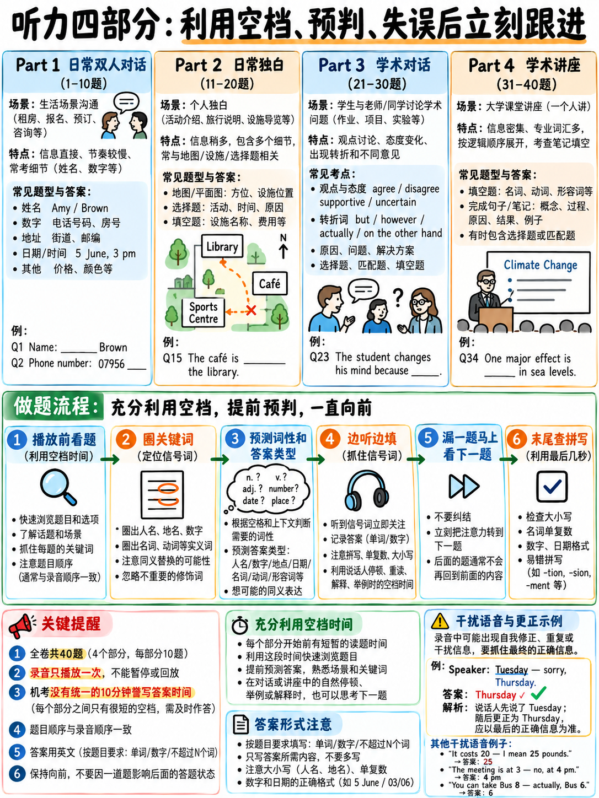

# 01. 雅思听力评分规则、四大 Part 场景特征与机考答题节奏 (Listening Scoring & Tactics)



雅思听力（IELTS Listening）是全科备考中投入产出比最高、提分见效最快的单项。听力不仅测试考生的听觉接收能力，更是一场高度程式化的“信息检索与实时速记”考核。理解官方评分逻辑、洞悉四大 Part 场景规律，并在机考环境下建立严谨的审题、键入与止损节奏，是冲刺 7.0+ 高分的基石。

---

## 1.1 官方核心事实与评分规则

| 考核维度 | 官方标准规定 `[1]` `[2]` | 备考战术推论 |
|---|---|---|
| **考试总时长** | **约 30 分钟音频播放** + **2 分钟机考检查时间** | 必须边听边键入答案，绝不能指望考后誊写。 |
| **题量与结构** | **4 个 Part**，每个 Part 10 道题，共 **40 题** | 题目难度梯度递增，Part 1 和 2 是基本盘。 |
| **播放次数** | **音频仅播放一次**（"You will hear the recordings once only"） | 错过必须瞬间弃题，严禁卡顿回想。 |
| **题型种类** | **6 大题型**（填空、选择、配对、地图、流程图、简答） | 填空题占比超 60%，拼写与单复数是生命线。 |
| **计分方式** | **每题 1 分**，答错**不倒扣分**（No negative marking） | 所有空格必须填满，空题等于主动放弃得分机会。 |
| **口音分布** | **英音、澳音、新西兰音、北美音**多元混杂 | 需熟悉非标准英音中的连读、弱读与特有词汇。 |
| **学术类与培训类** | **完全同一套考题与评分标准**（A/G类同卷） | 无论出国留学还是移民，听力考核要求完全一致。 |

### 官方原始得分与 Band 换算表（Raw Score to Band）

官方评分数据 `[7]` 显示，听力试卷各分数段锚点清晰：

| 答对题数 (Raw Score) | 对应最终分数 (Band) | 备考战略定位 |
|---|---|---|
| **16 – 22 题** | **Band 5.0 – 5.5** | 仅抓住 Part 1 基础题与散碎信息，拼写错误较多 |
| **23 – 29 题** | **Band 6.0 – 6.5** | 拿下 Part 1–2 基本盘（18+），Part 3–4 斩获 5–8 分 |
| **30 – 34 题** | **Band 7.0 – 7.5** | Part 1–2 几乎全对（19–20），Part 3–4 命中 11–14 题 |
| **35 – 38 题** | **Band 8.0 – 8.5** | 全卷仅失误 2–5 题，高难选择与 Part 4 讲座全面攻克 |
| **39 – 40 题** | **Band 9.0** | 满分容错率极低（最多错 1 题） |

:::{important}
**核心算分逻辑：Part 1 与 Part 2 贡献了整整 20 分！**
很多初学者花费大量时间死磕高难度的 Part 4 学术讲座，却忽视了 Part 1 和 Part 2。Part 1–2 的场景属于“日常生活社交”，答案以具体名词、数字、人名、时间为主。一个考生如果在 Part 1–2 拿到 **18/20**，哪怕后面 Part 3–4 仅拿到 **6/20**，总分依然达到 **24 分（稳过 6.0 分）**。这是整个雅思考试中用时最短、涨分最可靠的“黄金交易”。
:::

---

## 1.2 四大 Part 场景特征与核心难度阶梯

雅思听力由浅入深，每个 Part 都有固定的场景模型与出题逻辑：

```
   雅思听力四大 Part 进阶梯队

   Part 1 [双人对话]  ────► 日常生活生活咨询 (租房/旅游/求职/俱乐部)
                           核心考察：拼写、人名、数字、日期、具体名词 (原词抓取)

   Part 2 [单人独白]  ────► 公共社交活动导览 (景区介绍/社区活动/场馆指引)
                           核心考察：地图/平面图 (空间方位)、选择题、活动日程

   Part 3 [2-4人对话] ────► 学术辅导与研究探讨 (导师辅导/小组实验/论文反馈)
                           核心考察：观点推演、态度反转、学术分工、长选项配对

   Part 4 [学术独白]  ────► 真实大学课堂讲座 (自然科学/历史人文/生态环境)
                           核心考察：10 题无间断长独白、路标信号词定位、学术笔记填空
```

| Part | 官方定义 `[1]` | 对话人数 | 核心场景与话题 | 典型题型 | 难度评级 |
|---|---|---|---|---|---|
| **Part 1** | 日常社交背景对话（如租房、活动咨询、投递简历） | 2 人 | 登记个人信息、询问服务价格、确认预约日期、交通方式 | 表格/笔记填空 | ⭐⭐ |
| **Part 2** | 日常社交背景独白（如当地设施讲解、志愿者指导） | 1 人 | 公园/博物馆导览、新员工入职须知、节日庆典安排 | 地图题、单选题、配对题 | ⭐⭐⭐ |
| **Part 3** | 学术教育背景对话（如导师与学生讨论作业方案） | 2–4 人 | 毕业论文选题、学术调研反馈、实验设计评估、分歧协商 | 单选、多选、观点配对 | ⭐⭐⭐⭐ |
| **Part 4** | 学术专题讲座独白（如大学专业课讲授） | 1 人 | 生物多样性、海洋保护、古代建筑史、心理学行为实验 | 提纲/总结填空 | ⭐⭐⭐⭐⭐ |

---

## 1.3 机考时代（CDI）的答题节奏与输入规范

自雅思全面普及机考（Computer-delivered IELTS）以来，答题模式发生了不可逆转的变化。

```
   ┌──────────────────────────────────────────────────────────────────┐
   │ 传统纸笔考时代（历史）：                                           │
   │   边听边在试卷题目旁做草稿记录                                       │
   │   ──► 听力结束后享有【整整 10 分钟誊写答题卡时间】                   │
   │                                                                  │
   │ 现代机考时代（当前唯一标准）：                                     │
   │   听到答案必须【第一时间直接敲入屏幕输入框】                         │
   │   ──► 音频结束后仅有【2 分钟（120秒）屏幕检查时间】                  │
   │   ──► 没有任何所谓的“誊写时间”，因为屏幕上已经是最终答案！           │
   └──────────────────────────────────────────────────────────────────┘
```

:::{danger}
**任何教你在草稿纸上写完整答案、等考完再抄上去的攻略都已经彻底过时！**
机考播放完毕后，倒计时仅有 **2 分钟**。你只能用这 2 分钟做拼写复查、单复数确认与检查是否有遗漏未填的空。如果平时练习习惯在纸上慢吞吞写完再录入，考场上必将面临至少 10 道题未提交的灾难。
:::

### 机考键盘键入规范与细节要求

1. **大小写规则（Capitalisation）**：
   - 官方评卷系统不区分大小写！输入 `London`、`london` 或 `LONDON` 均被系统判定正确。
   - **推荐策略**：
     - 如果担心专有名词大小写出错，可以**全大写输入（Caps Lock 开启）**，如 `BAKER`、`WEDNESDAY`、`LIBRARY`，完全避免首字母大小写纠结；
     - 或者正常书写，普通单词小写，专有名词首字母大写。
2. **英式拼写 vs 美式拼写**：
   - 两者皆可被官方系统识别（例如：`colour` / `color`、`centre` / `center`、`theatre` / `theater`、`travelled` / `traveled` 均算对）。
   - 但**单词拼写错误计 0 分**（如 `Wednesday` 拼成 `Wensday`，`accommodation` 漏写一个 `c` 或 `m`，直接扣除 1 分）。
3. **机考界面快捷操作**：
   - **Tab 键**：快速跳转到下一个填空输入框；
   - **Shift + Tab 键**：回跳到上一个输入框；
   - **鼠标划词高亮**：右键可对题干关键路标词进行 Highlight（高亮黄色），或添加 Notes 笔记。

---

## 1.4 听力核心技巧：利用 40–60 秒黄金预读窗口

雅思听力的胜负绝不是在按下播放键的那一秒决定的，而是在**音频播放前的审题间隙（The Gaps）**决定的。

```
   雅思考场听力闭环循环（The Listening Cycle）

   ┌── 听音前：黄金预读阶段 (40–60 秒) ──────────────────────────────┐
   │ 1. 扫描字数限制 (Word Limit)：如 NO MORE THAN TWO WORDS          │
   │ 2. 预测空格属性：词性 (名词/动词/数字) + 信息范畴 (人名/时间/费用) │
   │ 3. 标记定位路标词 (Signposts)：抓住题干中不可被替换的专有名词/介词 │
   └────────────────────────────────────────────────────────────────┘
                                  │
                                  ▼
   ┌── 听音中：实时抓取阶段 (音频播放中) ────────────────────────────┐
   │ 4. 视线领先半步：题目是严格顺序出题 (Strict Sequential Order)     │
   │ 5. 捕捉信号词与同义替换：识别说话人语音语调的重读与停顿          │
   │ 6. 提防转折陷阱：听完完整意群再最终确认键入                      │
   │ 7. 瞬间止损：一旦走神漏题，立刻视线跳转到下一题 (Abandon & Move)  │
   └────────────────────────────────────────────────────────────────┘
                                  │
                                  ▼
   ┌── 听音后：迅速转场阶段 (小结停顿 30–60 秒) ─────────────────────┐
   │ 8. 绝不留恋纠结刚才的丢分！立刻把视线投向下个 Part 的题干！       │
   └────────────────────────────────────────────────────────────────┘
```

:::{tip}
**“预判”（Prediction）是听力的灵魂。**
如果审题时你看到 `Deposit required: £______`，你的大脑会自动调取“数字、货币金额”的听觉通道，音频中报出数字时你会产生瞬间电位反射；如果你没有预读，听着漫无边际的租房对话，大量日常闲聊会冲垮你的注意力，等反应过来对方早已掠过了金额。同样的录音，预判与否决定了完全不同的分数。
:::

---

## 1.5 极速止损法则（Recovery Drill）：区分 5.0 与 6.5 的分水岭

在雅思听力中，导致新手崩溃的往往不是“做错了一道难题”，而是**因为执着于刚才没听清的一道题，导致接下来的三四道题接连失控**。

```
   新手典型的连环翻车事故：
   第 12 题 ──► 听到了，敲入答案 ✓
   第 13 题 ──► 没听清！心里开始纠结焦虑，脑子里回想刚才的那个音...
   第 14 题 ──► ...还在回想第 13 题... ──► 彻底错过 ✗
   第 15 题 ──► “天哪他们说到哪里了？完全找不到位置！” ──► 错过 ✗
   第 16 题 ──► 彻底失控崩盘 ──► 错过 ✗
   结果：漏掉 1 题 导致 净损失 4 分！

   高分考生的止损反射：
   第 13 题 ──► 没抓到？判定丢失，1 秒内将视线狠狠砸向第 14 题！
   第 14 题 ──► 锁定第 14 题的定位词，顺利捕捉到录音对应句子 ✓
   结果：丢 1 题，仅损失 1 分，大盘稳固。
```

### 考场迷失重新定位法（Re-anchoring）

当你发现自己完全不知道录音讲到哪里时：
1. **不要试图靠理解上下文内容来追赶进度**；
2. **立即扫描后方两道题的“绝对定位词”（大写专有名词、特殊年份、专业术语）**；
3. **静止等待这个声音信号**。学术讲座或对话中，发言人一定会清晰报出下一个段落的核心概念。一旦听到，瞬间归位！

---

## 1.6 四大经典干扰陷阱（Distractors）与防坑手册

雅思官方出题考官在设计选项和台词时，绝不会平铺直叙地给出答案。以下四大干扰手法贯穿 Part 1 至 Part 4：

| 干扰类型 | 听觉特征与录音套路 | 考点防范与破解准则 |
|---|---|---|
| **自我修正陷阱**<br>*(The Correction)* | "The meeting is on Tuesday... oh wait, sorry, it's been moved to Wednesday." | **以最后说出的修正内容为准！** 听到 *sorry, actually, no wait, I mean*，立即推翻前面内容。 |
| **时态与否定陷阱**<br>*(The Negative/Past)* | "We used to open at 8:00 on Sundays, but we don't anymore; we now start at 9:30." | 警惕 *used to, past, no longer, except*。注意题干问的是当下（now）还是过去。 |
| **虚拟与备选干扰**<br>*(The Hypothetical)* | "You could take the express coach, but most visitors prefer the local ferry." | 留意 *could / might / plan to* 与真实选择的对比，重点捕捉 *but / in fact / actually* 后的真实决策。 |
| **烟雾弹数字轰炸**<br>*(The Decoy Numbers)* | "It's normally £40, students get it for £25, and there's a £5 booking fee." | 多个数字轮番出现。严密审题看清题干问的是谁的价格（原价、学生优惠价还是总价）。 |

:::{warning}
**自我修正陷阱在 Part 1 几乎 100% 出现！**
录音常常故意让一方报错电话号码、记错日期或拼错姓名字母，随后另一方纠正，或者说话人自己说 "Oh sorry, that was my old number, the new one is..."。养成习惯：**在说话人彻底说完这个意群之前，保持手指在按键上随时准备重打。**
:::

---

## 1.7 科学有效的听力提分训练闭环

刷题本身不能提高听力，**对答案后的深度复盘**才能提分。

| 训练活动 | 训练机理 | 建议训练频次 |
|---|---|---|
| **1. 文本精听对照重听**<br>*(Transcript replay)* | 做完一套题后，对照录音文本（Tapescript）重新播放，精准标出答案出现的瞬间，分析为何当时没听出来（弱读？连读？干扰？生词？）。 | 每做完一个 Section 必做（约 20 分钟） |
| **2. 听写训练**<br>*(Dictation)* | 播放 10–15 秒录音，按下暂停，将听到的每一个单词、标点、单复数完整写出，再核对文本。专治“听得懂大意但写不对原词”。 | 每日 15 分钟 |
| **3. 影子跟读**<br>*(Shadowing)* | 看着录音文本，嘴巴落后音频半秒同步跟读，模仿发音、语调起伏与吞音连读。自己能发出的声音，耳朵才能秒速识别。 | 每日 10 分钟 |
| **4. 泛听磨耳朵**<br>*(Passive listening)* | 仅作为语感熏陶，对雅思考试提分效果极其有限。千万不可用泛听代替精听。 | 闲暇碎片时间 |

:::{danger}
**做完题只看分数（如 22/40）然后合上书，是雅思备考最大的时间浪费。**
错题如果没搞清是**“没听到”**、**“听到了但拼写错了”**、**“单复数写反了”**还是**“被干扰项骗了”**，下次做同类题依然会错。真题的每一篇听力录音文本都是无价之宝，必须彻底榨干。
:::

---

## 1.8 考场实战操作检查清单 (Tactics Checklist)

```
   考前准备阶段
   □ 调整耳机音量，确保两耳声道清晰无杂音
   □ 草稿纸与铅笔就位（随时记录长数字、陌生人名发音）

   每个 Part 开始前（审题窗口）
   □ 严格扫描字数限制（如 NO MORE THAN TWO WORDS AND/OR A NUMBER）
   □ 预判空格词性（名词/数字/形容词）与可能语义（地点/时间/材料）
   □ 圈出题干不可替换路标词（专有名词、核心动词）

   音频播放过程中
   □ 边听边录入，利用键盘 Tab 键切换
   □ 视线领先录音半步，密切关注下一题路标
   □ 听见自我修正词（actually, sorry），立即更正答案
   □ 一旦漏掉一题，立即视线强行后移，绝不纠结

   音频播放结束后（2 分钟检查窗口）
   □ 检查所有填空题拼写（Wednesday, accommodation, library 等高频错词）
   □ 检查名词单复数是否与题干语法完全匹配
   □ 确认字数限制绝对没有超标
   □ 确保所有空格与选择题全部选满，零留白提交！
```

---

**上一章：** {doc}`../40-reading/06-reading-practice-set` | **下一章学习指南：** {doc}`02-completion-tasks`
