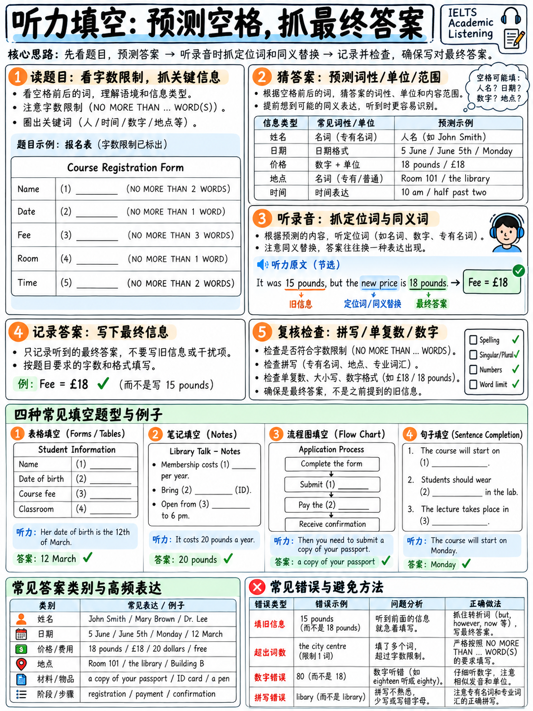

# 02. 听力填空题（表格/笔记/句子/总结）预判定位与原词原形抓取 (Completion Tasks)



填空题是雅思听力的绝对基本盘。官方三大主流填空形式（笔记/表格/流程图填空、句子填空、简答题）在整套考卷中通常占据 **20–28 题（占总分 50%–70%）**，密集分布在 Part 1、Part 2 和 Part 4。

填空题的核心逻辑极其简单纯粹：**“所听即所得，原词原形填空”**。然而大量考生屡屡失分，根源并不完全在于“听力听不懂”，而在于**预读不充分、单复数失误以及拼写错误**。攻克填空题，是雅思听力迈向 7 分以上的最大分水岭。

---

## 2.1 填空题三大失分维度深度诊断

很多考生误以为填空题做错只是因为“语速太快没反应过来”。实际上，一道填空题的得分涉及三个独立的子能力：

| 考核维度 | 典型失分现象 | 根源剖析 | 提分解决方案 |
|---|---|---|---|
| **辨音抓词**<br>*(Hearing)* | 根本没听出说话人说的是哪个词 | 语音连读、弱读失爆、吞音或口音干扰（如把 `next day` 听成 `neks day`） | 精听文本对照、影子跟读与专项辨音训练 |
| **词形语法**<br>*(Forming)* | 听出了单词，但写错形态（如写成 `child`，题干要求 `children`） | 忽略了题干空格前后的语法逻辑（单复数、时态、词性约束） | 听前空格语法预判、单复数警惕反射 |
| **准确拼写**<br>*(Spelling)* | 听出且认出单词，但键盘拼错字母（如写成 `accomodation` 或 `libary`） | 机械记忆不扎实，字母混淆，键盘盲打失误 | 高频听力拼写核心词库强化速查 |

:::{important}
**自测诊断法：分清是“没听到”还是“送了人头”。**
做完一套模考填空题后，严格分析错题原因：如果是因为拼写少了一个字母、或者把复数名词写成了单数，这是**“白白丢分（Free marks lost）”**！大多数初学者在 40 题中，有 4–7 分纯粹是因为拼写和单复数扣掉的。解决这部分问题，甚至不需要提升你的耳朵灵敏度，只需规范做题习惯，即可直接提高半个 Band。
:::

---

## 2.2 填空题标准审题与预判四步法

录音正式播放前，考官会给出 30–60 秒的准备时间。这段时间必须完成以下四步标准化操作：

```
   填空题听前预判标准流（The 4-Step Protocol）

   Step 1. 扫描字数限制 (Word Limit)
           ► 题干要求："ONE WORD ONLY"？
           ► 还是："NO MORE THAN TWO WORDS AND/OR A NUMBER"？
           ► 绝不可超字数，超出一个冠词或介词整题直接计 0 分！

   Step 2. 预判词性与语法形态 (Grammar Constraints)
           ► 空格是名词（单数还是复数？）、动词、形容词还是数字？
           ► 若题干为 "Three ______ are needed"，空格【必须】是复数名词！

   Step 3. 预判信息类别 (Information Type)
           ► 是人名、价格、日期、星期、交通工具、材质、还是评价品质？
           ► 大脑开启对应信息雷达（如锁定金额数字）。

   Step 4. 圈定核心定位路标词 (Signposts)
           ► 锁定空格前后不易被替换的专有名词、介词、连词及时间状语。
           ► 录音念到定位词，意味着答案就在前后半秒内！
```

### 预判实战训练示范

在没有任何音频的情况下，仅凭题目表面文本，即可预判出 80% 的信息特征：

| 题目空格呈现 | 词性预判 | 信息类型预判 | 录音抓取靶标 |
|---|---|---|---|
| `Name: ______` | 专有名词 | 姓氏（通常会逐字母拼读） | 听取字母报读："That's B-A-K-E-R" |
| `Deposit: £______` | 数字 | 纯金额数字 | 抓取价格数字："two hundred and fifty" |
| `Course starts on ______` | 名词 | 日期或星期几 | 抓取时间词："the third of October" |
| `Must bring a ______` | **可数名词单数** | 随身证件或物品 | 抓取单数物品："you'll need a passport" |
| `The room is too ______` | 形容词 | 负面评价或特征 | 抓取描述性品质词："it's a bit noisy, actually" |
| `Classes are held ______ a week` | 副词 / 频度短语 | 频率 | 抓取频次："twice a week" |
| `Made from ______` | 抽象/物质名词 | 制作原料或材料 | 抓取材质："made of recycled plastic" |
| `Open from ______ to 6 pm` | 时间点 | 营业开始时间 | 抓取具体钟点："half past eight" |
| `Students should avoid ______` | 动名词 (-ing) / 名词 | 禁忌行为或动作 | 抓取否定警示词后的动作："parking on the main road" |
| `Three ______ are needed` | **可数名词复数** | 必需物品或凭证 | 抓取复数形式："three references" |

:::{tip}
**词性预判是抵御单复数扣分的终极武器！**
如果题目清晰写着 `Three ______ are needed`，录音中即使因为连读或弱读导致 `references` 结尾的 `/s/` 听得不够清晰，语法常识也告诉你必须在键盘上敲入复数形式 `references`。雅思听力填空必须符合句子语法规范！
:::

---

## 2.3 官方全真案例深度拆解：二手家具电话咨询

以下选自剑桥官方精选样题 `[18]` `[25]`（Part 1 笔记填空任务）。包含完整录音文本、题干以及逐题解析。

### 官方录音原文 (Official Transcript)

> **M:** 348831.  
> **F:** Oh hello… I'm calling about your advertisement in the local paper.  
> **M:** Oh well, there were two ads actually. Was it the one for second-hand furniture?  
> **F:** That's right, yes. Last Thursday…  
> **M:** Oh yes… Some of it's already gone I'm afraid, but… what exactly were you interested in?  
> **F:** Mainly the dining room furniture, specially the table. Has that gone yet?  
> **M:** Not yet.  
> **F:** Oh good. Can you tell me a bit about it?  
> **M:** Well, it's **round**. I'm not sure of the exact measurements, but it's medium sized. It seats about six.  
> **F:** And how old is it?  
> **M:** Mmmm. Mm let's see… ten years? No it must be **twelve** by now.  
> **F:** And the advertisement said you were asking £25 for that?  
> **M:** That's right.  
> **F:** And do you still have the dining chairs?  
> **M:** Yes. It's a set of **four** chairs – there were two more but over the years a couple have disappeared.  
> **F:** What are they like?  
> **M:** Quite nice – they've got upholstered seats – you know they're covered in material to make them more comfortable to sit on. That's **green** – but you could change it of course, if you wanted something different.  
> **F:** What sort of condition are they in?  
> **M:** I'd say **reasonable** – they've had a bit of wear. And we're asking £20 for those.  
> **F:** Right. And the other thing I wanted to ask about was the desk. Can you tell me roughly how long the top is, so I know if it'll fit in my room?  
> **M:** Let's see… It's 75 cm high I know, and the length's err **1 metre 20**. And it's 40 cm deep. It's got 3 drawers – the top one's got a **lock** so you can keep your valuables there.

---

### 题干题目 (Reconstructed Notes Task)

**Complete the notes. Write NO MORE THAN TWO WORDS AND/OR A NUMBER for each answer.**

```
   SECOND-HAND FURNITURE

   Dining table
     shape ............................. (1) ____________
     age ............................... (2) ____________
     price ............................. £25

   Dining chairs
     number in the set ................. (3) ____________
     colour of seat covers ............. (4) ____________
     condition ......................... (5) ____________
     price ............................. £20

   Desk
     length of top ..................... (6) ____________
     top drawer has a .................. (7) ____________
```

---

### 官方答案键 (Official Answer Key)

> **1** round  
> **2** 12 years / twelve years  
> **3** 4 / four  
> **4** green  
> **5** reasonable  
> **6** 1.20 metres / 1.20 m / 1 metre 20  
> **7** lock  

---

### 逐题考点透析与高频陷阱剖析

| 题号 | 官方标准答案 | 音频定位路标词 | 陷阱防范与解析 |
|---|---|---|---|
| **1** | **round** | "Can you tell me a bit about it?" → "Well, it's round." | 紧接着出现了 "medium sized" 和 "seats about six" 两个极具迷惑性的描述。但题干要求的是 `shape`（形状），因此唯一答案是 `round`。 |
| **2** | **12 years** | "And how old is it?" | **典型自我修正陷阱**！男声先说 "ten years?"，随即推翻："No it must be twelve by now." 如果听到第一个数字就立刻按回车，直接落入考官圈套。 |
| **3** | **4** | "do you still have the dining chairs?" → "It's a set of four chairs" | **烟雾弹数字干扰**：男声随后补充 "there were two more but a couple have disappeared"（原来有 6 把，丢了 2 把）。题干问的是目前一套有几把，答案是 4。 |
| **4** | **green** | "upholstered seats... That's green" | 答案出现在闲聊材质与舒适度之后。需时刻锁定目标信息：`colour`（颜色）。 |
| **5** | **reasonable** | "What sort of condition are they in?" → "I'd say reasonable" | 形容词直接抓取。紧接着虽然解释 "they've had a bit of wear"（有些磨损），但题干只填一个概括性评价形容词。 |
| **6** | **1.20 metres** | "how long the top is" → "length's err 1 metre 20" | **多重尺寸轰炸干扰**：录音一口气报出高 75cm、长 1m20、深 40cm。必须精准对应 `length`（长度）。写作 `1.20 metres` 或 `1.20m` 均可。 |
| **7** | **lock** | "top drawer has a..." → "the top one's got a lock" | 录音前置干扰为 "It's got 3 drawers"（3个抽屉是数字干扰），题干问顶层抽屉配有什么，答案为名词 `lock`。 |

:::{important}
**考点复盘启示：**
短短一段只有 1 分多钟的日常咨询录音中，考官连续布置了：**1 处自我修正、3 处多余数字干扰、1 处多重尺寸混淆、以及多处多余闲聊细节**。雅思考察的绝不是高深词汇，而是你在干扰信息轰炸中保持清醒、精准提取目标要素的抗干扰能力！
:::

---

## 2.4 四大多样化填空题型精要拆解

除了常规的日常笔记填空，雅思听力还广泛分布着以下四大经典填空变体：

### 1. 句子填空（Sentence Completion）—— 开放大学学习讨论

- **官方标准答案**：`1 motivation`, `2 time(-)management`, `3 modules`, `4 summer school(s)` `[18]`。
- **关键原文切片**：
  > "I found I needed to maintain a high level of **motivation** because it's so different from school."  
  > "I got very good at **time-management** because I had to fit time for studying round a full-time job."  
  > "the degree is made up of **modules**, so you can take time off between them"  
  > "from time to time there are **summer schools**. They usually last a week."
- **考点精要**：注意 `time-management`（带连字符或不带均算对）和 `summer school(s)`（单复数皆可接受）。官方在制定答案键时，凡是语法合规的可选形态，均会用括号注明。

### 2. 表格填空（Table Completion）—— 学习坚持度学术研究 (Part 4)

- **官方标准答案**：`1 challenge`, `2 school`, `3 health`, `4 interests`, `5 tutor(s)` `[18]`。
- **关键原文切片**：
  > "many respondents reported that they took pleasure in **challenge**"  
  > "a sizeable percentage talked about the fact that they had enjoyed themselves in **school**"  
  > "a number of people said that what was of most importance was decent **health**"  
  > "they felt it was important to have lots of **interests** in their everyday lives"  
  > "several respondents talked about good relationships with their **tutors**"
- **考点精要**：表格填空的**行标题（Row headings）和列标题（Column headings）就是路线图**。讲师授课时会极其严密地按照表格结构念出路标词："At the first level...", "Under social factors..."。跟着表格坐标走，绝对不会跟丢。

### 3. 简答题（Short-answer Questions）—— 服装行业岗位招募

- **官方标准答案**：`1–3 IN ANY ORDER: 1 scientist(s), 2 engineer(s), 3 accountant(s)` `[18]`。
- **关键原文切片**：
  > "Right now we're on the lookout for **scientists**, particularly to work with the dyes...  
  > We're **not** looking for any new **designers** at present but vacancies may arise in future. However, at the moment we are looking for **engineers** to work in the production department...  
  > so we're currently recruiting **accountants**."
- **考点精要（绝妙的否定陷阱）**：录音中大篇幅提到了 `designers`（设计师），但前面带有强否定词："We're **not** looking for any new designers"。盲目听到职业名称就写的考生必中圈套。此外，官方标注 `IN ANY ORDER`，意味着这三个职业填写在 1、2、3 题的任何一个框内均可得分。

### 4. 流程图填空（Flow-chart Completion）—— 地外生命探测研究

- **官方标准答案**：`1 site`, `2 radiation`, `3 heat`, `4 microbes`, `5 results` `[18]`。
- **关键原文切片**：
  > "they direct it to a **site** that's likely to provide this... the surface might be exposed to high levels of **radiation**... the sample has to be exposed to **heat**, and then run through a mass spectrometer... to search for microscopic signs of life, much smaller than fossils, such as **microbes**... once all this has been done and the **results** sent back to Earth"
- **考点精要**：流程图按箭头时序推进。注意即使遇到质谱仪（mass spectrometer）等高难词，考官也会在录音中给出自带释义，**真正的填空答案全是基础词汇**（site, heat, microbes）。

---

## 2.5 十大高频答案词类别与速记规范

基于官方题库统计，Part 1 和 Part 2 的填空答案高度集中于以下 10 个领域：

| 答案类别 | 常见考点范例 | 听音与速记要领 | 机考规范与书写建议 |
|---|---|---|---|
| **1. 报读姓氏** | Baker, Mackenzie, Lawrence | 听清双写字母（double L）与易混字母读音 | 大小写均可，推荐全大写 `MACKENZIE` 确保清晰 |
| **2. 价格金额** | £25, £4.50, €120, $15.50 | 听清货币单位与小数点，注意便士（p）读法 | 题干已有货币符号则只需填数字，无符号则需写明 |
| **3. 电话/编码** | 07944 31208, SW19 4LT | "0" 读作 "oh" 或 "zero"；双数字连读 double 4 | 连续长串数字可连写，英联邦邮编字母数字交替 |
| **4. 日期** | 21 May, 3 October, 14th Sept | 注意序数词读音（third, twenty-first） | 推荐统一写为阿拉伯数字+月份全拼：`21 May` |
| **5. 具体时刻** | 8.30 am, half past eight, 9.15 | 区分 quarter to（差一刻）与 past（过一刻） | 推荐使用机考数字简写：`8.30` 或 `8:30` |
| **6. 星期几** | Wednesday, Thursday, Tuesday | 重点防范发音易混淆与拼写陷阱 | 绝不能漏掉字母，必须完整拼出 |
| **7. 地址道路** | 14 Hill Road, Oxford Street | 道路常用词：Road, Street, Avenue, Lane | 缩写不扣分，但推荐完整书写避免歧义 |
| **8. 建筑与房间** | Room 4B, Mitchell Building | 字母与数字组合，专用楼宇名称 | 首字母大写或全大写录入 |
| **9. 材质与日常物品**| recycled plastic, leather, cotton| 名词单复数与材质形容词固定搭配 | 原词原形提取，注意不要漏掉修饰词 |
| **10. 评价与性质** | reasonable, affordable, noisy | 基础高频评价形容词 | 严禁多写无关修饰词 |

---

## 2.6 雅思听力杀手级拼写词汇排行榜

以下词汇在雅思听力真题中反复作为答案出现，同时也是**中国考生拼错率最高的单词**。请逐一自查肌肉记忆：

| 单词 | 最常犯的拼写错误 | 记忆锚点与口诀 |
|---|---|---|
| **Wednesday** | 漏写字母 `d` 写成 "Wensday" | **Wed-nes-day**：记住中间藏着一个结婚的 `Wed` |
| **Tuesday / Thursday** | 两者发音与拼写混淆 | **Tuesday** 无 `h`；**Thursday** 有 `h` |
| **February** | 漏写中间的 `r` 写成 "Febuary" | **Feb-RU-ary**：两个字母 `r` |
| **accommodation** | 漏写 `c` 或 `m` | **双 c 双 m**（两个 c，两个 m） |
| **necessary** | 错拼成 "neccessary" | **单 c 双 s**（一件衬衫 shirt，两条袜子 socks） |
| **separate** | 错拼成 "seperate" | 中间藏着一只老鼠：se-**p-a-rat**-e |
| **receipt** | 错拼成 "reciept" 或漏写 `p` | c 后面是 **ei**，且含有不发音的 **p** |
| **library** | 漏写第二个 `r` 写成 "libary" | **lib-ra-ry**：含有两个 r |
| **vegetable** | 错拼成 "vegtable" | 书面共有四个音节：ve-ge-ta-ble |
| **restaurant** | 错拼成 "restarant" | 中间含有 **au**：res-ta-**u**-rant |
| **beginning** | 漏写第二个 `n` | 词根 begin 双写 n 变 **beginning** |
| **business** | 错拼成 "buisness" | 来自 busy，变 y 为 i：**busi-ness** |
| **appointment** | 漏写 `p` | **双 p**：ap-point-ment |
| **equipment** | 误加字母 `t` 写成 "equiptment" | 根本没有字母 `t`！不可数名词 |
| **colleague** | 错拼成 "collegue" | 结尾是 **ague**：col-le-a-gue |
| **questionnaire** | 漏写第二个 `n` | question 加 **naire**：双写 n |
| **recommend** | 错拼成双 c 或单 m | **单 c 双 m**：re-com-mend |
| **tomorrow** | 错拼成双 m 单 r | **单 m 双 r**：to-mor-row |

:::{danger}
**拼写不是小问题，拼写是决定 Band 分数的生死线！**
官方评分标准非常残酷：“Each correct answer receives 1 mark” `[2]`，只要拼错一个字母，整道题当场归零。在 40 道题中，因为粗心拼错 5 个单词，你的总分就会从 **Band 7.0 暴跌至 Band 6.0**。花一周时间死磕上述 18 个核心词汇与常见规则，提分效果远胜于盲目刷十套听力题。
:::

---

## 2.7 填空题四周专项提分训练方案

- [ ] **每日 10 分钟原速听写（Dictation）**：截取 15 秒官方真题对话或独白，逐词听写，核对单复数与拼写。
- [ ] **每日 5 分钟无音频“预判专项操练”**：拿出任意一套听力题，不放录音，仅凭卷面在 60 秒内用铅笔在 10 个空格旁飞速批注出“词性”与“信息类型”。
- [ ] **每周 3 次高频易错词默写**：逐一默写 §2.6 中的 18 大杀手级单词，形成肌肉记忆。
- [ ] **建立专属错题本**：严格区分是听辨问题、单复数语法问题还是键盘误触，针对性查漏补缺。
- [ ] **阶段达成目标**：考前实现 **Part 1 稳定 9–10 分，Part 2 填空全对，Part 4 填空命中 6+ 题**！

---

**上一章：** {doc}`01-scoring-and-section-tactics` | **下一章学习指南：** {doc}`03-multiple-choice-and-matching`
