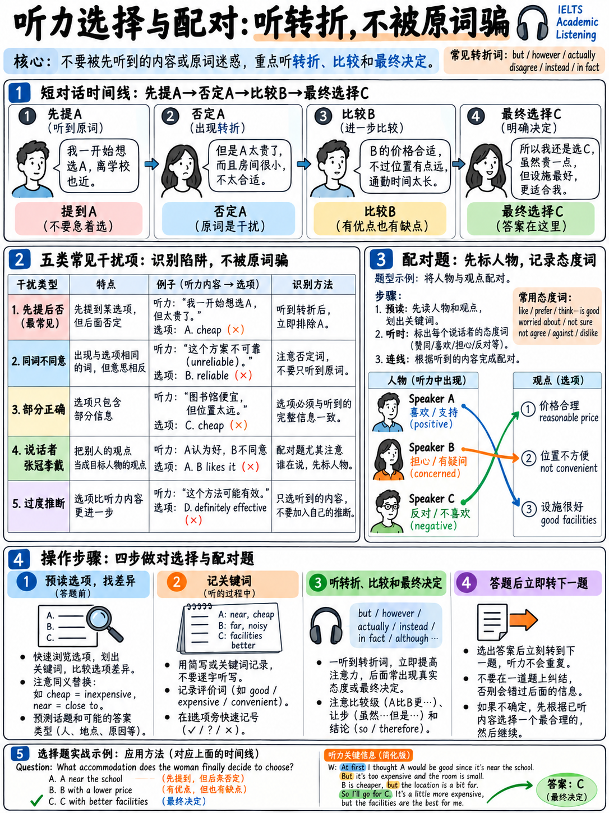

# 03. 听力单选、多选题与选项配对题防干扰与排除法 (Multiple Choice & Matching)



如果说填空题考核的是“辨音抓词的原形誊录”，那么**选择题（Multiple Choice）与配对题（Matching）**考核的则是完全不同维度的能力：**“同义替换的瞬间映射与干扰项排除”**。

这两大题型集中轰炸于 **Part 2 与 Part 3**。很多考生在这两部分大面积丢分，并非听不懂单词，而是因为被漫长的选项阅读量拖垮，或者在多人快速辩论中被考官精心设计的“原词诱饵”带偏。掌握科学的降维审题法与五大干扰项排除法则，是稳守 7 分的关键。

---

## 3.1 题型本质差异与认知负荷对比

| 考核维度 | 填空题 (Completion) | 选择题与配对题 (MC & Matching) |
|---|---|---|
| **答案呈现形式** | 说话人说出的**原词原句** | 对说话人观点的**高度同义改写 (Paraphrase)** |
| **听音与作答机制** | 听到关键词后即刻敲入键盘 | 脑海中需同时处理 3–4 个选项的含义并比对判断 |
| **说话人角色** | 通常为单人或信息单向传递 | 通常为 **2–4 人学术对话**，涉及意见摇摆与反转 |
| **听前阅读压力** | 阅读量极小（仅需看空格前后几个词） | **阅读量巨大**（10 道题可能多达 40 个长句子选项） |

:::{important}
**选择题真正的死穴是“审题时间枯竭”。**
在 Part 3 开始前的 40–50 秒预读窗口内，普通考生根本不可能把 10 道长单选题的所有选项逐字逐句读完。如果你试图读完每一个单词，结果就是大脑超载，录音开始时你还在看第 3 题。**选择题的核心必须是“题干降维与选项极简法”！**
:::

---

## 3.2 选择题听前“降维打击”三步法

```
   选择题审题黄金流程（The 3-Step MC Protocol）

   Step 1. 扫荡题干：圈定不可替换路标 (Question Stems Only)
           ► 优先读完所有题目的【题干】（绝不先看选项！）。
           ► 圈出题干问的核心：
             • 问【谁】的观点？(Who: Student A / Tutor)
             • 问【哪个时间】？(When: past / present / future)
             • 问【什么问题】？(Problem / main reason / final choice)

   Step 2. 选项对比：抓取核心差异词 (Spot the Difference)
           ► 仅精读前 3–4 题的选项；
           ► 划掉选项中相同的修饰语，圈出互斥的【唯一核心词】：
             • 选项 A: too expensive    ──► 简化为 [贵/COST]
             • 选项 B: lack of time     ──► 简化为 [没时间/TIME]
             • 选项 C: poor quality     ──► 简化为 [质量差/QUALITY]

   Step 3. 听中跟进：答案出现后再看下一题 (Read-ahead during speech)
           ► 听到说话人开始讨论当前题目的定位词时，聚精会神听意群；
           ► 选定当前题目后，利用说话人闲聊过场的时间，立即向下预读下一题的选项！
```

:::{tip}
**核心心法：意群匹配（Meaning Matching），绝非字面匹配（Word Matching）！**
雅思听力选择题的错误选项，通常直接包含录音中出现的**一模一样的原词**；而正确选项几乎 100% 经过了**深层同义改写**。如果你在听音时发现某个选项里有两三个词跟录音完全重合，那大概率是考官为你量身定做的“听觉陷阱”！
:::

---

## 3.3 选择题五大经典干扰项套路与排除手册

官方出题专家在设计选择题干扰项时，遵循着五个高度固定的陷阱模板：

| 干扰类型 | 典型音频话术 | 陷阱防范与破解准则 |
|---|---|---|
| **1. 提及但推翻**<br>*(Mentioned & Rejected)* | "You might assume we did X... but actually we chose Y." | **真正的答案永远在转折词之后**（如 *but, actually, in fact, however, instead*）。听到第一个选项切勿激动。 |
| **2. 张冠李戴 / 角色错位**<br>*(Wrong Speaker)* | 选项是男生的建议，但题干问的是女生的最终决定；或者属于导师的批评。 | **严密锁定题干的主体人名！** 在草稿纸上标记发言人符号（M/F/T），分清谁同意了谁。 |
| **3. 时态范畴偷换**<br>*(Wrong Timeframe)* | 选项是去年的调研结果，题干问的是今年的改进方案。 | 听清时态：*initially, originally, used to* 对应过去；*currently, now, plan to* 对应当前与未来。 |
| **4. 以偏概全 / 部分正确**<br>*(Partially Right)* | 录音说了 "interviewed teachers and students"，选项却说 "only teachers"。 | 选项含有绝对化词汇（*all, only, entirely*）需高度警惕。 |
| **5. 原词重现，逻辑颠倒**<br>*(Verbatim Trap)* | 录音："The data analysis took ages, but it was worthwhile."<br>选项："She regretted the time spent on data analysis." | 虽然听到原词 `data analysis` 和 `time`，但态度完全相反（worthwhile vs regretted）。 |

:::{warning}
**“提及但推翻（Mentioned and rejected）”是 Part 3 出现频率最高的陷阱！**
真实大学学术讨论中，学生和导师必定会经历“提出设想 A ── 发现 A 的缺陷 ── 提出替代方案 B ── 最终敲定 B”的过程。听到说话人提到某个选项时，务必耐心听完后续的评价词。
:::

---

## 3.4 官方全真案例深度拆解：东区历史论文讨论

以下选自官方精选样题 `[18]`（Part 3 学术毕业论文讨论单选题）：

### 官方录音原文切片 (Official Transcript Extract)

> **STUDENT:** "Lots of books have been published about the East End, covering everything from health to how roads and districts got their names, so you might think it's an obvious subject to pick. **But in fact I was brought up there, and I've always been interested in finding out how the area shaped my upbringing.**"

---

### 题干与选项还原

**Question 1. Why did the student choose the East End as her dissertation topic?**  
- **A** It has been heavily documented in existing literature.  
- **B** She wanted to understand her own background.  
- **C** Her tutor strongly recommended the location.  

---

### 官方答案键与深度剖析

- **官方标准答案**：**B** (`She wanted to understand her own background`)。
- **干扰拆解**：
  1. 录音开门见山说："Lots of books have been published about the East End..."。选项 **A** 完美重现了这一事实（很多书籍文献记录），但学生紧接着用 **"so you might think it's an obvious subject... But in fact..."** 将其彻底推翻！这是极具杀伤力的“提及并推翻”与“原词诱饵”组合拳。
  2. 真实原因出现在转折后："I was brought up there, and I've always been interested in finding out how the area shaped my upbringing." 这里的 `brought up / upbringing`（抚养长大、成长背景）被选项 **B** 高度同义改写为 `her own background`。
  3. 选项 **C** 全文未提及导师的推荐。

---

## 3.5 选项配对题（Matching）极速破局法则

配对题通常以三大形态出现：
1. **观点归属配对（Opinion attribution）**：将不同观点匹配给不同发言人（如 男生 / 女生 / 两人均同意 / 导师）。
2. **分类配对（Classification）**：将具体事项归类（如 必须保留 / 计划翻新 / 彻底淘汰）。
3. **属性特征匹配（Feature matching）**：将不同建筑/课程与对应特色匹配。

```
   配对题解题关键：选项极致极简，题干顺序锁定！

   题干项目 (14–18)：严格按照录音顺序逐一报出！
   选项列表 (A–E)：静态类别，可在多道题目中复用。

   【听前必须做的动作】：
   将 A–E 每个选项压缩提炼为 1 个【中文或英文单字】：
   • A. Needs immediate repair   ──► 【修】
   • B. Scheduled for replacement ──► 【换】
   • C. Kept in current condition ──► 【留】

   听音时：视线死锁题干的推进，耳朵判断对该题干的最终评价，
   在对应的单字选项上秒选答案！
```

### 多人学术讨论中的声音追踪（Voice Tracking）

在 Part 3 的 2–4 人学术对话中，必须建立敏锐的“声音画像”：
- **前 10 秒听音辨人**：旁白介绍完毕后，立刻在草稿纸上写下说话人特征（如：男声 = Jack，女声 = Mary，沉稳年长声 = Tutor）。
- **捕捉态度与共识信号词**：
  - **个人独立观点**："I'd say...", "In my view...", "As far as I'm concerned..."
  - **质疑与否定**："Mm, but...", "I'm not convinced...", "Surely that's not the case."
  - **共同达成共识（双方皆同意）**："Exactly!", "I couldn't agree more.", "That makes total sense." ── 若题目问“两人都同意的观点”，必须听到双方明确赞同。
  - **转述他人观点（非本人观点）**："Well, the lecturer suggested that...", "According to the article..." ── 警惕这并非说话人自己的主张。

---

## 3.6 多选题（Multi-select）机考规范与盲猜保底战术

多选题通常要求：`Choose TWO letters, A–E` 或 `Choose THREE letters, A–G`。

1. **机考界面特征**：机考界面中，多选题通常呈现为复选方框（Checkbox），考生勾选对应字母即可。
2. **计分规则（Partial Credit）**：
   - 多选题每个正确字母**独立计算 1 分**！例如要求选 2 项，你选对 1 个、选错 1 个，依然能稳稳拿到 1 分。
3. **绝对不要少选或留空**：
   - 听力没有任何倒扣分机制。如果有一题只确信 1 个选项，剩下的那个空**哪怕凭第一感觉盲猜，也必须把规定数量全部勾选满**！留白等于 100% 放弃得分机会。

---

## 3.7 Part 4 选择题特别防线

偶尔 Part 4 学术讲座的末尾会出现 2–3 道单选题。与 Part 3 的辩论不同，Part 4 只有**单个讲师**在发言：
- **没有他人纠错**：讲师说一不二，逻辑缜密，不会出现对话中的观点推翻；
- **重音与停顿预警**：讲师在念出核心结论时，语速会放慢，并使用强强调路标词：
  > *"The crucial point here is..."*  
  > *"What we found most remarkable was..."*
- **紧盯讲义大纲**：选择题的题干必定是讲座的一个明确小结，听到对应学术专有名词时即刻作答。

---

## 3.8 选择与配对题专项训练清单

- [ ] **完成 6 套 Part 3 真实全真试题**：做完后严格对照 Tapescript 进行文本复盘。
- [ ] **错题陷阱归因分析**：对照 §3.3 的五大陷阱模板，标出自己是因为“原词诱饵”、“时态偷换”还是“推翻反转”做错的。
- [ ] **60 秒选项极简提炼训练**：找 5 套配对题，不放音频，计时 60 秒内将所有长选项压缩写成 1 个核心汉字。
- [ ] **声音辨识训练**：播放任意一段 Part 3 音频 90 秒，不做题，仅在纸上记录说话顺序（如：女 ──► 男 ──► 导师 ──► 女同意），训练对多人语调的敏锐度。
- [ ] **阶段目标**：在整体备考中，确保 **Part 3 斩获 5–6 分以上**，即可为全卷 6.5–7.0 分奠定胜局！

---

**上一章：** {doc}`02-completion-tasks` | **下一章学习指南：** {doc}`04-map-plan-diagram`
