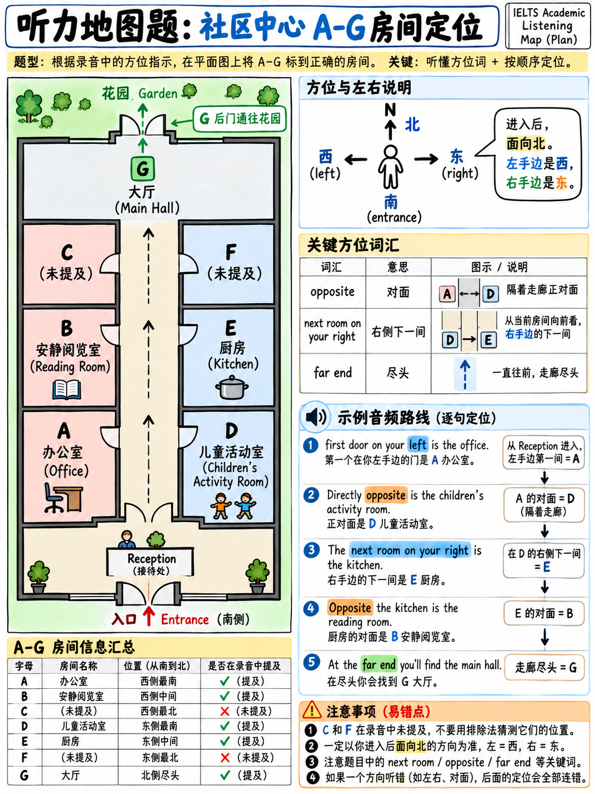

# 04. 地图题、平面图与流程图标记法：空间方位词与路线追踪技巧 (Maps, Plans & Diagrams)



地图与平面图标记题（Plan/map/diagram labelling）是雅思听力中让许多初学者望而生畏、但实际上**得分最机械、套路最固定**的题型。它最常出现在 **Part 2** 的公共生活导览中（如旅游景点路线介绍、社区活动中心设施布局、动植物园指引或大学校园导览）。

地图题本质上不是考空间几何想象力，而是考**“空间方位词汇的听觉快速反应”与“第一人称路线行进追踪”**。只要攻克约 40 个核心方位介词，并掌握“以手指代脚步”的行进技巧，地图题就能从心理绊脚石变成稳拿满分的“送分题”。

---

## 4.1 题型全貌与两种作答机制

在考卷中，地图题通常呈现一张画有若干建筑、道路、房间或机械零件的简易线稿图，考察形式分为两种：

1. **选项字母匹配型（最普遍，占 90% 以上）**：
   - 地图上标注了若干字母（如 A–G），题干列出几个具体地名或设施（如 `the café`, `the library`）。考生需要根据听力路线，将地名与正确字母一一对应。
2. **原词填空型（占不到 10%）**：
   - 地图上留有空白横线（如 `Room 12: ______`），要求根据录音写下听到的具体房间名称或建筑功能词（需严格遵守字数限制）。

---

## 4.2 听前 30 秒“黄金准备动作”四步法

在音频播放前的审题空隙，必须严格执行以下四步准备动作，绝不能发呆干等：

```
   地图题听前 4 步准备流（The 4-Step Map Drill）

   Step 1. 寻找出发原点 (Find the Starting Point / Entrance)
           ► 扫描图上的 "Entrance", "Reception", "You are here" 或大门。
           ► 说话人 95% 会从原点出发引导路线，这是所有方位的坐标系！

   Step 2. 判定方位参照物 (Check the Compass Rose)
           ► 寻找指北针（N 箭头）：
             • 有指北针：说话人必定大量使用 North / South / East / West；
             • 无指北针：说话人通常使用 Top / Bottom / Left / Right。

   Step 3. 默读已知固定地标 (Read Known Landmarks)
           ► 快速用眼扫描图上已印出的街道名（如 Elm Street）、湖泊（Lake）、
             停车场（Car park）等。
           ► 脑内建立它们的发音印记，它们是说话人报出目标前的绝对路标！

   Step 4. 脑内预判每个字母的位置特征 (Pre-describe the Letters)
           ► 扫视 A–G 各字母，用简短词汇在脑海中做位置预判：
             • A: 拐角处 (corner)
             • B: 主路尽头 (far end)
             • C: 两个建筑之间 (between)
           提前预判后，听音过程就从“手忙脚乱找字母”变成了“听音验证已知”！
```

:::{tip}
**第四步是地图题制胜的核心法门！**
听录音找位置的时间极其紧迫。如果能在听音前提前把字母的位置“翻译”成空间特征（如“A 在大门西侧”、“C 在湖的西北角”），当耳机里响起 *"just to the north-west of the lake"* 时，你的鼠标会瞬间精准点击 C，完全不给大脑犹疑停滞的时间。
:::

---

## 4.3 必须绝对掌握的空间方位词汇库（封闭清单）

雅思地图题使用的空间表达高度程式化，总共不超过 40 个核心短语。将其彻底内化为本能反应：

### 1. 指南针与边缘方位 (Compass & Edges)

| 英文表达 | 中文含义 | 听觉注意要点 |
|---|---|---|
| **north / south / east / west** | 北 / 南 / 东 / 西 | 听清发音，尤其是 East 与 West 的辨识 |
| **north-east / south-west** | 东北 / 西南 | 复合方位词通常一口气念出，无停顿 |
| **the northern end / southern side**| 北端 / 南侧 | 形容词形式，指代某条街道或场地的端点 |
| **at the top / bottom of the map** | 地图顶端 / 底部 | 在没有指北针的室内平面图中频繁使用 |
| **on the left-hand / right-hand side**| 在左手边 / 右手边 | 需结合第一人称行走视角判断 |

### 2. 相对空间位置 (Relative Positions)

| 英文表达 | 中文含义 | 考点特征 |
|---|---|---|
| **opposite / facing / across from**| 在……正对面 | 隔着一条走廊或马路正对着的目标 |
| **next to / beside / adjacent to** | 紧挨着 / 相邻 | 紧邻隔壁，通常只隔一堵墙或无间隔 |
| **between X and Y** | 在 X 和 Y 之间 | 夹在两个已知地标中间的位置 |
| **in front of / behind** | 在……前面 / 后面 | 建筑物的正前方开阔地或后方区域 |
| **on the corner of A and B** | 在 A 街与 B 街的交叉拐角处| 两条街道垂直交汇处的拐角建筑 |
| **at the junction / intersection of**| 在……的交叉十字路口/丁字路口| 道路交叉核心区域 |
| **halfway along / middle of the block**| 在街区中段 / 半途中间 | 不在街角，位于整条街的中部 |
| **at the far end** | 在走廊/道路的最尽头 | 沿着主路一直走到最底端 |
| **just past / just before** | 刚刚经过 / 就在……之前 | 刚刚穿过某个地标，或者差一点到达某个地标 |
| **set back from the road** | 远离街道（向后退缩） | 建筑不在街沿上，而是退后一段距离 |
| **overlooking** | 俯瞰 / 面朝景观 | 窗户或阳台正对着湖泊、花园等景观 |
| **adjoining** | 紧连着的（共用一堵墙） | 常用于两个相邻的房间 |

### 3. 行走轨迹与动态移动 (Movement & Directions)

| 英文表达 | 典型指路动作 | 实操追踪动作 |
|---|---|---|
| **go / head / continue along** | 沿着……一直向前走 | 手指沿主路向前推进 |
| **take the first / second turning on...**| 在第 1 个 / 第 2 个路口转弯 | **警惕序数词**！不要在第 1 个路口急转弯 |
| **turn left / right** | 向左转 / 向右转 | **以说话人当前行进方向为准**进行左右转弯 |
| **go past the...** | 穿过 / 经过某建筑物 | 手指继续向前，越过该地标 |
| **cross the road / path** | 穿过马路 / 小径 | 横跨道路到达对街 |
| **follow the path round** | 顺着弯曲的小径走 | 沿弯道弧度行进 |
| **on your left / on your right** | 在你的左侧 / 右侧 | **致命考点！** 见下方防坑警告 |

:::{danger}
**“On your left”是全场最大的扣分陷阱！**
“在你的左边”是**相对于行走者的第一人称视角**，绝非你面对试卷屏幕时的绝对左边！
如果说话人刚说：“从大门向北走到湖边，然后转身向南往回走（turn around and head back South）”，此时说话人是面朝南方的，他的“左手边”实际上对应试卷屏幕的**右侧（东面）**！
**破解法：必须在纸上或屏幕前使用手指/鼠标，随着路线行进方向实时转动你的视角！**
:::

### 4. 建筑内部与机械构造专有词汇 (Indoor & Diagram Terms)

- **室内平面图**：
  - `ground floor`：英式英语中指**一楼（街面平层）**；
  - `first floor`：英式英语中指**二楼**（美式英语常将平层称为 first floor）；
  - `basement`（地下室）、`mezzanine`（夹层）、`corridor / hallway`（走廊）、`reception / foyer / lobby`（前台/大厅）、`stairwell`（楼梯间）、`lift / elevator`（电梯）、`wing (east wing)`（侧翼大楼）。
- **器械与流程图**：
  - `base`（基座）、`lid`（顶盖）、`casing`（外壳）、`inlet / outlet`（进气/出气口）、`valve`（阀门）、`pipe / tube`（管道）、`nozzle`（喷嘴）、`clockwise`（顺时针）、`anticlockwise`（逆时针）。

---

## 4.4 官方全真案例深度拆解：小镇欢迎中心周边导览

以下选自官方精选真题 `[18]`（Part 2 户外地图标记题）：

### 官方录音原文 (Official Transcript)

> "You'll notice that the Welcome Centre, where we are, is located on the **southwest corner of Elm and Main Streets**. For those of you interested in doing a little shopping... **on the other side of Main Street** you can see a wonderful quilt shop…  
> The next street up Main is Ash Street. **On the Southside of Ash**, is a handicrafts museum worth a look…  
> On Main Street, **in the middle of the block past Ash but before Oak Street** is a traditional one-room school house."

---

### 官方答案键与考点透视

- **官方标准答案**：`1 H, 2 A, 3 C` `[18]`。
- **深度解析**：
  1. **原点锚定**：导游开门见山点明当前位置——"Welcome Centre... located on the **southwest corner of Elm and Main Streets**"（Elm 街与 Main 街十字路口的西南拐角）。
  2. **第 1 题（被子手作店 quilt shop）**："on the other side of Main Street" —— 横穿 Main 街到达对街，锁定对应字母 **H**。
  3. **第 2 题（手工艺品博物馆 handicrafts museum）**："The next street up Main is Ash Street. On the Southside of Ash..." —— 沿 Main 街向北走，到达的下一条街是 Ash 街；在 Ash 街的南侧，精准命中字母 **A**。
  4. **第 3 题（传统校舍 school house）**："in the middle of the block past Ash but before Oak Street" —— 过了 Ash 街但还没到 Oak 街，位于这个街区的正中间，命中字母 **C**。

全篇没有任何生僻词汇，完全由街道名 + 相对方位（southwest corner, other side, Southside, past Ash but before Oak）组成，考查极其规范利落。

---

## 4.5 经典室内平面图实战演练：社区中心内部布局

```
   社区中心室内平面图 (Community Centre Plan)

                 ┌─────────────────────────────┐
                 │       [G] Main Hall         │
                 └──────────────┬──────────────┘
                                │ 门通往花园 (Garden)
           [C]                  │                  [F]
                                │
           [B]                  │ Corridor         [E]
                                │ (走廊向北)
           [A]                  │                  [D]
                 ┌──────────────┴──────────────┐
                 │          Reception          │
                 │         (前台大厅)          │
                 └──────────────┬──────────────┘
                                ▲
                        Main Entrance (南门)
```

### 录音模拟文本 (Script)

> "Right, so let me just run through where everything is. As you come in through the main entrance you'll be in reception, and the corridor runs straight ahead of you. Now, the first door on your left is the **office** — that's where you'd come to pay for a class. Directly opposite that, on your right, is the **children's playroom**, which gets very noisy on Saturday mornings, I'm afraid. Carry on along the corridor and the next room on your right is the **kitchen**. We ask people not to use it without booking. The room opposite the kitchen used to be a store cupboard but it's now a small **quiet room** for reading. Right at the far end of the corridor is the **main hall** — that's the big room where we hold the yoga classes and the Saturday market. And just beyond the hall there's a door out into the garden."

### 题目：选择正确的房间字母 A–G

1. **the office**  
2. **the children's playroom**  
3. **the kitchen**  
4. **the quiet room**  
5. **the main hall**  

---

### 答案与解析剖析

| 题号 | 答案 | 录音线索表达 | 行走视角推理过程 |
|---|---|---|---|
| **1** | **A** | "the first door **on your left**" | 从南门进入向北走，左手边即为**西侧**。西侧由南向北的第 1 间房是 **A**（办公室）。 |
| **2** | **D** | "**Directly opposite** that, **on your right**" | 正对着办公室 A，在右手边东侧的第 1 间房：**D**（儿童游乐室）。 |
| **3** | **E** | "Carry on along the corridor and the **next room on your right**" | 沿走廊继续向北，右手边东侧紧接着的下一间房：**E**（厨房）。 |
| **4** | **B** | "The room **opposite the kitchen**" | **正对着厨房 E**，即西侧对应的房间：**B**（阅览静音室）。 |
| **5** | **G** | "Right at the **far end** of the corridor" | 走廊最尽头的宽敞主厅：**G**（大礼堂）。 |

:::{important}
**注意两大核心考点陷阱：**
1. **未提及的干扰字母**：图中房间 **C** 和 **F** 从未在录音中提及！考官故意安排多余字母，防止考生通过简单的排除法混过关。
2. **连环错题风险（Chaining Risk）**：第 4 题的静音室完全是根据第 3 题的厨房来定义的（"opposite the kitchen"）。如果你第 3 题走神漏掉了厨房的位置，第 4 题极大概率跟着选错！
   - **自救法则**：一旦发现上一题跟丢，立即跳过，绝不要猜测；下一题如果听到独立定位词（如 "Right at the far end"），立刻重新把手指落在尽头大厅重新跟进。
:::

---

## 4.6 地图题常见翻车误区与自查清单

| 常见翻车现象 | 根本诱因 | 考场纠错机制 |
|---|---|---|
| **左右全部颠倒选反** | 以面对屏幕的视角判断左右，而非行进者视角 | 严格使用“手指指路法”，手指尖永远指向行进方向 |
| **连环丢分找不到位置** | 听前没有标记已知地标和预判各字母方位 | 听前 30 秒务必默读地名，预判字母相对位置 |
| **相邻两个房间选错** | 漏听序数词（*first / second / third door*） | 强化对序数词的听觉敏感度 |
| **把单词错填成了字母** | 审题粗心，没看清题目要求填字母还是填单词 | 审清题干：*Choose the correct letter* 还是 *Write NO MORE THAN...* |
| **误以为上方永远是北** | 没核对指北针方向 | 进题第一秒务必扫一眼指北针（有时 N 会朝向右方或斜方） |

---

## 4.7 地图题刻意练习行动方案

- [ ] **精听练习 4 套经典真题地图题**：反复复盘导游指路行进的每一个拐角与转折。
- [ ] **15 分钟拿下 §4.3 方位词汇库**：确保每一个方位介词在 0.2 秒内转化为大脑空间反射。
- [ ] **极其实用的“自说自画”练习（无需官方音频）**：
  - 找一张生活中的商场平面图或校园地图；
  - 设定一个入口，自己用手机录音口述一段 90 秒的导览英文（如 *"Enter from the main gate, go straight past the fountain, take the first right..."*）；
  - 第二天播放自己的录音，尝试在图上用手指追踪路线。这个训练不仅能彻底征服听力地图题，还能同步精进口语 Part 2 空间描述能力！
- [ ] **考场铁律：手指不离卷面，路线实时跟进！**

---

**上一章：** {doc}`03-multiple-choice-and-matching` | **下一章学习指南：** {doc}`05-part-4-the-lecture`
