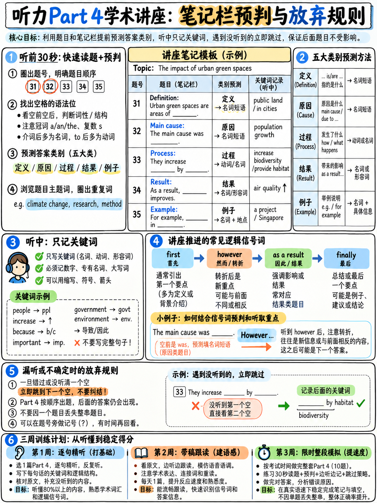

# 05. Part 4 学术讲座突破：一气呵成 10 道题无停顿的长独白生存法 (Part 4 The Lecture)



**"A monologue on an academic subject, e.g. a university lecture"** `[1]` —— 雅思官方对 Part 4 的定义是极其纯粹的大学学术讲座独白。整整 10 道题，由单个讲师从头讲到尾，**中途没有任何停顿时间，没有任何第二个人打岔、纠正或重复，音频一气呵成播放到底**。

这是整个雅思听力试卷中信息密度最高、耗费脑力最大的一段。本章的核心战略不是追求虚无缥缈的“满分攻坚”，而是**“精准止损与高性价比拿分（Damage Limitation）”**。只要看清学术讲座的路标架构，即使只能听懂 60% 的内容，你依然能稳稳斩获 5–7 题，锁定全卷 7 分以上的胜局。

---

## 5.1 战略定位：为什么 Part 4 是“止损战”而非“决胜战”

很多考生在备考时陷入误区，花费一半以上精力去背诵深奥的生物学、天文学或考古学生僻词，试图在 Part 4 拿下 9–10 分。从雅思考试的计分效率来看，这是一种极低效的投入：

| Part 4 核心特征 | 给考生的真实生理与心理挑战 | 战略应对结论 |
|---|---|---|
| **单人学术长独白** | 语速快且匀速，无问答互动，容易产生听觉疲劳 | 视线不能散，紧跟段落导航词 |
| **中途零停顿** | 连续播放 10 道题，一旦掉队极易引发大面积崩盘 | 必须掌握“1 秒止损弃题原则” |
| **长难句学术句式** | 从句套从句，定语后置，修饰冗长 | 提炼句子主干，直击核心名词 |
| **考场压轴出场** | 经历前 3 个 Part 近 25 分钟高强度输出，精力透支 | 心理脱敏，把预期降到稳拿 5–6 分 |

### 算分经济学：重新审视你的目标

如果你的目标是听力 **Band 6.5**，全卷只需 27/40；若目标是 **Band 7.0**，只需 30/40 `[7]`：

$$10\text{分 (Part 1)} + 8\text{分 (Part 2)} + 6\text{分 (Part 3)} + 5\text{分 (Part 4)} = 29\text{分} \approx \text{Band 7.0}$$

:::{important}
**认清算分事实：Part 4 的一道高难学术题，和 Part 1 记一个电话号码，分值完全相同（都是 1 分）！**
把 Part 1 从 6 分提升到 10 分，只需要花 3 天练习数字和拼写；而把 Part 4 从 4 分提升到 8 分，需要数月的学术词汇与语感沉淀。明确**“Part 1–2 保基本盘，Part 4 稳拿 5–6 分”**的心态，可以让你在考场上彻底卸下恐慌包袱，遇难题心态不崩。
:::

---

## 5.2 讲座提纲就是讲师的 PPT：利用预读建立“结构罗盘”

Part 4 在音频正式开始前，会有大约 **30–40 秒的集中审题时间**。这是决定 Part 4 生死的关键窗口。

```
   Part 4 黄金审题流程 (30–40 秒极速扫描)

   Step 1. 扫描讲座大标题 (Lecture Title)
           ► 标题揭示了讲座的主题与学科领域 (如 Urban Beekeeping)。
           ► 大脑立刻激活该领域的常识背景。

   Step 2. 扫荡大写主标题与次级副标题 (Headings & Sub-headings)
           ► 这些就是讲师投影屏幕上的【PPT 幻灯片大纲】！
           ► 例如：Background ──► Food Supply ──► Problems ──► Conclusions
           ► 讲师每到一个新板块，必定口头宣布大纲词汇！

   Step 3. 圈定每个空格的词性与核心限制
           ► 90% 的答案为【名词】（单数还是复数？）。
           ► 标记空格周围的特殊定位词（如具体年份、大写地名、专有名词）。

   Step 4. 重点关注带有转折与因果逻辑的考点行
           ► 留意空格前后的对比结构（more than, decline, caused by）。
```

:::{tip}
**结构罗盘效应：只要知道讲师在讲哪一张 PPT，你就永远不会迷失！**
哪怕讲座中有一大段关于细胞结构或地质年代的专业术语你完全听不懂，只要你盯紧题干上的副标题（如 `Problems`），当听到讲师说 *"Now, let's turn to the problems..."* 时，你的大脑会瞬间拉响警报：下一道题的答案马上要在接下来两句话内出现了！
:::

---

## 5.3 学术讲座路标词系统（Signpost Language）

大学教授在授课时，有极强的逻辑指引本能。他们会频繁使用路标短语来梳理脉络。这些词汇不仅易于辨识，更是**送给考生的答题信号弹**：

| 教学逻辑功能 | 讲师极高频路标表达 (Signpost Phrases) | 考生应激反射动作 |
|---|---|---|
| **开场与主题宣布** | *"Today I'd like to look at..."*<br>*"I'll begin by focusing on..."*<br>*"Our topic today is..."* | 确认讲座大方向，准备迎接第 31 题 |
| **逻辑段落转折推进** | *"Now, turning to..."*<br>*"That brings me to my next point..."*<br>*"So much for X, let's now consider Y..."*<br>*"Right, the next issue is..."* | **极其重要！** 视线立即下移，定位到下一个副标题 |
| **层级分项罗列** | *"There are three main aspects..."*<br>*"Firstly... Secondly... Finally..."*<br>*"The first of these categories is..."* | 预判接下来会有连续几道题按部就班出现 |
| **重点强调（答案预警）**| *"The crucial point here is..."*<br>*"What is particularly significant is..."*<br>*"And this is the key thing to remember..."* | **高危红色预警！** 答案词马上在紧随其后的意群中报出！ |
| **专业名词释义** | *"By X, I mean..."*<br>*"This is what we call..."*<br>*"The term X refers to..."* | 解释术语，通常考点就在该术语的功能或定义词上 |
| **举例佐证** | *"A good illustration of this is..."*<br>*"Take X, for instance..."* | 题干若有 "such as / e.g."，立即在此抓取具体名词 |
| **因果关系推导** | *"As a result of this..."*<br>*"Consequently..."*<br>*"This led directly to..."* | 对应题干中的 "cause, reason, effect, impact" |
| **总结收尾** | *"To summarise that..."*<br>*"In conclusion..."*<br>*"The upshot of the research is..."* | 对应最后 1–2 道题（结论与建议部分） |

:::{important}
**“The crucial point here is...” 是全卷最可靠的答案信标！**
学术独白不同于日常闲聊。教授为了让学生记笔记，在说到核心研究发现时，音调一定会提高、语速会放慢，并伴随强调副词（*particularly, dramatically, essential*）。训练耳朵对这套强调体系的敏锐度，能直接提升 2–3 题命中率。
:::

---

## 5.4 官方全真案例深度拆解：学生“学习坚持度”学术讲座

以下选自官方精选样题 `[18]`（Part 4 大学讲师关于“学习坚持度（Learner Persistence）”研究报告）：

### 官方录音原文 (Official Transcript)

> "The second section of my questionnaire looked at learner persistence under **three main headings**: social and environmental factors, other factors, and intrinsic or personal characteristics. I identified **three levels of importance** for each of these.  
>  
> **At the first level** – those points identified by participants as most important… for social factors, many respondents said… **As regards other factors**, students are heartened… **And for personal characteristics**, many respondents reported that they took pleasure in **challenge**…  
>  
> **At the second level of importance, in the first category**, a sizeable percentage talked about the fact that they had enjoyed themselves in **school**… **In the second column, other factors**, a number of people said that what was of most importance was decent **health**… **And then under the heading of personal characteristics**, there were quite a large percentage of respondents who mentioned they felt it was important to have lots of **interests**…  
>  
> **And then onto the third level. Under social factors**, several respondents talked about good relationships with their **tutors**."

---

### 官方答案键 (Official Answer Key)

> **1** challenge  
> **2** school  
> **3** health  
> **4** interests  
> **5** tutor(s)  

---

### 深度解析：结构与路标的完美统一

仔细审视上述官方录音文本，你会发现官方考官展示了极其规范的学术出题法：
1. **多达 9 个毫无遮掩的纯结构路标词**：
   - "three main headings"
   - "three levels of importance"
   - "At the first level"
   - "As regards other factors"
   - "And for personal characteristics"
   - "At the second level of importance, in the first category"
   - "In the second column, other factors"
   - "under the heading of personal characteristics"
   - "And then onto the third level. Under social factors"
2. **讲师完全是在照着卷面表格逐行逐列大声读出坐标！**
   - 试卷上的表格有三行（三个重要性层级）和三列（三大影响因素）。讲师在说话时，每到一个单元格，都用语言清晰通报。
3. **答案词全部是最基础的初高中词汇**：
   - `challenge`（挑战）、`school`（学校）、`health`（健康）、`interests`（兴趣）、`tutors`（导师）。全篇没有一个难词！
4. **字数提纯原则**：
   - 第 3 题原文中讲师说的是 "decent **health**"（良好的健康）。虽然填两个词 `decent health` 符合字数限制，但官方标准答案直接给出单核心名词 **health**。**在保证语法完整的前提下，填单核心词永远最稳妥、最不易超字数！**

---

## 5.5 机考环境下草稿纸的使用原则

在机考听力中，考官会发放铅笔和一张专用的草稿纸（带有个人考号与姓名）。在 Part 4 中，请严格遵循以下草稿纸使用规范：

| 推荐使用草稿纸记录的情况（DO） | 严厉禁止的草稿纸行为（DO NOT） |
|---|---|
| **速记长串数字或专业拼写**：听到时先用笔在纸上写下发音，等该段讲完后敲入屏幕 | **全篇在纸上做笔记而不敲电脑**：音频结束后仅有 2 分钟，根本没有时间全篇誊写！ |
| **标记掉队题号**：如果在第 34 题跟丢，立即在草稿纸上写下 "34"，立刻抬头看电脑屏幕第 35 题 | **记完整的整句长难句**：写字速度远远跟不上语速，低头写字必错过后文 |
| **记下备选生词的拼音或字母缩写**：避免打断连续听音的节奏 | **长时间低头看纸**：目光必须时刻紧盯电脑屏幕题干的滚动行进 |

:::{danger}
**机考没有任何所谓的“10 分钟答题卡誊写时间”！**
草稿纸只是你的“急救暂存器”，不是你的最终答卷。听到确定的单词，手指在键盘上直接敲进屏幕输入框才是唯一的正道。
:::

---

## 5.6 独白掉队自救程序：1 秒止损弃题原则 (The Abandonment Protocol)

在 Part 4 的 10 道长独白中，漏掉某一题是绝大多数考生都会经历的正常现象。决定分数的，是你漏题后接下来的 **1 秒钟反应**：

```
   当你突然意识到第 34 题已经讲过去了，你没抓到答案：

   1. 绝对不要在脑海中倒带回想！音频绝不会停下等你！
   2. 视线瞬间强行跳到第 35 题（甚至第 36 题）！
   3. 在屏幕上锁定第 35 题题干中绝对不可被替换的专有名词或特殊动宾短语。
   4. 用铅笔在草稿纸上的 "34" 旁边画一个圆点（标记这道题需要考后猜测）。
   5. 集中注意力，等待第 35 题的路标信号词进入耳朵！
   6. 在考完后的 2 分钟检查时间内，回到第 34 题，根据讲座主题常识填入一个合理的学科相关名词（绝不留空）。
```

### 什么是高概率常识盲猜？
如果讲座主题是“冰川消退（Glacier retreat）”，第 34 题为 `Main cause of acceleration: ______`。即使你完全没听到，在最后检查时，凭常识敲入 `temperature`、`climate change`、`rainfall` 或 `meltwater`。空着是 0 分，填入一个高度相关的词汇，有不小的概率蒙对得分！

---

## 5.7 Part 4 三周科学突击行动方案

Part 4 的能力突破，不需要盲目刷题，关键在于建立对学术独白信息流的抗压耐受度：

| 阶段周期 | 核心专项训练内容 | 每日训练量 | 训练达标衡量指标 |
|---|---|---|---|
| **第 1 周：框架辨识周** | **只听结构，不做题目**。选取任意一段 4 分钟学术讲座音频，不看题目，仅在纸上记录你听到的路标词（Firstly, turning to, key issue...），并画出讲座的大纲树状图。 | 每日 1 篇 (10 分钟) | 能精准辨认出讲座从一个分论点过渡到下一个分论点的瞬间 |
| **第 2 周：学术短语听写周** | **精听学术高频名词短语**。利用官方真题 Part 4 录音文本，选取核心段落进行 15 秒间隔的听写训练，重点死磕学术名词的单复数（如 hypotheses, nutrients, emissions）。 | 每日 15 分钟 | 学术高频核心名词单复数抓取准确率达到 90% 以上 |
| **第 3 周：全真模考复盘周** | **整套 Part 4 实战演练 + 文本逐句复盘**。严格按照机考环境连做 10 题，做完后对照录音文本，逐一标记 10 个答案前后的路标词与同义替换。 | 每日 1 套 (20 分钟) | 稳定命中 **5–6 题以上**，实现 Part 4 战略止损目标！ |

---

**上一章：** {doc}`04-map-plan-diagram` | **下一章学习指南：** {doc}`06-listening-practice-set`
