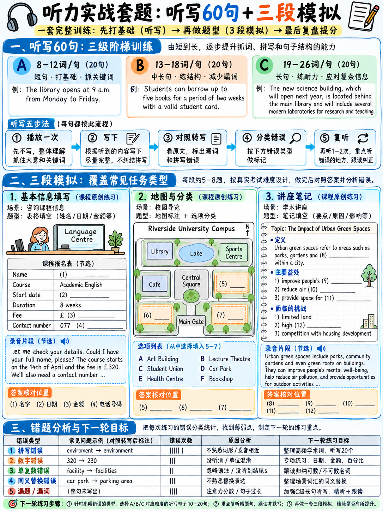

# 06. 听力全真官方音频试题演练、听音听写精听与逐题复盘 (Listening Practice Set)



自学雅思听力最大的痛点是“缺乏针对性音频与高质量复盘指导”。本章为你提供一套完整的全真训练武器库：
1. **音频获取与自然语速生成方法**（官方音频 + 本地高真实度 TTS 解决方案）；
2. **60 句听力核心考点听写题库（Dictation Bank）**（全覆盖姓名、数字、日期、高危拼写词）；
3. **三套高拟真官方语域实战套题**（包含 Part 1 咨询表、Part 2 地图与多选题、Part 4 学术讲座总结，附带完整英文录音文本与逐题中文考点剖析）；
4. **官方样题全索引**与**考后自我诊断复盘分析表（Self-Scoring Diagnostic Sheet）**。

---

## 6.1 音频资源获取与独立自学方法

| 音频来源方式 | 具体实操途径 | 雅思备考价值评级 |
|---|---|---|
| **官方真题原始音频** | 雅思官方在线练习系统（Official Practice Player）`[25]` 及官方试卷音频。每道样题均配有官方录音文本与标准答案 `[18]`。 | ⭐⭐⭐⭐⭐ **最高（首选）** |
| **剑桥雅思官方真题集**<br>*(Cambridge IELTS 11–19)* | 配套完整音频，场景真实，口音地道，是检验水平的黄金标准。 | ⭐⭐⭐⭐⭐ **最高（核心必刷）** |
| **语伴朗读录音文本** | 找同伴为你朗读录音文本，尤其是逐字母报读人名和数字，完美模拟 Part 1 真实互动。 | ⭐⭐⭐⭐ **极佳（完全免费）** |
| **文本转语音 (TTS)** | 将下文录音文本输入 TTS 工具生成音频。推荐设置：**英式或澳式口音**，语速 **150 词/分钟**（标准考试语速）。Linux 系统可直接运行：<br>`espeak-ng -v en-gb -s 150 -f script.txt`。 | ⭐⭐⭐⭐ **适合听写与数字专项** |
| **自录自听法** | 自己大声朗读文本并用手机录音，隔天播放听写。既能熟悉语音节奏，又能同步纠正发音弱点。 | ⭐⭐⭐ **极具自省价值** |

:::{tip}
**绝不要减速播放音频！**
很多考生遇到听不懂的地方习惯放慢到 0.8x 语速，这会产生错误的心理安慰并破坏对自然连读、弱读的感知。考试音频只有一次正常语速播放机会。如果觉得难，正确的做法是：**原速播放做题 ──► 结合录音文本（Tapescript）原速对照精听复盘**。
:::

---

## 6.2 听写提纯大题库：60 句高频考点必背句型

由考官题库常考答案词高频重组。请让同伴朗读或使用 TTS 播放，**原速播放一次，听完立刻默写出整句**。重点检查拼写、单复数、连字符及数字。

### 第一组：基础奠基组（Set A，8–12 词）

1. The deposit is two hundred and fifty pounds, payable in advance.
2. My surname is Mackenzie — that's M-A-C-K-E-N-Z-I-E.
3. The library closes at half past eight on Wednesdays.
4. We'll need three references before the appointment can be confirmed.
5. The accommodation office is on the second floor of the Mitchell Building.
6. Classes run twice a week, on Tuesdays and Thursdays.
7. The course begins on the third of February and lasts eleven weeks.
8. Please bring your passport and a recent utility bill.
9. The nearest car park is behind the leisure centre.
10. It costs four pounds fifty for students and seven pounds otherwise.
11. Her phone number is oh double one six, four nine two, oh three.
12. The equipment must be returned by Friday at the latest.
13. There's a questionnaire to complete before the first seminar.
14. The restaurant is closed throughout January for refurbishment.
15. Accommodation is guaranteed for all first-year students.
16. The museum is free on Sundays but closed on Mondays.
17. You'll find the receipt inside the envelope.
18. The temperature rarely falls below eight degrees in that region.
19. Separate arrangements are necessary for the evening session.
20. The vegetables are grown locally and delivered twice weekly.

### 第二组：能力进阶组（Set B，13–18 词）

21. The conference will be held at the Riverside Hotel on the fourteenth and fifteenth of September.
22. If you arrive before nine, go straight to reception and ask for Doctor Pearson.
23. The annual membership fee is one hundred and twenty pounds, or fifteen pounds a month.
24. Unfortunately the swimming pool is unavailable on Thursday mornings because of a maintenance contract.
25. Students who are recommended by their tutor may apply for the additional bursary.
26. The flat has two bedrooms, a separate kitchen, and a small balcony facing south.
27. Tomorrow's lecture has been moved from room 4B to the main hall on the ground floor.
28. Please note that the deadline for the questionnaire is the twenty-second of November.
29. The business studies department is beginning a new programme in international management.
30. Our colleague will meet you at the airport at a quarter past eleven.
31. The equipment should be collected from the laboratory, not from the main office.
32. There is a discount of twenty-five per cent for anyone booking before the end of March.
33. The train leaves at seven forty-three and arrives at eleven minutes past ten.
34. Accommodation in the city centre is considerably more expensive than in the suburbs.
35. The library holds approximately four hundred thousand volumes, including a rare-books collection.
36. You'll need to complete the form in black ink and sign it at the bottom.
37. The restaurant can seat about sixty people, although it's usually quieter midweek.
38. February's figures were disappointing, but sales recovered strongly in the spring.
39. The university recommends that all students take out separate travel insurance.
40. Participants were asked to record their sleeping patterns over a fortnight.

### 第三组：长难高分挑战组（Set C，19–26 词）

41. The survey found that almost two-thirds of respondents were unaware that the service existed, which the authors described as a failure of communication.
42. Before the laboratory session begins, please make sure that your equipment has been checked and that you have signed the attendance register.
43. The new timetable means that the Wednesday seminar will now start at four fifteen rather than three thirty, and will finish an hour later.
44. Although the accommodation is reasonably priced, it is some distance from the campus, so most residents rely on the bus service.
45. The committee recommended that the deadline be extended by three weeks, which would give applicants until the end of February to respond.
46. Our research suggests that average temperatures in the region have risen by roughly one point four degrees over the last fifty years.
47. If you need to cancel your booking, you must give at least forty-eight hours' notice, otherwise the full fee remains payable.
48. The museum's collection was originally housed in a private residence on Elm Street before moving to its present site in nineteen seventy-eight.
49. Students are reminded that the computer laboratories close at eleven o'clock, and that the building is locked fifteen minutes afterwards.
50. The questionnaire was distributed to approximately twelve hundred households, of which four hundred and thirty-six returned a completed copy.
51. Participants in the second group received no training whatsoever, which allowed the researchers to compare their performance with that of the first group.
52. The restaurant on the top floor is open to the public, but tables must be reserved at least a week in advance during the summer.
53. Because the equipment is extremely sensitive, it should not be moved without permission from the technician responsible for that laboratory.
54. The scheme was introduced in two thousand and nine, abandoned four years later, and then reintroduced in a substantially modified form.
55. We found that persistence was associated far more strongly with personal characteristics than with any of the environmental factors we examined.
56. The bus departs from the stop opposite the post office, not from the station, and the journey takes about thirty-five minutes.
57. Although the initial results appeared promising, the effect disappeared entirely when the experiment was repeated with a larger sample.
58. Please note that the fee covers tuition and materials, but does not include accommodation, meals, or transport to the field site.
59. The council has agreed to fund the project for an initial period of eighteen months, after which its continuation will be reviewed.
60. Visitors should be aware that photography is permitted in the main galleries but strictly prohibited in the manuscript room.

### 听写正确率评估与进阶阶梯

| 单词正确率 (Words Correct) | 当前水平诊断 | 下一步攻坚动作 |
|---|---|---|
| **Set A 低于 70%** | 辨音基础脆弱，拼写与虚词（of, a, the）失误严重 | 暂停刷题，每日专攻 Set A + 默写易错词表 |
| **Set A 70%–90%** | 典型初学者起步水平（约 Band 5.0–5.5） | 重点攻克 Set A，正确率达到 90% 后转入 Set B |
| **Set B 达 90% 以上** | 听觉辨识力稳健，具备 Band 6.5+ 实力 | 开始攻克 Set C，并进入全真限时模考 |
| **Set C 达 90% 以上** | 听写已不再是瓶颈，具备 Band 7.5–8.0 实力 | 精力转移至 Part 3 逻辑论辩与 Part 4 架构跟进 |

---

## 6.3 全真实战演练 Part 1：语言学校咨询登记表 (Form Completion)

### 题干任务：Questions 1–10

**Complete the form. Write NO MORE THAN TWO WORDS AND/OR A NUMBER for each answer.**

```
   LANGUAGE SCHOOL — ENQUIRY FORM

   Name ............................... Anna (1) ____________
   Nationality ........................ Polish
   Contact number ..................... (2) ____________
   Course wanted ...................... (3) ____________ English
   Current level ...................... (4) ____________
   Preferred start date ............... (5) ____________
   Number of weeks .................... (6) ____________
   Class size (maximum) ............... (7) ____________
   Cost per week ...................... £(8) ____________
   Accommodation required ............. yes — a (9) ____________
   Also interested in ................. the (10) ____________ programme
```

---

:::{admonition} 完整英文录音文本 (Tapescript) —— 做完前请勿阅读
:class: warning
> **RECEPTIONIST:** Good morning, Hilltop Language School, how can I help?  
> **ANNA:** Oh, hello. I'm ringing about your English courses — I saw a leaflet at the library.  
> **R:** Of course. Let me just take a few details. Can I start with your name?  
> **A:** Yes, it's Anna Zielinski.  
> **R:** Could you spell the surname for me?  
> **A:** Z-I-E-L-I-N-S-K-I.  
> **R:** Z-I-E-L-I-N-S-K-I. Lovely. And where are you from, Anna?  
> **A:** I'm Polish, from Gdansk.  
> **R:** Right. And a contact number?  
> **A:** It's oh seven, nine double four, three one two, oh eight.  
> **R:** So that's 079 944 312 08. Let me read that back — oh seven nine, nine four four, three one two, oh eight. Is that right?  
> **A:** Yes, that's it.  
> **R:** Now, which course were you interested in? We run General English, Business English, and Academic English.  
> **A:** Well, I was thinking about Business English at first, because of my job — but actually what I really need is Academic, because I'm applying to do a master's next year.  
> **R:** Academic English, then. And what would you say your current level is?  
> **A:** I'm not sure. I did a test online and it said upper intermediate, but I think that was quite generous. I'd probably say intermediate, honestly.  
> **R:** We'll test you on arrival anyway, so don't worry. I'll put intermediate for now. When would you like to start?  
> **A:** As soon as possible — is there anything in April?  
> **R:** We've got courses beginning on the sixth and the twentieth of April.  
> **A:** The sixth would be too soon, I think. Let's say the twentieth.  
> **R:** The twentieth of April. And for how long?  
> **A:** I was thinking twelve weeks, but it depends on the cost. What if I did eight?  
> **R:** Eight weeks is fine, that's a standard block.  
> **A:** Eight, then. How big are the classes?  
> **R:** Small — we cap them at fourteen, though in practice it's usually around ten or eleven.  
> **A:** And the price?  
> **R:** For Academic English it's a hundred and eighty-five pounds a week. General English is a hundred and sixty.  
> **A:** Right. And can you help with somewhere to live?  
> **R:** We can. Most students stay with a host family, but we also have a small residence, and some people arrange a private flat themselves.  
> **A:** A host family would be better for my speaking, I think. Yes, please.  
> **R:** I'll note that down. One last thing — we also run a free conversation club on Thursday evenings, and a social programme at weekends, trips and so on.  
> **A:** The social programme sounds good. Could you send me the details?  
> **R:** I'll email everything today.
:::

---

### 答案与深度逐题复盘

| 题号 | 官方标准答案 | 考点特征与核心陷阱剖析 |
|---|---|---|
| **1** | **Zielinski** | 姓氏逐字母拼读：`Z-I-E-L-I-N-S-K-I`。前台随后**完整复述重读了一遍**，这是典型的“二次复核机会”。 |
| **2** | **07994431208** | 电话号码报读：注意 `double four` = 44。连续敲入数字即可，无需空格。 |
| **3** | **Academic** | **经典自我修正陷阱**："thinking about Business English at first... but actually what I really need is Academic"。转折词 `but actually` 引导真实意图。 |
| **4** | **intermediate** | **二次反转干扰**：线上测试结果是 `upper intermediate`，但她自评 "I'd probably say intermediate, honestly"，前台确认记录 "I'll put intermediate"。以最终敲定值为准。 |
| **5** | **20(th) April / 20 April** | **日期排除**：提供了 6 号与 20 号两个日期，Anna 明确拒绝了 6 号（"too soon"），敲定 20 号。 |
| **6** | **8 / eight** | **周数纠结**：先提出 12 周，因费用考虑改成 8 周，并以 "Eight, then" 确认。 |
| **7** | **14 / fourteen** | **最大班级规模**：题干问 `maximum`（上限）。前台说 "cap them at fourteen"（以 14 人封顶），后面的 10 或 11 人是平时实际人数，属于烟雾弹干扰。 |
| **8** | **185** | **课程价格对应**：给出 185 和 160 两个数字。根据第 3 题，Anna 报名的是 Academic English，对应 185 镑。题干已有 `£` 符号，只敲入数字即可。 |
| **9** | **host family** | 住宿类型：在寄宿家庭、宿舍和私租房中明确选择了 `host family`。两个词，完全合规。 |
| **10** | **social** | 附加项目：在周四晚上的 conversation club 和周末的 social programme 中选择了后者。题干已有 `programme`，只需填形容词 `social`。 |

---

## 6.4 全真实战演练 Part 2：乡村公园平面图与设施开闭 (Map & Multi-select)

### 题干任务：Questions 11–16

**Questions 11–14.** 标注平面图。选择正确的字母，**A–G**。

```
   OAKFIELD COUNTRY PARK  (平面示意图)

                      ┌─────────────────────────────────┐
                      │            LAKE                 │
                      │                                 │
          [F]         └─────────────────────────────────┘        [G]
                                                                        N
       ┌────┐                                                           ↑
       │ [E]│        ·········· main path ··········
       └────┘            │                     │
                        [C]                   [D]
                         │                     │
       ┌──────────────── main entrance (south) ──────────────────┐
              [A]                                      [B]
```

- **A** —— 入口西侧
- **B** —— 入口东侧
- **C** —— 主路西侧
- **D** —— 主路东侧
- **E** —— 西侧林区深处
- **F** —— 湖泊西北角
- **G** —— 湖泊东北角

11. the visitor centre ................... ______  
12. the café ............................. ______  
13. the bird hide ........................ ______  
14. the children's playground ............ ______  

**Questions 15–16.** 选择 **TWO** 个字母，**A–E**。哪 **两处** 设施目前处于**关闭状态（closed）**？

- **A** the boathouse  
- **B** the café  
- **C** the bird hide  
- **D** the playground  
- **E** the car park  

---

:::{admonition} 完整英文录音文本 (Tapescript) —— 做完前请勿阅读
:class: warning
> Good morning everyone, and welcome to Oakfield Country Park. Before we set off, let me just point out a few things on the plan, because the park's bigger than it looks and people do get lost.  
>  
> So, we're standing at the main entrance, which is at the southern end of the park. As you came in you'll have passed the car park — that's the large area on your left, to the west of the entrance. Opposite it, on the eastern side, is the **visitor centre**, where you'll find toilets, a shop and the information desk. Do go in before you walk up; it's the only place you can get a proper map.  
>  
> From the entrance, the main path runs due north, up towards the lake. A little way along it on the left — that's the western side — there's a small wooden building that used to be the park ranger's office and is now the **café**. I'm afraid it's not open at the moment; the roof's being replaced and it won't reopen until the end of next month. So if you want a hot drink, buy it at the visitor centre before you start. Directly across the path from the café is the **children's playground**, which is open as usual and is very popular, so expect some noise.  
>  
> Carry on north and you'll reach the lake, which takes up most of the northern half of the park. There are two buildings on the shore. The one on the north-eastern side is the boathouse — you can hire a rowing boat there in summer, although not today, as all the boats are out of the water for repairs until April. And on the opposite side, the north-western corner, is the **bird hide**. That's a small hut with narrow windows where you can watch the birds without disturbing them, and it is open, so do use it. It's much the best thing in the park, in my opinion.  
>  
> Finally, if you want a longer walk, there's a separate woodland trail that starts away to the west, well beyond the main path. It's about four kilometres and quite muddy, so I wouldn't recommend it in those shoes.
:::

---

### 答案与深度逐题复盘

| 题号 | 官方标准答案 | 路线行进与解题线索 |
|---|---|---|
| **11** | **B** | 原点南门出发："car park... on your left, to the west of the entrance. **Opposite it, on the eastern side, is the visitor centre**" ── 停车场在西侧（A），正对面的东侧就是访客中心，锁定 **B**。 |
| **12** | **C** | 沿主路向北走："A little way along it on the left — that's the western side... now the **café**" ── 导游主动将左侧翻译为西侧，主路西侧建筑即为 **C**。 |
| **13** | **F** | 走到湖边北岸两座建筑："on the opposite side, the **north-western corner**, is the bird hide" ── 湖泊的西北角即为 **F**（观鸟屋）。 |
| **14** | **D** | "**Directly across the path from the café** is the children's playground" ── 穿过主路正对着咖啡厅 C 的东侧建筑，精准命中 **D**。此题体现连环定位特征。 |
| **15, 16** | **A, B**<br>*(顺序随意)* | **否定信号词捕捉（Closed）**：<br>• 咖啡馆 (B)："it's **not open at the moment**; the roof's being replaced"；<br>• 游船坞 (A)："**although not today**, as all the boats are out of the water for repairs"。其余设施（观鸟屋 C 和游乐场 D）录音中均强调明确开放（"open as usual", "it is open"）。 |

---

## 6.5 全真实战演练 Part 4：城市养蜂学术讲座提纲 (Notes Completion)

### 题干任务：Questions 17–26

**Complete the notes. Write ONE WORD ONLY for each answer.**

```
   URBAN BEEKEEPING — RESEARCH SUMMARY

   Background
     • Number of registered hives in the city has risen by a factor
       of (17) ____________ since 2010
     • Main motivation given by new keepers: (18) ____________

   Findings — food supply
     • City bees had access to more (19) ____________ than rural bees
     • Rural decline linked to large areas of a single (20) ____________
     • City forage peaks in (21) ____________, later than in the countryside

   Findings — problems
     • Overcrowding increases the spread of (22) ____________
     • Competition affects (23) ____________ bee species most severely
     • Hives on (24) ____________ suffer in windy conditions

   Conclusions
     • Researchers recommend a limit on hive (25) ____________
     • Better approach: planting to increase the (26) ____________
```

---

:::{admonition} 完整英文录音文本 (Tapescript) —— 做完前请勿阅读
:class: warning
> Right, so today I want to look at urban beekeeping, which is a nice example of a well-intentioned environmental practice whose effects turn out to be more complicated than anyone expected.  
>  
> Let me begin with some background. Keeping honeybees in cities has become extremely popular over the last fifteen years. In the city we studied, the number of registered hives has increased sixfold since 2010 — from just under two hundred to well over a thousand. When we surveyed new beekeepers about why they had started, we expected the main answer to be honey, and a reasonable number did mention it. But by a clear margin the commonest reason given was **conservation** — people believed they were helping to save declining bee populations. We'll come back to whether that belief is well founded.  
>  
> Now, turning to our findings, and I'll start with the good news, which concerns food supply. It is genuinely true that cities can be excellent places for bees. Our colonies in the city centre had access to a far greater variety of **flowers** than those we monitored on farmland twenty kilometres away. The crucial point is the contrast with modern agriculture: a rural landscape dominated by a single **crop** provides an enormous quantity of forage for about three weeks and almost nothing for the rest of the season. Gardens, parks, railway embankments and street trees, by contrast, flower in sequence. We also found that the city's forage peaked in **August**, which is noticeably later than in the surrounding countryside, and that late-season supply is particularly valuable because it determines whether a colony survives the winter.  
>  
> So much for the benefits. Let's consider the problems, which are where the picture changes. The first is **disease**. Honeybee colonies at high density transmit infection very readily, and in the areas of the city with the greatest concentration of hives we recorded significantly higher rates of two common viruses. The second problem is more serious and less obvious. Honeybees are not endangered — they are a managed agricultural animal, and there are more of them now than at any point in recorded history. The species that are genuinely in decline are wild bees, and particularly **solitary** bees, which do not live in colonies. Where we found very high honeybee densities, we recorded measurable reductions in solitary bee numbers, presumably through competition for the same flowers. I should add one practical finding as well: a surprising number of urban hives are placed on **rooftops**, and these performed noticeably worse than ground-level hives, which we attribute mainly to exposure to wind.  
>  
> That brings me to our conclusions. We are not arguing that urban beekeeping should stop. But we do recommend that cities introduce a limit on hive **density**, in the way that several European cities already have. And the more important recommendation is this: if your aim is conservation rather than honey, keeping honeybees is close to the least effective thing you can do. Planting to increase the **forage** available — flowering trees, uncut verges, wildflower areas — benefits all bee species, costs very little, and requires no equipment at all.
:::

---

### 答案与深度逐题复盘

| 题号 | 官方标准答案 | 路标引导词与抓取逻辑 |
|---|---|---|
| **17** | **six** | 录音路标："increased **sixfold** since 2010"。题干为 `by a factor of ___`（增加了……倍），故答案直接填基数词 **six**。后方跟出 200 和 1000 两个数量干扰。严格遵守 ONE WORD ONLY 限制。 |
| **18** | **conservation** | **提及并否定干扰**：讲师说预想的主要原因是产蜂蜜（honey），"But by a clear margin the commonest reason given was **conservation**"。保护生态才是首要动机。 |
| **19** | **flowers** | 城市蜜源优势："access to a far greater variety of **flowers**"。题干要求单字填空修饰食物多样性，填名词 **flowers**。 |
| **20** | **crop** | 乡村单一农业："dominated by a single **crop**"。空格前已有定冠词和 single，抓取原词 **crop**。 |
| **21** | **August** | 蜜源峰值月份："peaked in **August**, which is noticeably later"。首字母大写与小写均可识别，月份全拼。 |
| **22** | **disease** | 新板块路标："Let's consider the problems... The first is **disease**." 首选概括性核心名词 **disease**（后文提到的 viruses 属于具体病原体举例）。 |
| **23** | **solitary** | 独栖野生蜂受害严重："particularly **solitary** bees, which do not live in colonies"。抓取修饰蜂种的形容词 **solitary**。 |
| **24** | **rooftops** | 暴露于风中的蜂箱放置地："hives are placed on **rooftops**... exposure to wind"。注意复数形式 **rooftops**。 |
| **25** | **density** | 结论板块路标："That brings me to our conclusions... limit on hive **density**"。直接提取核心名词 **density**。 |
| **26** | **forage** | 最佳保护手段："Planting to increase the **forage** available"（增加蜜源植物）。核心高频学术名词 **forage**。 |

---

## 6.6 官方精选样题完整索引 (Official Sample Tasks Index)

以下 7 套官方样题均可在雅思官方备考页面免费下载 `[18]` `[25]`，每套题都包含**完整官方音频、题干、录音文本及官方答案键**：

| 官方题型分类 | 听力录音背景场景 | 官方标准答案键概览 `[18]` |
|---|---|---|
| **表格/笔记填空 (Notes)** | 二手家具购买电话咨询 (Part 1) | round · 12 years · 4 · green · reasonable · 1.20 metres · lock |
| **句子填空 (Sentence)** | 开放大学在职进修经验分享 (Part 3) | motivation · time(-)management · modules · summer school(s) |
| **表格填空 (Table)** | 大学生学习坚持度学术调研 (Part 4) | challenge · school · health · interests · tutor(s) |
| **流程图填空 (Flow-chart)** | 探索外太空微观生命迹象讨论 (Part 3) | site · radiation · heat · microbes · results |
| **简答题 (Short-answer)** | 知名服装企业各类技术岗位招募 (Part 2) | scientist(s) · engineer(s) · accountant(s)（顺序任意） |
| **单项选择题 (Multiple Choice)** | 伦敦东区历史毕业论文选题探讨 (Part 3) | 1. She wanted to understand her own background<br>2. interviews<br>3. organising what she had collected |
| **地图标记题 (Map Labelling)** | 游客小镇欢迎中心街道导览 (Part 2) | 1. H · 2. A · 3. C |

:::{tip}
**官方样题“一题三吃”高效复用法：**
1. **第一吃（裸考自测）**：闭卷限时做题，计算原始得分与 Band 分数；
2. **第二吃（精听听写）**：一周后，拿该录音的 Tapescript 作为听写与抓词材料；
3. **第三吃（影子跟读）**：第三周，跟随音频逐句跟读，专门训练辨识爆破音、弱读以及学术强调语调。
:::

---

## 6.7 模考复盘自查诊断表 (Self-Scoring Diagnostic Sheet)

每次完成一套 40 题完整听力模考后，严禁只记录总分！打印或在草稿纸上绘制下表，将每一道错题精准归类：

```
   ┌──────────────────────────────────────────────────────────────────┐
   │ 雅思听力全真模考诊断复盘表                                       │
   │                                                                  │
   │ 模考日期：____________    试卷来源：剑桥雅思真题 ______ Test ______  │
   │                                                                  │
   │ Part 1 得分：___/10   Part 2 得分：___/10                        │
   │ Part 3 得分：___/10   Part 4 得分：___/10                        │
   │                                                                  │
   │ 全卷总分：____/40  ──► 对应 Band 分数：______                    │
   │                                                                  │
   │ 【五大失分根因归类统计】                                         │
   │  1. 根本没听到 / 走神掉队 ................... _____ 题           │
   │  2. 听到了，但拼写错误 (Spelling error) ..... _____ 题  ← 白送失分!
   │  3. 听到了，但单复数/词形错误 (Word form) ... _____ 题  ← 白送失分!
   │  4. 超出字数限制 (Over the limit) ........... _____ 题  ← 白送失分!
   │  5. 掉入自我修正或数字烟雾弹陷阱 ............ _____ 题           │
   │  6. 卷面留白未作答 (Empty blanks) ........... _____ 题  ← 严禁留白!
   │                                                                  │
   │ 本次“白白丢分（2+3+4+6）”合计：________ 分 (能挽回将近 1 个 Band!)│
   │ 下次模考必须执行的一个针对性改进行动：__________________________ │
   └──────────────────────────────────────────────────────────────────┘
```

:::{important}
**算一算你的“白白丢分”有多惊人！**
绝大多数 5.5–6.0 分的考生，在仔细核对试卷后会惊愕地发现：拼写错误、单复数写错、超字数以及留白加起来竟然高达 **5–8 分**！
在雅思官方换算表中，**6 分的差距整整跨越了一个 Band**（从 23 分的 Band 6.0 跃升至 29–30 分的 Band 7.0）。只要在日常训练中彻底消除这些低级错误，你的听力分数将实现瞬间跨越！
:::

---

**上一章：** {doc}`05-part-4-the-lecture` | **下一章学习指南：** {doc}`../60-toolkit/01-core-vocabulary`
