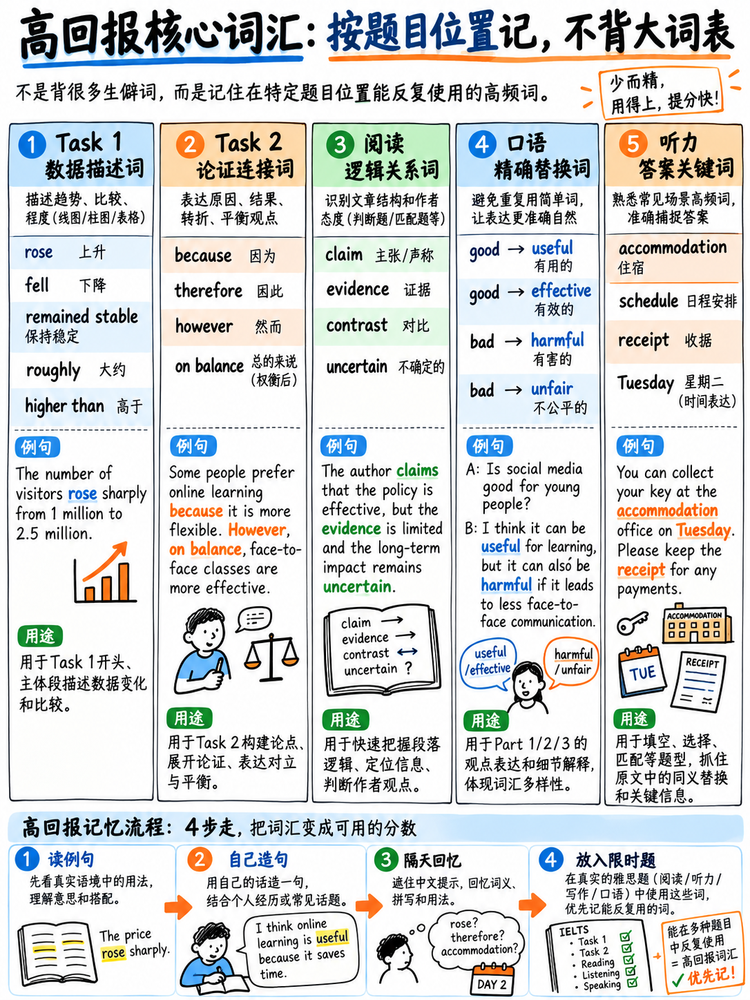

# 01. 雅思学术类核心高频词汇分类速记表 (Core Academic Vocabulary)

## 核心编排逻辑：按“考试产出场景”分类，而非死记字典

本词汇表**不按字母 A-Z 顺序排列，也不按宽泛学科罗列，而是完全按照它在雅思考试中“在哪个具体板块能帮你直接拿分”**进行组织。精准掌握用在关键位置的 300 个核心功能词与实词，远胜于盲目死记 3,000 个生僻词。

请时刻牢记官方评分标准中关于 Band 6（及格/合格水平）的词汇量定义：
> “即使词汇运用范围较为受限（a rather restricted range），但整体意思表达清晰准确” `[8]`。

一个受限的词汇库，只要在正确的题型和语境中用得准确、地道，就足以稳拿 6.0 分。词汇量从 6.5 分跨越到 7.5 分往往需要数月的语言沉淀；因此在短期冲刺或极速备考中，**词汇学习只应占到你总复习时间的 4% 左右**（详见：{doc}`../00-foundations/04-priority-triage` §4.1）。

:::{important} 科学背词四大黄金法则（造句产出法）
**坚决不要捧着单词书对着中英释义死记硬背！** 科学的极速激活流程如下：

1. 从下列某一分类中挑选出 **10 个单词**；
2. 为每个单词写出**一个完整的英文句子**，句子内容必须结合你**自己的真实生活经历、工作或家乡城市**；
3. 将写好的每个句子**大声朗读两遍**；
4. 次日复习时，用这同样的 10 个单词写出全新语境的句子。

只有在考生自己的实际造句中被使用过的单词，才是考场上能够随时调用的**产出性词汇（Productive Vocabulary）**。脱离语境机械记忆的孤立词表仅能用于被动识别——对阅读略有助益，对口语与写作输出则完全无效。
:::

---

## 1.1 学术类小作文（Writing Task 1）：数据描述与图表语言高频库

这是全书提分性价比最高、见效最快的一组词汇。因为学术类 Task 1 属于“高度可预测的输出任务（a largely predictable output）”`[10]`，其考核的图表描述语言也具有高度的确定性与规律性。

### 动态趋势动词（熟练掌握每列 1-2 个核心词即可）

| 呈上升趋势 (Increase) | 呈下降趋势 (Decrease) | 保持平稳 (Stay the same) | 不规则波动 (Fluctuate) |
|---|---|---|---|
| **rise** (rose, risen) | **fall** (fell, fallen) | **remain stable** | **fluctuate** |
| **increase** | **decrease** | **stay constant** | **vary** |
| **grow** (grew, grown) | **decline** | **hold steady** | **oscillate** |
| **climb** | **drop** | **level off** | — |
| **soar** *(急剧暴涨)* | **plummet** *(断崖式下跌)* | **plateau** *(进入平台期)* | — |
| **double / triple** *(翻倍/翻三倍)* | **halve** *(减半)* | — | — |
| **peak (at)** *(达到顶峰)* | **bottom out (at)** *(触底)* | — | — |
| **recover** *(企稳回升)* | **dip** *(短暂小幅回落)* | — | — |

### 程度与变化速度副词

| 幅度巨大 (Large) | 幅度微弱 (Small) | 变化迅猛 (Fast) | 变化缓慢 (Slow) | 变化平稳 (Steady) |
|---|---|---|---|---|
| **sharply** *(急剧地)* | **slightly** *(略微地)* | **rapidly** *(迅速地)* | **gradually** *(逐渐地)* | **steadily** *(平稳持续地)* |
| **dramatically** *(显著地)* | **marginally** *(微小地)* | **suddenly** *(突然地)* | **slowly** *(缓慢地)* | **consistently** *(一贯地)* |
| **considerably** *(相当大地)* | **a little** *(一点点)* | **abruptly** *(陡然地)* | **progressively** *(逐步地)* | **continuously** *(不断地)* |
| **substantially** *(大幅度地)* | — | — | — | — |
| **significantly** *(显著地)* | — | — | — | — |

### 趋势变化名词（用于 "there was a ___ in..." 结构升级）

> **a rise** · **an increase** · **growth** · **a surge** · **a peak** · **a fall** · **a decrease** · **a decline** · **a drop** · **a dip** · **a slump** · **a fluctuation** · **a recovery** · **a levelling-off** · **a plateau**

*句型对比示范：*
- 动词版（简单句）：*Sales **rose sharply** in 2020.*
- 名词版（高级学术句式）：*There was **a sharp rise in** sales in 2020.*

### 数据比较与占比核心表达

| 功能分类 | 常用短语与高频搭配 | 示例与考场用法 |
|---|---|---|
| **倍数与高低对比** | far higher than · considerably lower than · marginally above · roughly the same as · comparable to · almost identical to | *The figure for City A was **far higher than** that for City B.* |
| **倍数关联** | twice as high as · three times the figure for | *Expenditure was **twice as high as** in 2010.* |
| **极值标定** | the highest · the lowest | *...reaching **the highest** point among all categories.* |
| **数据占比动词** | **accounted for** · **made up** · **represented** | *Renewable energy **accounted for** 25% of the total.* |
| **份额与比例** | a share of · a proportion of · the majority of · a minority of | *...securing **a majority of** the domestic market.* |
| **分数与比率转化** | just under a third (≈30%) · slightly over half (≈52%) · around a quarter (≈25%) · nine in ten (90%) · one in five (20%) | 用自然分数替代机械百分比，体现词汇灵活性（LR 提分关键）。 |

### 数据估算副词（考场高频使用：体现学术严谨客观性，绝非模糊敷衍）

> **approximately** · **about** · **around** · **roughly** · **just over** · **just under** · **nearly** · **almost** · **slightly more than** · **a little under** · **in the region of** · **or so**

### 流程图与地图题专项高频语料库

| 流程图推进词 (Process Diagrams) | 地图变迁与空间方位词 (Map Tasks) |
|---|---|
| **the process begins with** *(过程始于...)* | **to the north / south / east / west of** *(在...以北/南/东/西)* |
| **is then / subsequently** *(随后被...)* | **in the north-eastern corner** *(在东北角)* |
| **once this is complete** *(该步骤完成后)* | **on the opposite side of** *(在对侧)* |
| **at this stage** *(在此阶段)* | **adjacent to / adjoining** *(毗邻/紧邻)* |
| **in the final stage** *(在最终阶段)* | **was replaced by / was converted into** *(被...取代/转变为)* |
| **is transferred to** *(被转移至...)* | **was demolished / was cleared** *(被拆除/被清理平整)* |
| **is fed into** *(被送入机器/装置)* | **was extended / was widened** *(被延伸/拓宽)* |
| **the resulting [product]** *(最终生成的产物)* | **remained unchanged / was retained** *(保持未变/被保留)* |
| **which produces / generating** *(从而产生...)* | **gave way to / made way for** *(给...让位腾出空间)* |

---

## 1.2 学术类大作文（Writing Task 2）：学术论证与逻辑推进语言

学术论证的核心语言与具体的考题话题是解耦的。掌握一套通用的逻辑推进与论证修辞词汇，考生可以在任何议论文中无缝复用。

### 观点断言与学术审慎/软化表述（Hedging）

| 绝对化强语气 (Strong) | 中立客观叙述 (Neutral) | 审慎软化表述 (Hedged) **[重点掌握，考官推崇]** |
|---|---|---|
| **clearly** *(显然)* | **it is the case that** *(事实确实如此)* | **it appears that** *(似乎表明...)* |
| **undeniably** *(不可否认)* | **research suggests** *(研究表明)* | **it seems likely that** *(很可能...)* |
| **there is no question that** *(毫无疑问)* | **evidence indicates** *(证据显示)* | **tends to** *(往往倾向于...)* |
| — | — | **in most cases** *(在绝大多数情况下)* |
| — | — | **arguably** *(可以说/论证上成立)* |
| — | — | **to some extent** *(在某种程度上)* |
| — | — | **is likely to** *(有很大可能)* |
| — | — | **may well** *(极有可能)* |

:::{tip} 考官评语实证：Hedging 是官方明文肯定的高分特征
在官方公开的 Band 7.5 真实答卷考官批注中，考官特别赞赏了考生展现出的高水平语言技巧：“体现了高级语篇特征，例如恰当的学术软化（evidence of higher-level features, such as 'softening', e.g. 'They tend to', 'This appears to be', and 'might disagree'）”`[12]`。先掌握审慎表达，避免非黑即白的绝对断言。
:::

### 因果关系与连锁推导

> **leads to** · **results in** · **gives rise to** · **contributes to** · **is driven by** · **stems from** · **is attributable to** · **brings about** · **has the effect of** · **consequently** · **as a result** · **therefore** · **which in turn** *(这反过来又导致...)*

### 利弊权衡与取舍比较

> **outweigh** *(超过/胜过)* · **at the expense of** *(以...为代价)* · **a trade-off between** *(在两者之间的权衡取舍)* · **on balance** *(权衡各方之后)* · **the benefits exceed [the drawbacks]** *(收益大于弊端)* · **the drawbacks are significant** *(弊端十分显著)* · **far more important than** *(远比...重要)* · **of secondary importance** *(处于次要地位)* · **a price worth paying** *(值得付出的代价)*

### 考官青睐的让步论证（冲刺 7 分的关键动作）

> **admittedly** *(不可否认的是)* · **it is true that** *(诚然)* · **while it may be the case that** *(尽管情况确实可能是...)* · **granted** *(诚然承认)* · **to be fair** *(客观地说)* · **there is some force in the argument that** *(该论点确有一定合理性)* · **critics would point out that** *(批评者通常会指出)* · **having said that** *(话虽如此/然而)*

### 提出建议与责任界定

> **should / ought to / must** · **it is essential that** · **there is a strong case for** *(有充分理由支持...)* · **one option would be to** · **a more effective approach would be** · **governments could** · **regulation might** · **incentives such as** · **subsidise** *(提供财政补贴)* · **tax** *(征税)* · **ban** *(明令禁止)* · **restrict** *(限制)* · **encourage** *(鼓励)* · **invest in** *(投资)* · **fund** *(资助)*

### 影响范围与尺度限定

> **widespread** *(普遍存在的)* · **marginal** *(微不足道的)* · **negligible** *(可以忽略的)* · **substantial** *(实质性重大的)* · **a minority of** · **the vast majority of** · **in certain contexts** *(在特定背景下)* · **across the board** *(全面/普遍地)* · **locally / nationally / globally** *(在地方/全国/全球层面)*

---

## 1.3 核心十二大常考话题极精压缩词库 (The Twelve Topic Areas, Compressed)

**每个常考话题严格精选 8 个核心学术实词。坚决不要随意扩充这份清单！** 盲目扩充词表只会让考生陷入背诵大段语料库的泥潭，丧失现场临场构思的能力（参见 {doc}`../00-foundations/05-glossary-and-question-banks`）。

| 话题领域 | 精选核心 8 词 | 中文释义核心速览 |
|---|---|---|
| **教育** *(Education)* | curriculum · compulsory · vocational · tuition fees · literacy · assessment · dropout rate · lifelong learning | 课程体系 · 义务强制的 · 职业技术的 · 学费 · 读写识字率 · 评估考核 · 辍学率 · 终身学习 |
| **科技与人工智能** *(Technology / AI)* | automation · algorithm · surveillance · screen time · digital divide · productivity · misinformation · data privacy | 自动化 · 算法 · 监控监视 · 屏幕使用时间 · 数字鸿沟 · 生产力 · 虚假错误信息 · 数据隐私 |
| **环境与生态** *(Environment)* | emissions · renewable · single-use · biodiversity · carbon footprint · conservation · subsidy · landfill | 碳排放 · 可再生的 · 一次性的 · 生物多样性 · 碳足迹 · 生态保育 · 补贴支持 · 垃圾填埋场 |
| **健康与医疗** *(Health)* | obesity · preventive care · life expectancy · sedentary · mental health · waiting lists · diet · public health | 肥胖症 · 预防性医疗 · 预期寿命 · 久坐不动的 · 心理健康 · 排队等待名单 · 日常饮食结构 · 公共卫生 |
| **工作与就业** *(Work)* | remote working · job security · minimum wage · work–life balance · retraining · gig economy · burnout · unemployment | 远程办公 · 工作稳定性 · 最低工资标准 · 工作生活平衡 · 技能再培训 · 零工经济 · 职业倦怠 · 失业率 |
| **城市与交通** *(Transport / Cities)* | congestion · infrastructure · public transport · pedestrianise · urban sprawl · housing shortage · commute · cycle lane | 交通拥堵 · 基础设施 · 公共交通 · 步行街化 · 城市无序扩张 · 住房短缺 · 通勤 · 自行车专用道 |
| **家庭与社会** *(Family / Society)* | ageing population · extended family · childcare · generation gap · birth rate · community · care home · social mobility | 人口老龄化 · 大家庭 · 幼儿托育 · 代沟 · 出生率 · 社区社群 · 养老院 · 阶层流动性 |
| **犯罪与法律** *(Crime / Law)* | deterrent · rehabilitation · custodial sentence · reoffend · policing · youth crime · fine · surveillance | 威慑震慑力量 · 改造康复 · 监禁判决 · 重新犯罪 · 治安执法 · 青少年犯罪 · 罚款 · 监控监视 |
| **传媒与文化** *(Media / Culture)* | censorship · heritage · globalisation · mass media · cultural identity · advertising · tradition · state funding | 审查制度 · 文化遗产 · 全球化 · 大众传媒 · 文化认同感 · 商业广告 · 民俗传统 · 国家财政资助 |
| **政府财政支出** *(Gov Spending)* | taxation · subsidise · allocate · public funding · priority · budget deficit · welfare · investment | 税收征管 · 财政补贴 · 调配划拨 · 公共财政资金 · 优先事项 · 财政赤字 · 社会福利保障 · 资本投资 |
| **旅游业发展** *(Travel / Tourism)* | overtourism · seasonal · heritage site · low-cost airline · cultural exchange · visitor numbers · authenticity · infrastructure | 过度旅游 · 季节性的 · 历史遗迹 · 廉价航空 · 文化交流互鉴 · 游客体量 · 真实原真性 · 基础设施 |
| **消费主义** *(Consumerism)* | disposable · advertising · brand · second-hand · repair · status · sustainable · planned obsolescence | 一次性抛弃的 · 商业广告 · 品牌效应 · 二手循环的 · 维修翻新 · 社会地位象征 · 可持续发展的 · 计划性报废 |

---

## 1.4 学术阅读（Reading）：学术论证与逻辑脉络核心词

**这是全书最被初学者低估、但实战提分杠杆极高的一组词汇。** 雅思阅读文章涵盖记叙、描述与学术论证，且“至少有一篇文章包含极其严密的逻辑推论（contains detailed logical argument）”`[6]`。以下词汇构成了这些学术文章的论证骨架，完全不受学科主题限制，且是突破 **TFNG / YNNG 和单项选择题**的核心解题抓手。

### 观点陈述与转述动词（攻克 YNNG 题的核心命门）

> **claim** *(声称)* · **assert** *(断言)* · **argue** *(论证主张)* · **maintain** *(坚称)* · **contend** *(抗辩主张)* · **suggest** *(暗示提出)* · **propose** *(提议)* · **hypothesise** *(做出假设)* · **posit** *(假定)* · **acknowledge** *(承认)* · **concede** *(让步承认)* · **deny** *(否认)* · **dispute** *(质疑争议)* · **refute** *(驳斥反驳)* · **challenge** *(提出挑战)* · **dismiss** *(不屑一顾/驳回)* · **attribute X to Y** *(将X归因于Y)* · **be sceptical of** *(持怀疑态度)* · **be convinced that** *(深信确信)*

:::{important} 转述动词是区分 NOT GIVEN 的黄金命门
当原文写道：*“Smith **claims** that global warming has slowed down.”* 原文**仅仅陈述了史密斯的个人观点，而并未将全球变暖放缓作为客观事实予以确认**。如果题目题干断言：“*Global warming has indeed slowed down.*”，答案往往是 **NOT GIVEN**（原文未确认事实），而非 TRUE 或 FALSE（详见：{doc}`../40-reading/02-true-false-not-given` §40.2.3）。
:::

### 逻辑推导与转折连词

> **however** *(然而)* · **nevertheless / nonetheless** *(尽管如此)* · **whereas** *(然而/对比)* · **conversely** *(相反地)* · **by contrast** *(相比之下)* · **on the other hand** *(另一方面)* · **although / albeit** *(尽管)* · **despite / in spite of** *(不管不顾)* · **thus / hence / thereby** *(因此/从而)* · **consequently / accordingly** *(相应地)* · **insofar as** *(在...范围内)* · **provided that** *(倘若/只要)* · **unless** *(除非)* · **otherwise** *(否则)*

### 实验与实证证据评估词汇

> **evidence** *(证据)* · **data** *(数据资料)* · **findings** *(研究发现结论)* · **a correlation** *(相关性)* · **a causal link** *(因果链条)* · **a proxy for** *(作为...的代用指标)* · **extrapolate** *(外推推导)* · **a sample** *(样本抽样)* · **a control group** *(对照组)* · **statistically significant** *(统计学上显著的)* · **anecdotal** *(坊间传闻的/轶事的)* · **robust** *(严谨稳健的)* · **inconclusive** *(无定论的)* · **contested** *(存在争议的)* · **widely accepted** *(被广泛认可的)* · **premature** *(为时尚早草率的)* · **counter-intuitive** *(反直觉的)*

### 确定性与概括范围副词

> **invariably** *(无一例外地)* · **consistently** *(持续一贯地)* · **typically** *(典型地)* · **frequently** *(频繁地)* · **occasionally** *(偶尔)* · **rarely / scarcely / hardly ever** *(极少/几乎从不)* · **by no means** *(绝不/决非)* · **in principle** *(原则上)* · **in practice** *(在实际操作中)* · **ostensibly / apparently** *(表面上看起来)* · **reportedly** *(据报道称)*

### 变化演进与机制动词

> **emerge** *(显现涌现)* · **persist** *(持续存在)* · **diminish** *(减少削弱)* · **accelerate** *(加速推进)* · **reverse** *(彻底倒退反转)* · **stagnate** *(停滞不前)* · **deteriorate** *(恶化衰退)* · **be superseded by** *(被...迭代取代)* · **be phased out** *(被逐步淘汰)* · **undergo** *(经历承载)* · **be subject to** *(受制于/经历)* · **give rise to** *(引发/促成)*

---

## 1.5 口语（Speaking）：低频万能词的高级替换升级表

在口语考试中，考生**完全不需要追求生僻拗口的罕见学术词**——官方 Band 6 评分量表只要求词汇“意思表达清晰”，即使“偶有用词不当也完全无妨”`[9]`。

中国考生在口语中最致命的问题是：**陷入 4-5 个单调词汇的无休止循环重复**（如通篇都是 good, bad, very, a lot of, I think）。掌握以下场景化升级词，口语词汇多样性立即跃升至 6.0–7.0。

### 告别万能形容词 "good"

| 描述对象 | 告别单调 "good" 的场景高级替换词 |
|---|---|
| **评价一个人** | **kind** *(友善)* · **reliable** *(靠谱)* · **hard-working** *(勤勉)* · **thoughtful** *(体贴)* · **easy-going** *(随和好相处)* · **generous** *(大度慷慨)* |
| **评价一个地点** | **lively** *(热闹有烟火气)* · **peaceful** *(宁静祥和)* · **convenient** *(便利)* · **attractive** *(诱人迷人)* · **well-connected** *(交通四通八达)* · **affordable** *(性价比高)* |
| **评价一项决策** | **sensible** *(明智合乎情理的)* · **worthwhile** *(非常值得的)* · **the right call** *(正确的抉择)* |
| **评价一部电影/书籍** | **gripping** *(扣人心弦引人入胜)* · **moving** *(感人至深)* · **well-made** *(制作精良)* · **thought-provoking** *(发人深省)* |
| **评价美食** | **tasty** *(可口)* · **fresh** *(新鲜)* · **filling** *(管饱解饿)* · **beautifully cooked** *(烹饪火候极佳)* |
| **评价成果与考分** | **encouraging** *(令人鼓舞振奋)* · **impressive** *(令人印象深刻)* · **satisfactory** *(令人满意达标)* |

### 告别万能形容词 "bad"

> **disappointing** *(令人失望的)* · **frustrating** *(令人沮丧抓狂的)* · **unreliable** *(不靠谱的)* · **overpriced** *(价格虚高虚贵的)* · **inconvenient** *(不方便的)* · **noisy** *(嘈杂喧闹的)* · **stressful** *(压力山大的)* · **pointless** *(毫无意义的)* · **poorly organised** *(组织混乱的)* · **a waste of time** *(纯属浪费时间)*

### 告别单调强调副词 "very"

> **really** *(真真切切)* · **extremely** *(极其)* · **incredibly** *(难以置信地)* · **particularly** *(尤其地)* · **remarkably** *(异乎寻常地)* · **fairly / quite / rather** *(相当/挺)* · **a bit / slightly** *(稍微有点)* · **not especially** *(并不是特别...)*

### 告别数量词 "a lot of"

> **a great deal of** *(大量，修饰不可数)* · **a considerable number of** *(相当数量的，修饰可数)* · **plenty of** *(充足富余的)* · **loads of** *(口语极地道：超多的)* · **the vast majority of** *(绝大多数)* · **a fair amount of** *(相当一部分)*

### 告别机械口头禅 "I think"

> **I'd say...** *(依我看/我觉得)* · **in my view...** *(在我看来)* · **personally...** *(就我个人而言)* · **I tend to think...** *(我倾向于认为)* · **it seems to me that...** *(在我看来似乎)* · **I suppose...** *(我想应该)* · **I'm fairly sure...** *(我相当确定)* · **as far as I can tell...** *(据我所知观察)*

### 告别简单表达 "I like it"

> **I'm quite keen on it** *(我对它挺感兴趣/挺喜欢的)* · **I'm really into it** *(我超级迷这个/很沉浸)* · **it appeals to me** *(它对我很有吸引力)* · **I get a lot out of it** *(我从中获益匪浅/收获良多)* · **I find it very relaxing** *(我发现做这件事超级解压)* · **it's not really my thing** *(这真不是我的菜/我不太感冒，地道否定表达)*

### 轻松填补答题时长的地道频率与数量词汇

| 频率表达 (自然拉长时间) | 模糊数量表达 (避免僵硬数字) |
|---|---|
| **hardly ever** *(几乎从不)* · **once in a while** *(偶尔一次)* · **now and then** *(时常/不时)* | **a couple of** *(两三个)* · **a handful of** *(屈指可数的几个)* · **the odd one** *(偶尔零星的一个)* |
| **every so often** *(隔三差五)* · **most days** *(大多数时候)* · **a few times a year** *(一年几次)* | **barely any** *(几乎没有)* · **one or two** *(一两个)* |
| **constantly / all the time** *(始终/一直)* | **the odd occasion** *(个别偶发场合)* |

---

## 1.6 听力（Listening）：真题官方常考核心答案词（重点是拼写准确！）

根据官方真题及公开样本题目的考察规律`[1]` `[18]`，Part 1 和 Part 2 的高频答案高度聚集在以下几个核心生活场景中。**对这部分词汇，你的复习重点是“100% 盲打盲写拼写正确”，而非停留在认识释义上！**

### 租房与日常生活高频词 (Accommodation & Daily Life)

> **accommodation** · **deposit** *(押金)* · **rent** *(租金)* · **landlord** *(房东)* · **tenant** *(租客)* · **utilities** *(水电燃气费)* · **furnished** *(带家具的)* · **en suite** *(带独立卫浴的套间)* · **balcony** *(阳台)* · **basement** *(地下室)* · **ground floor** *(一楼/底层)* · **shared kitchen** *(公用厨房)* · **laundry** *(洗衣房)* · **lease** *(租约)* · **notice period** *(退租提前通知期)* · **inventory** *(物品交接清单)* · **receipt** *(收据)*

### 校园与学术学习高频词 (University & Courses)

> **tutorial** *(导师小组辅导)* · **seminar** *(研讨课)* · **lecture** *(学术大课)* · **module** *(课程模块)* · **assignment** *(作业)* · **dissertation** *(毕业论文)* · **deadline** *(截止时间)* · **credits** *(学分)* · **timetable** *(课程时间表)* · **semester / term** *(学期)* · **registration** *(注册)* · **enrolment** *(入学报到)* · **prerequisite** *(先修课程)* · **supervisor** *(导师)* · **reference** *(推荐信/参考文献)* · **bursary / scholarship** *(助学金/奖学金)* · **questionnaire** *(问卷调查)* · **attendance** *(出勤率)*

### 出行交通与公共场所 (Travel & Places)

> **departure** *(出发)* · **arrival** *(到达)* · **platform** *(站台)* · **terminal** *(航站楼/客运终点站)* · **return ticket** *(往返票)* · **single ticket** *(单程票)* · **timetable** *(时刻表)* · **delay** *(延误)* · **connection** *(中转联程)* · **shuttle** *(摆渡车)* · **car park** *(停车场)* · **pedestrian** *(行人)* · **roundabout** *(环岛)* · **junction** *(路口交叉点)* · **bypass** *(绕城外环路)* · **leisure centre** *(文体娱乐中心)* · **library** *(图书馆)* · **museum** *(博物馆)* · **gallery** *(美术馆/画廊)* · **harbour / marina** *(海港/游艇码头)*

### 职场工作与行政事务 (Work & Admin)

> **appointment** *(预约面谈)* · **interview** *(面试)* · **colleague** *(同事)* · **supervisor** *(主管)* · **shift** *(轮班)* · **overtime** *(加班)* · **application form** *(申请表格)* · **CV** *(个人简历)* · **contract** *(合同)* · **insurance** *(保险)* · **invoice** *(发票凭证)* · **subscription** *(订阅会员)* · **membership** *(会员资格)* · **cancellation** *(退订取消)* · **refund** *(退款)*

### 星期、月份与极易混淆的数字 (Days, Months & Numbers)

> **Monday** · **Tuesday** · **Wednesday** *(重点攻克中间的d)* · **Thursday** · **Friday** · **Saturday** · **Sunday**  
> **January** · **February** *(重点攻克首个r)* · **March** · **April** · **May** · **June** · **July** · **August** · **September** · **October** · **November** · **December**  
> **thirteen / thirty** · **fourteen / forty** *(注意 forty 没有 u)* · **fifteen / fifty** · **eighteen / eighty** · **nineteen / ninety** · **hundred** · **thousand** · **million**

:::{danger} 听力失分重灾区：-teen 与 -ty 的听音重音与拼写防坑
这是中国考生在雅思听力 Part 1 中丢失客观题分数**最频繁的非受迫性失误**！
- **发音辨析差异在重音**：thir-**TEEN**（重音在第二音节，尾音带有鼻音 /n/）；而 **THIR**-ty（重音在第一音节，结尾是干脆利落的元音 /i/）。
- **拼写陷阱红线**：4 是 *four*，14 是 *fourteen*，但 **40 绝对没有字母 u，必须拼作 forty**！在备考初期必须进行针对性听写专项强化。
:::

---

## 1.7 跨板块最高杠杆：60 个横跨四科的“核心多产词” (The 60-Word Priority List)

如果你备考时间极度紧迫，只能记忆 60 个词汇，请务必死磕以下 60 个词！这 60 个词入选的唯一理由是：**每一个词都能在雅思考试的两个及以上科目中直接变现为卷面分数**。

| 核心词汇 | 带来卷面分数的实战科目与题型 |
|---|---|
| **increase / decrease** (n. + v.) | 写作 Task 1、听力 Part 4、阅读核心词 |
| **significant / significantly** | 写作 Task 1 趋势副词、Task 2 论据、阅读核心词 |
| **approximately / roughly** | 写作 Task 1 数据估算、口语流利描述、听力数据捕捉 |
| **the majority / a minority** | 写作 Task 1 占比、Task 2 观点铺陈、阅读同义替换 |
| **tend to** | 写作 Task 2、口语学术软化（Hedging 官方评分标准直接加分项 `[12]`） |
| **whereas / by contrast** | 写作 Task 1 核心对比句、Task 2 对比论证、阅读连接词 |
| **however / nevertheless** | 写作 Task 2 让步转折、阅读段落转折定位 |
| **therefore / consequently** | 写作 Task 2 因果链推导、阅读因果题定位 |
| **although / despite** | 写作 Task 2 复合句型（GRA 6分门槛）、口语、阅读 |
| **outweigh** | 写作 Task 2 利弊题型首段与尾段必用词 |
| **trade-off** | 写作 Task 2 权衡分析、口语 Part 3 深度讨论 |
| **available / unavailable** | 听力信息匹配、阅读定位词 |
| **accommodation** | 听力 Part 1 必考拼写词（双c双m）、口语话题 |
| **convenient / inconvenient** | 口语常备高质量形容词、听力高频词 |
| **affordable / expensive** | 口语描述城市与生活设施、Task 2 社会成本 |
| **reliable / unreliable** | 口语描述人物/交通、Task 2 论述科技与公共服务 |
| **essential / unnecessary** | 写作 Task 2 强化重要性、口语替换 important |
| **claim / argue / suggest** | 阅读 YNNG 题型判定关键、Task 2 引用各方观点 |
| **evidence / findings** | 阅读实验类文章骨架、Task 2 论证依据 |
| **cause / lead to / result in** | 写作 Task 2 因果展开、阅读因果配对、听力 Part 4 |
| **reduce / cut / limit** | 写作 Task 2 对策展开、听力同义替换 |
| **improve / enhance** | 写作 Task 2 解决方案、口语个人规划 |
| **access / accessible** | 写作 Task 2 探讨公平与公共资源、口语生活便利度 |
| **rural / urban** | 写作 Task 1 地点分类、Task 2 城乡发展话题、口语 |
| **environment / environmental** | 写作 Task 2 环保话题、阅读高频词（注意拼写中的 n） |
| **government / authorities** | 写作 Task 2 责任主体、口语讨论（注意 government 的 n） |
| **policy / regulation** | 写作 Task 2 措施落地、阅读政策类文章 |
| **public transport** | 写作 Task 1/2 交通话题、口语 Part 1/2 必考通勤话题 |
| **congestion** | 写作 Task 2 城市病治理、口语交通拥堵替换 traffic jam |
| **population** | 写作 Task 1 人口图表、Task 2 社会问题、阅读数据词 |
| **proportion / percentage** | 写作 Task 1 占比核心替换词、阅读百分比换算 |
| **deposit / fee / charge** | 听力 Part 1 费用数字考点、口语生活开销 |
| **deadline** | 听力 Part 3 课业时间节点、口语工作学习压力 |
| **questionnaire** | 听力 Part 3 调研作业（双n拼写陷阱）、阅读研究方法 |
| **research / study** | 阅读研究报告背景词、Task 2 引用学术结论 |
| **necessary** | 写作 Task 2 必备表达、听力拼写陷阱（一c双s） |
| **separate** | 听力高频拼写陷阱（中间是 a 不是 e）、Task 2 分类讨论 |
| **February / Wednesday** | 听力 Part 1 极高频答案（拼写失分重灾区） |
| **library / restaurant** | 听力公共场所答案词（高频拼写拼错点） |
| **colleague / supervisor** | 听力职场背景答案、口语工作生活话题 |
| **particularly** | 听力、阅读、写作、口语四科通用的强力副词 |
| **rather / fairly / quite** | 口语自然拉长修辞、Task 2 程度修饰 |
| **in terms of** | 写作 Task 1 分类讨论、Task 2 角度切入神仙短语 |
| **depend on** | 口语流利度引擎、Task 2 因果条件分析 |
| **take into account** | 写作 Task 2 论证严密性、口语考虑各方因素 |
| **in the long run** | 写作 Task 2 远期影响推导、口语对策探讨 |
| **to some extent** | 写作 Task 2 让步软化语气、口语地道表达 |
| **on balance** | 写作 Task 2 总结段权衡、口语最终结论 |
| **for instance** | 四科全能通用的举例连接词（替换单一的 for example） |
| **the main reason** | 写作 Task 2 核心论点切入、口语答题框架 |
| **what's more** | 口语推进论点自然递进表达 |
| **having said that** | 口语与写作 7 分段高端让步转折连词 |
| **it depends on** | 口语避免冷场、展开细节的黄金起手式 |
| **I'd say** | 口语 Part 1/3 代替 I think 的极地道开场白 |
| **worthwhile** | 口语与写作评价决策高价值词汇 |
| **frustrating** | 口语描述困难负面经历的地道表达（替换 difficult） |
| **straightforward** | 口语与写作评价过程简便明了（替换 simple） |
| **widespread** | 写作 Task 2 描述社会现象的普及性、阅读关键定位词 |
| **gradually / steadily** | 写作 Task 1 核心平稳趋势副词、听力抓取动向 |
| **peak** (n. + v.) | 写作 Task 1 极值必用词、听力 Part 4 学术趋势 |

---

## 1.8 极简每日词汇复习执行 SOP (Daily Routine)

请将每日词汇学习转化为完全不占精力的肌肉记忆清单：

- [ ] **严格限制用时：每天仅需 10 分钟，绝不多花一分钟**。挑出 10 个词，结合自己真实经历造 10 个句子，并大声念出来。
- [ ] **所有做阅读与听力模考遇到的生词，直接记入“错题日志”（{doc}`04-error-log-method`），坚决不要设立专门的生词笔记本**。这能确保你背的每一个生词都与丢分真题直接挂钩。
- [ ] **只要查阅单词拼写与词义，就必须顺手查验并大声跟读单词的重音与发音**。同一道动作同时拿下听力、阅读、口语三项能力（详见：{doc}`../10-pronunciation/01-start-here-sound-system` §10.1.4）。
- [ ] **绝不背诵你无法想象自己在考场上如何使用的偏门生僻词**。如果你无法用该词造出一个关于自己生活或观点的通顺句子，立刻果断跳过！

---

**上一章：** {doc}`../50-listening/06-listening-practice-set` | **下一章学习指南：** {doc}`02-grammar-minimum`
