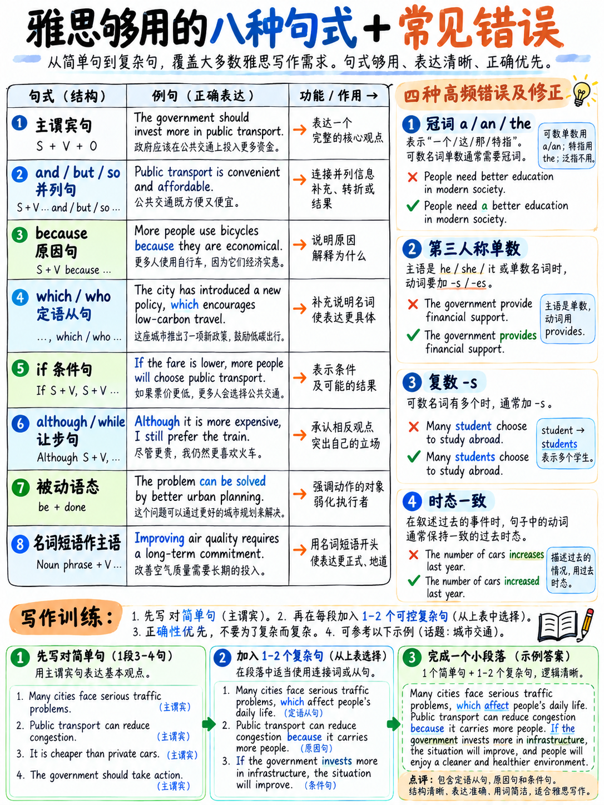

# 02. 极简语法底线：考官眼中的及格语法结构与高频致命扣分点 (Grammar Minimum)



## 2.1 官方评分标准对语法的真实要求（绝不要求你成为语法大师）

在雅思写作与口语的官方评分细则中，对 **Band 6（语法多样性与准确性 GRA）** 的定义如下：

> **写作标准 (Writing Band 6 GRA)**：  
> “能够**混合使用简单句与复杂句型（a mix of simple and complex sentence forms）**，但句式灵活度较为有限。复杂句式的准确度通常不如简单句。文章中会出现语法和标点符号错误，但**极少阻碍交流（but rarely impede communication）**。” `[8]`

> **口语标准 (Speaking Band 6 GRA)**：  
> “能够产出**短句与复杂句式的混合表达**，展现出一定的句型多样性，但灵活性有限。尽管复杂句结构中频繁出现语法错误，但**这些错误极少阻碍交流**。” `[9]`

:::{important} 官方标准推导出的三大实战破局铁律
研读官方量表，我们可以得出三条直接决定提分生死的结论：

1. **你必须在答卷中展现出句式的“混合（Mix）”**：  
   如果你通篇只有简单的短句，系统与考官会直接判定为 **Band 5**（“句式结构狭窄且高度重复” `[8]`）。因此，你**必须主动产出一定数量的复杂句**。
2. **你的复杂句完全允许包含语法小错**：  
   Band 6 的标准白纸黑字写着“复杂句中经常出现错误”。你完全不需要掌握晦涩高深的语法大师级规则，敢于写出从句即可拿分。
3. **你的简单句必须具备极高准确率**：  
   Band 5 标准明确指出“考生在简单句上能达到最高准确率”。如果你在最基础的简单句中（如主谓一致、单数复数、基本时态）频繁爆雷，考官就会直接将你判定在 5 分及以下。

**通关核心战术**：在极少数简单句型中做到**高度准确**，并熟练运用极少数高性价比的复杂句式。**全篇只需要掌握 8 种核心句式结构**，足以通关 6.0–6.5 分！
:::

---

## 2.2 考官眼中的 8 大核心语法句式结构 (The Eight Structures)

熟练掌握以下 8 种结构，你就完全满足了写作与口语中“混合使用简单句与复杂句”的评分标准。其他复杂的语法花架子在冲刺阶段一律无需关注。

### 1. 基础陈述简单句（SVO：主语 + 谓语 + 宾语）

> *Many cities have introduced a congestion charge.*  
> （许多城市已经引入了拥堵费机制。）

- **定位**：你的论证主力基石。
- **准确性红线**：必须做到 100% 正确——主谓单复数一致、动词时态准确、冠词不可遗漏。

### 2. 基础并列复合句（由 and / but / so 连接的两个完整分句）

> *Public transport is cheaper, **but** it is often unreliable.*  
> （公共交通虽然更便宜，但往往不够靠谱。）
> 
> *Fares were reduced, **so** passenger numbers rose.*  
> （票价降低了，因此乘客人数出现了上涨。）

:::{warning} 严惩致命硬伤：逗号连句 (Comma Splice)
在英语正式学术写作中，**绝对不能用逗号直接连接两个完整的句子**！  
❌ *Fares were reduced, passenger numbers rose.*（考官一眼扣分）  
✅ *Fares were reduced, **so** passenger numbers rose.*（加入连词）  
✅ *Fares were reduced**;** passenger numbers rose.*（改用分号）  
标点符号错误直接在 GRA 维度扣分 `[10]`（参见：{doc}`../30-writing/01-how-writing-is-scored` §30.1.4）。
:::

### 3. 原因状语从句（*because* 从句——英语中性价比最高、最便宜的复杂句）

> *Cycling has become more popular **because** the city built segregated lanes.*  
> （骑行变得更加普及，因为该市修建了隔离自行车道。）

这一种结构能瞬间把考生的单一断言升级为**有逻辑支撑的完整论证**，这正是写作 Task Response（切题与任务回应）高分的核心考核点 `[10]`。同样支持前置倒装：

> ***Because** the city built segregated lanes, cycling has become more popular.*

### 4. 定语从句（*which* / *who* 引导的修饰从句）

> *The new policy, **which** was introduced in 2022, has reduced traffic by a fifth.*  
> （这项于 2022 年推行的新政策使交通流量减少了五分之一。）
> 
> *Students **who** live on campus pay a higher fee.*  
> （住在校内的学生支付更高的费用。）

- **非限制性定语从句（补充附加信息）**：前后必须加逗号，指物必须用 *which*（不能用 that）。如：*The library, which opened last year, is free.*
- **限制性定语从句（限定特定对象）**：不加逗号，指物可用 *that* 或 *which*。如：*The building that opened last year is free.*

### 5. 条件状语从句（*If* 条件句——学术假设与推演）

| 条件句类别 | 语法形态 | 考场全真实战范例 |
|---|---|---|
| **客观普遍真理** | if + 一般现在时, 一般现在时 | *If fares rise, people drive.*<br>*(票价一旦上涨，人们就会选择开车。)* |
| **真实将来推测** | if + 一般现在时, **will** + 动词原形 | *If the council acts, congestion **will** fall.*<br>*(如果市议会采取行动，拥堵将会缓解。)* |
| **虚拟假设推演** | if + 一般过去时, **would** + 动词原形 | *If I **had** more time, I **would** travel by train.*<br>*(如果我有更多时间，我就会坐火车出行。)* |

掌握其中后两种即可。虚拟假设句型尤其适合在口语 Part 3 中进行深入抽象讨论时使用（如：*“If governments invested more in renewable energy, it would significantly reduce carbon emissions.”*）。

### 6. 让步转折复合句（*Although* / *While* 从句——斩获 7 分的标志性句式）

> ***Although** the scheme was expensive, it achieved its aim.*  
> （尽管该方案成本高昂，但它达成了既定目标。）
> 
> ***While** some people object to the charge, most drivers have adapted.*  
> （虽然部分人反对收费，但绝大多数司机已经适应。）

这是考官评分细则中极其看重的**“深思熟虑且具思辨性（Considered and rejected）”的论证动作**（详见：{doc}`../30-writing/05-task-2-worked-examples` §30.5.1）。学会让步句，是打破 5.5 分作文僵局的利器。

### 7. 被动语态（Passive Voice——图表与客观学术文体必备）

> *The bottles **are washed** in hot water.*（流程图题必须掌握的句型：一般现在时被动）  
> *The factory **was demolished** in 2010.*（地图变迁题必须掌握的句型：一般过去时被动）  
> *It **is widely believed** that modern diets are unhealthy.*（大作文客观论述必备的学术软化被动句）

- **结构核心**：`be 动词 + 过去分词 (V3)`。考场上只需要熟练使用一般现在时被动（*is/are + V3*）和一般过去时被动（*was/were + V3*），其他复杂的被动时态无需死磕。

### 8. 名词化短语作主语（提升语体学术格调的核武器）

> *The introduction of a congestion charge reduced traffic by a fifth.*  
> （拥堵费的引入使交通量减少了五分之一。）
> 
> *A lack of affordable housing is the main cause of the problem.*  
> （可负担住房的短缺是该问题的核心成因。）
> 
> *Government investment in public transport has been inadequate.*  
> （政府在公共交通领域的投资一直显不足。）

对比以下两句话的语体层次：
- 口语化/低阶表达（Band 5）：*“They introduced a congestion charge and traffic went down.”*
- 高阶学术表达（Band 6–7）：*“**The introduction of a congestion charge** reduced traffic considerably.”*

将动词或简单句子转化为**“抽象名词 + of / in 短语”作为句子主语**，是雅思写作中提升学术语体档次最立竿见影的技术手段。

| 常见口语化谓语动词表达 | 升级为学术级名词短语作主语 |
|---|---|
| they introduced X | **the introduction of X** |
| prices increased | **the increase in prices** |
| people use cars | **car use / the reliance on private cars** |
| the government spends money on X | **government spending on X** |
| people are not aware of the risk | **a lack of public awareness** |
| cities are growing rapidly | **rapid urban growth / urban sprawl** |
| X is available to students | **the availability of X** |
| people depend heavily on X | **dependence on X** |

---

## 2.3 考官眼中的 9 大高频致命扣分点 (The Nine Errors That Cost You Marks)

以下是考官在批改答卷时最刺眼、最容易直接扣分的 9 类语法硬伤，按照破坏严重程度从高到低排列。官方判分的红线标准是该错误是否“**阻碍了正常意义交流（impedes communication）**”`[8]` `[9]`。

### 1. 冠词遗漏或用错 (*a / an / the*)

这是母语为中文的考生的通病，因为汉语语法中没有冠词体系。

```
   冠词判定“三步排查法则” (应用于你写下的每一个单数名词)
   
   第一步：该名词是否【可数 (Countable)】？
          否  → 不加冠词 (或用泛指)。例："Information is vital." "Pollution is rising."
          是  → 进入第二步
   第二步：该名词是否为【复数 (Plural)】？
          是  → 泛指不加冠词。例："Cars cause pollution."
                特指加 the。例："The cars in this car park are new."
          否  → 进入第三步
   第三步：读者/考官是否知道你在具体指代【哪一个 (Which one)】？
          否  → 使用 "a" / "an"。例："The city built a new stadium."
          是  → 使用 "the"。例："The stadium built last year is modern."
```

**最容易中招的三大核心场景：**
1. **学术表述客观泛指规律时**：必须使用**复数名词且不加冠词**！  
   ✅ *Cars cause pollution.*  
   ❌ *Car causes pollution.*（单数可数名词绝不能光杆出现）  
   ❌ *The cars cause pollution.*（特指这几辆车，改变了句子语义）
2. **第二次提及同一事物时**：加 *the*。  
   *I visited **a** library yesterday. **The** library was well-equipped.*
3. **世上独一无二或特定语境下唯一的事物**：必加 *the*。  
   *the government* · *the environment* · *the internet* · *the same* · *the first* · *the main reason* · *the majority of*

### 2. 主谓一致（单复数搭配失误）

| 典型错误 (✗) | 正确表达 (✓) | 考点说明 |
|---|---|---|
| The graph **show** | The graph **shows** | 单数主语（图表）一般现在时加 -s |
| People **is** | People **are** | people 是集合复数 |
| The number of students **are** rising | The number of students **is** rising | **the number of** 的中心词是 number，谓语用单数；**a number of** 谓语用复数 |
| Each of the countries **have** | Each of the countries **has** | each / every 做主语，谓语用单数 |
| Information **are** | Information **is** | 不可数名词谓语一律用单数 |
| Everyone **have** | Everyone **has** | 不定代词 everyone 谓语用单数 |

### 3. 名词复数 `-s` 漏写或不可数名词误加复数

| 典型错误 (✗) | 正确表达 (✓) |
|---|---|
| many student | many student**s** |
| two different reason | two different reason**s** |
| a lot of problem | a lot of problem**s** |

:::{tip} 绝对不可数、严禁末尾加 -s 的高频学术名词清单
*information, advice, research, equipment, furniture, knowledge, traffic, pollution, money, news, progress, evidence, accommodation, homework, luggage, staff, software, feedback*。  
以上所有词**严禁加 -s**！量化时请使用短语：*a piece of advice*, *a great deal of research*, *an item of equipment*。
:::

### 4. 时态前后脱节与混淆

| 典型错误 (✗) | 正确表达 (✓) | 考点说明 |
|---|---|---|
| In 1990 the figure **is** 20% | In 1990 the figure **was** 20% | 小作文明确历史年份，必须用一般过去时 |
| Yesterday I **go** to the library | Yesterday I **went** to the library | 过去时间副词对应过去式 |
| I live here **since** 2020 | I **have lived** here since 2020 | 口语 Part 1 提问“居住/工作多久”，必用现在完成时 |
| Last year sales **have risen** | Last year sales **rose** | 具体过去时间状语（last year）不可与现在完成时连用 |

```
   口语 Part 1 必考时态铁律：
   考官问："How long have you lived in this city?"
   ✅ "I have lived here FOR five years." (for + 时间段)
   ✅ "I have lived here SINCE 2020." (since + 具体时间点)
   ❌ "I live here five years."
   ❌ "I am living here since 2020."
```

### 5. 常见固定介词搭配硬伤

真题中高频出现且不可随意替换的 30 组固定搭配：

| 介词搭配 1 | 介词搭配 2 |
|---|---|
| depend **on** *(取决于)* | an increase **in** prices *(物价的上涨)* |
| interested **in** *(对...感兴趣)* | a rise **of** 5% *(5%的增幅)* |
| good **at** *(擅长)* | rose **by** 10% *(增长了10%的差额)* |
| afraid **of** *(害怕)* | **from** X **to** Y *(从X到Y)* |
| the reason **for** *(...的原因)* | **at** a peak **of** *(在...的峰值)* |
| responsible **for** *(负责)* | **in** 2020, **on** Monday, **at** 6pm |
| different **from** *(不同于)* | arrive **in** London, arrive **at** the station |
| similar **to** *(相似于)* | **according to** *(根据)* |
| focus **on** *(专注于)* | **in terms of** *(就...而言)* |
| consist **of** *(由...组成)* | **as a result of** *(由于...的结果)* |
| result **in** *(导致结果)* | **in contrast to** *(与...形成对比)* |
| lead **to** *(引起)* | **compared with / to** *(与...相比)* |
| benefit **from** *(从...获益)* | **on the other hand** *(另一方面)* |
| contribute **to** *(促成/贡献)* | **in the long run** *(从长远来看)* |
| succeed **in** *(在...方面成功)* | **at the expense of** *(以...为代价)* |

### 6. 词性与派生形式混淆 (Word Form)

| 典型错误 (✗) | 正确表达 (✓) | 考点说明 |
|---|---|---|
| It is a **benefit** solution | It is a **beneficial** solution | 名词 benefit 误作定语形容词 |
| This will **affect on** the economy | This will **affect** the economy / have an **effect on** | affect 是及物动词不加 on；effect 是名词加 on |
| **Economic** growth is good for the **economic** | **Economic** growth is good for the **economy** | 经济学/经济体系名词是 economy |
| a **pollution** city | a **polluted** city | 污染的城市应使用过去分词形容词 polluted |
| governments should **investment** | governments should **invest** | 情态动词后加动词原形 invest |
| it is **danger** | it is **dangerous** | 系表结构需要形容词 dangerous |

:::{tip}
词性错误在官方评分细则中直接在 **词汇丰富度 (Lexical Resource)** 维度下扣分 `[10]`。因此消灭词性错误不仅能挽救语法分，更能同时挽救词汇分！
:::

### 7. 可数/不可数修饰限定词混淆

| 仅修饰不可数名词 | 仅修饰可数名词复数 | 两者均可修饰 |
|---|---|---|
| **much** | **many** | **a lot of / lots of** |
| **a little** | **a few** | **some / plenty of** |
| **a great deal of** | **a number of** | **most / all** |
| **less** | **fewer** | — |

- ✅ *much information · many students · fewer cars · less pollution*  
- ❌ *many information · much students · less cars*

### 8. 双重比较级与双重最高级错误

| 典型错误 (✗) | 正确表达 (✓) |
|---|---|
| more cheaper | **cheaper** |
| most biggest | the **biggest** |
| more better | **better** |
| the more important reason | the **most** important reason |

### 9. 间接引语与从句疑问语序倒错

| 典型错误 (✗) | 正确表达 (✓) | 考点法则 |
|---|---|---|
| I like very much this city | I like this city **very much** | 状语不可随意插入动宾之间 |
| Always I go by bus | I **always** go by bus | 频度副词放在实义动词之前、be动词之后 |
| I know what is the answer | I know **what the answer is** | 宾语从句必须使用陈述语序！ |
| Why you think that? | Why **do you think** that? | 特殊疑问句必须借助助动词 do/did |
| He asked me where did I live | He asked me **where I lived** | 间接引语恢复为陈述语序 |

---

## 2.4 极简 20 句语法肌肉记忆强化训练 (The 20-Sentence Drill)

连续 7 天，每天**亲手手写一遍**以下 20 个句子。每个句子精准对应上述 8 种高分句型或 9 大避坑红线：

1. *The graph shows the number of visitors to four cities.* （主谓一致 + 图表小作文首句）
2. *Car use increased sharply, but cycling fell.* （并列连词 but 规范使用，防范逗号连句）
3. *Public transport is popular because it is cheap.* （because 引导原因状语从句）
4. *The new policy, which was introduced in 2022, has reduced traffic.* （非限制性定语从句）
5. *If fares rise, more people will drive.* （真实条件句）
6. *Although the scheme was expensive, it achieved its aim.* （although 引导学术让步）
7. *The bottles are washed in hot water and then sorted by colour.* （流程图被动语态）
8. *The introduction of a charge reduced congestion considerably.* （名词化短语作主语）
9. *Cars cause pollution in most large cities.* （可数名词复数泛指不加冠词）
10. *A lack of affordable housing is the main problem.* （特指唯一加 the + 名词化主语）
11. *I have lived in this city for about six years.* （完成时态与 for 连用）
12. *The number of students is rising every year.* （the number of 谓语用单数）
13. *There is a great deal of information available online.* （不可数名词修饰语与无 -s）
14. *Fewer cars entered the centre, so air quality improved.* （fewer 修饰可数名词复数 + so 并列）
15. *Economic growth has benefited the economy as a whole.* （词性准确区分）
16. *Students who live on campus pay a higher fee.* （限制性定语从句）
17. *Most people depend on public transport to get to work.* （固定介词搭配 depend on）
18. *In 1990 the figure was twenty per cent; by 2020 it had doubled.* （历史年份过去时与分号用法）
19. *I would travel more if I had enough money.* （虚拟假设条件句）
20. *It is widely believed that the policy was a success.* （学术客观被动语态套句）

:::{important} 必须手写默写，不可纯靠眼睛看
语法准确性与口语发音一样，是一种**神经肌肉习惯**。纯看语法规则只能建立被动认知，手写句子才能真正建立答题生产本能。手写这 20 个句子仅需 8 分钟，连续打卡一周即可彻底固化。
:::

---

## 2.5 冲刺阶段坚决不需要学习的语法黑洞清单

备考时间极其宝贵，必须果断进行战略减负。以下语法内容对于冲击 6.0–6.5 分甚至 7.0 分**完全不需要专门学习**：

| 语法板块 | 坚决跳过的理由 |
|---|---|
| **过去完成进行时、将来完成时** | 考场极少用到；哪怕出现时态失误也绝非判卷人眼中的“基础致命伤”。 |
| **完全倒装与部分倒装句 (*Never have I seen...*)** | 属于 Band 8 的炫技动作，在 6 分水平文章中往往显得生硬刻意、模板感极强。 |
| **分裂句 (*It was X that...*)** | 同上，极易造成表达啰嗦。 |
| **系统背诵海量短语动词 (Phrasal Verbs)** | 体量巨大且 ROI 极低；只需掌握自己造句中习惯用的 8-10 个即可。 |
| **虚拟语气的生僻形态与祝愿结构** | 极其罕见，常规直陈语气在官方评判中完全被接受。 |
| **直接引语转间接引语的繁杂变态变形** | 口语中仅需掌握最自然的单层转述（如 *she told me that she was...*）。 |
| **专有名词极其繁琐的冠词规则** | 仅需记住自己准备的论据中出现的国家和机构名字即可。 |
| **每个动词接动名词还是不定式的字典级背诵** | 仅需掌握最核心的常用词：*enjoy doing, decide to do, avoid doing, manage to do, consider doing, suggest doing, plan to do*。 |

:::{warning} 切勿购买 400 页的厚重大部头语法书
一本 400 页的系统英语语法全书是为一到两年的长期英语学习者设计的。其中绝大多数偏门规则在雅思 6.0–6.5 评分量表中根本不作考核。本章提炼的 **8 种核心句式**与 **9 大致命扣分点**就是你通关所需的全部语法军火库！把省下的几十个小时直接砸在客观题（听力与阅读）上，提分效率高出 10 倍！
:::

---

**上一章：** {doc}`01-core-vocabulary` | **下一章学习指南：** {doc}`03-spelling-numbers-and-answer-rules`
