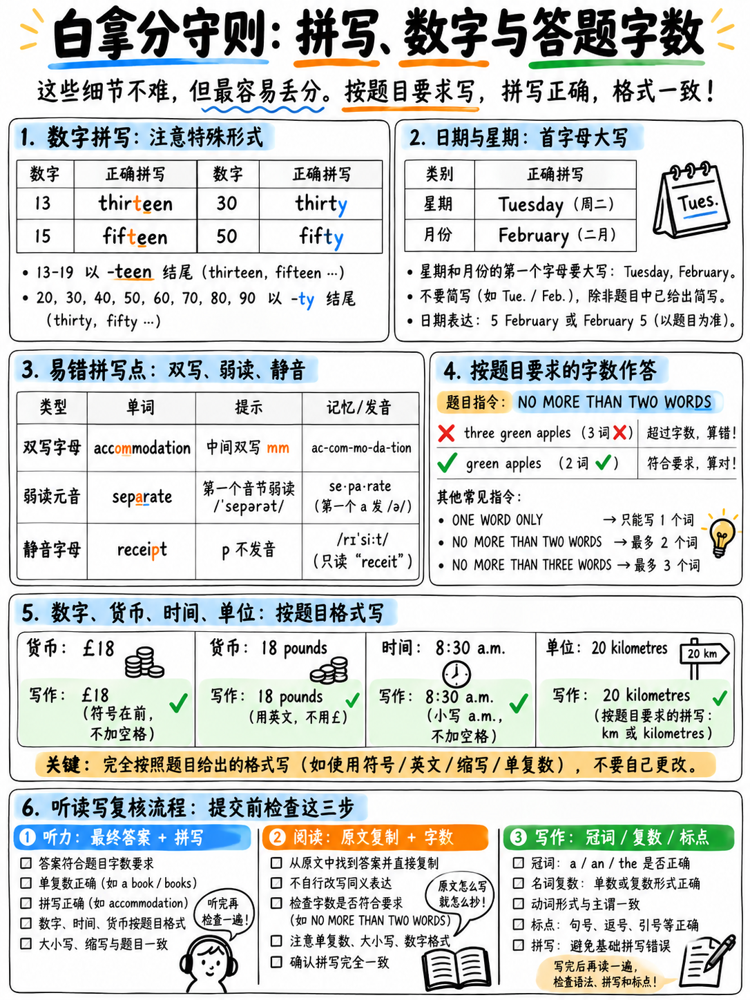

# 03. 拼写红线、数字日期与答题格式规范全汇总 (Spelling, Numbers & Answer Rules)

## 3.1 为什么本章是全场最高提分杠杆？（免费白拿 6–15 分）

**如果你的雅思考试就在未来三天内，请先停下手头所有其他复习，立刻通读并背诵本章！** 本章所涉及的每一个考点，都是**完全不需要提升任何英语学术能力就能当场挽救的纯失分**。

在官方评分体系中，“每一道正确答案计 1 分”`[2]` `[3]`。拼写错误的单词在客观题中一律判为 0 分；在写作中，拼写失误直接扣减 **词汇丰富度 (Lexical Resource)** 的得分，占小作文与大作文各四分之一的权重 `[10]`。

根据雅思官方评分规律与实战大样本统计，一个毫无格式防坑经验的初学者，往往在考场上因非实力因素白白蒙受如下惨重损失：

| 考场非受迫性失误类型 | 典型失分区间 | 扣分根源与性质 |
|---|---|---|
| **听力填空拼写错误**（如漏字母、双写混淆） | **2–4 分** | 听懂了内容，答案词写错一个字母得 0 分 |
| **阅读填空原文照抄却抄错字母** | **1–2 分** | 原文就在眼皮底下的送分题，抄写粗心丢分 |
| **突破字数上限**（如限制两词却写了三词） | **1–3 分** | 无论语义多正确，超字数直接系统判定 0 分 |
| **词形不符**（漏写复数 `-s`、时态不当） | **1–2 分** | 语法形态与空格前后语法不兼容判错 |
| **考场时间耗尽，试卷留下空白题目** | **1–4 分** | 雅思无倒扣分，留白等于主动放弃猜对概率 |
| **累计无谓损失总分** | **6–15 分** | **相当于直接丢失 1.0 到 2.0 个总分 Band！** |

:::{danger} 战略洞察：这是短期提分最立竿见影的“抢分金矿”
在雅思听力和阅读中，卷面原始分每提高 6 分，就足以使你的单科成绩**跃升整整一个分数段**（例如听力从 23 题的 6.0 分跃升至 30 题的 7.0 分 `[7]`）。追回这 6–15 分不需要几个月的语言积累，只需要两三个小时把本章的格式红线刻进脑海！
:::

---

## 3.2 雅思答题格式与考场红线铁律全览表 (The Answer-Format Rules)

| 答题规范细则 | 官方规则与考场执行要求 | 官方依据与文献来源 |
|---|---|---|
| **字数上限是绝对死线** | 题干写明 **"NO MORE THAN TWO WORDS"**，写了 3 个词一律得 0 分，无论内容多么正确！ | 官方标准题干说明 `[25]` |
| **带连字符的复合词计为 1 个词** | 带有连字符的词汇（如 *check-in*, *part-time*, *time-management*）系统判定为**单字 (single words)**。 | 官方规则明确 `[3]` |
| **缩写形态绝不在答案中考核** | 诸如 *they're*, *can't* 等缩写不会作为考核答案设计，答题时避免随意缩写。 | 官方规则明确 `[3]` |
| **数字单独计为一个计数单位** | 题干说明中的 **"AND/OR A NUMBER"** 意味着除了规定单词数外，允许额外附加一个数字。 | 官方标准题干说明 `[25]` |
| **英式拼写与美式拼写全盘接受** | 无论使用英式 (*colour, centre, programme*) 还是美式 (*color, center, program*) 均满分接受。 | 官方评分标准 |
| **客观题大小写不作硬性扣分要求** | 全大写 (*LONDON*)、全小写 (*london*) 或首字母大写 (*London*) 均给分。建议首字母清晰大写。 | 考生指导规范 `[1]` |
| **语法允许情况下的单复数兼收** | 官方答案标准库中括号内为可选项，如 *scientist(s)*、*summer school(s)* 均算对。 | 官方真题答案库 `[18]` |
| **TFNG 与 YNNG 绝不可混淆混用** | **TRUE/FALSE/NOT GIVEN**（事实题）与 **YES/NO/NOT GIVEN**（作者观点题）属于不同题型，写混直接得 0 分！ | 官方考试指引 `[3]` |
| **写作严禁使用 Bullet Points 或笔记体** | 官方评语明确指出：大作文或小作文使用项目清单符号（点状列举）或笔记缩写体属于严重违规，直接扣分！ | 官方考官细则 `[10]` |
| **客观题坚决不要留下任何一题空白** | 雅思**没有任何倒扣分机制**。哪怕最后 10 秒钟，也必须全蒙上答案！ | 官方计分规则 |

:::{tip} 避开超字数陷阱：在填空题中果断删掉冠词 a / an / the
在听力和阅读的填空题中，冠词 (*a, an, the*) 几乎从不作为采分点，但却极容易诱使考生突破字数上限！  
例如题目限制“不超过两词 (NO MORE THAN TWO WORDS)”：  
❌ *a significant increase* （计为 3 个词，直接判 0 分）  
✅ *significant increase* （计为 2 个词，拿满 1 分）
:::

---

## 3.3 听力数字与日期：考场口语读法与标准书写规范

### 致命陷阱：-teen 与 -ty 的听音与拼写辨析

这是雅思听力 Part 1 中考生失分频率最高的一道坎。

| 数字对比组 | 听觉辨析核心差异 | 拼写红线与易错点 |
|---|---|---|
| **thirTEEN (13) vs THIRty (30)** | 13 重音在后半部，尾音带鼻音 /n/；30 重音在首音节，尾音短促 /i/ | 30 拼写为 *thirty*，没有 r 的缺失 |
| **fourTEEN (14) vs FORty (40)** | 重音位置差异同上 | **forty 绝对没有字母 u**（对比 *four* 与 *fourteen*） |
| **fifTEEN (15) vs FIFty (50)** | 重音位置差异同上 | 均为 fif- 开头，注意 50 为 *fifty* |
| **sixTEEN (16) vs SIXty (60)** | 重音位置差异同上 | 辨清结尾鼻音 /n/ |
| **sevenTEEN (17) vs SEVenty (70)** | 重音位置差异同上 | 70 重音在第一音节 |
| **eighTEEN (18) vs EIGHty (80)** | 重音位置差异同上 | 80 拼写作 *eighty*（只有一个 t） |
| **nineTEEN (19) vs NINEty (90)** | 重音位置差异同上 | 90 拼写作 *ninety*（保留字母 e） |

**针对性操练**：让同伴或使用 TTS 工具随机打乱朗读 20 个包含 -teen 和 -ty 的数字。直接在纸上写出阿拉伯数字，反复训练直至达到 20/20 满分。

### 英语数字在听力中的常用口语读法速查表

| 口语音频念法 (Spoken) | 实际代表数值 | 考场填写说明与陷阱防范 |
|---|---|---|
| **"oh"** | **0** | 电话号码与房间编号中，0 通常念作 "oh" 而非 zero |
| **"nought"** | **0** | 英式发音常用于小数，如 "nought point five" 即 0.5 |
| **"double four"** | **44** | 电话号码常见连续读法，听到后直接连敲两个 4 |
| **"treble eight" / "triple eight"** | **888** | 连续三个 8 |
| **"oh seven nine, four four two"** | **079442** | 念的时候有停顿意群，写的时候连贯写出完整连续数字 |
| **"one two three four"** | **1234** | 邮编与参考号通常单字连读 |
| **"a thousand"** | **1,000** | 听到 a 不要漏掉 1 |
| **"fifteen hundred"** | **1,500** | **绝对不是 15,100**！英文习惯用百为单位称呼 1500 |
| **"two thousand and nine"** | **2009** | 年份念法 |
| **"twenty twenty-five"** | **2025** | 现代年份常用两两拆读法 |
| **"a quarter of a million"** | **250,000** | 百万的四分之一即 25 万 |
| **"point five"** | **0.5 或 .5** | 小数直接写阿拉伯数字 |
| **"one metre twenty"** | **1.20 m 或 1.20 metres** | 官方答案库写作 "1.20 metres" `[18]` |
| **"half past eight"** | **8:30** | 8 点半 |
| **"quarter to six"** | **5:45** | **差一刻钟到六点，绝对不是 6:15**！ |
| **"ten past three"** | **3:10** | 3 点过 10 分 |
| **"twenty to nine"** | **8:40** | 差 20 分到 9 点 |

### 货币、度量衡与百分比书写规则

| 口语念法 | 考场最稳妥写法 | 规则要点 |
|---|---|---|
| "twenty-five pounds" | **£25** 或 **25 pounds** | 题干已有货币符号 £ 时，只写数字 25！切勿重复写 £25 pounds |
| "four pounds fifty" | **£4.50** | 货币小数标准格式 |
| "a hundred and eighty-five pounds" | **£185** | 直接写数字加符号 |
| "thirty euros" | **€30** 或 **30 euros** | 欧元符号 |
| "seventy-five centimetres" | **75 cm** 或 **75 centimetres** | 度量衡缩写均被接受 |
| "one point four degrees" | **1.4 degrees** | 温度单位 |
| "twenty-five per cent" | **25%** 或 **25 per cent** | 百分比符号 |
| "two-thirds" | **two-thirds** | 分数带有连字符算作 1 个词 `[3]` |

:::{important} 铁律：只要允许，一律优先写阿拉伯数字
写阿拉伯数字（如 `12`、`450`、`1.20`）比写英文单词（*twelve, four hundred and fifty*）书写速度快 5 倍，且**彻底免除了单词拼写错误的任何风险**！官方答案库完全认可阿拉伯数字 `[18]`。
:::

### 考场日期的黄金书写规范

在听力中，日期无论先读日还是先读月，书写时只要日与月清晰无歧义，两种顺序均可得分：
- 录音念：*"the third of October"* 或 *"October the third"*
- 考场标准安全写法：**3 October**、**October 3** 或 **3rd October**
- 录音念：*"the twenty-second of November"* -> 考场写：**22 November**

:::{warning} 坚决禁止将日期写成纯纯数字斜杠格式 (如 03/10)
在英式格式中 `03/10` 代表 10 月 3 日；但在美式格式中 `03/10` 代表 3 月 10 日。考官面对纯数字无法判定你的格式意图，极易判错。**月份必须完整写出英文单词**，歧义立刻彻底消除！
:::

---

## 3.4 雅思高频 150 词听力拼写红线词表 (The 150-Word Spelling List)

本词表汇集了雅思真实考试中出现概率最高、且中国考生最容易拼写错误的 **150 个考点核心词**。所有标出的错误类型均来自真实考卷的高频错例。

### 第 1 组：双写字母陷阱词（双写漏写或单写错双写）

| 核心考点词 | 中国考生典型错误 (✗) | 记忆口诀与拼写挂钩 (Hook) |
|---|---|---|
| **accommodation** | accomodation / accomadation | 牢记：**双 c，双 m** |
| **necessary** | neccessary / nescesary | 牢记：**单 c，双 s**（一件衬衫两只袖子） |
| **recommend** | reccomend / reccommend | 牢记：**单 c，双 m** |
| **occasion** | ocassion / occassion | 牢记：**双 c，单 s** |
| **beginning** | begining | begin + 双写 n + ing |
| **committee** | commitee / comittee | 牢记：**双 m，双 t，双 e**（全双写） |
| **address** | adress | **双 d，双 s** |
| **appointment** | apointment | 必须**双写 p** |
| **opportunity** | oportunity | 必须**双写 p** |
| **professional** | proffesional | 牢记：**单 f，双 s** |
| **questionnaire** | questionaire | question + **双写 n** + aire |
| **disappear** | dissapear | 前缀 dis- + appear，**单 s，双 p** |
| **embarrass** | embarass | 牢记：**双 r，双 s** |
| **parallel** | paralell / parrallel | 牢记：中间**双 l**，结尾单 l |
| **successful** | succesful | 牢记：**双 c，双 s**，结尾单 l |
| **tomorrow** | tommorow | 牢记：**单 m，双 r** |
| **until** | untill | 结尾只有**一个字母 l** |
| **skilful** | skillfull | 英式：前单 l 后单 l；美式为 skillful |
| **colleague** | colege / coleague | 必须**双写 l**，且结尾是 -ague |
| **possession** | posesion | 牢记：**双 s，双 s** |
| **traffic** | trafic | 必须**双写 f** |
| **million** | milion | 必须**双写 l** |

### 第 2 组：非重读音节弱读元音陷阱（Schwa /ə/ 音导致的字母混淆）

此类单词由于非重读音节在发音时被弱化为 /ə/，听觉无法提供拼写提示，极易混淆 a、e、i、o。

| 核心考点词 | 中国考生典型错误 (✗) | 核心纠偏关注点 |
|---|---|---|
| **separate** | seperate | 中间是 **字母 a**（牢记：there is 'a rat' in separate） |
| **definitely** | definately / definetly | 词中是 **字母 i**，来自 finite |
| **independent** | independant | 结尾是 **-ent**，而非 -ant |
| **environment** | enviroment / environtment | 必须包含不发音的 **字母 n** |
| **government** | goverment | 必须包含中间的 **字母 n** (govern + ment) |
| **restaurant** | restarant / resturant | 词中有 **-au-** |
| **vegetable** | vegtable | 中间包含弱读的 **字母 e** |
| **temperature** | temprature | 中间包含 **-er-** |
| **category** | catagory | 中间是 **字母 e** |
| **calendar** | calender | 结尾是 **-ar** |
| **grammar** | grammer | 结尾是 **-ar**，绝无字母 e |
| **similar** | similiar | 结尾是 **-lar**，不要多加 i |
| **convenient** | convinient | 前缀是 **con-**，中间是 **-ve-** |
| **experience** | experiance | 结尾是 **-ence** |
| **difference** | diffrence | 中间有 **-er-** |
| **maintenance** | maintainance | 保持动词是 maintain，但名词变为 **mainten-** + ance |
| **performance** | performence | 结尾是 **-ance** |
| **relevant** | relevent | 结尾是 **-ant** |
| **apparent** | apparant | 结尾是 **-ent**，双写 p |
| **privilege** | priviledge | 中间无 d，词尾是 **-lege** |
| **develop** | developpe / develope | 结尾无 e，单写 p |
| **benefit** | benifit | 中间是 **字母 e** |

### 第 3 组：不发音辅音字母陷阱 (Silent Letters)

拼读时该字母完全不发音，但书写时少一个字母即判 0 分。

| 核心考点词 | 隐形不发音的关键字母 | 考场实战提醒 |
|---|---|---|
| **Wednesday** | 必须有第一个字母 **d** (Wed-nes-day) | 听力 Part 1 极高频考点，默写 10 遍 |
| **February** | 必须有第一个字母 **r** (Feb-ru-ary) | 听力 Part 1 极高频考点，绝不可漏写 r |
| **receipt** | 包含不发音的字母 **p** | 押金与报销场景必考，念 /rɪˈsiːt/ |
| **island** | 包含不发音的字母 **s** | 地理与旅游场景常见 |
| **knowledge** | 开头不发音的 **k**，结尾有 **d** | 基础词但常有笔误 |
| **foreign** | 包含不发音的字母 **g** | 外国/国际话题常见 |
| **autumn** | 结尾不发音的字母 **n** | 季节填空常见，切勿漏 n |
| **psychology** | 开头不发音的字母 **p** | 学术讲座与课程名称高频词 |
| **rhythm** | 全词除 y 之外没有任何元音字母 | 艺术文化讲座高频词 |
| **answer** | 包含不发音的字母 **w** | 基础答题词 |
| **science** | 字母组合 **sci-**，包含不发音的 c | 学科名称必考词 |
| **guarantee** | 字母 g 后必须有字母 **u** | 商业服务场景常见 |
| **queue** | 词尾是 **-ueue** | 排队场景高频词 |
| **climb** | 词尾不发音的字母 **b** | 动作与趋势常考 |
| **doubt** | 词中不发音的字母 **b** | 学术论证词汇 |
| **column** | 词尾不发音的字母 **n** | 图表与建筑常考 |

### 第 4 组：*ie* 与 *ei* 拼写混乱辨析

| *ie* 组合词 | *ei* 组合词（尤其在字母 c 之后或特殊发音） |
|---|---|
| **believe** *(相信)* · **achieve** *(实现)* · **relief** *(缓解)* · **field** *(田野/领域)* · **friend** *(朋友)* · **piece** *(碎片)* · **niece** *(侄女)* · **retrieve** *(检索)* · **brief** *(简短)* | **receive** *(收到)* · **deceive** *(欺骗)* · **ceiling** *(天花板)* · **either / neither** · **weird** *(怪异)* · **foreign** *(外国的)* · **height** *(高度)* · **leisure** *(休闲)* · **their** *(他们的)* |

*传统英文口诀：* "i before e except after c"（在 c 之后写 ei，如 receive；其他常写 ie）。特例词汇直接作为红线词记忆：*weird, foreign, height, leisure*。

### 第 5 组：星期、月份与季节高频词表（听力 Part 1 基本盘）

> **Monday** · **Tuesday** · **Wednesday** *(重点攻克中间字母 d)* · **Thursday** · **Friday** · **Saturday** · **Sunday**  
> **January** · **February** *(重点攻克首个字母 r)* · **March** · **April** · **May** · **June** · **July** · **August** · **September** · **October** · **November** · **December**  
> **spring** · **summer** · **autumn** *(美式可写 fall)* · **winter**

:::{danger} 考前警报：Wednesday 和 February 是全场失分率最高的两个单词
因为在绝大多数雅思听力 Part 1 的预约表格中，日期和星期是固定必考题。由于日常口语发音将 *Wednesday* 念作 /ˈwenzdeɪ/，将 *February* 念作 /ˈfebjʊəri/，大量考生凭发音写出 Wensday 或 Febuary，白送 1 分。请立即在草稿纸上各自手写 10 遍！
:::

### 第 6 组：听力核心场景高频答案名词与形近近音词混淆库

| 考点单词 1 | 考点单词 2 | 考点单词 3 |
|---|---|---|
| **accommodation** *(住宿)* | **deposit** *(押金)* | **receipt** *(收据发票)* |
| **library** *(图书馆)* | **laboratory** *(实验室，简写 lab 也收)* | **questionnaire** *(调查问卷)* |
| **timetable** *(时间表)* | **equipment** *(设备，不可数)* | **insurance** *(保险)* |
| **dissertation** *(毕业论文)* | **assignment** *(日常大作业)* | **enrolment** *(入学注册)* |
| **supervisor** *(导师主管)* | **colleague** *(同事)* | **reference** *(推荐人/参考文献)* |
| **brochure** *(宣传手册)* | **leaflet** *(传单折页)* | **certificate** *(证书)* |
| **curriculum** *(课程大纲)* | **attendance** *(出勤考勤)* | **facility** *(设施场所)* |
| **pedestrian** *(步行者行人)* | **roundabout** *(环岛路口)* | **appliance** *(家用电器)* |

**形近近音混淆词组辨析（一词之差，全句扣分）：**
1. **stationery** *(文具信纸，包含 e 像 pen)* vs **stationary** *(静止不动的，包含 a 像 car)*
2. **practice** *(名词，英美通用)* vs **practise** *(动词，英式拼写)*
3. **advice** *(名词，不可数)* vs **advise** *(动词)*
4. **affect** *(及物动词，产生影响)* vs **effect** *(名词，效果影响)*
5. **its** *(它的，物主代词)* vs **it's** *(it is 的缩写)*
6. **their** *(他们的)* vs **there** *(那里)* vs **they're** *(他们是)*
7. **your** *(你的)* vs **you're** *(你是)*
8. **whose** *(谁的)* vs **who's** *(who is 缩写)*
9. **to** *(介词/不定式)* vs **too** *(也/过于)* vs **two** *(数字2)*
10. **than** *(比较级连词)* vs **then** *(然后/当时)*
11. **lose** *(动词，丢失输掉，单 o)* vs **loose** *(形容词，宽松松散，双 o)*

---

## 3.5 7 天彻底清除拼写短板极速落地行动表

拼写是一项**纯神经肌肉运动技能**。光用眼睛看词表毫无效果，必须动笔落到纸面上：

| 训练日程 | 核心操练动作与内容 | 预估耗时 |
|---|---|---|
| **第 1 天：全面排查摸底** | 让同伴或使用 TTS 语音工具，将 3.4 节的 **全部 150 个考点词** 完整朗读听写一遍。亲手写下并逐一对照批改。**挑出所有拼错的词汇，这就是你的“专属私人红线词表”**（通常在 20–40 个词之间）。 | 35 分钟 |
| **第 2–6 天：单点肌肉固化** | 每天将你的“专属私人红线词表”**手写默写 3 遍**。每日练习结束后再次由 TTS 听写一次。已经连续两次完全正确的词汇移出清单，专注攻坚剩余难词。 | 15 分钟/天 |
| **第 7 天：全真句子听写测试** | 进行包含剩余难词的**全真完整句子听写训练**（可直接使用 {doc}`../50-listening/06-listening-practice-set` §50.6.2 中的高精听写语料库）。 | 20 分钟 |

:::{important} 训练原则：严禁在已经熟练掌握的词汇上浪费时间
如果 *library* 和 *student* 你早已掌握，写上 100 遍也是纯属浪费生命。第 1 天的全面听写摸底就是为了把复习范围迅速收缩到你自己独有的 20–40 个弱点词上。这个小规模清单在一周内完全能够被 100% 攻克！
:::

---

## 3.6 考场交卷前最后 3–5 分钟专项排查清单 (The Final-Check Routine)

考场上最后几分钟如果漫无目的地“随便看看有没有错”，你几乎发现不了任何问题。**必须采取“单项定向扫描法（Single-purpose Passes）”**，每一次扫描只死盯一个特定维度。

### 听力交卷前复查清单 (Listening Review)

- [ ] **所有填空框全满，坚决没有任何空白**（即使漏听也已全凭常识填补猜测）。
- [ ] **星期和月份拼写无误**（特别排查 Wednesday 和 February）。
- [ ] **数字全部以阿拉伯数字书写**，且数值准确无误。
- [ ] **绝无任何题目超过字数上限**（如两词上限题目绝无出现三词）。
- [ ] **单复数形式与题干上下文语法完美契合**（如题干有 a 则填单数；题干无冠词可数名词填复数）。

### 阅读最后 3 分钟复查清单 (Reading Final 3 Minutes)

- [ ] **答题卡/机考输入框零空白**（全部题目已填满）。
- [ ] **填空题抄录词汇与原文拼写 100% 一致**（避免手抖抄错字母）。
- [ ] **TRUE/FALSE/NOT GIVEN 与 YES/NO/NOT GIVEN 严格与各题题干对应**，绝无写混。
- [ ] **单选题与配对题填写的是字母代号 (A, B, C...)**，而不是抄写选项内容单词。
- [ ] **严格遵守各填空题字数上限**。

### 写作交卷前 5 分钟复查清单 (Writing Final 5 Minutes)

- [ ] **字数完全达标**：Task 1 确信达到 150 词以上（机考实时显示，目标 170–190 词）；Task 2 达到 250 词以上（目标 270–300 词）。
- [ ] **可数名词复数扫描**：扫描所有表示泛指的名词，检查末尾是否遗漏复数 **-s**。
- [ ] **第三人称单数扫描**：扫描主语为单数名词、he/she/it 的一般现在时动词，检查是否补齐 **-s**。
- [ ] **冠词扫描**：扫描所有单数可数名词，确保前面都有 a / an 或 the。
- [ ] **逗号连句排查**：确保绝无用逗号连接两个完整分句的硬伤，必要时补上 so, but, because 或改为句号。
- [ ] **段落间距清晰**：自然分段，段与段之间空行分明。
- [ ] **Task 1 数据精准度**：快速扫视文中提及的所有关键极值与年份，确保与图表数据吻合。

---

**上一章：** {doc}`02-grammar-minimum` | **下一章学习指南：** {doc}`04-error-log-method`
