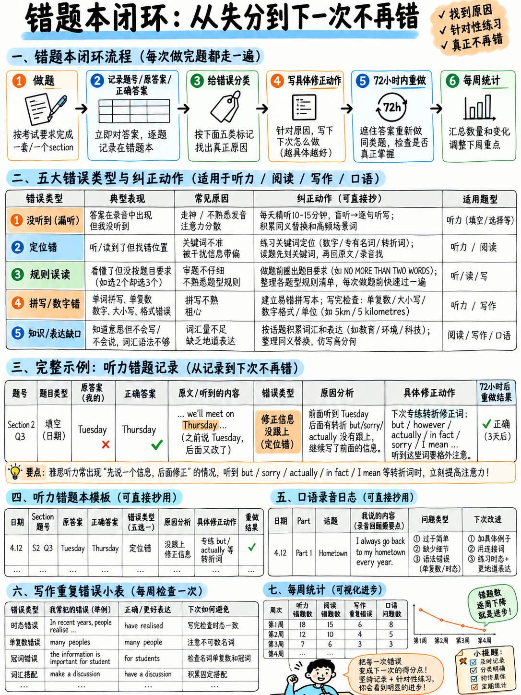

# 04. 错题复盘闭环法：四步归因与针对性提分复盘 SOP (Error Log Method)



## 4.1 为什么盲目刷题却不复盘几乎毫无提分效果？

绝大多数雅思自学考生的典型复习日常是：做一套真题、对答案、算出一个令人沮丧的分数、叹一口气，然后第二天再做一套新的真题。做完几套之后发现分数毫无长进，便得出结论：“我需要做更多的题，背更多的词。”

**这是雅思备考中最大的时间与精力黑洞。** 盲目做题只是把原本错误的解题习惯、拼写误区和拖沓流程**操练得更加根深蒂固**。单纯的分数只能告诉你“你不知道多少”；只有建立系统化的**错题复盘日志（Error Log）**，才能精准告诉你“你具体做错了什么，以及考场上如何当场抢回这些分数”。

:::{important} 错题日志是极简备考的核心支柱
一个规范的错题日志能够同时替代四样低效冗余的东西：厚重的生词笔记本、繁杂的语法笔记本、毫无依据的“自我感觉薄弱点清单”，以及“自以为很努力刷题”的虚假充实感。  
**单页纸张、五大归因维度、每次模考后仅需 5 分钟**，提分立竿见影。
:::

---

## 4.2 雅思丢分五大根本原因归因模型 (The Five Causes)

你在雅思考试中丢失的每一分，必定严格归属于以下五大根源之一。能够精准分类，问题就解决了一大半，因为每种原因对应的修复策略截然不同：

```
   ┌────────────────────────────────────────────────────────────────────┐
   │ 原因 1：知识盲区 (KNOWLEDGE)                                       │
   │   • 真实表现：生词不认识、固定语法规则不懂、背景事实完全未知。   │
   │   • 纠偏方案：查词典/看规则，针对性记忆。在日志中记录 1 行。       │
   ├────────────────────────────────────────────────────────────────────┤
   │ 原因 2：流程方法变形 (PROCESS)                                     │
   │   • 真实表现：明明具备解题能力，但解题步骤变形——先通读全文才看题、 │
   │               没读清题目要求、没预判空格词性、听力漏听一题后慌乱。 │
   │   • 纠偏方案：修正做题流水线 SOP，机械化执行标准步骤。             │
   ├────────────────────────────────────────────────────────────────────┤
   │ 原因 3：时间管理失控 (TIME)                                       │
   │   • 真实表现：题目会做，如果多给 5 分钟就能做对，但前面超时了。    │
   │   • 纠偏方案：强制执行单篇时间死线 (Time Caps) 与果断弃题。        │
   │               坚决不需要去背更多生词！                             │
   ├────────────────────────────────────────────────────────────────────┤
   │ 原因 4：机械操作失误 (MECHANICAL)                                 │
   │   • 真实表现：单词拼错、漏加复数 -s、突破字数上限、留白未猜、       │
   │               TFNG 与 YNNG 答题格式写反。                          │
   │   • 纠偏方案：执行第 03 章《答题格式与拼写规范清单》。纯白送分！   │
   ├────────────────────────────────────────────────────────────────────┤
   │ 原因 5：命题陷阱干扰 (TRAP)                                       │
   │   • 真实表现：掉入考官精心布置的干扰项——转折更正干扰、烟雾弹数字、 │
   │               选项中提及但被否决的内容、绝对化限定词偷换概念。     │
   │   • 纠偏方案：掌握考官干扰项设计套路，对原文转折词建立下意识警惕。 │
   └────────────────────────────────────────────────────────────────────┘
```

:::{danger} 核心战略认知：后四类原因根本不是“英语水平问题”！
请仔细审视上述归因：**原因 2（流程）、原因 3（时间）、原因 4（机械）、原因 5（陷阱）完全不是英语语言能力的问题！**  
在初学者的失分构成中，这四类非受迫性失误**通常占据了总失分的 50% 到 70%**！修复它们的速度比提升纯语言知识（原因 1）要快上十倍。错题日志的首要价值，就是让你清楚地看到：**你的考分中有多少原本就是属于你的白送分！**
:::

---

## 4.3 错题日志标准格式与全真实战范例 (The Log Format)

采用六列标准表格，记录在一个专门的文档或纸质活页本中。**每道错题严格只占一行**，拒绝冗长的心得体会。

| 日期 | 出处题号 | 我的错误作答 / 动作 | 官方正确答案 | 原因归因 (1–5) | 落地纠偏动作 (Fix) |
|---|---|---|---|---|---|
| 10月11日 | 听力 Part 1 Q4 | Wensday | Wednesday | **4 机械失误** | 星期拼写红线：手写默写 10 遍 |
| 10月11日 | 听力 Part 1 Q6 | 30 | 13 | **5 陷阱/辨音** | -teen / -ty 专项听写对练 |
| 10月11日 | 听力 Part 3 Q23 | *(空白未填)* | B | **2 流程失误** | Q22 漏听后发呆丢失定位 → 操练紧急跳题锚定法 (§50.1.4) |
| 10月11日 | 阅读 P2 Q17 | FALSE | NOT GIVEN | **1+5 知识/陷阱** | 原文未作比较，误判为反面事实 → 牢记 NG 典型特征 |
| 10月11日 | 阅读 P3 Q34 | *(空白未填)* | C | **3 时间失控** | 第二篇超时耗费 24 分钟 → 严格执行 17/37/57 时间死线 |
| 10月11日 | 阅读 P1 Q8 | a large increase | large increase | **4 机械失误** | 题干限制两词，冠词导致超词 → 填空题一律剔除冠词 |
| 10月12日 | 写作 Task 2 | "In conclusion, I firmly believe the advantages outweigh..." | — | **2 流程/语言** | 机械套用低分模板套话 → 删掉公式化套话，改用自然论证 |
| 10月12日 | 写作 Task 1 | "The chart show" | shows | **4 机械失误** | 第三人称单数漏 -s → 写入交卷前 5 分钟专项检查单 |
| 10月12日 | 口语 Part 2 | 仅说了 68 秒闭麦 | 120 秒 | **2 流程失误** | 没准备展开救场手段 → 操练救场衔接句式 (§20.3.6) |
| 10月12日 | 口语 Part 1 | "I live here five years" | I have lived here for five years | **1 知识盲区** | 完成时态搭配 for 专项造句朗读 10 次 |

:::{tip} 记录核心法则：只写客观原因编号，坚决不写情绪化宣泄
“我听力太差了”、“我好笨总是做不对”不是有效的日志内容，对提分毫无意义。“原因 4 — Wednesday 拼写漏了 d”才是清晰可执行的日志，且它有明确的 5 分钟修复动作。
:::

---

## 4.4 每周复盘统计与提分决策树 (The Weekly Review)

每周做题结束后，**将所有错题按照 1 到 5 的原因编号进行汇总计数**。这个统计数字就是你下周复习日程表的核心依据：

```
   第一周错题统计样例 (全真复盘数据)
   
   原因 1：知识盲区 (KNOWLEDGE)    ████████                8 题
   原因 2：流程变形 (PROCESS)      ██████████████         14 题
   原因 3：时间失控 (TIME)         ███████████            11 题
   原因 4：机械失误 (MECHANICAL)   █████████████████      17 题
   原因 5：命题陷阱 (TRAP)         ██████████             10 题
                                                          ──
                                                          共计 60 处错误
   
   深度剖析该统计图：
     • 机械失误 (17) + 时间失控 (11) = 28 处错误完全与“英语水平”无关！
     • 真正的语言知识盲区仅仅只有 8 处！
     • 结论：下周的提分核心是：背熟 150 拼写词表 + 严守单篇时间死线 + 识别考官陷阱套路。
       坚决不要盲目去背 500 个生僻单词！
```

### 错题归因纠偏决策矩阵表

| 如果你本周失分最多的原因是 | 下一周你必须执行的核心纠偏动作 | 跳转对应章节指引 |
|---|---|---|
| **原因 1：知识盲区** | 针对性学习核心功能词汇与 8 种基础语法句型 | {doc}`01-core-vocabulary`, {doc}`02-grammar-minimum` |
| **原因 2：流程变形** | 重读该题型的标准做题 SOP，并在做题时刻意放慢节拍严格执行 | 阅读 40 / 听力 50 对应题型章节 |
| **原因 3：时间失控** | 佩戴倒计时表强制训练。刻意操练“当断则断，到点猜题跳过”的心态 | {doc}`../40-reading/01-scoring-and-section-tactics` §40.1.2 |
| **原因 4：机械失误** | 全面手写过关 150 词听力拼写表，考场强制执行交卷前排查清单 | {doc}`03-spelling-numbers-and-answer-rules` |
| **原因 5：命题陷阱** | 针对性研读考官设坑模式，听力对照原文听第二遍捕捉转折信号词 | {doc}`../50-listening/01-scoring-and-section-tactics` §50.1.5 |

:::{danger} 考前警惕：自学考生的头号杀手
自学考生最致命的通病就是**把所有做错的题统一归咎为“原因 1（词汇量不够）”**。如果一个考生明明是因为机械拼写和时间失控丢了 28 分，却反过来逼自己去死记 500 个生僻学术词，一个月后他的成绩依然不会有任何改变！错题统计正是为了彻底阻止这种悲剧。
:::

---

## 4.5 主观题（写作与口语）专属复盘子系统

写作与口语属于产出性技能，考题没有唯一的标准答案单词，因此需要采用专门设计的复盘追踪表。

### 写作复盘：复发性硬伤追踪打卡单 (Recurring-Error Sheet)

每写完一篇作文，在一张**长期固定的单页纸**上追踪记录你的个人高频语法与格式毛病。绝不要每次另起炉灶，核心目的在于**观察错误的重复出现频率**：

```
   我的个人写作高频复发性硬伤清单 (每次发现即在末尾打勾 ✓)
   
   1. 单数可数名词前面遗漏冠词 (a / an / the) ........... ✓✓✓✓✓✓✓✓
   2. 表达社会公众泛指时误写为 "the people" ............. ✓✓✓✓✓
   3. 逗号连句硬伤 (Comma Splice) ....................... ✓✓✓✓
   4. 第三人称单数谓语动词漏加 -s ....................... ✓✓✓
   5. 不可数名词误加复数 ("informations" / "advices") ... ✓✓✓
   6. 频繁无意义滥用连接词 "Moreover" .................. ✓✓✓
   7. 大作文主体段第 2 段缺少具体论据示例 ............... ✓✓
   8. 字数不足 250 词被扣分 ............................. ✓✓
   9. 混淆动词 "affect" 与名词 "effect" ................. ✓
```

**唯一具有立竿见影效果的动作**：  
将累计打勾次数最多的 **前 3 项硬伤**，直接抄写在你的交卷前 5 分钟专项排查卡片上（{doc}`03-spelling-numbers-and-answer-rules` §3.6）。每次写完作文，**专门只拿放大镜排查这 3 个毛病**！

### 口语复盘：全真录音反思日志 (Recording Log)

**口语练习必须录音**。没有任何替代方案——任何人都不可能在实时开口说话的同时客观精准地听到自己的发音缺陷和语法卡顿。

| 练习日期 | 练习任务 | 实录时长 | 流利度反思 (仅记1点) | 发音与重音反思 (仅记1点) | 语法准确性反思 (仅记1点) |
|---|---|---|---|---|---|
| 10月11日 | Part 2 卡片 15 | 1分08秒 | 提早闭麦，缺乏细节扩展支撑 | 语调平直缺乏起伏，实词未加重音 | 误说 "I have it since 2019" |
| 10月12日 | Part 2 卡片 22 | 1分52秒 | 大有改观；使用了 "I should mention" | /θ/ 发音不准，three 读成了 see | 误说比较级 "more cheaper" |
| 10月13日 | Part 3 Q5 | 22秒 | 答题过短，缺少具体举例展开 | 句末疑问升调，显得缺乏确信度 | 过去时态中途滑向一般现在时 |

:::{important} 极度克制：每个维度严格只记录 1 个痛点
每次听录音复盘，**每个维度绝不允许记录超过 1 个问题**！如果你一口气列出 8 个毛病，你明天一个都改不掉。错题日志能够生效的根本原因，在于它强制你锁定**明天开口时唯一必须改掉的那个单点**。
:::

---

## 4.6 根治“化石级顽固错误” (Fossilised Error)

所谓的**化石级错误（Fossilised Error）**，是指那些由于长年语言习惯导致你已经彻底“习以为常、完全听不出自己有错”的顽固下意识毛病。每个考生身上通常有 3–4 个这样的化石错误，正是它们把无数考生死死按在 5.5 分整整一年。

| 为什么错题日志能挖出化石错误？ | 具体实施路径 |
|---|---|
| **化石错误必定产生极高的重复打勾频次** | 查看 4.5 节的复发性打勾清单，勾选超过 5 次的即是化石错误 |
| **自我感觉完全正确，当场毫无感知** | 只有在听次日录音或重读昨天写的作文时，才能客观发现 |
| **高度集中于母语负迁移（母语干扰）** | 对照 {doc}`../10-pronunciation/07-first-language-interference` 中的中式英语典型特征 |

**根治化石级错误的核心，绝不是再去听老师讲一遍语法规则**——你心里早就明白规则！真正的唯一解法是**“刻意过度矫正（Over-correction）”**：通过大声朗读，在短时间内高频次、超负荷地重复正确形式，直到正确形式成为大脑新的第一直觉反应。

*针对“可数名词单数遗漏冠词”的过度矫正示范：*
> *A car. The car. A problem. The problem. A solution. The solution. A city. The city.*  
> *Cars cause pollution. The cars in my city are old.*  
> （每天清晨高声朗读这 20 组对照，连续操练一周）

---

## 4.7 全真实战案例：两周错题复盘带来的提分奇迹

以下展示一名真实考生的两周复盘对比数据：

| 关键追踪指标 | 第一周初诊复盘 | 第二周结核复盘 |
|---|---|---|
| **两周练习总量** | 听力 3 套、阅读 3 篇、大作文 2 篇、口语录音 5 段 | 相同练习量 |
| **记录错题总量** | **60 处** | **41 处** |
| **失分最多的原因** | **原因 4：机械失误 (17 次)** | 原因 1：知识盲区 (12 次) |
| **针对性执行动作** | 每日听写 150 词拼写表；严格执行 3.6 检查单；操练 -teen/-ty | 核心功能词造句；操练 8 种语法核心句式 |
| **机械失误数量** | 17 次 | **骤降至 4 次** |
| **考场客观题空白** | 6 道题留白 | **0 道题留白** |
| **听力原始卷面得分** | 19 / 40 (Band 5.0–5.5) | **26 / 40 (Band 6.5)** |
| **阅读原始卷面得分** | 17 / 40 (Band 5.0) | **24 / 40 (Band 6.0)** |

:::{important} 数据背后的真相：第一周没有学任何新的高深英语
在第一周到第二周之间，该考生**没有学习任何高深的英语语法，也没有背诵海量生僻词**。听力从 19 分暴涨到 26 分、阅读从 17 分暴涨到 24 分，**完全归功于修复了机械拼写失误（原因 4）和时间管理（原因 3）**！这就是错题复盘闭环带来的威力。
:::

---

## 4.8 随身打印：标准空白错题复盘模板 (Blank Log Template)

你可以直接将以下表格打印或复制到活页本中，开始记录你的提分闭环：

```
   ┌────────────────────────────────────────────────────────────────────────────────────────┐
   │ 雅思备考极速复盘日志 (ERROR LOG)                         周次：第 _____ 周             │
   ├──────┬──────────────┬──────────────────┬──────────────────┬──────┬─────────────────────┤
   │ 日期 │ 题号/科目    │ 我的作答/动作    │ 官方正确答案     │原因  │ 纠偏修复行动 (Fix)  │
   ├──────┼──────────────┼──────────────────┼──────────────────┼──────┼─────────────────────┤
   │      │              │                  │                  │      │                     │
   │      │              │                  │                  │      │                     │
   │      │              │                  │                  │      │                     │
   │      │              │                  │                  │      │                     │
   │      │              │                  │                  │      │                     │
   │      │              │                  │                  │      │                     │
   │      │              │                  │                  │      │                     │
   │      │              │                  │                  │      │                     │
   │      │              │                  │                  │      │                     │
   │      │              │                  │                  │      │                     │
   ├──────┴──────────────┴──────────────────┴──────────────────┴──────┴─────────────────────┤
   │ 本周错误分类总计：                                                                     │
   │   1 知识盲区：_____ 处    2 流程变形：_____ 处    3 时间失控：_____ 处                 │
   │   4 机械失误：_____ 处    5 命题陷阱：_____ 处                                         │
   │                                                                                        │
   │   占比最高的核心致错原因：____________________                                         │
   │   下周必须执行的单点纠偏行动：_______________________________________________________ │
   │                                                                                        │
   │ 我的前 3 项高频复发性顽疾 (考场交卷前必须逐一排查)：                                   │
   │   1. _________________________________________________________________________________ │
   │   2. _________________________________________________________________________________ │
   │   3. _________________________________________________________________________________ │
   └────────────────────────────────────────────────────────────────────────────────────────┘
```

---

**上一章：** {doc}`03-spelling-numbers-and-answer-rules` | **下一章学习指南：** {doc}`05-study-plans`
