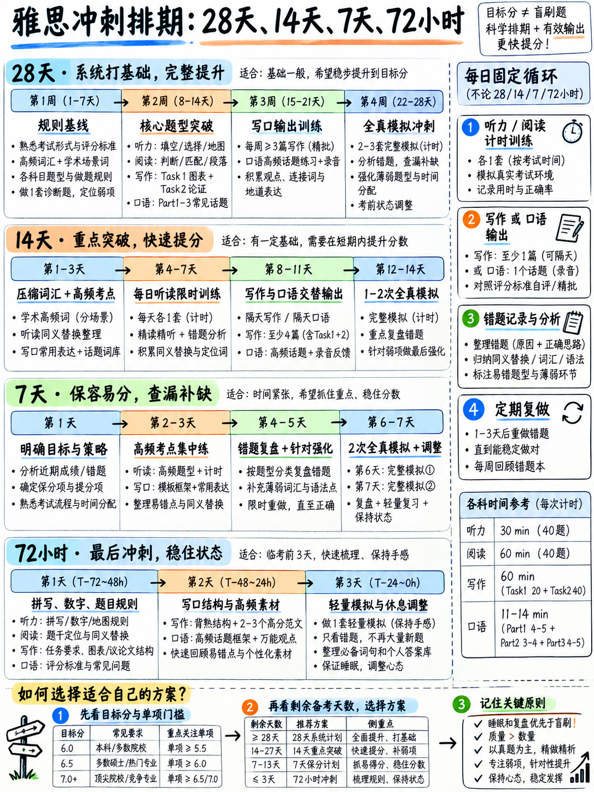

# 05. 分阶段实战备考计划：7天冲刺、14天突破与30天全面通关日程表 (Study Plans)



## 5.1 备考方案选择原则：按“真实剩余时间”匹配，绝不凭空幻想

本章提供四套经过实战检验的高效排期计划：**30天（28天）全面通关计划**、**14天快速突破计划**、**7天极限冲刺计划**、以及 **72小时考前特急抢救应急指南**。

请根据你**当前能够实打实拿出的复习时间**来选择，切忌好高骛远选择不切实际的冗长方案。

:::{important} 启动任何计划前的先决动作：首日全真基线模考
在翻开任何复习资料之前，必须先完成 {doc}`../00-foundations/06-choose-your-target` §6.3 的**第一天全真摸底诊断 (Day-One Diagnostic)**。  
没有听力、阅读、写作、口语四科的初始基线分数，任何计划都只是盲人摸象！
:::

### 四大备考方案共同遵循的优先级投入梯队 (Priority Triage)

所有计划均严格按照 {doc}`../00-foundations/04-priority-triage` 确定的提分杠杆率排序推进：

```
   1. 答题格式规范与机械拼写 (Spelling, Numbers & Rules)   → 白送分，最优先攻克
   2. 听力 Part 1 & Part 2 基础填空题                      → 提分性价比最高的基本盘
   3. 阅读 填空题与判断题 (TFNG / YNNG)                    → 提分性价比次高的客观题
   4. 写作 Task 1 小作文学术图表框架                       → 规律可预测，最易拿稳及格分
   5. 口语 意群切分 (Chunking) 与单词重音                  → 口语最立竿见影的提分点
   6. 写作 Task 2 大作文四段式论证骨架                     → 守住及格底线，杜绝模板判 0 分
   7. 其他高耗时、低性价比题型 (如阅读段落信息匹配 MI)     → 时间越紧，越先从底部果断砍掉！
```

---

## 5.2 30天（28天）全面通关日程表 (The 28-Day Plan)

- **每日投入时间**：约 **3 小时**（全周期累计约 90 小时）。
- **提分目标模型**：基础 4.5–5.0 突破至 6.5 分（听力 6.5–7.0，阅读 6.5–7.0，写作 5.5–6.0，口语 5.5–6.0；四科总和达到 25 分，平均分 6.25 四舍五入稳拿 **Overall 6.5**，参见 {doc}`../00-foundations/06-choose-your-target` §6.5）。

### 第一周：基础排雷、答题规范与核心客观题 (Week 1)

| 日期 | 模块 1 (60 分钟) | 模块 2 (60 分钟) | 模块 3 (60 分钟) |
|---|---|---|---|
| **第 1 天** | **基线摸底**：完整限时做一套官方全真听力 + 阅读 | **基线摸底**：限时 40 分钟写一篇 Task 2；录音一段口语 Part 2 | 精读 {doc}`../00-foundations/06-choose-your-target` 与 {doc}`../00-foundations/04-priority-triage`，计算目标分并写下四个单科目标 |
| **第 2 天** | 研读 {doc}`03-spelling-numbers-and-answer-rules`，进行 150 词听写初筛 | 建立个人专属红线拼写清单，手写默写 3 遍；进行 -teen/-ty 听音辨析 | 学习 {doc}`../10-pronunciation/01-start-here-sound-system` 44 个音标体系，完成中式发音自检 |
| **第 3 天** | 研读 {doc}`../50-listening/01-scoring-and-section-tactics` 与 {doc}`../50-listening/02-completion-tasks` | 专攻听力 Part 1 填空真题 2 套，对照听力文本精听纠错 | 操练听写集 A ({doc}`../50-listening/06-listening-practice-set` §50.6.2) 1–20 句 |
| **第 4 天** | 研读 {doc}`../40-reading/01-scoring-and-section-tactics` 与 {doc}`../40-reading/03-completion-and-short-answer` | 限时做一篇阅读，只做其中的填空题部分，体验原词定位 | 学习 {doc}`../10-pronunciation/04-word-stress` 60 词重音规则并跟读 |
| **第 5 天** | 研读 {doc}`../40-reading/02-true-false-not-given` 判断题解题公式 | 连续刷 2 套 TFNG 专项题组，记录失分归因 | 复习个人拼写清单；完成听写集 21–40 句 |
| **第 6 天** | 研读 {doc}`../30-writing/01-how-writing-is-scored` 与 {doc}`../30-writing/02-task-1-academic` | 限时 20 分钟手写完成一篇小作文 (T1-1)，对照标准量表自评 | 学习 {doc}`../10-pronunciation/05-chunking-and-sentence-stress` 意群停顿并完成初次影子跟读 |
| **第 7 天** | **周度复盘**：整理本周错题日志，统计 5 大致错原因分布 ({doc}`04-error-log-method`) | 重做第 1 天做错的听力题目，对照原文搞懂同义替换 | 适当休息，或研读官方 Band 4–7.5 真实考生范文考官评语 `[12]` |

### 第二周：题型攻坚、小作文框架与口语破局 (Week 2)

| 日期 | 模块 1 (60 分钟) | 模块 2 (60 分钟) | 模块 3 (60 分钟) |
|---|---|---|---|
| **第 8 天** | 听力 Part 1 + Part 2 限时连刷，逐题复盘定位失误 | 研读 {doc}`../50-listening/04-map-plan-diagram` 地图题解题方位词 | 研读 {doc}`../20-speaking/01-how-speaking-is-scored` 与 {doc}`../20-speaking/02-part-1`，录音并复盘 10 道 Part 1 问答 |
| **第 9 天** | 阅读单篇限时 20 分钟全真模考，严格执行题型顺序漏斗 | 错题入日志；学习 {doc}`../40-reading/04-matching-tasks` 配对题破局法则 | 影子跟读 15 分钟 + 默写个人红线拼写词 |
| **第 10 天** | 小作文动态图表句式框架复习；限时 20 分钟写 T1-4 | 对照 {doc}`../30-writing/03-task-1-worked-examples` 优秀范文，重点优化 Overview 段落 | 听写集 B；操练 20 个高频词汇重音 |
| **第 11 天** | 听力 Part 3 学术讨论题专练 + 文本转折词复盘 | 学习 {doc}`../50-listening/03-multiple-choice-and-matching` 单选排除技巧 | 学习 {doc}`../20-speaking/03-part-2-long-turn`，按 1 分钟笔记法录制 3 个 Part 2 话题 |
| **第 12 天** | 研读 {doc}`../30-writing/04-task-2-essay-types` 五大议论文类型与四段骨架 | 限时 40 分钟写一篇 Task 2（题目 1），严格禁止使用公式化模板 | 对照 {doc}`../30-writing/05-task-2-worked-examples` 范文纠偏论证深度 |
| **第 13 天** | 阅读全题型综合篇章限时模考 (20 分钟) | 学习 {doc}`../40-reading/05-multiple-choice-and-sentence-endings` 单选与句子填空 | 影子跟读；手写 {doc}`02-grammar-minimum` 20 句语法肌肉记忆清单 |
| **第 14 天** | **周日全真听力模考** (40 题完整连续播放) | **周日全真阅读模考** (60 分钟完整 3 篇) | 整理错题日志统计表；依据失分最多的原因微调第三周复习比重 |

### 第三周：难点强化、大作文逻辑与深度互动 (Week 3)

| 日期 | 模块 1 (60 分钟) | 模块 2 (60 分钟) | 模块 3 (60 分钟) |
|---|---|---|---|
| **第 15 天** | 听力 Part 3 + Part 4 连听与高密度学术信息捕捉 | 研读 {doc}`../50-listening/05-part-4-the-lecture` 独白逻辑信号词 | 学习 {doc}`../20-speaking/04-part-3` 深入双向讨论，录音 5 道问答 |
| **第 16 天** | 限时 20 分钟写一篇流程图小作文 (T1-15) | 限时 20 分钟写一篇地图题小作文 (T1-18)，自检被动语态 | 学习 {doc}`01-core-vocabulary` §1.1 数据描述语言并造句 |
| **第 17 天** | 阅读 60 分钟全真模考 (严格执行 17/37/57 时间死线) | 错题归因复盘，重点分析未能定位的原因 | 听写集 C；手写 20 个语法关键句 |
| **第 18 天** | 限时 40 分钟写一篇双边讨论型大作文 (Task 2) | 使用 11 点自检法审查大作文：立场是否在首段亮明？连词是否≤8个？ | 操练 {doc}`../20-speaking/05-fluency-engine` 口语流利度引擎与同义改述 |
| **第 19 天** | 官方全真听力模考一套，严查单复数与拼写失误 | 针对失分最多的 Part 查听力文本，标记设坑干扰项 | 影子跟读；排查母语发音干扰项 ({doc}`../10-pronunciation/07-first-language-interference`) |
| **第 20 天** | **写作双任务连堂限时模考** (T1 20分 + T2 40分) | 严格自查字数、分段及前三大高频复发性语法错误 | 录制一场完整的 14 分钟全流程口语模考 |
| **第 21 天** | **周度复盘**：统计错题日志，确定最后一周围剿重点 | 针对弱势题型进行 3 套专项强化练习 | 全身心放松休息，储备脑力 |

### 第四周：全真连堂模拟、心理调适与考前点睛 (Week 4)

| 日期 | 模块 1 (60 分钟) | 模块 2 (60 分钟) | 模块 3 (60 分钟) |
|---|---|---|---|
| **第 22 天** | 全真限时听力套题 (严格机考输入节奏) | 全真限时阅读套题 (严格执行时间死线) | 写作全真双任务连堂限时撰写 |
| **第 23 天** | 全面批改三科模考卷，录入错题日志，明确 Top 3 错因 | 针对第 1 错因进行专项针对性纠偏训练 | 针对第 2 错因进行专项纠偏训练 |
| **第 24 天** | 听力专项：重刷自己此前最薄弱的 2 个 Part | 阅读专项：重刷自己最薄弱的 2 种题型 | 口语：14 分钟完整模考并录音自评 |
| **第 25 天** | 写作 Task 1 专项：针对薄弱图表类型连写 2 篇 | 写作 Task 2 专项：针对薄弱题型完成构思与正文 | 快速过一遍 60 个跨学科核心优先词与语法清单 |
| **第 26 天** | **终极全真模考：严格按考场时间顺序，听力 → 阅读 → 写作，连续 2小时45分 无间断实操** | *(模考中)* | *(模考中)* |
| **第 27 天** | 批改终极模考卷，只看机械失误与流程失误 | 专属红线拼写表最后一次听写默写过关 | 研读 {doc}`06-exam-day-checklist` 考场清单；装好身份证件 |
| **第 28 天** | 轻松翻阅 {doc}`06-exam-day-checklist` 五大单页通关卡片 | 20 分钟口语暖噪朗读，听一听温和的原声听力 | **绝对彻底休息！** 严禁做任何新题，保证早睡充足睡眠 |

---

## 5.3 14天快速突破日程表 (The 14-Day Plan)

- **每日投入时间**：约 **3 小时**（全周期累计约 42 小时）。
- **预期提分产出**：总分在原有基础上有望**提升 +0.5 至 +1.0 Band**，分数主要来自客观题（听力与阅读）与小作文的白送分抢回。
- **战略删减内容**：坚决放弃听力 Part 4 学术细节死磕、放弃阅读段落信息匹配题 (MI)、放弃大作文繁复润色、放弃口语 Part 3 生僻哲学探讨，聚焦高确定性基本盘。

| 日期 | 核心训练焦点 | 极简执行细则与必做任务 |
|---|---|---|
| **Day 1** | **基线摸底与战略对齐** | 计时做 1 套听力 + 1 套阅读 + 1 篇大作文 + 录制 1 个口语 Part 2。通读基础篇 {doc}`../00-foundations/06-choose-your-target` 明确目标分。 |
| **Day 2** | **机械失误全面排雷** | 精读 {doc}`03-spelling-numbers-and-answer-rules` 全文；完成 150 词听写初筛并建立个人红线表；操练 -teen/-ty 听音。 |
| **Day 3** | **听力填空题基本盘突破** | 研读 {doc}`../50-listening/02-completion-tasks`；连做 2 套 Part 1 真题并精对原文；完成听写集 A。 |
| **Day 4** | **阅读填空原词定位** | 研读 {doc}`../40-reading/03-completion-and-short-answer`；做 2 篇阅读文章中的填空题部分，体会原词摘抄原则。 |
| **Day 5** | **阅读 TFNG 逻辑秒杀** | 研读 {doc}`../40-reading/02-true-false-not-given`；连刷 3 组 TFNG 专项真题，牢牢掌握 NOT GIVEN 判别特征。 |
| **Day 6** | **小作文核心框架确立** | 研读 {doc}`../30-writing/02-task-1-academic` 与 {doc}`../30-writing/03-task-1-worked-examples`；限时 20 分钟各写 2 篇不同图表小作文。 |
| **Day 7** | **发音重音与口语 Part 1** | 操练 {doc}`../10-pronunciation/04-word-stress` 与 {doc}`../10-pronunciation/05-chunking-and-sentence-stress`；录音并复盘 10 道 Part 1 问答。 |
| **Day 8** | **听力 Part 1+2 满分巩固** | 限时连做 2 套 Part 1 和 Part 2；研读 {doc}`../50-listening/04-map-plan-diagram` 地图题方位词。 |
| **Day 9** | **阅读限时全卷模拟** | 严格执行 17/37/57 分钟死线完成 60 分钟全真阅读；录入错题日志，归纳超时原因。 |
| **Day 10** | **大作文四段式论证骨架** | 研读 {doc}`../30-writing/04-task-2-essay-types`；限时 40 分钟写一篇 Task 2，确保首段立场明确，连接词≤8个。 |
| **Day 11** | **口语 Part 2 讲满两分钟** | 研读 {doc}`../20-speaking/03-part-2-long-turn` 与 {doc}`../20-speaking/05-fluency-engine`；连续录制 6 个 Part 2 话题，操练救场词。 |
| **Day 12** | **全真连堂无间断模考** | 严格按照考场顺序：听力 → 阅读 → 写作，无间断连续 2 小时 45 分钟实测。 |
| **Day 13** | **专项错题清零与查漏** | 批改模考卷，只攻坚失分最多的前两大机械与流程问题；进行个人红线词最后一次听写默写。 |
| **Day 14** | **轻量复习与考前减负** | 朗读通读 {doc}`06-exam-day-checklist` 核心清单；做 20 分钟口语跟读暖嗓；早睡储备体能。 |

---

## 5.4 7天极限冲刺日程表 (The 7-Day Plan)

- **每日投入时间**：约 **4 小时**（上午 2 小时 + 晚间 2 小时，全周期累计约 28 小时）。
- **预期提分产出**：**稳抢回 0.5 Band 左右**的非受迫性失分（相当于听力阅读多对 4–6 题）。
- **极限取舍法则**：彻底砍掉所有生词记忆、彻底放弃高难度的听力 Part 4 与阅读段落匹配、语法仅保留手写 20 句，所有精力砸在格式规范与高频送分题型。

| 日程 | 上午攻坚时段 (2 小时) | 晚间攻坚时段 (2 小时) |
|---|---|---|
| **第 1 天** | **摸底基线**：限时做一套听力 + 一套阅读，算卷面原始分 | 通读 {doc}`../00-foundations/04-priority-triage` 与 {doc}`../00-foundations/06-choose-your-target`，算清提分数学公式 |
| **第 2 天** | 研读 {doc}`03-spelling-numbers-and-answer-rules` 全文；150 词听写初筛，建立私人红线表；练 -teen/-ty | 研读 {doc}`../50-listening/01-scoring-and-section-tactics` 与 {doc}`../50-listening/02-completion-tasks`；做 2 套 Part 1 填空真题并纠错 |
| **第 3 天** | 研读 {doc}`../40-reading/01-scoring-and-section-tactics` 与 {doc}`../40-reading/03-completion-and-short-answer`；做填空题 | 研读 {doc}`../40-reading/02-true-false-not-given`；连刷 2 组 TFNG 真题，背诵三大判定法则 |
| **第 4 天** | 研读 {doc}`../30-writing/01-how-writing-is-scored` 与 {doc}`../30-writing/02-task-1-academic`；限时 20 分钟写 2 篇小作文 | 研读 {doc}`../30-writing/04-task-2-essay-types`；限时 40 分钟写 1 篇大作文，严格自查首段与分段 |
| **第 5 天** | 操练 {doc}`../10-pronunciation/04-word-stress` 与 {doc}`../10-pronunciation/05-chunking-and-sentence-stress`；影子跟读 15 分钟 | 录音 10 道口语 Part 1 + 4 个 Part 2 话题 ({doc}`../20-speaking/02-part-1`, {doc}`../20-speaking/03-part-2-long-turn`) |
| **第 6 天** | **全真连堂模考**：听力 → 阅读 → 写作，无间断连续实操 | 批改模考；只修复机械拼写与留白问题；红线词最后默写 |
| **第 7 天** | 精读 {doc}`06-exam-day-checklist`；朗读五大单页卡片；口语暖嗓 15 分钟 | **完全彻底休息！** 检查准考证、身份证件；早早上床入睡 |

---

## 5.5 72小时考前特急抢救应急指南 (The 72-Hour Plan)

当你距离考试只有整整三天时间，请必须保持清醒认知：**72 小时不可能让你的英语语言基本功发生蜕变，但它能彻底阻止你无谓地丢失原本属于你的 0.5 个甚至 1 个 Band 的送分！**

:::{warning} 战略建议：如果完全没接触过雅思且时间允许，请认真考虑转考
如果你距离考试只有 3 天，且此前从未完整看过一套雅思真题，转考或延期的手续费远远低于拿着一份无法使用的大幅低分成绩单重考的综合成本！如果无法转考，以下计划是你在 72 小时内提分 ROI 最高的行动序列。
:::

### 倒计时第 3 天：止血防坑排雷（累计 6 小时）

- **第 1 小时**：速读 {doc}`../00-foundations/01-what-the-test-is` 与 {doc}`../00-foundations/02-question-type-inventory`。搞懂全部考试流程与题型外观，消除考场未知恐惧。
- **第 2 小时**：精读 {doc}`03-spelling-numbers-and-answer-rules` 全文。将 150 词听写一遍，挑出错词并手写 3 遍。
- **第 0.5 小时**：操练 -teen 与 -ty 的 20 个随机数字听辨，确保正确率达到 20/20。
- **第 1.5 小时**：研读听力填空攻略 ({doc}`../50-listening/02-completion-tasks`)，做一套官方 Part 1 样题，体验边听边在电脑打字的感觉。
- **第 1 小时**：研读阅读时间管理 ({doc}`../40-reading/01-scoring-and-section-tactics`)，在纸上写下 17/37/57 时间线；研读 {doc}`../40-reading/02-true-false-not-given` 判断题三条判定公式。

### 倒计时第 2 天：主观题骨架固化（累计 6 小时）

- **第 1 小时**：研读小作文架构与框架句 ({doc}`../30-writing/02-task-1-academic` §30.2.3 / §30.2.7)。
- **第 1 小时**：掐表 20 分钟写一篇小作文，必须包含 Overview 段且不写具体数字。
- **第 1 小时**：研读大作文题型与四段骨架 ({doc}`../30-writing/04-task-2-essay-types` §30.4.2–30.4.6)。
- **第 1.5 小时**：掐表 40 分钟写一篇大作文，首段亮出清晰观点立场，通篇连接词不超过 8 个。
- **第 1 小时**：快速浏览口语 Part 1 高频生活话题与 Part 2 个人素材清单 ({doc}`../20-speaking/06-speaking-practice-bank` §20.6.1)。
- **第 0.5 小时**：手机录音 5 道 Part 1 问答和 2 个 Part 2 话题，听一遍并确认自己能够讲满 2 分钟。

### 倒计时第 1 天：极简模拟与心理整备（累计 5 小时，然后强制休息）

- **第 2 小时**：完整限时做一套官方听力 + 一套官方阅读。
- **第 1 小时**：批改这两科，**清点机械拼写错误和空白题目**，确认客观题零空白。
- **第 0.5 小时**：大声朗读口语流利度衔接套话与救场短语（{doc}`../20-speaking/05-fluency-engine` §20.5.2）。
- **第 0.5 小时**：阅读 {doc}`06-exam-day-checklist`；准备好身份证原件、透明水瓶与薄外套。
- **第 1 小时**：进行 20 分钟口语发音跟读，过一遍个人红线拼写词。
- **晚间**：**坚决禁止熬夜！晚上 10:30 前准时上床入睡**。

---

## 5.6 备考方案选择矩阵与提分预期对照表

| 考生现状与条件 | 推荐选择方案 | 现实提分预期与核心产出 |
|---|---|---|
| **剩余 4 周以上**，每天可用 3 小时，目标 6.0–6.5 | **28 天全面计划** | 全科能力稳固提升，目标分达成概率极高 |
| **剩余 2 周**，每天可用 3 小时，目标 6.0 | **14 天突破计划** | 起步分在 5.0 左右时极大概率达标 6.0 |
| **剩余 1 周**，每天可用 4 小时 | **7 天冲刺计划** | 稳固提升 +0.5 Band；若距离目标分差 1 分以上建议考虑延期 |
| **仅剩 3 天** | **72 小时应急指南** | 抢回 0.5 Band 左右的送分，彻底堵住非受迫性漏洞 |
| **剩余 6 周以上** | 执行 28 天计划，后两周滚动重复第三、四周动作 | 进一步夯实词汇与语法多样性，冲击 7.0+ |
| **单科重考考生 (OSR)** | 专攻该薄弱单科模块，每天 90 分钟，持续 2 周 | 单科稳固提升 +0.5 至 +1.0 Band (详见 {doc}`../00-foundations/06-choose-your-target` §6.4) |

---

## 5.7 衡量真正提分的 12 大关键“行为里程碑” (Checkpoints)

很多自学考生过度焦虑于某一天模考分数的起伏。由于民间真题难度参差不齐，单纯看原始分数往往存在极大噪音。

以下 **12 项可观察的具体解题行为指标**，才是衡量你是否真正具备稳过 Band 6 乃至 6.5 真实能力的黄金试金石：

| 关键行为里程碑指标 | 目标达成时间节点 | 行为达标状态判定 |
|---|---|---|
| **1. 听力边听边在电脑键盘上打出答案**，绝不等待录音放完 | 第一周末尾 | [ ] 已达成 |
| **2. 听力和阅读无论多难，全卷保持【零空白】** | 第一周末尾 | [ ] 已达成 |
| **3. 全套模考客观题机械错误控制在 3 处以内** | 第二周末尾 | [ ] 已达成 |
| **4. 阅读严格遵守 17/37/57 时间死线**，绝不在单篇死磕纠结 | 第二周末尾 | [ ] 已达成 |
| **5. 听力一旦漏听一题，视线立刻下移捕捉下一题**，绝不慌乱 | 第二周末尾 | [ ] 已达成 |
| **6. 每一篇 Task 1 都在第二段写出不包含具体数据的 Overview** | 第二周末尾 | [ ] 已达成 |
| **7. 每一篇 Task 2 都在第一段直接明确亮出自己的立场** | 第二周末尾 | [ ] 已达成 |
| **8. 整篇大作文全文连接词使用数量严格控制在 8 个以内** | 第三周末尾 | [ ] 已达成 |
| **9. 口语 Part 2 能够在 2 分钟提示前持续自然展开**，讲满两分钟 | 第三周末尾 | [ ] 已达成 |
| **10. 口语作答时自然在【意群边界】短暂停顿**，而非单个词蹦字 | 第三周末尾 | [ ] 已达成 |
| **11. 遇到卡壳单词时，能下意识使用同义解释描述绕过**，而不是长时间沉默 | 第三周末尾 | [ ] 已达成 |
| **12. 能脱口说出自己写作中最容易犯的前三大复发性语法错误** | 第三周末尾 | [ ] 已达成 |

:::{important} 行为决定分数：达成 10 条即代表稳操及格胜券
只要你能够在上述 12 个行为里程碑中**稳定勾选达成 10 条以上**，无论考场抽到什么生僻题目，你的真实考场操作行为就已经达到了稳妥的 **Band 6.0–6.5 实战水平**！标准化操作流程会自然带来优异的分数，而不是反过来。
:::

---

**上一章：** {doc}`04-error-log-method` | **下一章学习指南：** {doc}`06-exam-day-checklist`
