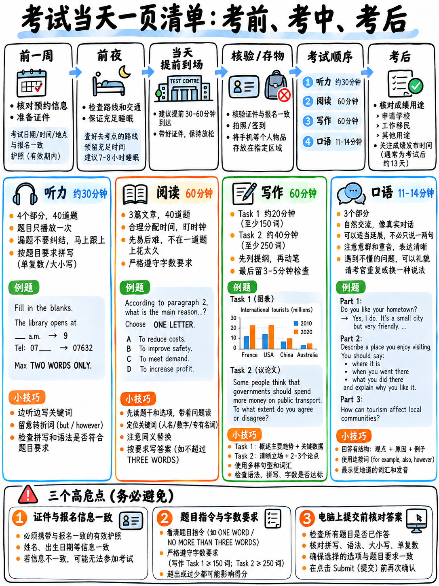

# 06. 考试当天全流程行动清单与心理战术防坑手册 (Exam-Day Checklist)



## 6.1 考前一周全流程战备清单 (The Week Before)

- [ ] **核验考试日期、准确场次时间与考点具体位置**：官方核心考务指引明确要求考生反复核实考场信息（"Double-check the date, time, and location of your test" `[1]`）。
- [ ] **确认口语考试具体时间与形式**：口语考试可能安排在笔试机考的**同一天，也可能在笔试前或后一周内**`[1]`。务必看清是现场真人面对面面试还是考场内视频通话。
- [ ] **核查报名证件原件及有效期**：确认携带你报名时填报的**同一有效身份证件原件**（身份证或护照），且必须在有效期内。考官在口语开考前会再次当面查验身份 `[13]`。
- [ ] **确认考试交付形式与界面要求**：目前全球雅思均已全面转向计算机机考（Computer-delivered）`[14]`；核实你所在的考点是否开放“纸笔作答写作（Writing on Paper）”选项，以及你此前选定的是哪一种 `[15]`。
- [ ] **无障碍便利安排确认**：若有特殊健康或无障碍需求，必须在考前至少 6 周完成官方申请 `[1]`。
- [ ] **终极全真模拟安排在考前 2 天，绝非考前 1 天**：考前 48 小时让大脑完成全真演练，考前 24 小时进入休息储能状态。
- [ ] **规划出行交通路线并预留 45 分钟缓冲余量**：防止极端天气、早高峰拥堵或地铁延误。

---

## 6.2 考前一晚心理与物资整备 (The Night Before)

- [ ] **坚决禁止刷任何新题与背诵生词**：今晚强行灌输的任何新语法和生僻单词，明早在考场上大脑均无法调用。
- [ ] **仅翻阅 6.7 节的“五大单页通关卡片”与个人专属红线拼写表**：只强化机械性防坑反射。
- [ ] **物资打包清单**：
  - [ ] 报名所用的身份证/护照原件；
  - [ ] 打印的准考信息确认信；
  - [ ] 透明无标签瓶装水（撕掉外部塑料包装纸）；
  - [ ] 考后补充能量的零食（如巧克力，存包备用）；
  - [ ] 一件保暖舒适的薄外套/卫衣（机考机房常年空调温度较低）。
- [ ] **大声朗读 10 道口语 Part 1 问答**：纯作为声带与面部肌肉的“暖嗓”运动。
- [ ] **进行 5 分钟发音影子跟读**：唤醒大脑英文语调节奏。
- [ ] **设置两个相互独立的闹钟**。
- [ ] **准时早睡（建议晚 10:30 前）**：睡眠对成绩的影响远远超过熬夜复习。

:::{warning} 考前自毁行为警示：严禁熬夜复习至深夜
雅思考试第一科就是听力，仅播放一次 `[1]` `[2]`，且要求长达 30 分钟无间断高度警觉；紧接着是长达 60 分钟高强度的学术阅读定位。疲劳应考的考生在听力中因注意力涣散丢失的客观题分数，远远多于熬夜突击能换来的任何微弱收获！
:::

---

## 6.3 考试当天早晨行动指南 (The Morning)

- [ ] **进食清淡高热量早餐**：听力、阅读、写作连续作战 **2 小时 45 分钟，中途全程无任何官方休息时间** `[1]`！
- [ ] **进考场前强制上一次洗手间**：考试期间若举手如厕，考试倒计时绝不暂停，消耗的是你宝贵的阅读与写作时间。
- [ ] **提前到达考场**：入场身份核验、电子人像采集与个人物品寄存均需要排队耗时。
- [ ] **赴考路上进行 2 分钟开口英语热身**：边走边随口说任何英文短句。声带冷启动的考生在口语首阶段往往容易显得迟疑卡顿，而迟疑会被直接计入流利度扣分 `[11]`。
- [ ] **手机与所有电子手表关机存入储物柜**：考场内严禁携带任何通讯与智能设备。

---

## 6.4 进入考场后至开考前操作 (In the Room, Before the Test Starts)

- [ ] **音量与耳机设备测试**：在试音阶段仔细确认两侧耳机是否有杂音、音量大小是否合适。若有任何杂音或接触不良，立即举手要求监考人员更换设备。
- [ ] **在草稿纸上写下 Reading 时间死线**：写下 `17 / 37 / 57 分钟` 节点（参见：{doc}`../40-reading/01-scoring-and-section-tactics` §40.1.2）。
- [ ] **在草稿纸上写下你的“前三大高频复发性语法错误”**（来自：{doc}`04-error-log-method` §4.5），提醒自己在写作时专门定向排查。
- [ ] **在草稿纸顶端写下大写字眼：“NO BLANKS（绝不留白）”**。

---

## 6.5 各科目考场全流程实战操作战术 (During Each Section)

### 听力实战（约 30 分钟）

- [ ] 在每部分录音开始前的读题时间内，**通读全部 10 道题目**。
- [ ] 紧盯**字数限制 (Word Limit)**，牢记连字符词算一词，数字单独计数。
- [ ] 为每个填空**预判词性与信息属性**（是名词、数字、日期还是动词）。
- [ ] **边听录音边在机考输入框敲入答案**。机考没有纸笔考当年的 10 分钟誊写答题卡时间 `[1]`！
- [ ] 一旦漏听某一题，**视线立刻向下移动，全力捕捉下一题**！漏一题仅失 1 分，纠结漏题会导致连丢 3 分。
- [ ] 遇到人名、日期和价格时，**必须等说话者把整个句子说完**，防范后半句的“更正干扰项 (Correction Distractor)”。
- [ ] 利用两题之间的对话停顿间隙，提前向后浏览后续题目。
- [ ] 最终检查阶段：**确保全卷零空白，全猜满**。

### 阅读实战（60 分钟）

- [ ] **严禁从头到尾精读文章**。先看标题与每段首句，立刻直奔题目。
- [ ] **执行题型进攻漏斗**：填空题 → TFNG / YNNG → 细节单选与人名配对 → 段落标题匹配 (Headings) → 段落信息匹配 (MI) 坚决留到最后。
- [ ] **严格执行单篇时间死线**：到第 17 分钟时，无论第一篇做成什么样，必须立刻切入第二篇；到第 37 分钟切入第三篇。
- [ ] 严格审查 **TRUE/FALSE/NOT GIVEN** 与 **YES/NO/NOT GIVEN**，严防写串题型判 0 分。
- [ ] 最后 3 分钟：**填补全卷所有留白**。雅思没有任何倒扣分 `[3]`！

### 写作实战（60 分钟）

- [ ] **先写 Task 1 小作文，掐表到第 20 分钟强行停笔收尾**。Task 2 大作文分值权重是小作文的整整两倍 `[10]`！
- [ ] **Task 1 核心段落骨架**：第 1 段改写题干 → **第 2 段概述总趋势（OVERALL，严禁包含具体数据）** → 第 3 段具体数据对比分析 → 第 4 段次要数据对比分析。
- [ ] **Task 1 铁律**：**严禁主观推测数据变化的原因**（如“因为经济危机所以下降了”，考官直接判扣分 `[10]`）。
- [ ] **Task 2 核心审题**：数清题目中有几个问号，确保正文全覆盖。
- [ ] **Task 2 首段亮明立场**：在引言段末尾直接给出你的清晰倾向。
- [ ] **Task 2 主体段闭环**：每个主体段严格遵循“中心句 → 理论解释 → 具体举例”结构。
- [ ] **全文连接词数量严格控制在 8 个以内**。滥用连接词是典型的 Band 5 扣分特征 `[8]`。
- [ ] **全卷严禁使用任何项目清单符号 (Bullet Points) 或笔记缩写** `[10]`。
- [ ] **留出最后 5 分钟执行单项定向扫描**：单复数 -s、主谓一致、冠词、逗号连句、机考字数达标确认。

### 口语实战（11–14 分钟）

- [ ] 从考官开门核对证件的第一秒起，保持微笑、眼神接触与声音洪亮。
- [ ] **Part 1 答题节奏**：每题回答 **2–3 句话**（核心回答 + 一句理由或细节拓展）。坚决不吐单字，也绝不长篇大论。
- [ ] **Part 2 充分用满 1 分钟草稿时间**：在纸上仅记录关键名词、动词与数字，绝不写整句。
- [ ] **Part 2 必须讲满整整 2 分钟**：如果话说完了考官没打断，立刻使用救场衔接句（如 *"Oh, I should also mention that..."*）。**被考官举手打断是官方标准化流程的必然动作** `[13]`，绝非扣分信号！
- [ ] **Part 3 答题节奏**：每题作答 **30–45 秒**（立场观点 → 论证因果 → 具体社会案例 → 审慎让步）。
- [ ] 遇到想不起来的生词时：**立刻用简单日常英语解释其功能**（如 *"I can't recall the exact word, but it's a device used for..."*）。这是官方评分标准明确加分的词汇技巧 `[11]`！
- [ ] 没听清考官提问时：坦然大方提问（*"Sorry, could you please repeat the question?"*）。
- [ ] 保持意群自然停顿，陈述句末尾音调自然下沉。
- [ ] 绝不要为了语法不出错而刻意把语速放得极慢。
- [ ] 保持体能与能量，最后两分钟依然维持充沛的精神面貌。

---

## 6.6 考后事务与成绩复查/重考政策 (Afterwards)

- [ ] **出分周期**：计算机机考成绩通常在考后 **1–5 个工作日内**在线公布；IELTS Online 约为 6–8 天 `[1]`。
- [ ] **单科重考机制 (One Skill Retake, OSR)**：  
  若有一门单科成绩未达申请门槛，可在**原考试日起 60 天内**报名申请单科重考。每场完整考试仅限申请一次单科重考，且必须在开放该功能的机考考点进行 `[16]`（详见：{doc}`../00-foundations/06-choose-your-target` §6.4）。
- [ ] **利用算术法则核算重考必要性**：  
  对照你的真实成绩单，运用 **(4 × 目标分) − 1** 计算四科总分（参见：{doc}`../00-foundations/03-how-scoring-works` §3.6）。很多时候仅需单科提升 0.5 分即可带动总分进位。
- [ ] **成绩有效期**：雅思官方成绩单在考试日起 **2 年内**全球有效 `[14]`。

---

## 6.7 考前随身必读：五大极简通关卡片 (The One-Page Cards)

建议将以下五张卡片打印或抄录在便签纸上，考前随时拿出来强化肌肉记忆。

### 卡片 1：非英语能力的送分防坑白皮书 (The Free Marks)

```
   ┌─────────────────────────────────────────────────────────────┐
   │  那些完全不考英语实力、却白白扣分的致命考场陷阱             │
   │                                                             │
   │   □ 客观题出现空白留白     → 雅思无倒扣分，必须全猜满！     │
   │   □ 突破字数上限           → 无论内容多对，多写一词判 0 分  │
   │   □ Wednesday / February   → 听力失分率最高的两个易错词     │
   │   □ thirteen 与 thirty     → 听力辨音看重音与结尾鼻音 /n/   │
   │   □ 名词复数漏写 -s        → 交卷前定向扫描所有泛指名词     │
   │   □ "the graph show" 漏-s  → 小作文首句主谓一致检查         │
   │   □ 泛指单数名词缺少冠词   → 单数可数名词绝不能光杆出现     │
   │   □ 逗号连句 (Comma Splice)→ 两个完整句之间必须有连词或分号 │
   │   □ 写作字数不足 150/250   → 基础量表惩罚，必须写够字数     │
   │   □ 写作使用清单标点符号   → 官方明文严禁笔记体与清单序号   │
   │   □ TFNG 与 YNNG 写串混用  → 严格按照各题题干说明书写       │
   │   □ 阅读第一篇耗时超25分钟 → 考场自杀式行为，严守时间死线   │
   └─────────────────────────────────────────────────────────────┘
```

### 卡片 2：四科核心解题一句话心法

```
   ┌─────────────────────────────────────────────────────────────┐
   │ 听力 LISTENING │ 录音前看完全部10题并预判空格。边听边打字。 │
   │                │ 漏听一题立即视线下移盯紧下一题。全卷零留白 │
   │                                                             │
   │ 阅读 READING   │ 坚决不读全文。填空→TFNG→单选配对→标题→MI   │
   │                │ 留最后。严守17/37/57死线。最后3分钟全猜满  │
   │                                                             │
   │ 写作 WRITING   │ T1严格掐表20分钟停笔。Overview段绝不写具体 │
   │                │ 数字。T2首段亮明立场，每个主体段观点+解释+ │
   │                │ 例证闭环。连接词≤8个。                     │
   │                                                             │
   │ 口语 SPEAKING  │ P1每题2-3句。P2讲满整整2分钟。P3每题30-45秒│
   │                │ 观点+展开+案例。想不起词就用简单英文解释。 │
   │                │ 在意群边界自然停顿。                       │
   └─────────────────────────────────────────────────────────────┘
```

### 卡片 3：大小作文结构骨架速览

```
   ┌─────────────────────────────────────────────────────────────┐
   │ 小作文 TASK 1 (20分钟)       大作文 TASK 2 (40分钟)         │
   │                                                             │
   │ ¶1 改写图表介绍题干         ¶1 背景改写 + 亮明清晰个人立场  │
   │ ¶2 OVERALL 概述 (无数据!)   ¶2 主体论点 1：中心句、深入解释 │
   │ ¶3 主题组 A 数据与极值           具体例证、回扣立场         │
   │ ¶4 主题组 B 数据与对比      ¶3 主体论点 2：相同严密结构展开 │
   │ (小作文无须写个人结论段)    ¶4 总结段：换词重述个人立场 +   │
   │                                  一句深远影响推演           │
   │                                                             │
   │ 篇幅建议：170–190 词         篇幅建议：270–300 词           │
   │ 历史数据统一使用一般过去时   坚决不用死记硬背的低分模板句   │
   │ 流程图统一使用一般现在时被动 严禁项目清单符号与笔记体       │
   │ 地图变迁统一使用过去时被动   小作文严禁主观脑补数据原因     │
   └─────────────────────────────────────────────────────────────┘
```

### 卡片 4：口语流利度引擎与救场衔接句

```
   ┌─────────────────────────────────────────────────────────────┐
   │ 自然开场   "Well, ..."  "I'd say..."  "It depends, really." │
   │ 阐述因果   "mainly because..."  "which is why..."           │
   │ 具体例证   "For instance..."  "In my own personal case..."  │
   │ 让步转折   "Having said that..."  "Although..."             │
   │ 学术软化   "tend to"  "roughly speaking"  "I suppose"       │
   │ 忘词救场   "I can't recall the exact word, but it's a thing │
   │            used for..."    ← 官方评分标准明文加分特征 [11]  │
   │ P2展开救场 "Oh, I should also mention that..."              │
   │            "Actually, a really good example was when..."    │
   │ P2多角推进 "There are two main reasons, really. The first   │
   │            is practical... while the second is personal..." │
   │                                                             │
   │ 核心原则：每个套话仅用一到两次。过度滥用会被判为公式化背诵 │
   └─────────────────────────────────────────────────────────────┘
```

### 卡片 5：算分数学公式与原始分锚点表

```
   ┌─────────────────────────────────────────────────────────────┐
   │ 核心算分公式：四科分数之和必须达到 (4 × 目标分) − 1   [7]    │
   │                                                             │
   │    总分 5.5 → 四科之和需 ≥ 21.0                             │
   │    总分 6.0 → 四科之和需 ≥ 23.0                             │
   │    总分 6.5 → 四科之和需 ≥ 25.0                             │
   │    总分 7.0 → 四科之和需 ≥ 27.0                             │
   │                                                             │
   │ 官方听力与学术阅读卷面原始分锚点换算参考：          [7]     │
   │    对 16/40 题 ≈ Band 5.0      对 23/40 题 ≈ Band 6.0       │
   │    对 30/40 题 ≈ Band 7.0      对 35/40 题 ≈ Band 8.0       │
   │                                                             │
   │ 黄金配比：听力 7.0 + 阅读 7.0 + 写作 5.5 + 口语 5.5 = 25.0  │
   │ 算术平均 6.25 进位为 6.5 分！用客观题的高分带动主观题及格！ │
   └─────────────────────────────────────────────────────────────┘
```

---

## 6.8 考前早晨 60 秒定心丸速览法则 (The Sixty-Second Version)

如果在开考前几分钟你只能看一眼手机或便签，请将以下 6 句话烙印在心头：

1. **听力**：录音播放前看完全部题目，边听边在电脑键盘上打字，漏听一题视线立刻下移，坚决不纠结。
2. **阅读**：死守 17 / 37 / 57 分钟时间线；先做填空和判断，段落信息匹配题留到最后；最后 3 分钟全卷填满。
3. **全卷零空白**：任何客观题绝不留白，没有倒扣分。
4. **写作**：小作文 20 分钟强行停笔，小作文必须有不含具体数字的 Overview 概述段；大作文第一段直接亮明个人立场；连接词不超过 8 个。
5. **口语**：持续开口；Part 1 答满 2–3 句；Part 2 讲满整整 2 分钟；不会说的单词用简单英语解释；遇到考官打断保持微笑。
6. **交卷前检查**：专门单项定向扫描你的个人前三大复发性语法硬伤，而不是漫无目的地“随便看看”。

---

**上一章：** {doc}`05-study-plans` | **下一章学习指南：** {doc}`07-free-tools-and-self-testing`
