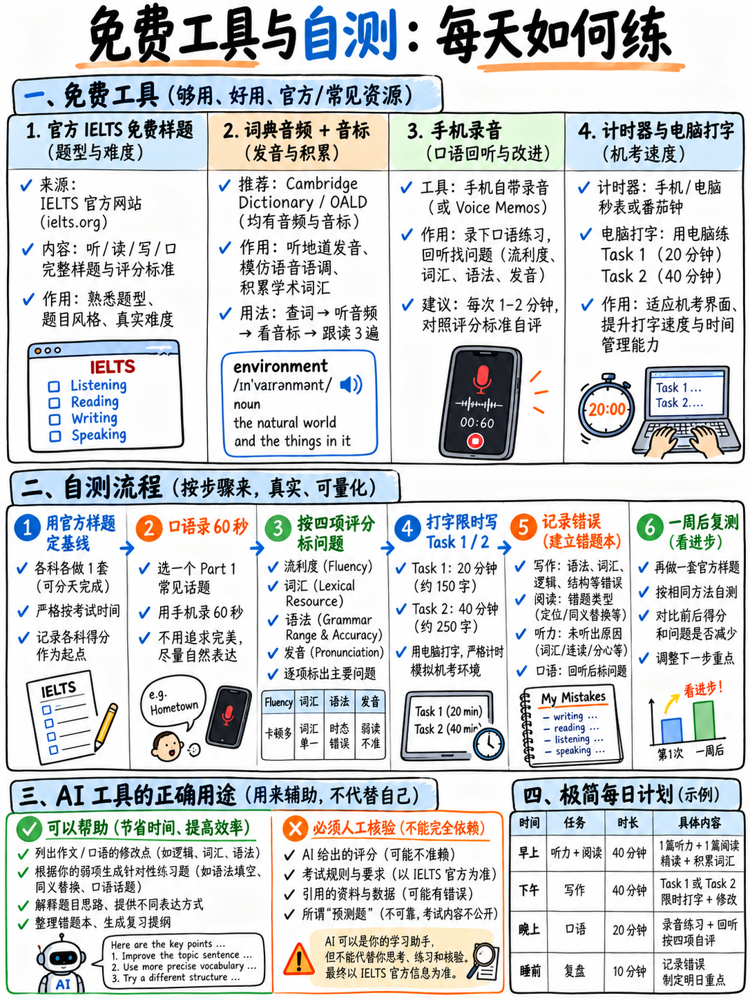

# 07. 官方与优质免费模考、自测自查工具推荐 (Free Tools & Self-Testing)



## 7.1 备考认知重塑：雅思学术类备考完全可以“零成本”通关

**你完全可以不花一分钱，单凭优质免费资源拿下雅思考试！**

市面上动辄数千甚至上万元的培训课程，往往充斥着过时的答题模板与无序的题海战术。本章系统整理了全球官方与权威机构公开的**高价值免费备考资源、单人模拟考场环境的标准流程、AI 工具的高效使用 SOP**，以及如果预算极为有限时，唯一的钱应该花在什么刀刃上。

---

## 7.2 官方权威免费核心资料库（第一优先使用）

在寻找任何第三方资料前，必须先吃透雅思考试三大主办方（剑桥大学考评部、英国文化教育协会 BC、IDP 澳洲教育）官方公开的免费素材：

| 官方权威备考材料 | 具体获取的内容与价值 | 官方来源与索引 |
|---|---|---|
| **各题型官方真题样题 (Sample Tasks)** | 涵盖 6 种听力与 11 种学术阅读官方样题，附带**官方标准答案与完整听力录音文本** `[18]` `[25]` | 官方 Sample Questions 专区 `[25]` |
| **官方机考全真网页模拟器** | 完整包含听力、学术阅读与学术写作，完全复刻考场屏幕界面与字数统计系统，包含“纸笔作答写作”选项体验 `[25]` | 官方模拟测试平台 `[25]` |
| **真实考生答卷与考官深度批注** | 官方公开的 **Band 4、5.5、6.0、7.5** 四档真实答卷，逐段附带考官详尽判分评语与扣分归因 `[12]` | 官方备考资源包 `[12]` |
| **官方口语实测场景与脚本** | 包含 Part 1 / 2 / 3 完整考官发问框架（Examiner Frame）与真实考生对答音频及文本 `[13]` | 官方口语真题库 `[13]` |
| **2023 年改版写作评分细则 (Band Descriptors)** | 官方考官给分的尺子！明确规定 0–9 各分档的扣分标准（尤其严惩模板背诵与生硬套话）`[8]` | 官方公开 PDF 规范 `[8]` |
| **官方口语评分细则 (Speaking Descriptors)** | 官方口语四维给分量表，明确定义 5 分与 6 分的流利度与发音分水岭 `[9]` | 官方公开 PDF 规范 `[9]` |
| **写作与口语关键评价维度解读指南** | 官方详细拆解 TR、CC、LR、GRA 每一个词条的真实评估意图 `[10]` `[11]` | 官方评估指南 `[10]` `[11]` |
| **考生全真手册《Guide for Test Takers (2026)》** | 最新考制规范、全真各科考试时长、分值换算表与出分周期 `[1]` | 官方考务手册 `[1]` |
| **纸笔模式写作标准答题卡** | 若选择纸笔手写作文，提供官方标准行距答题卡 PDF 可供打印操练 `[1]` `[25]` | 官方样卡下载区 `[25]` |

*上述官方文献的具体索引链接见：{doc}`../70-references/01-sources-and-reliability`。*

:::{important} 考前必做：下载并打印四份官方评分标准
请立刻下载并打印 `[8]`、`[9]`、`[10]`、`[11]` 这四份官方评分文件（总共约 20 页）。在每次练习写作文或自评口语时，**必须将评分量表平铺在桌面上逐条对照**。它们是考场上决定你考分的唯一法律条文，而 95% 的自学考生从未亲眼读过它们。
:::

---

## 7.3 听力音频单人自制与高效精听方案

自学听力最大的痛点是获取大量发音地道、难度匹配的音频。以下四种免费渠道足以支撑全周期训练：

| 训练路径 | 具体操作方法 | 最适合攻克的考点 |
|---|---|---|
| **文本转语音 (TTS)** | 将官方听力文本或真题段落粘贴至 TTS 工具中。现代浏览器与手机均内置“朗读”功能。建议选择**英音 (British) 或澳音 (Australian)**，以契合考场真实口音 `[1]`。 | 听力拼写听写、数字与日期训练、-teen/-ty 专项听辨 |
| **语伴朗读** | 学习伙伴朗读文本并为你读出姓名字母拼读与电话号码，高度还原 Part 1 | 听力 Part 1/2，最真实的免费模拟 |
| **自我录音次日复听** | 今天大声朗读一段听力文本并录音，次日拿自己的录音当作听力题作答 | 同时打通发音与听觉神经通路 |
| **带字幕英音纪录片** | 观看 BBC、TED 或高校学术讲座带字幕视频 | 适应 Part 4 学术语料与长句推进 |

### Linux 环境下的命令行极简音频处理脚本

若在无手机的纯开发环境或服务器端：

```bash
# 录制 60 秒口语练习音频
arecord -f cd -d 60 answer.wav

# 播放刚录制的音频
aplay answer.wav

# 利用 espeak-ng 生成地道英音听写音频 (语速 150 词/分钟)
espeak-ng -v en-gb -s 150 -f transcript.txt -w listening.wav

# 使用 ffmpeg 压缩为便于存档的 mp3 格式
ffmpeg -i answer.wav -b:a 64k answer.mp3
```

:::{tip} 铁律：从第一天起就坚持在常速（1.0x）下练习听力
很多考生喜欢把音频放慢至 0.75x 播放，这会产生虚假的掌握感并彻底破坏考场听力节奏——因为考试只播放一次且语速固定 `[1]` `[2]`。如果一段录音太难听不懂，**不要减速，而是听两遍**：第一遍全盲听模拟考试打分，第二遍**打开听力文本对照着听**，找出自己究竟错在哪。这第二遍的精听才是真正让你涨分的环节！
:::

---

## 7.4 键盘打字速度：机考时代的隐形提分杠杆

由于全球雅思已全面普及计算机机考 `[14]`，**键盘英文打字速度直接决定了你的写作分数上限**！

打字过慢会严重蚕食你本应用于审题构思、段落逻辑推演与交卷前检查的时间（参见：{doc}`../30-writing/01-how-writing-is-scored` §30.1.7）。

| 你的英文打字速度 | 对写作考场发挥的实质性影响 | 针对性行动方案 |
|---|---|---|
| **低于 20 wpm** (词/分钟) | **极其危险**。几乎注定无法在 40 分钟内写完大作文，或写完后完全零检查时间。 | 每天抽出 20 分钟在免费打字练习网站训练盲打。这是见效最快的提分动作。 |
| **20–30 wpm** | 能够勉强写完，但仅剩不到 2 分钟做仓促检查。 | 每天 10 分钟强化键位熟练度。 |
| **30–45 wpm** | **非常理想**。构思与输入平稳，留出 5–8 分钟深度检查。 | 保持现有习惯即可。 |
| **45 wpm 以上** | 打字速度已不再是制约分数的瓶颈。 | 无需额外练习打字。 |

**考场时间数学测算**：  
完成一篇 180 词的小作文加上一篇 290 词的大作文，考生在 60 分钟内总共需要输出约 **470 个英文单词**。  
- 在 **20 wpm** 速度下，仅纯物理打字就需要消耗 **24 分钟**；
- 在 **10 wpm** 的二指禅摸键盘速度下，纯打字就要耗尽 **47 分钟**！只剩下区区 13 分钟用于两篇作文的审题、构思、行文修改与语法纠错——这就是导致绝大多数考生小作文写不完的隐形元凶！

:::{tip} 最佳打字训练法：直接在屏幕上照抄打字官方 7.5 分范文
与其玩无意义的打字游戏，不如直接对照屏幕敲下官方 Band 7.5 真实考官满分答卷 `[12]`。  
这个动作一石三鸟：**既操练了键盘盲打速度，又吸收了考官认可的高分句式，还亲身体会到了 375 词在屏幕上所呈现的物理长度和篇幅感！**
:::

---

## 7.5 权威英英词典与发音自查工具推荐

| 实用工具 | 核心功能与使用姿势 | 备考实战建议 |
|---|---|---|
| **剑桥词典 / 牛津高阶 / 朗文 / 韦氏词典** | 免费在线英英释义，提供权威国际音标 (IPA) 与**真人英美音发音**。查词时必须核对单词的重音符号。 | 优先查看例句与搭配，参见 {doc}`../10-pronunciation/01-start-here-sound-system` §10.1.4。 |
| **British Council 音标发音图 / LearnEnglish Sounds Right** | 英国文化教育协会官方交互式 44 音标表，每个音标均有高保真真人发音与单词范例 `[21]`。 | 针对性纠正中式英语易混淆的元音与辅音。 |
| **在线搭配词典 (Collocation Dictionaries)** | 写作词汇的核心在于搭配：如 *heavy traffic*, *take measures*, *make progress*。搭配能力在 LR 量表中被直接评分 `[10]`。 | 写作遇到动宾搭配犹豫时，使用搭配词典排查。 |

:::{warning} 严禁使用中英双语直译机器翻译软件作为核心词典
双语直译软件往往只给出孤立的中文对应词，完全脱离了学术语体（Register）、搭配习惯（Collocations）与单词重音。这是导致考生在作文中写出生硬辞藻、使 Lexical Resource 被死死卡在 Band 5 的核心诱因 `[8]`。  
在官方 Band 5.5 真实样卷中，考生因为双语直译把日常饮食写成了医学罕见词 *"alimentation"*，被考官在评语中直接点名批评扣分 `[12]`！请坚决使用英英学习词典。
:::

---

## 7.6 单人备考时，如何科学模拟最难单人模拟的环节？

### 科学模拟口语实战考场（无需昂贵陪练）

考生无法凭空变出一个真人考官，但考生完全可以**高度还原考场的施压条件**：

| 考场真实环境要素 | 单人条件下的科学模拟方案 |
|---|---|
| **考官的标准化固定提问用语** | 大声朗读官方口语考官脚本 `[13]` 并录音，播放录音作为考官发问，自己面对麦克风作答。 |
| **考场零思考准备时间** | 看到屏幕或纸面题目的第一秒立刻按下录音键，逼迫自己即时开口，严禁停下来反复打腹稿。 |
| **Part 2 严格的一分钟草稿时间** | 手机设置 60 秒倒计时，倒计时一响必须停笔；紧接着设置 2 分钟倒计时录音作答。 |
| **在 2:00 被考官无情举手打断** | 手机闹钟设置在 2 分 00 秒蜂鸣，听到声音哪怕话只说了一半也必须当场闭麦，适应被打断的心理节奏。 |
| **长达 14 分钟的全程精力耐力** | 坚决不进行 2 分钟的碎片练习，每次模考必须一口气连贯完成 Part 1 → Part 2 → Part 3 全流程 14 分钟。 |
| **考官的追问与质疑挑战** | 录制一段自己用严厉语气追问 *"Why do you think so?"* 或 *"Could you be more specific?"* 的音频插入在回答后。 |

### 科学模拟机考阅读的屏幕化体验

| 机考阅读实战要素 | 真实模拟执行方案 |
|---|---|
| **面对电子屏幕阅读长文** | 所有阅读练习必须在电脑屏幕或平板上阅读 PDF，坚决戒除打印成纸质试卷的习惯。 |
| **高亮划线与便签功能** | 使用 PDF 阅读器或浏览器的标注功能练习荧光笔高亮核心定位词。 |
| **没有页边空白做笔记** | 适应在屏幕右侧直接作答，不在文章旁边乱写乱画。 |
| **使用官方机考练习界面** | 考前至少完整体验两次官方公开机考在线测试系统 `[25]`。 |

### 科学模拟连续 2 小时 45 分钟无间断实战

在正式考试前，**至少进行两次完整的全真连堂模考**：  
严格按照考场真实顺序：**听力 (30分) → 阅读 (60分) → 写作 (60分)，中途全程不休息、不看手机、不吃零食** `[1]`。  
最后 20 分钟大作文撰写时的脑力疲劳是极其真实的生理挑战，唯有通过全真连堂演练才能建立起稳定的生理心理耐受力。

---

## 7.7 如果预算极度有限，唯一的钱应该花在哪里？

本课程主张零成本备考。但如果你的备考预算极其有限（如数百元人民币），以下是按照提分产出性价比（ROI）严格排列的付费建议：

| 优先级 | 唯一值得付费的项目 | 核心依据与无可替代的理由 |
|---|---|---|
| **第 1 优先** | **1–2 本正版《剑桥雅思真题集》（剑 10–20）** | 官方退役真题库，配有权威原声听力与标准答案，是校准自身分数的唯一可靠标尺。 |
| **第 2 优先** | **1–3 小时专业资深雅思考官/名师的【写作人工批改】** | **写作是全场唯一考生完全无法进行客观自我评估的科目！** 3 篇带详尽维度归因的精批，胜过自己盲目写 30 篇不复盘的作文。 |
| **第 3 优先** | **1 小时专业考官一对一【口语全真诊断】** | 只为解决一个核心问题：“究竟是什么顽疾死死把我的口语按在 5.5 分？” |
| **第 4 优先** | 官方推出的机考额外模考卷 | 难度最为精准校准。 |
| **坚决不要付费的智商税清单** | **所谓“考前预测机经”、“包过班”、“名师 9 分范文大全”** | 雅思官方从不泄露题库；网络上来源不明的所谓高分范文充斥着公式化模板套话，极易直接触发官方 Band 4 判分惩罚 `[8]`（参见 {doc}`../00-foundations/05-glossary-and-question-banks`）。 |

:::{important} 预算精打细算：如果只能买一样东西，买写作批改
听力和阅读有标准客观答案，对完答案错题日志就能自愈。发音可以通过自己的录音回听排查。**唯独写作，初学者无法客观对照四项量表评判自己的逻辑严密性与语体层级**。3 篇高质量的专业人工批改，能帮你把复习方向校准数个月。
:::

---

## 7.8 科学使用 AI 辅助工具的 SOP (Use AI Wisely)

AI 语言模型是极其强大的免费私人家教，但若使用不当，其副作用足以摧毁考生的写作与口语分数。

| 强烈推荐使用的 AI 辅助场景 | 为什么极其有效？ | 实操 Prompt 示范 |
|---|---|---|
| **解释语法错题背后的机制** | 快速、精准，且可以针对模糊点连续追问 | *"请用通俗中文解释这句话中的语法错误：[句子]，并指出违反了哪条学术英语规则。"* |
| **生成针对性的数据图表与辩论题目** | 提供源源不断且贴合雅思题材的全新题干 | *"请依据雅思学术类 Task 1 风格，设计一组关于英国不同年龄段通勤方式的模拟表格数据与题干。"* |
| **单项排查自己作文中的机械失误** | 协助扫描冠词、单复数 -s 与标点错误 | *"请扮演语法校对员，只找出以下作文中的【冠词、名词单复数、标点符号】错误，列出清单，不要重写全文：[作文文本]"* |
| **制作听写操练语料** | 结合考点生词生成学术语境短句 | *"请用 accommodation, environment, separate 这三个词，造出三句符合雅思听力 Part 1/2 风格的听写真题句子。"* |
| **剖析官方高分范文的逻辑骨架** | 将文字拆解映射到评分标准细则中 | *"请对照雅思写作 Band 7.5 评分标准，深度解析这篇文章的主体段是如何做到论据闭环的：[范文]"* |
| **同义词改述口语专项对练** | 锻炼忘词时的同义描述能力 | *"请随机列出 5 个日常用品，我将用简单英文解释其功能，请评价我的解释是否清晰自然。"* |

| 坚决禁止的 AI 错误使用方式 | 为什么具有毁灭性危害？ |
|---|---|
| **直接背诵 AI 生成的所谓“满分范文”** | AI 生成的散文往往极度空洞、高度套路化，充斥着 *"In today's rapidly changing modern society"* 等陈词滥调。这正是官方 Band 4 词汇量表明确惩处并直接降级的公式化语言（Formulaic language）`[8]`！ |
| **盲目迷信 AI 给你的作文打出的分数** | AI 没有经过官方真题考官的标定校准，给分通常严重虚高（动辄虚假评出 7.0–8.0 分），给考生造成盲目乐观的致命错觉。 |
| **直接让 AI 全篇重写润色你的文章** | 读一篇被高级 AI 重写得天花乱坠的文章，无法让你获得任何实际写作能力的提升。要求其列出**错误类型清单**，然后由你自己亲手修改，才能形成有效神经记忆。 |
| **让 AI 预测下周末考试的具体考题** | 任何人都无法预测官方题库。 |

:::{danger} 防范 AI 语体污染：你的文章必须是真实的考生论述
考官每天批改上百份答卷，对 AI 特有的辞藻堆砌、虚假平衡、滥用连接词（如 Furthermore, Moreover, In conclusion 通篇飞舞）具有极高的职业敏感度。这完全吻合官方量表中由于“过度机械使用连接手段”而被判定在 **Band 5–6** 的扣分特征 `[8]`！  
**永远以官方公开的 4 篇带考官评语的真实考生试卷 `[12]` 为唯一标准进行标定！**
:::

---

## 7.9 极简每日备考工具箱清单 (A Minimal Daily Kit)

你备考雅思所需要的全部装备，仅此而已：

- [ ] 一台带有键盘与屏幕的电脑，用于机考阅读练习与官方机考模拟器 `[25]`
- [ ] 一副舒适降噪的头戴式耳机
- [ ] 录音设备（手机自带录音机即可）
- [ ] 文本转语音工具（手机或电脑内置朗读功能）
- [ ] 一本带真人发音与英英释义的权威学习词典（如剑桥在线词典）
- [ ] 一个计时器（手机秒表即可）
- [ ] 纸和笔，用于速记笔记与记录错题复盘日志
- [ ] 官方四份公开评分细则标准文件（`[8]`, `[9]`, `[10]`, `[11]`）已下载存盘
- [ ] 官方公开的 7 套听力样题录音文本与标准答案 `[18]`
- [ ] 1–2 本正版《剑桥雅思真题集》（若条件允许）

这就是全部。除此之外，无需添置任何冗杂材料。

---

**上一章：** {doc}`06-exam-day-checklist` | **下一章学习指南：** {doc}`../70-references/01-sources-and-reliability`
