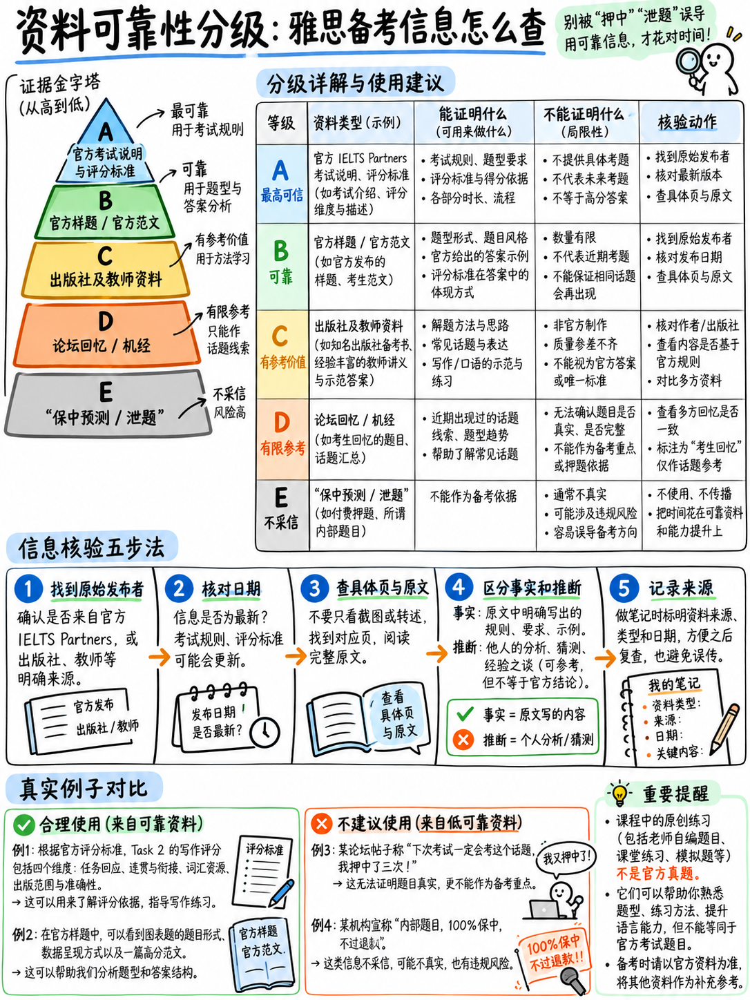

# 01. 官方权威资料来源与可信度分级 (Sources & Reliability)

本知识库中的每一项事实性主张、数据引用与评分标准，均可严格追溯至下文列出的编号文献。每一条目均明确阐述**该原始文献实际证明了什么**，以便考生能够亲自核验考据，并清晰区分“官方白纸黑字的定论”与“本课程的独家教研推导”。

**所有官方引用链接均已于 2026 年 10 月 11 日完成逐一实测核验**，主列表中的所有官方 URL 在该日期均返回 HTTP 200 正常响应。

---

## 1.1 本知识库资料可信度分级体系 (Reliability Grades)

| 可信度等级 | 严格定义与属性 | 在本教材中出现的对应内容范围 |
|---|---|---|
| **官方直引 (Official — quoted)** | 直接字面引用自雅思三大主办方的现行官方出版物与公报。作为**不可动摇的客观事实**对待。 | 考试形式、各科计时、题目数量、字数下限、评分量表、核心考核指标、原始分锚点、2026 全面机考官方公告。 |
| **官方释义 (Official — paraphrased)** | 将官方复杂的学术或法律表述用更通俗浅显的语言进行重述。 | 考场流程描述、证件核验、报名及退考规程。 |
| **专业推导 (Analysis)** | 基于官方已知事实，经过严密数学与教研逻辑推导出的实战模型（均有明确标注）。 | 全部题型优先级（Tier S/A/B/C）、备考时间精力预算比例、实操目标做对题数表、单题时间成本模型、提分速度预期。 |
| **原创实战训练素材 (Authored practice material)** | 由本课程教研团队依据官方真题语域、词频与设问风格自编的演练材料。 | 针对性阅读短篇、跟读听写语料库、范文样本、Task 2 演练命题、口语任务卡。 |
| **社群非官方参考 (Community — unverifiable)** | 教师网站与考生社群回忆整理的非官方资料。仅可作为补充练习语料，**绝不可作为押题依据**。 | 近期口语与写作热点话题池。 |
| **未完全证实项 ([Unverified])** | 暂未在官方公开文件中检索到明确书面定论的民间说法（均在文内醒目标注）。 | 3 项具体考场细节主张——详见 §1.4。 |

---

## 1.2 一级官方权威来源 (Primary Sources)

雅思（IELTS）由英国文化教育协会（British Council）、IDP 教育集团（IDP: IELTS Australia）以及剑桥大学考评部（Cambridge University Press & Assessment）共同拥有与运营。引用的相关内容版权归属于主办方，此处出于学术研究与备考指导目的进行规范引用。

**[1]** 雅思主办方（IELTS Partners）. *IELTS Guide for Test Takers（雅思考生指南）.* © 2026 Cambridge University Press & Assessment. 12 页.  
`https://ielts.org/cdn/ielts-downloadable-assets/ielts-guidance-and-support/ielts-guides/ielts-guide-for-test-takers.pdf`  
→ *证明内容：* 考试总时长为 2 小时 45 分钟；听力、阅读、写作同场连续进行且中途无休息；口语安排在笔试当天或前后一周内；听力四大板块划分（含 Part 3 中“至多 4 人的学术讨论”）；涵盖的四种口音类型；写作两篇作文的最低字数下限与建议时间；口语三个阶段划分及耗时；官方 9 分制完整描述语；出分周期（机考 1–5 天，在线考试 6–8 天）；考点考试全面由计算机终端交付；特殊考试安排需提前 6 周申请；纸笔听力曾有的 10 分钟誊写时间以及阅读从未有过誊写时间。

**[2]** 雅思官方（IELTS）. *IELTS Academic format – Listening（学术类听力考试结构说明）.*  
`https://ielts.org/take-a-test/test-types/ielts-academic-test/ielts-academic-format-listening`  
→ *证明内容：* 时长约 30 分钟；4 个板块，每部分 10 题，共 40 题；录音仅播放一次；听力 6 大官方题型；每答对 1 题计 1 分；成绩按整分或半档发放。

**[3]** 雅思官方（IELTS）. *IELTS Academic format – Reading（学术类阅读考试结构说明）.*  
`https://ielts.org/take-a-test/test-types/ielts-academic-test/ielts-academic-format-reading`  
→ *证明内容：* 时长整 60 分钟；3 个独立自然篇章；全卷文章总长度 2,150–2,750 词；共 40 题；学术类阅读 11 大官方题型；每答对 1 题计 1 分；连字符单词计为一个单词，缩写词不计入考查。

**[4]** 雅思官方（IELTS）. *IELTS Academic format – Writing（学术类写作考试结构说明）.*  
`https://ielts.org/take-a-test/test-types/ielts-academic-test/ielts-academic-format-writing`  
→ *证明内容：* 时长整 60 分钟；两篇必写任务；150 词与 250 词的字数下限要求；四大评分维度；Task 2 的分值权重大于 Task 1。

**[5]** 雅思官方（IELTS）. *IELTS Academic format – Speaking（学术类口语考试结构说明）.*  
`https://ielts.org/take-a-test/test-types/ielts-academic-test/ielts-academic-format-speaking`  
→ *证明内容：* 时长 11–14 分钟；三个环节及其单独时长；Part 2 提供 1 分钟纸笔准备与至多 2 分钟的个人陈述；考试全程录音。

**[6]** 雅思官方（IELTS）. *Academic test format in detail（学术类考试细则深度说明）.*  
`https://ielts.org/organisations/ielts-for-organisations/test-types/ielts-academic-test/academic-test-format-in-detail`  
→ *证明内容：* 阅读文章选材出处（“面向非专业受众编撰的书籍、学术期刊、知名杂志、报纸及权威网络资料”）；文体风格（“叙述性、描述性或论说学术思辨性”）；“至少有一篇文章包含详尽的复杂逻辑论证”；“所有专业术语均附有通俗词典解释”；听力与阅读的全套官方题型清单。

**[7]** 雅思官方（IELTS）. *IELTS scoring in detail（雅思评分机制深度说明）.*  
`https://ielts.org/take-a-test/your-results/ielts-scoring-in-detail`  
→ *证明内容：* 官方 9 分制能力标签；**官方平均原始分锚点**（听力 Band 5 = 16，Band 6 = 23，Band 7 = 30，Band 8 = 35；学术类阅读对应为 15，23，30，35），并郑重警示该数据为平均值且“在不同试卷版本间略有波动”；学术类与培训类阅读具有不同原始分换算门槛；写作四大维度与口语四大维度**等权重计分（各占 25%）**；**总成绩为四科平均分修约至最近半档，.25 进位至 .5，.75 进位至下一个整分**；以及本课程在 {doc}`../00-foundations/03-how-scoring-works` §3.6 引用的三组官方算分范例。

**[8]** 雅思主办方（IELTS Partners）. *IELTS Writing Band Descriptors（雅思写作评分标准细则）.* **2023 年 5 月正式更新版.** 9 页.  
`https://ielts.org/cdn/Guides/ielts-writing-band-descriptors.pdf`  
（备用官方存储节点：`https://ielts.org/cdn/ielts-downloadable-assets/ielts-guidance-and-support/ielts-guides/ielts-writing-band-descriptors.pdf`）  
→ *证明内容：* Task 1 与 Task 2 涵盖 Band 0–9 的全部四维标准细则；明确规定“考生答卷必须完全契合某一档位的全部正面特征”；黑体字明确标示“限制分数的负面特征”；**Band 6 语法维度的“容错冒险者条款”**；Band 5 与 Band 6 关于“过度使用衔接手段（Overuse of cohesive devices）”的降级特征；Band 0–4 关于**死记硬背语言**的严厉惩处（包括 Band 0 针对“有确凿证据证明全篇背诵”的零分裁定）；**20 词或以下直接判 Band 1** 的硬性规则；Band 3 关于字数不足的描述；“抄录题目的语句必须直接核减”。**这是全套课程体系中权重最高的一级核心纲领文件。**

**[9]** 雅思主办方（IELTS Partners）. *IELTS Speaking Band Descriptors（雅思口语评分标准细则）.* 4 页.  
`https://ielts.org/cdn/ielts-guides/ielts-speaking-band-descriptors.pdf`  
（备用官方存储节点：`https://ielts.org/cdn/ielts-downloadable-assets/ielts-guidance-and-support/ielts-guides/ielts-speaking-band-descriptors.pdf`）  
→ *证明内容：* 流利性与连贯性、词汇多样性、语法多样性及准确性、发音四个维度的 Band 0–9 完整标准；考生必须完全契合对应分段正面特征；考官评定考生“在全场所有环节中的整体平均综合水准”；**Band 6 发音维度的核心要求**（“意群切分总体得体……考官基本无需费力即可轻松理解整场表达”）；**Band 5 与 Band 7 发音完全是依附于双数分档进行相对界定**；Band 5 关于“过度使用特定语篇标志词”的特征；Band 6 关于“乐于展开长篇陈述”与“通常能有效进行转述改写”的规定；机械记忆话段仅在 Band 1–3 中出现。

**[10]** 雅思主办方（IELTS Partners）. *IELTS Writing Key Assessment Criteria（雅思写作核心评价指标解析）.* 4 页.  
`https://ielts.org/cdn/ielts-downloadable-assets/ielts-guidance-and-support/ielts-guides/ielts-writing-key-assessment-criteria.pdf`  
→ *证明内容：* 四大维度考核细节的逐项释义；**两篇作文独立评卷且 Task 2 占更大分值比重**；明文规定**“若存在部分或全部抄袭，或未采用完整连贯语句成文（如在任何部分使用项目符号列表 Bullet points 或笔记形态），将被严肃扣分”**；学术类 Task 1 **“具有固定的输入信息和高度可预测的输出……属于信息转述型任务……切忌脱离数据进行主观臆测解释”**；Task Achievement 考核的 5 大核心要素；Task 2“论据可取材于考生自身的经历与日常思考”；拼写与词形变换计入 LR，标点符号计入 GRA。

**[11]** 雅思主办方（IELTS Partners）. *IELTS Speaking Key Assessment Criteria（雅思口语核心评价指标解析）.* 4 页.  
`https://ielts.org/cdn/ielts-downloadable-assets/ielts-guidance-and-support/ielts-guides/ielts-speaking-key-assessment-criteria.pdf`  
→ *证明内容：* 口语四大维度的官方定义与关键指标；流利度指标包含**“语速理想，不可过慢”**，惩罚“假开头、倒流重复、无意义的机械重复以及为了搜索单词而导致的停顿卡顿”；词汇维度明确涵盖**“转述释义能力（The ability to use paraphrase，即遇到生词时用其他词绕道解释清楚的能力）”**；**发音考查排在首位的第一核心指标是“将连续话语切分为有意义的意群单元（Chunks）的能力”**，随后是节奏、重音计时、连读与弱读，而单音素的发音仅排在**第四位**；强调考查“口音对可理解度的综合影响”。

**[12]** 雅思主办方（IELTS Partners）. *Sample Candidate Writing Responses and Examiner Comments (Academic)（学术类写作考生实考答卷及考官权威评语）.* 5 页.  
`https://ielts.org/cdn/computer-delivered-sample-tests-academic-writing/ielts-academic-writing-example-responses-to-parts-1-and-2-with-band-scores-and-examiner-comments.pdf`  
→ *证明内容：* 四份附有官方认证成绩与考官逐字评析的真实考生答卷——学术类 Task 1 获得 **4.0 分**（119 词）与 **6.0 分**（229 词）；Task 2 获得 **5.5 分**（201 词）与 **7.5 分**（375 词）。提供了考官认可的高分特征（如“An alternative position is also considered but rejected”，“展现了更高级的语言特征，例如运用委婉软化语态 Softening，如 'They tend to', 'This appears to be', 'might disagree'”）；以及考官严厉批评的失分特征（如**“第二段过度堆砌使用顺承连接词 [Firstly | So | Also | Yet]”**，“过度依赖短小句型”，“描述过于机械化”，“未达到最低字数要求”，“受到考生第一母语负迁移影响，如生造词 'alimentation'”）。**这是全球范围内唯一公开的带官方确凿分值的真实范文校准依据。**

**[13]** 雅思主办方（IELTS Partners）. *IELTS Speaking Sample Tasks（雅思口语官方全套样题）.* 2023 年版. 7 页.  
`https://ielts.org/cdn/ielts-downloadable-assets/ielts-sample-tests/ielts-speaking-sample-tasks-2023.pdf`  
→ *证明内容：* 涵盖 Part 1、Part 2、Part 3 的全套完整口语考题——Part 1 考官引导话术与家乡、居住环境提问；Part 2 任务卡（“Describe something you own which is very important to you”）及其 3 个核心问点与“and explain”归纳点，以及考官收尾追问；Part 3 考官引导演示——**附带真实考生的完整文字答录转录**。证实了考官的标准串场台词，包括那句著名的“Remember you have one to two minutes for this, so don't worry if I stop you. I'll tell you when the time is up.”。

**[14]** 雅思官方（IELTS）. *Updates to IELTS test delivery（雅思考试交付模式重大变革通告）.* 发布于 **2026 年 3 月 5 日**.  
`https://ielts.org/news-and-insights/updates-to-ielts-test-delivery`  
→ *证明内容：* **“自 2026 年中起，我们将不再提供雅思纸笔考试模式”**，且**“所有雅思考试将全面转为计算机机考交付”**；UKVI SELT“将仅支持纯数字化机考模式”；具体交替时间表依各地区市场而定；现有纸笔考试成绩在 2 年有效期内继续全面有效；大规模实测证实机考与纸笔考试具有高度的分数可比性。

**[15]** 雅思官方（IELTS）. *Updates to IELTS Writing test delivery mode (Writing on Paper)（雅思机考·纸笔写作模式官方说明）.*  
`https://ielts.org/organisations/ielts-for-organisations/test-types/ways-to-take-ielts/updates-to-ielts-writing-test-delivery-mode`  
→ *证明内容：* 纸笔写作模式自 2026 年中起在部分选定国家和地区试点开放，适用于学术类与培训类；考生在考场领取官方答题纸（Answer Sheet）并使用黑色水笔手写答卷；题目、评分标准与考试时长与标准机考完全一致；**该模式不支持英国签证及移民类雅思（UKVI）**；若选择该模式，写作单科重考（OSR）亦必须采用纸笔手写；2025 年 11 月实地试验确认两种书写模式得分一致。

**[16]** 雅思官方（IELTS）. *IELTS One Skill Retake（雅思单科重考官方规程）.*  
`https://ielts.org/take-a-test/booking-your-test/one-skill-retake`  
→ *证明内容：* **“在原考试日起 60 天之内完成单科重考”**；**“每次全科考试仅限申请一次单科重考”**；听说读写四科均可任选一门重考；原考试必须是在支持 OSR 的考点完成的机考；重考后发放包含新单科成绩的全新成绩单（TRF），考生可自由选择使用原成绩单或新成绩单；出分通常 3–5 天；各院校机构认可政策存在差异，须考前向申请院校确认。

**[17]** 雅思官方（IELTS）. *Test statistics 2024–2025（雅思全球考生成绩官方统计年报）.*  
`https://ielts.org/researchers/our-research/test-statistics`  
→ *证明内容：* 统计周期内全球考生的平均表现——听力全球平均分为 **6.45 分**，学术类阅读全球平均分为 **6.32 分**。

**[18]** 雅思主办方（IELTS Partners）. *Sample Listening tasks: recording transcripts and answer keys（官方听力各题型录音原文与标准答案库）.* 共 7 份独立 PDF，归档于 `https://ielts.org/cdn/computer-delivered-sample-tests-listening/`，可从 **[25]** 索引访问.  
→ *证明内容：* 官方听力 7 大题型的真实录音文本与标准采分答案——包括表格笔记填空（*round · 12 years · 4 · green · reasonable · 1.20 metres · lock*）、句子填空（*motivation · time(-)management · modules · summer school(s)*）、图表标签填空（*H · A · C*）等。同时证实了**官方参考答案允许使用括号标明可接受的复数或符号变形**，如 "tutor(s)", "time(-)management"。

**[19]** 雅思官方（IELTS）. *Differences between IELTS 6 and 7 for productive skills（官方解读：雅思 6 分与 7 分在输出类科目中的核心差异）.*  
`https://ielts.org/news-and-insights/differences-between-ielts-6-and-7-for-productive-skills`  
→ *证明内容：* 雅思官方以通俗语言对口语和写作从 6 分跨越到 7 分的核心本质进行对比阐释。注：该文献为通俗释义，当与评分量表出现细微差异时，以 **[8]** 和 **[9]** 原始量表为准。

**[20]** 雅思官方（IELTS）. *Everything you need to know about IELTS and the CEFR（雅思与 CEFR 换算全景指南）.* 发布于 **2023 年 11 月 17 日**.  
`https://ielts.org/news-and-insights/everything-you-need-to-know-about-ielts-and-the-cefr`  
→ *证明内容：* 雅思 5.5–6.5 对应 CEFR **B2**；雅思 7.0–8.0 对应 **C1**；~9.0 对应 C2；官方定性该文为极速速查指南；CEFR 并非认证体系，各机构自主对标。官方未发布精确到每个小数点的全量对标表。

**[25]** 雅思官方（IELTS）. *Sample test questions — Academic test（官方学术类全套公开样题总索引库）.*  
`https://ielts.org/take-a-test/preparation-resources/sample-test-questions/academic-test`  
→ *证明内容：* 官方免费真题资源的汇总中枢——包含听力和学术类阅读全题型样题、参考答案、听力录音与原文；学术类写作范文批注 **[12]**；口语样题文本 **[13]**；以及**全真机考在线模考系统（涵盖听力、阅读、写作及纸笔写作机考体验）**。

---

## 1.3 二级与社群参考资料 (Secondary Sources)

下述文献**非雅思官方文件**。本教材在此完整列出，并向读者明确界定其真实使用边界：

**[21]** 英国文化教育协会（British Council）. *Phonemic chart (国际音标语音图表)* 与 *LearnEnglish Sounds Right 应用*.  
`https://www.teachingenglish.org.uk/teaching-resources/teaching-secondary/teaching-tools/phonemic-chart` 与 `https://learnenglish.britishcouncil.org/apps/learnenglish-sounds-right`  
→ *使用范畴：* 英语国际音标（IPA）标准架构——44 个基础音素，划分为 12 个单元音（7 短 5 长）、8 个双元音与 24 个辅音；作为各单音的标准发音音频参照。**可信度：高（BC 为雅思主办方之一，但该材料属基础教学教具，非雅思考试规范）**。注：2026 年 10 月 11 日测试时，自动化爬虫请求返回 HTTP 403，但在常规浏览器中正常访问。个别音标统计在不同学术版本间微有出入（如 /ʊə/ 的存废），详见 {doc}`../10-pronunciation/01-start-here-sound-system` §10.1.2。**没有任何雅思得分取决于你采用哪种音标图表体系。**

**[22]** IELTS Liz（资深雅思名师教研网）. *IELTS Speaking Topics 2026（2026 雅思口语话题集）.* `https://ieltsliz.com/ielts-speaking-topics-2026/`  
→ *使用范畴：* 印证 Part 1 开场必问话题（工作/学业、家庭、家乡、住宿环境）具有绝对稳定性，以及归纳 Part 2 话题卡轮换规律与 Part 3 母题家族。**可信度：在教学方法论上为中高，在话题覆盖上为中等，作为考题预测则极低。** 网站作者明确指出雅思官方“从未向公众公布口语题库”，其清单为民间整理。

**[23]** Cathoven 教学教研库. *IELTS Speaking Part 2 cue card bank* 与 *Common IELTS Writing Task 2 Topics 2026.*  
`https://resources.cathoven.com/ielts-speaking/cue-card-bank` · `https://resources.cathoven.com/ielts-writing-task-2/topics-2026`  
→ *使用范畴：* 用于横向交叉核对高频话题领域的客观复现率。**可信度：低至中等。** 属于考生回忆集合，不可盲信其声称的轮换周期。

**[24]** AllThingsIELTS 教研网. *Recent IELTS Exam Questions 2026* 与 *Part 2 cue cards.*  
`https://allthingsielts.com/recent-exam-questions.php` · `https://allthingsielts.com/ielts-speaking/part-2-cue-cards.php`  
→ *使用范畴：* 同上，用于核实母题大类的复现。**可信度：低至中等。**

**[26]** 综合民间机经汇总资料（例如 `band9prep.com`, `ielts9.io`, `upscoreielts.com`, `simplyielts.com` 等）.  
→ **可信度：低。** 这类商业网站在统计数据和轮换时间线上互有冲突，且大量互相转载陈旧题目。**仅用于提取宏观话题背景，严禁用于押题。**

:::{danger}
**社群民间资料的使用红线与正确定位：**  
社群资料在本课程中**仅用于证明一个唯一的事实**：即写作 Task 2 和口语考试始终在一个**极其稳定的宏观核心母题池**（教育、科技、生态环境、公共健康、职场就业、交通、家庭、犯罪、媒体、政府投资、旅游、消费主义）中轮转，且口语 Part 1 永远以工作/学业、家乡、住所开场。  
**社群资料绝不能用于所谓的“押题押宝”。** 本课程中所有的模拟练习命题、训练文本与示范范文，**全部由本团队独立原创编撰**。任何宣称能提供“当期绝密真题”的机构均涉嫌虚假宣传。
:::

---

## 1.4 未经官方明确证实的民间说法标注 ([Unverified] Claims)

秉持严谨求实的治学态度，本课程对 3 项流传甚广但在官方文件中未能检索到确凿明文规定的民间说法进行客观标注：

| 民间说法与考场传言 | 真实核验状态 | 本课程的科学应对建议与出处 |
|---|---|---|
| **单篇作文中混用英式与美式拼写是否会被直接扣分** | **[Unverified] 未完全证实**——官方未出台专门罚则。官方标准指出拼写错误在词汇维度（LR）受罚 `[10]`，但英式拼写（Colour）与美式拼写（Color）本身均为正统英语。本课程建议：整篇作文保持统一的英式或美式拼写风格，作为最安全的防守策略。 | 详见 {doc}`../30-writing/04-task-2-essay-types` §30.4.9 |
| **阅读判断题（TFNG）的三种选项在答案中是否严格均分** | **[Unverified] 未完全证实**——雅思官方从未公布参考答案分布概率。本课程建议：唯有在时间耗尽、被迫盲猜时，才利用统计概率逻辑补全选项。 | 详见 {doc}`../40-reading/02-true-false-not-given` §40.2.5 |
| **单项选择题中特定字母（如 A/B/C/D）是否存在显著统计偏好** | **[Unverified] 未完全证实**——官方从未发表过相关统计。盲猜时请保持选项一致性。 | 详见 {doc}`../40-reading/05-multiple-choice-and-sentence-endings` §40.5.4 |

另外两项事实性边界说明：
- **官方从未公布 0–40 全题量精细原始分换算表**：官方仅发布 16/15、23、30、35 四个核心锚点 `[7]`，任何声称官方权威的精细逐题换算表皆属民间拟合。
- **官方从未发布关于各科目提分周期的实证数据**：本课程在 {doc}`../00-foundations/06-choose-your-target` §6.3 列出的提分预期，属于基于题型客观性与语言学规律的教研模型推导，用于指导备考规划，非官方官方承诺。

---

## 1.5 本课程独家原创教研模型与资产清单 (Original Innovations)

为了让考生清晰区分“官方原生材料”与“本课程的独家教研成果”，现将本课程的原创新知识产权模型归纳如下：

| 原创教研成果 | 属性与底层逻辑 |
|---|---|
| **$4 \times \text{目标分} - 1$ 极速算分公式** | 基于官方四舍五入进位规则 `[7]` 严格数学推导得出，并通过三大官方范例完全验证。 |
| **Tier S / A / B / C 备考精力分级模型** | 基于官方题型是否有序排列、是否原词抄写等底层属性 `[2]` `[3]` `[6]` 独家建立的投入产出比量化体系。 |
| **28 天冲刺精力百分比分配饼图** | 结合初学者词汇积累周期与客观题提分杠杆独家推导的精力分配模型。 |
| **阅读 17 / 37 / 57 分钟强制时间截断法** | 依据官方 60 分钟 3 篇文章规则 `[3]` 研发的实战控时止血策略。 |
| **听力各 Part 靶向做对题数模型** | 基于各 Part 场景难度梯度量身定制的目标切分法。 |
| **口语发音阶梯读法（奇数档依附双数档）** | 对官方口语评分量表文本逻辑结构 `[9]` 的独创性解构与红利发掘。 |
| **大作文 Task 2 五大母题破题框架** | 针对官方题型特征提炼的高效备考分类法。 |
| **学术类小作文 Task 1 八大子题型及核心时态矩阵** | 基于官方“图表/地图/流程”定义 `[10]` 归纳的标准化应对模型。 |
| **写作 8 大核心语法句型与 9 大易错点清单** | 严格对照 Band 6 评分量表 `[8]` `[9]` 筛选出的极简语法安全集。 |
| **错题五维归因复盘法** | 原创研发的错题反思诊断方法论。 |
| **全套实战练习素材** | 涵盖 60 句高频听力听写语料、40 套口语 Part 2 任务卡、32 道 Part 3 深度辨析题、20 套小作文数据、30 套大作文命题、2 篇高仿长篇阅读与 22 道配套习题、3 套完整听力精练及全部考官级示范范文，**均由本团队严格依据官方语域自主编写**。 |
| **发音母语干扰对照表** | 基于汉英对比语言学与语音学研发的中国考生易错音校正指南。 |
| **四大定制化通关复习日历** | 针对不同备考周期的个性化落地作战方案。 |

---

## 1.6 考据核验标准操作程序 (How to Check Sources)

1. 寻找正文中每一项事实主张后方标注的标号，例如 `[8]`。
2. 在本文 §1.2 列表中定位对应编号并打开官方链接。
3. 若涉及写作或口语评分争议，请以 **[8]** 和 **[9]** 评分量表原文为最终最高仲裁标准。
4. 若文内某项陈述未附带引用编号 `[n]`，则该陈述属于本课程教研团队的推导分析或实战建议，请结合其逻辑论证进行客观审视。

:::{important}
**如果备考时间极其有限，请至少精读这四份官方文献：[8]、[9]、[10] 和 [11]**——即写作评分标准、口语评分标准、写作核心指标和口语核心指标。总计仅约 20 页 PDF，完全免费公开。它们是全球雅思考官手中唯一的给分尺子，也是绝大多数考生从未认真看过的终极通关秘籍。
:::

---

**上一章：** {doc}`../60-toolkit/07-free-tools-and-self-testing` | **下一章学习指南：** {doc}`02-outdated-advice-red-flags`
