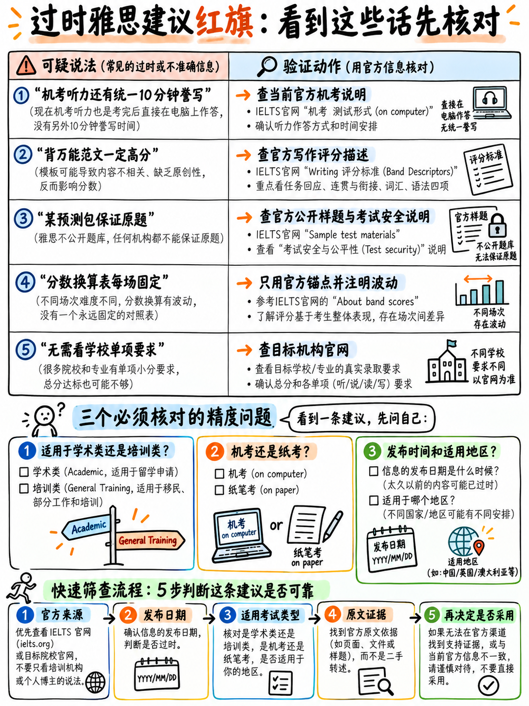

# 02. 民间过时备考建议与常见误区红线 (Outdated Advice & Red Flags)



在备考过程中，你不可避免地会接触到互联网上海量的免费雅思经验帖、教学视频和备考资料。其中不乏真知灼见，但同样充斥着大量描述“早已废止的旧考制”或“从未在官方存在过的民间谣传”。本章将为你提供一面照妖镜，助你迅速识别并过滤无效、有毒的过时资讯。

---

## 2.1 2026 考制过时警报特征识别 (The Staleness Markers)

如果一份教材、视频或培训课程包含以下任何一种陈述，即可判定其内容未根据 2026 最新官方标准进行同步更新，对其余部分的建议务必保持高度警惕：

| 过时错误特征 (Red Flag) | 为何属于严重过时？ | 2026 年当下的官方真实规则 |
|---|---|---|
| **“考生可以根据习惯自由选择纸笔考或机考”** | 雅思官方三大主办方已于 2026 年 3 月 5 日联合发布全球公告：自 2026 年中起全面终止雅思传统纸笔考试 `[14]`。 | **所有常规雅思考试已全面转为计算机机考交付（Computer-delivered Only）。** 唯一的例外是少数考点试点开放的“机考·纸笔写作模式（Writing on Paper）” `[15]`。 |
| **“听力录音结束后有 10 分钟时间把答案誊写到答题卡上”** | 10 分钟转写时间是传统纸笔考试的专属规则，纸笔考试取消后该规则随之作废 `[1]` `[14]`。 | **听力录音播放时必须同步在电脑屏幕输入框中敲入答案。** 录音结束后全卷仅留出 2 分钟进行极速检查。详见：{doc}`../50-listening/01-scoring-and-section-tactics` §50.1.2。 |
| **“考试当天请携带 2B 铅笔和橡皮涂写答题卡”** | 纸笔时代遗留产物 `[14]`。 | 考场作答全流程使用键盘与鼠标。若参加 Writing on Paper 模式，考场统一配发专用黑色水笔 `[15]`。 |
| **“考后需要等待 13 个自然日查询成绩”** | 纸笔考试漫长的阅卷周期 `[1]`。 | 现行机考通常在考后 **1 至 5 个工作日**即可在线极速出分；IELTS Online 出分耗时 6–8 天 `[1]`。 |
| **引用的写作评分标准未标注“Updated May 2023”** | 雅思写作评分细则已于 2023 年 5 月完成重大改版升级 `[8]`。 | 必须使用 2023 年 5 月更新版标准。该版本首次加入了 Band 6 容错条款，并对 Band 4 死记硬背套话进行了严厉的降级判定。 |
| **“阅读考试包含 3 篇文章，外加 10 分钟答题卡誊写时间”** | 雅思阅读历史上**从未存在过额外誊写时间** `[1]` `[3]`。 | 60 分钟做题时间到，机考系统直接强制锁屏交卷。 |
| **“单科重考 (One Skill Retake) 仅在澳洲等少数国家试点”** | 早期推广阶段的过时陈述。 | OSR 已在全球绝大部分主流机考中心普及落地。要求在原考后 **60 天内**申请，且**原考试必须为机考** `[16]`。 |
| **“雅思在线考试 (IELTS Online) 同样支持 G 类培训类报考”** | 错误混淆。 | 官方明确规定：IELTS Online **仅面向学术类（Academic Only）**开放 `[1]`。 |
| **“UKVI 签证雅思也可以选择机考纸笔写作 (Writing on Paper)”** | 违背签证监管条例。 | 官方明文规定：“机考纸笔写作模式**不支持任何英国签证及移民类雅思（IELTS for UKVI）**测试” `[15]`。 |

:::{warning}
**“听力有 10 分钟誊写时间”是杀伤力最大的过时认知！**  
它会从根本上摧毁你的答题节奏。如果考生平时练习习惯在纸上速记缩写、打算最后 10 分钟慢慢补全拼写，一旦进入真实的机考考场，录音一停你将完全没有补救时间，瞬间造成多题空白丢分。任何还在教授这一做法的资料，请立即丢弃！
:::

---

## 2.2 从未正确过的民间致命谣言盘点 (Advice That Was Never Right)

以下说法并非“过时”，而是从始至终都与官方评分标准背道而驰的民间臆测与以讹传讹：

| 广为流传的民间误区 | 官方权威文件与现行评分量表的真实定性 |
|---|---|
| **“大作文必须背诵一套万能模板并往里生搬硬套”** | 官方写作量表 Band 0 明文适用于“有确凿证据证明全篇死记硬背”；Band 4 词汇维度明文惩罚“不当套用成串记忆短语与公式化套话” `[8]`。在官方标准中，模板语言只出现在低分段（Band 0–4）的降级特征中。 |
| **“写大作文最好每句话开头都用一个高级连接词”** | Band 5 连贯维度将“过度使用衔接手段（Overuse of cohesive devices）”列为典型缺陷；Band 6 批评“衔接词误用或滥用” `[8]`。官方公开的 **7.5 分优秀范文**中，考官唯一严厉批评的正是“第二段过度堆砌连接词 [Firstly \| So \| Also \| Yet]” `[12]`。 |
| **“口语考试中要尽可能多地堆砌高级语篇连接短语”** | 官方口语流利度 Band 5 明确警示：“过度依赖某些语篇标志词、连接词和其他衔接特征” `[9]`，滥用只会导致考官降档。 |
| **“口语想冲高分必须大量背诵并狂甩英美俚语和习语 (Idioms)”** | Band 8 标准指出的是“熟练巧妙地运用（skilful use）”非核心及习语表达 `[9]`。生硬插入口语习语极易出现语境错配，一眼暴露死记硬背痕迹。 |
| **“大作文一定要写到 350 词以上，篇幅越长分数越高”** | 官方没有任何条款奖励超出下限的篇幅。官方披露的 7.5 分考卷虽然写了 375 词，但考官批评其“部分短小句型使用过载”，未在字数上给予任何加分 `[12]`。篇幅的核心是提供采分证据，而非盲目堆字。 |
| **“为了防止犯语法错误，口语应尽量放慢语速逐字斟酌”** | 官方流利度首要指标是“语速理想，**不可过慢（not too slow）**” `[11]`；Band 5 流利度明确将“过度依赖慢语速”列为扣分特征 `[9]`。 |
| **“发音必须彻底摆脱中式口音，练成纯正英音才能拿高分”** | 官方考查核心始终是“口音对可理解度（Intelligibility）的综合影响” `[11]`。即使是 8 分高分档，也仅要求“口音对理解的干扰极其微小” `[9]`。 |
| **“口语中绝对不能说 'I don't know'”** | 错了一半。陷入沉默才是致命伤。坦诚表达“我以前从未关注过这个话题，但我个人推测……”能维持语流；遇到不会的单词现场转述释义（Paraphrase）更是官方明文肯定的加分点 `[11]`。 |
| **“一定要说考官喜欢听的观点，政治正确才能拿高分”** | 雅思从来不考查观点本身的价值观正误。观点完全“可以取材于考生个人经历” `[10]`，口语更无任何事实真伪审核。考官只看语言组织与论据逻辑。 |
| **“学术类 Task 1 必须解释数据背后为什么会涨跌”** | 官方明文定性：Task 1“局限于对事实数据的提炼描述……**切忌展开脱离给定图表的任何主观臆测与因果推导**” `[10]`。多写臆测原因反而扣分。 |
| **“作文字数只要少于 250 词，就会按字数机械倒扣分”** | 不存在按字扣分的公式。篇幅不足的真正后果是“未能提供充分展现词汇与复杂句型的语言证据” `[8]`。唯一机械硬指标是 ≤20 词判 Band 1。官方 5.5 分范文评语指出字数不足是“留下了进一步展开的空间” `[12]`。 |
| **“为了条理清晰，可以在 Task 1 中使用项目符号（Bullet points）”** | 官方明文严厉禁止：“未以完整连贯文本撰写（如在**任何部分**使用项目符号或笔记提纲形式），将被严肃扣分” `[10]`。 |
| **“雅思有倒扣分机制，拿不准千万别乱猜”** | 雅思全卷无倒扣分。空白与错误均得 0 分，瞎猜有 25% 概率白赚原始分 `[2]` `[3]`。 |
| **“做阅读 TFNG 题可以凭借生活常识直接秒选”** | 题干永远是在问**原文是否提及或支撑**。依靠个人常识做题，是把 NOT GIVEN 误判为 FALSE 的头号元凶。 |

---

## 2.3 资料真伪四步精准质检法 (The Four Precision Tests)

在网络上遇到任何备考文章或网课时，只需执行以下四步质检：

```
   检验 1：它是否准确援引现行官方评分量表？
   如果一篇讲写作或口语的文章通篇不提 2023 年 5 月版写作评分细则 [8]
   或官方口语量表 [9]，纯靠作者主观发挥，一律视为无稽之谈。

   检验 2：它是否拿出一张 0–40 完整对分表，并宣称为“官方换算表”？
   雅思官方仅发布 16/15、23、30、35 四大平均锚点 [7]，并明确提示不同
   场次略有波动。任何声称精准到每一道题的全量表格均为民间推测。

   检验 3：它是否还在指导你“如何选择纸笔考”或“听力留 10 分钟抄答案”？
   若是，该资料自 2026 年初之后从未维护更新 [14]，全盘作废。

   检验 4：它的“满分 Band 9 范文”开头是否充斥陈词滥调？
   若范文第一句是 "In today's rapidly evolving world"、"Every coin has two sides"
   或 "It is a double-edged sword"，这恰恰是官方 Band 4 词汇标准严打的套话 [8]。
   真正的官方 9 分考卷绝无此类生硬表达。
```

---

## 2.4 备考资料风险梯队评估 (Where the Risk Lies)

| 资料来源类型 | 核心潜在风险 | 最科学的使用方式 |
|---|---|---|
| **官方 IELTS 门户与白皮书** | 不同页面偶有细微文字释义差异 | 遇冲突时以评分量表 **[8]** **[9]** 及《考生指南》**[1]** 为最高准则。 |
| **BC / IDP / 剑桥官方备考平台** | 风险极低，主办方出品 | 放心作为基础研读素材。 |
| **《剑桥雅思官方真题集》** | 早期册次（如 4–9 册）部分题型设计略带纸笔旧痕迹 | 推荐使用剑 10–20 册，忽略书本前言中关于纸笔答题卡的说明。 |
| **资深一线名师独立教学网** | 教学法过硬，但民间的“高频机经”无法律效力 | 吸收其解题思路，坚决不用其押题。 |
| **论坛“近期真题回忆”汇总** | 题目残缺、记忆偏差、真实性难以验证 | 仅用于提取母题词汇背景，绝不背诵题目。 |
| **视频博主自制雅思技巧** | 水平极度参差不齐，大量炒作过时模板与营销噱头 | 严格用上述四步质检法检验其专业度。 |
| **付费“保过预测包 / 内部押题”** | 雅思绝不提前流出考题，纯属商业骗局 | **坚决抵制，一分钱不要花。** |
| **AI 大模型一键生成所谓“满分范文”** | 充斥空洞华丽的大词，精准踩中 Band 4 套话降分陷阱 | 用 AI 辅助批改自身语法错误，绝不可盲目模仿其行文腔调。详见：{doc}`../60-toolkit/07-free-tools-and-self-testing` §60.7.7。 |
| **社交平台考官主观“压分”爆料帖** | 属于考生的情绪宣泄与归因偏差 | 评分受严格跨区域双盲质检复核，理性专注提升自身硬实力。 |

---

## 2.5 考生社群中流传甚广的 10 大荒诞传说 (Debunking Myths)

1. **“考官心情好坏决定你的分数”**：考官必须严格依照公开发布的四大维度正面特征进行比对 `[8]` `[9]`，且口语全程录音供全球专家抽检复核 `[1]`。
2. **“某些偏远小城市考点不压分，更容易出高分”**：全球所有考点的试卷命题、阅卷准则与考官监督均为全网标准化统一调度 `[1]`，不存在地域洼地。
3. **“必须全篇使用英式英语，使用美式英语会被扣分”**：英式英语与美式英语在拼写、语法和发音上完全受到同等认可与尊重。
4. **“口语 Part 1 就已经把你的最终成绩定下来了”**：评分标准明文规定“考生的口语得分取决于其在全场所有环节中的整体平均综合水准” `[9]`。
5. **“写作 Task 1 和 Task 2 是各占 50% 取平均分”**：官方明文指出 Task 2 的评分权重大于 Task 1（约占总分的三分之二）`[10]`。
6. **“总分算术平均后只要带小数都会自动进位”**：进位规则是：**.25 进位至 .5，.75 进位至整分** `[7]`。如 6.125 会被严格舍去为 6.0 分，这在官方范例中已有明确说明。
7. **“考试时间到了如果没写完，可以在考官收卷时偷偷补几笔”**：机考系统直接远程锁屏交卷，没有任何物理延时漏洞。
8. **“听力和阅读只要考出 8.5 的高分，就能抵消有单项小分限制的专业录取”**：高分仅能拉动平均分 `[7]`，无法逾越目标院校设定的“单项不得低于 6.0”等硬性门槛。
9. **“背会 20 个大作文高级模板句就能保 6.5 分”**：模板句是考官眼中的典型 Band 4 负面特征，套用越多，词汇分被封死得越低。
10. **“口语考官微笑点头就代表我稳拿 7 分了”**：点头与微笑是考官维持交流舒适度（Examiner frame）的职业礼貌规范，与实际打分毫无关联。

---

## 2.6 本手册时效性说明与自检指南 (Maintenance & Updates)

本手册编撰于 **2026 年 10 月 11 日**。随着国际考试政策的推进，以下动态政策仍需考生在考前做二次核验：

| 未来可能发生微调的政策板块 | 官方核对途径与权威出处 |
|---|---|
| **机考·纸笔写作模式（Writing on Paper）在你所在城市的考点部署** | 查阅官方公告 `[15]` 及当地考点最新报名页面 |
| **单科重考（OSR）在拟申请目标高校的最新认可清单** | 查阅官方 OSR 页面 `[16]` 并邮件咨询目标大学招生处 |
| **评分量表的最新修订版本号** | 查阅官方量表 PDF 版本 `[8]` `[9]`（若仍标为“Updated May 2023”则本手册建议完全最新） |
| **社群讨论的热门话题池** | 仅作为考前拓宽思路的补充，不可作为考题押注 |

**长久稳定不变的雅思底层基石：**  
听读客观题各 40 题无倒扣分、四科等权重算术平均、Task 2 占写作大头、客观题原词抄录送分、主观题注重逻辑连贯而非生僻词堆砌——这些核心机制是雅思数十年来保持学术信度的支柱，将长久指引你的备战方向。

:::{important}
**考前最值得你亲自做的一次动作：**  
下载并打开 **[8]** 和 **[9]** 两份官方评分标准 PDF，直接翻到 Band 5、Band 6 和 Band 7 这一栏。只要这两份文档的版本号未变，本课程传授的所有技术就是全网最权威、最锋利的通关利刃！
:::

---

**上一章：** {doc}`01-sources-and-reliability` | **下一章学习指南：** {doc}`../index`
