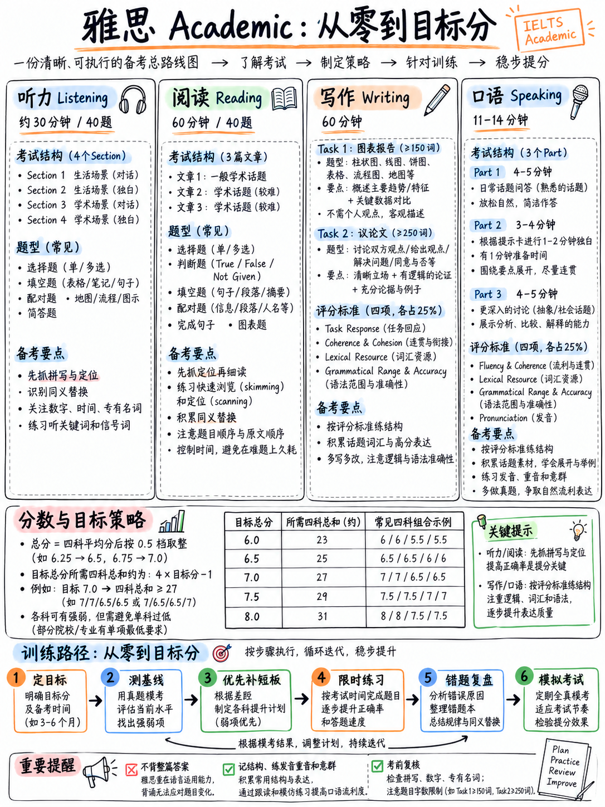

# 雅思学术类极速通关指南：零基础到目标分通关手册 (IELTS Academic Crash Course)

> **课程定位**：专为**零雅思基础**、**备考时间紧迫（数周内冲刺）**、追求**“以最少时间精力斩获最高目标分（6.0 / 6.5 / 7.0 / 7.5+）”**的中国考生量身打造的战略级实战课程。  
> **核心破局哲学**：雅思是一场明确规则、标准量表的学术语言考试。总成绩是四科的纯算术平均分（按 0.5 档四舍五入）。听力与阅读由机器/客观标准按 40 题采分（1 题 1 分且无倒扣分），纯拼**题型技巧与抓词技术**；写作与口语依赖**语言能力与逻辑输出**。本课程的核心宗旨只有一个：**把考生的每一小时时间，精准投放在单位提分杠杆最高的考点上**！  
> **考制版本与时效性（2026 全面机考现行标准）**：全书基于官方最新公开标准编撰。特别融入 **2026 年雅思全面转向机考（Computer-delivered Only）**的考场实战变化、2023 年 5 月更新的写作评分标准细则（严惩死记硬背与模板套话），以及客观题答题规则。

---

## 🧭 课程架构与备考战术决策树 (Tactical Architecture)

```{mermaid}
graph TD
    subgraph Core["雅思核心算分与破局法则"]
        C1["算术平均四舍五入<br/>• 总分 = (L+R+W+S) ÷ 4, 进退位按0.5档<br/>• 目标 6.5: 四科总分需 ≥ 25<br/>• 目标 7.0: 四科总分需 ≥ 27"]
        C2["客观题是提分引擎<br/>• 听力/阅读共80题, 1题1分无倒扣<br/>• 23分≈6.0分, 30分≈7.0分<br/>• 短期靠技巧提升最快"]
        C3["主观题守住底线<br/>• 写作/口语靠语言积累, 短期难暴涨<br/>• 重点是避开模板判0分惩罚<br/>• 掌握Frame弹性框架而非死背范文"]
    end

    subgraph Strategy["精力投入与优先级梯队 (Priority Triage)"]
        T_S["Tier S (王炸主力 · 提分杠杆最高 · 每日必刷)<br/>• 听力 Part 1 & Part 2 填空 (送分基本盘)<br/>• 阅读 填空类 (原词摘抄, 零拼写风险)<br/>• 阅读 TFNG / YNNG (掌握逻辑公式秒杀)<br/>• 听力高频 150 词拼写与数字日期训练<br/>• 口语 意群切分 (Chunking) 与单词重音"]
        T_A["Tier A (攻坚提分 · 掌握套路 · 稳步达标)<br/>• 写作 Task 1 (图表描述固定语法框架)<br/>• 听力 地图题/流程图与单选题排除法<br/>• 阅读 配对题 (人名/特征匹配优先突破)<br/>• 口语 Part 2 (结构化个人陈述 1-2 分钟)"]
        T_B["Tier B (保底达标 · 避免硬刚失分)<br/>• 写作 Task 2 (大作文四段式论证框架)<br/>• 听力 Part 3 & Part 4 (复杂学术长音频)<br/>• 口语 Part 3 (双向深入抽象讨论)"]
        T_C["Tier C (战略避坑 · 绝不死磕)<br/>• 阅读 段落信息匹配 (MI): 耗时长性价比极低, 留到最后或猜题<br/>• 生僻词死记硬背: 6.5分无需过载词汇, 搞懂高频核心词即可"]
    end

    subgraph Action["提分落地工具箱"]
        A1["错题本复盘 SOP<br/>(归因分析: 词汇/定位/同义替换/拼写)"]
        A2["写作 Task 1 & 2 弹性语法框架<br/>(只记骨架逻辑, 实词现场提炼)"]
        A3["发音与连读纠音集训<br/>(攻克中式英语吞音、加元音弊端)"]
    end

    Core ==> Strategy ==> Action
```

如图 1 所示，雅思学术类备考的核心在于**先抓客观题（听力与阅读）的基本盘，再守住主观题（写作与口语）的评分底线**。



*图 1：雅思 Academic 从零到目标分全景路线图：四科结构、算分策略、六步训练路径与备战核心法则。*

---

## 📌 雅思考试五大核心铁律（备考战略起点）

1. **总分是四科的纯算术平均，四舍五入至最近的 0.5 分**：没有加权、没有难度调分。因此你的四科总和只需达到 **(4 × 目标分) − 1** 即可！例如目标 6.5 分，四科之和达到 25 分即可（如 7.0 + 7.0 + 5.5 + 5.5 = 25.0，平均 6.25 进位为 6.5）。详见：{doc}`00-foundations/06-choose-your-target`。
2. **听力和阅读占了一半的权重，且完全由客观标准机器判定**：各 40 道题，每答对一题得 1 分，**没有倒扣分**。听力与阅读回报的是**答题技术与定位技巧**，几天内就能见效；写作与口语回报的是**英语综合素养**，通常需要数月沉淀。零基础或时间有限者，必须优先把时间砸在听力和阅读上。
3. **官方标准中：23/40 约为 6 分，30/40 约为 7 分**：在听力和学术类阅读中，你**完全不需要听懂或看懂全文的每一个词**。拿到 6 分你只需要 23 个正确答案；拿到 7 分只需要 30 个答案。
4. **死记硬背整篇答案与生硬套话会被明确严惩**：官方写作评分细则明确规定：若有证据表明考生答案属于整篇死记硬背，直接判定为 **Band 0**；词汇多样性（LR）Band 4 也明确警示“不恰当地套用机械套话与公式化语言”。因此，本课程传授的是**弹性语法框架（Sentence Frames）**——提供句式与逻辑骨架，实词与论据现场取材，杜绝套话。详见：{doc}`00-foundations/05-glossary-and-question-banks`。
5. **纸笔考试已成历史，全面进入机考时代**：官方已明确宣告全面转向计算机机考（Computer-delivered）。必须全流程在屏幕、键盘和鼠标环境下备考，适应屏幕划线定位、听力同步键入与写作字数实时统计。详见：{doc}`00-foundations/01-what-the-test-is`。

---

## 📊 本课程各板块证据与可靠性矩阵

| 教学内容板块 | 官方与学术依据 | 可靠性等级 | 中国考生复习启示 |
|---|---|---|---|
| **考试形式、计时、题量、字数下限** | 官方 IELTS 规范与最新《Guide for Test Takers》 `[1]`–`[6]` | **极高 (High)** — 官方准则 | 考场绝对红线，严格遵守字数下限与时间切分 |
| **写作与口语四维评分量表** | 官方公开 PDF：写作（2023年5月改版）`[8]`、口语 `[9]` | **极高 (High)** — 考官给分尺子 | 掌握每一档评分指标，不做考官反感的无效动作 |
| **卷面原始分换算分值锚点** | 官方 "IELTS scoring in detail" 权威说明 `[7]` | **极高 (High)** — 官方平均值 | 建立清晰的分数目标感知（如23题保6分，30题冲7分） |
| **考官评语与真实范文样本** | 官方公开的 Band 4 / 5.5 / 6 / 7.5 真实考生作答及考官批注 `[12]` | **极高 (High)** — 考官原话 | 认清 6 分与 7 分的分水岭在“连贯逻辑”而非“生僻词堆砌” |
| **高频词汇、语法红线、错题复盘** | 结合官方真题规律与中国考生高频失分点提炼总结 | **高 (High)** — 针对性教学 | 重点突破拼写、单复数、冠词与意群停顿等易错坑 |
| **网络机经、近期考题回忆** | 考生社群回忆与民间整理 `[22]`–`[26]` | **中等 (Medium)** — 仅作练习参考 | 坚决不可押题或背答案，仅作为题库语料练习 |

:::{warning} 考前警惕：以下过时资讯切勿轻信
如果你在其他地方看到：**推荐报纸笔考**、**听力考试结束后有 10 分钟转写答题卡时间**、或者使用 **2023 年 5 月改版前的老旧写作模板**，这些均已严重过时！最新机考听力仅有 2 分钟检查时间，老模板极易被考官识别并惩罚。避坑清单详见：{doc}`70-references/02-outdated-advice-red-flags`。
:::

---

## 📖 推荐通关阅读顺序与全课程模块导航 (Course Modules)

本课程按照**战略底座、发音基本功、口语破局、写作框架、阅读漏斗、听力通关、提分工具、权威参考**的科学逻辑展开：

### 阶段一：基础底座篇 (00 Foundations) — 考前必读 90 分钟
> 动笔练习前，先用 90 分钟通读基础篇。彻底理清算分算法、题型分布、精力投入优先级与目标分计算公式。搞懂规则，胜过盲目刷题 100 篇。

```{toctree}
:maxdepth: 1
:caption: 00 基础底座篇 (Foundations)

00-foundations/01-what-the-test-is
00-foundations/02-question-type-inventory
00-foundations/03-how-scoring-works
00-foundations/04-priority-triage
00-foundations/05-glossary-and-question-banks
00-foundations/06-choose-your-target
```

### 阶段二：发音从零蜕变篇 (10 Pronunciation) — 考官听得懂的核心基本功
> 发音不是追求英音或美音，而是追求“清晰可辨、重音准确、意群自然”。解决中国考生普遍存在的吃字、吞尾音、乱加元音等顽疾。

```{toctree}
:maxdepth: 1
:caption: 10 发音从零突破篇 (Pronunciation)

10-pronunciation/01-start-here-sound-system
10-pronunciation/02-consonants
10-pronunciation/03-vowels-and-diphthongs
10-pronunciation/04-word-stress
10-pronunciation/05-chunking-and-sentence-stress
10-pronunciation/06-connected-speech
10-pronunciation/07-first-language-interference
```

### 阶段三：口语通关篇 (20 Speaking) — 三大 Part 应对逻辑与流利度引擎
> 口语考试是真人或机考视频对话。核心不是辞藻华丽，而是流利表达、持续展开细节与自然互动。

```{toctree}
:maxdepth: 1
:caption: 20 口语实战篇 (Speaking)

20-speaking/01-how-speaking-is-scored
20-speaking/02-part-1
20-speaking/03-part-2-long-turn
20-speaking/04-part-3
20-speaking/05-fluency-engine
20-speaking/06-speaking-practice-bank
```

### 阶段四：写作破局篇 (30 Writing) — 评分标准剖析、图表报告与大作文
> 写作是绝大多数中国考生的卡分瓶颈。小作文靠客观数据与趋势对比框架，大作文靠清晰立论与四段式推演，彻底摆脱低分套话。

```{toctree}
:maxdepth: 1
:caption: 30 写作破局篇 (Writing)

30-writing/01-how-writing-is-scored
30-writing/02-task-1-academic
30-writing/03-task-1-worked-examples
30-writing/04-task-2-essay-types
30-writing/05-task-2-worked-examples
30-writing/06-writing-practice-bank
```

### 阶段五：阅读实战篇 (40 Reading) — 题型漏斗法则、判断题公式与时间管控
> 3 篇文章 40 道题，60 分钟极其紧迫。学会先看题干划定位词、分清题型顺序性，用“TFNG 公式”秒杀送分题，战略跳过耗时陷阱题。

```{toctree}
:maxdepth: 1
:caption: 40 阅读实战篇 (Reading)

40-reading/01-scoring-and-section-tactics
40-reading/02-true-false-not-given
40-reading/03-completion-and-short-answer
40-reading/04-matching-tasks
40-reading/05-multiple-choice-and-sentence-endings
40-reading/06-reading-practice-set
```

### 阶段六：听力全真篇 (50 Listening) — 预读定位、原词抓取与同义替换
> 听力录音仅播放一次！掌握 Part 1/2 的基本盘填空题，攻克地图路线与流程图，利用信号词捕捉学术讲座逻辑转折。

```{toctree}
:maxdepth: 1
:caption: 50 听力通关篇 (Listening)

50-listening/01-scoring-and-section-tactics
50-listening/02-completion-tasks
50-listening/03-multiple-choice-and-matching
50-listening/04-map-plan-diagram
50-listening/05-part-4-the-lecture
50-listening/06-listening-practice-set
```

### 阶段七：实战工具箱 (60 Toolkit) — 核心词表、答题规范、错题复盘与考前清单
> 把备考方法固化为可执行的工具：150 个考点拼写红线词、核心语法极简要求、错题复盘闭环 SOP、分阶段学习计划与考场全流程清单。

```{toctree}
:maxdepth: 1
:caption: 60 实战工具箱 (Toolkit)

60-toolkit/01-core-vocabulary
60-toolkit/02-grammar-minimum
60-toolkit/03-spelling-numbers-and-answer-rules
60-toolkit/04-error-log-method
60-toolkit/05-study-plans
60-toolkit/06-exam-day-checklist
60-toolkit/07-free-tools-and-self-testing
```

### 阶段八：权威文献与避坑参考 (70 References)
> 官方来源索引与民间过时误区清单，确保备战方向 100% 正确。

```{toctree}
:maxdepth: 1
:caption: 70 权威文献与参考 (References)

70-references/01-sources-and-reliability
70-references/02-outdated-advice-red-flags
```

---

## ⚡ 考前冲刺：如果你只有一两个晚上的备考时间 (Crash Plan)

请严格按以下顺序阅读核心关键章节：

1. {doc}`00-foundations/06-choose-your-target` — 计算你达到目标分所需的四科总分，确定各科保底策略。
2. {doc}`00-foundations/04-priority-triage` — 明确哪些题型是送分主力（Tier S），哪些题型该战略放弃（Tier C）。
3. {doc}`60-toolkit/03-spelling-numbers-and-answer-rules` — 扫清绝大多数新手白白丢分的拼写、大小写、单复数与数字日期规范。
4. {doc}`10-pronunciation/05-chunking-and-sentence-stress` — 掌握口语提分性价比最高的意群切分与句子重音习惯。
5. {doc}`60-toolkit/06-exam-day-checklist` — 快速通读一页纸考场全流程与考前注意事项。
