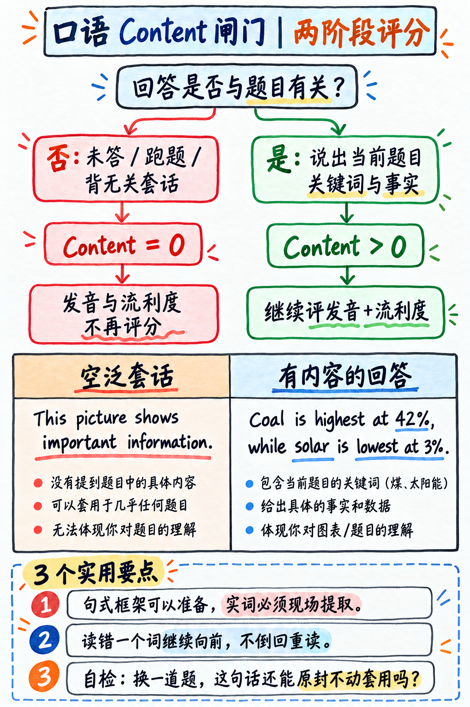

# 03. 机器评分底层机制：IRT 模型、特质系统与 Content 闸门 (How Scoring Works)

## 官方成绩单的构成 (The Score Report You Receive)

考生查到的官方成绩单包含两部分核心数据：
- 一个 **总分 (Overall Score)**（10–90 分分值区间）；
- 四大 **交际技能分 (Communicative Skills)**：听力 (Listening)、阅读 (Reading)、口语 (Speaking)、写作 (Writing) 各自独立显示（10–90 分分值区间）。

:::{important} 成绩单总分绝不是四大单项的算术平均分！
培生官方在指南中明确澄清：
> *"The overall score is not an average calculation of the communicative skills scores." (总分绝非四大交际技能分数的简单算术平均值。)*

PTE 的总分是基于**项目反应理论 (Item Response Theory, IRT)** 概率模型，综合全场所有题目的难度系数与考生作答特征动态计算出来的。在较难的题目上答对，对总分的拉动力度显著高于在极简单的题目上答对。

**实战策略启示**：你不需要也不可能逆向推导“每题精确值多少分”。你真正要做的是：**尽可能在所有能拿分的题目上稳定输出有效内容，并把时间精力重点押注在高回报题型上**（详见 {doc}`04-priority-triage`）。
:::

### 关于 Enabling Skills（辅助技能项）的历史变迁与辟谣

在 2021 年 11 月之前，PTE 成绩单下方会印出 6 项“Enabling Skills”（语法、流利度、发音、拼写、词汇、语篇组织）。**自 2021 年底起，官方已彻底从成绩单中剔除了这一部分**，改版为仅对考生可见的个性化诊断反馈报告（Skills Profile）。

目前国内仍有部分旧资料在指导考生“针对 Enabling Skills 提分”。请注意：虽然后台算法依然在评估发音和流利度，但在正式成绩单上它已不再向申请院校呈现。凡是宣称“保证 Enabling Skills 全满分保过”的内容，均基于过时信息。

---

## 机器评分特质体系 (The Trait System)

在评分引擎内部，每一道题目都是由预设的一组**特质 (Traits)** 组合量化打分的：
- **Content (内容度)**
- **Oral Fluency (口语流利度)**
- **Pronunciation (发音清晰度)**
- **Form (格式合规度)**
- **Development, Structure and Coherence (论述组织与连贯性)**
- **Grammar (语法规范)**
- **General Linguistic Range (语域与语言范围)**
- **Vocabulary (词汇丰富度与搭配)**
- **Spelling (拼写正确性)**

---

## Content 闸门规则 —— 整场考试最致命的给分红线

如图 4 所示，先判断回答是否切题，再看后续语言表现；图中的分支提醒考生用题目里的真实内容作答。



*图 4：内容闸门与后续评分的关系。图中把相关回答、无关回答和各特质评分路径分开，便于核对答题风险。*

对于所有考查 Content（内容度）的口语题目，官方引擎执行严格的**两阶段级联评分机制 (Two-Stage Scoring)**。以下为官方指南以 Describe Image 为例公布的判定逻辑：

> 1. 第一阶段：“系统首先对 Content（内容）进行评分。如果考生**未作答**，或者给出了**与题目无关的回答 (Irrelevant response)**，则 Content 得分为 0。**凡包含预先准备的死记硬背材料 (pre-prepared or memorized material) 的回答，均被直接归类为无关回答 (Content=0)！**”
> 
> 2. 第二阶段：“**仅当 Content 得分大于 0 时**，系统才会对剩余的两项特质（Pronunciation 发音与 Oral Fluency 流利度）进行打分。若 Content 为 0，则后续特质不再评分，该题彻底判零分！”

```
                        ┌───────────────────────────────┐
       考生录音输入 ───►│ 第一阶段：检测 Content (内容度) │
                        └──────────────┬────────────────┘
                                       │
                ┌──────────────────────┴──────────────────────┐
                │                                             │
          Content = 0                                    Content > 0
   (未答 / 跑题 / 大段死背模板)                                (包含题干关键实词)
                │                                             │
                ▼                                             ▼
    ┌─────────────────────────┐                   ┌─────────────────────────┐
    │ 评分强行终止！           │                   │ 第二阶段：继续评分      │
    │ Pronunciation 发音 = 0  │                   │ • Pronunciation (0–5分) │
    │ Oral Fluency 流利度 = 0 │                   │ • Oral Fluency  (0–5分) │
    │ ─────────────────────── │                   │ ─────────────────────── │
    │ 该题总分彻底为 0 分！   │                   │ 正常结算口语与总分贡献  │
    └─────────────────────────┘                   └─────────────────────────┘
```

:::{danger} 为什么“纯死记硬背万能模板”在改版后是高危自杀行为？
三大改版事实叠加，彻底堵死了空洞模板的生存空间：

1. **模板废话被算法精准捕获**：通篇大谈“This picture shows the data of modern society...”这类套在任何图上都能说的无意义废话，会被直接打上“Irrelevant Response”标签，判定 Content=0。
2. **触发 Content=0 导致全题连带清零**：一旦 Content 为 0，哪怕你的发音如母语者般字正腔圆，流利度如行云流水，**系统也不会打一分流利度与发音分**。整题全损。
3. **2025 年 8 月改版全面强化“真人专家双评 (Human Double-Marking)”**：官方对 Describe Image、Retell Lecture、Respond to a Situation、Summarize Group Discussion、Summarize Written Text、Write Essay、Summarize Spoken Text **共 7 种题型的内容分引入真人考务专家抽检与双评机制**。AI 算法与真人双重把关，生硬的假模板无所遁形。
:::

### 那么考场上到底允许用什么？—— 句式脚手架 (Sentence Frames)

PTE 严打的是**没有实际内容的通用空话**，但**绝对支持有逻辑的句式骨架 (Sentence Frames)**。两者的本质区别如下：

| ❌ 危险的万能套话 (极易触发 Content=0) | ✅ 安全的句式脚手架 (官方完全认可) |
|---|---|
| “The picture illustrates the given information. It can be seen from the picture that there are several key elements. In conclusion, the picture conveys important information about the topic.”<br>*(这几句话可以套在全世界任何一张图上，没有提及当前图表任何具体名词，算法判定为无关废话，Content=0)* | “This is a bar chart showing **[读取图表标题/轴标签]** across **[读取横轴分类]**. The highest category is **[读取最高值名称]** at approximately **[读取具体数值]**, while the lowest is **[读取最低值名称]**.”<br>*(句式骨架只有十几个语法连接词，但核心成分全是当前图表上独一无二的具体信息，Content 稳拿满分)* |

**黄金自检法则**：你的这句话，**如果不作任何修改直接套到另外一张截然不同的图表或题目上，能不能完全说得通？** 
- 如果完全说得通，说明它毫无信息量，属于危险模板；
- 如果必须填入当前题目的具体实体名词、数字或动作，它就是合规的句式脚手架。

本书提供的所有模板均严格遵循“**高密度提取题干信息、结构极简安全**”的句式脚手架设计。详见：{doc}`../60-toolkit/02-template-card`。

---

## 口语流利度与发音：AI 算法纯机器评分的破局点

口语的 Pronunciation（发音）和 Oral Fluency（流利度）覆盖整场约 28–34 道题目，**全程由 Pearson Versant 语音分析算法独立完成**，没有任何真人干预。这是全场最容易通过物理肌肉记忆与节奏训练短期攻克的分数矿脉。

### 发音 (Pronunciation) 官方 0–5 分梯队定义

- **5 分 (Highly Proficient)**：所有元音与辅音清晰无误，连读、弱读与省音自然恰当，单词重音与整句意群重音准确无误。
- **4 分 (Advanced)**：元音与辅音清晰明确，个别非关键发音扭曲不影响整体辨识度，所有高频词重音准确。
- **3 分 (Good)**：大部分元音辅音正确，但存在系统性的发音偏差，可能导致个别词汇含混。
- **2 分 (Intermediate)**：发音质量不稳定，部分音素缺失或错误。
- **1 分 (Intrusive)**：母语口音严重干扰识别。
- **0 分 (Non-English)**：非英语发音特征。

### 流利度 (Oral Fluency) 官方 0–5 分梯队定义

培生对流利度的定义是：“*能够准确、平滑地朗读或言语（the ability to speak, or read, accurately and smoothly），通过判定语流的节奏 (rhythm)、意群切分 (phrasing) 与重音连贯度来综合评估。*”

:::{tip} 价值千金的流利度实战真相：机器看重节奏连贯，不歧视口音！
**评分机器从不要求你具备英音或美音的纯正腔调。** 算法测量的是音频声学波形是否平稳、是否存在不规则的破裂、犹豫、气口停滞或自我纠正。

**一个带有明显中式口音、但语速均匀平缓、意群连贯、毫无卡顿停顿的考生，其流利度分数将大幅碾压一个口音地道、但在中途反复卡壳、"uh/um"不断、自我纠错倒车的考生！**

由此推导出口语全场必须刻入骨髓的**三大铁律**：
1. **绝不倒车自我纠错 (Never self-correct)**：读错或说错一个单词，顶多在发音细分上扣除微小的小数点；但如果你中途停下来重新说一遍，不仅节奏被彻底砸碎，流利度特质更是全线暴跌！说错就让它过去，眼睛往前看，节奏绝不能乱。
2. **句中停顿绝不能超过 1 秒**：说话时意群之间仅做微小的半秒换气，整句中间严禁长滞停顿；长停顿超过 3 秒麦克风直接被机器断电关机！
3. **设定一个比日常说话稍慢但极其匀速的节奏**：选定一个稳如节拍器的匀速状态，从头到尾匀速输出。专项节奏训练法见：{doc}`../60-toolkit/03-pronunciation-drills`。
:::

---

## 文本写作评分机制：IEA 引擎与潜在语义分析 (LSA)

- **写作评分**：采用培生专利技术 **Intelligent Essay Assessor™ (IEA)**，运行于 Knowledge Analysis Technologies™ (KAT™) 语义分析引擎之上，底层采用**潜在语义分析算法 (Latent Semantic Analysis, LSA)**。
- **LSA 的底层机理**：算法不是像人类老师那样字句鉴赏，而是将考生的文本映射至一个高维语义向量空间，计算你的词语网络与数十万篇同主题高分学术语料在“语义共现空间”中的重合度与内在连贯性。

:::{note} LSA 算法对大作文写作的实操要求
1. **紧扣题干核心实词及其自然搭配词**：如果题目关于“urbanisation（城市化）”，你的正文中必须高频自然出现与城市化强相关的语义网络词汇，例如 *infrastructure（基础设施）, traffic congestion（交通拥堵）, public transit（公共交通）, affordable housing（经济适用房）, population influx（人口涌入）*。LSA 会以此判定你真正探讨了核心命题。
2. **严禁无意义的假大空套话填充**：“With the rapid development of modern society, this problem has drawn more and more attention...”这类无实质语义的套话在 LSA 向量空间中权重极低，甚至被直接稀释降分。
3. **拼写 (Spelling) 维度严格执行前后一致**：英式拼写（colour, centre）与美式拼写（color, center）均被官方接受。但**切忌在同一篇文章中混用**（一段写 organise，下一段写 organize），前后混杂会被拼写引擎判定为拼写规范缺陷。
:::

---

## 步骤分分布与全场三大倒扣分例外情况

PTE 绝大部分题型均为**步骤给分（Partial Credit），最低得 0 分，不倒扣**。这就决定了明确的答题下注策略：

| 题目情境 | 实战绝对法则 |
|---|---|
| **各类填空题** (RW-FIB, R-FIB, L-FIB) | **每空必填，决不留白！** 填错 0 分，绝无倒扣分。猜一个完全免费，留白必为 0 分。 |
| **所有单选题** (R-MCSA, L-MCSA) | **遇到不会的立刻选一个最顺眼的并点击 Next！** 留白等于弃权。 |
| **段落排序题** (RO) | **即便完全排不准，也必须排出一个完整顺序！** 题目按“相邻对”给分，只要有任意两段前后关系蒙对就能捞到步骤分。 |
| **听写句子** (WFD) | **凡是听到的单词全部写上去！** 写对一个词拿一分；多写、错写不扣分。 |
| **多选题** (阅读与听力 R-MCMA / L-MCMA) | **⚠️ 选错一项扣 1 分！** 仅选择 100% 确定的选项；若不确定，**坚决只选 1 个最有把握的选项保底**，绝不贪多。 |
| **标出错误词** (HIW) | **⚠️ 误点正常词倒扣 1 分！** 紧跟音频，只标出 100% 确定读音与屏幕不符的单词，模糊不定的千万别乱点。 |

整场考试中，**唯有多选题与 HIW 需要保持克制；在其余所有题型中，尽可能完整作答永远是数学期望最高的策略！**

---

## 目标分定位与成绩换算标准 (Score Targets & Concordance)

### 全球院校常见准入门槛

| 课程申请类型 | 官方建议整体总分基准区间 |
|---|---|
| 预科及国际大一课程 (Foundation / Pathway) | 36–50 分 |
| 本科直录课程 (Undergraduate) | 51–60 分 |
| 授课型研究生直录 (Postgraduate) | 57–67 分 |
| 澳洲/新西兰移民加分高门槛（俗称“八炸”） | 79 分及以上（且听说读写四项单项全部 ≥ 79） |

### PTE 与 CEFR 欧洲语言框架对照

| PTE 总分区间 | CEFR 等级标准 | 能力梯队描述 |
|---|---|---|
| 85–90 | C2 | 精通级（接近母语者） |
| 76–84 | C1 | 熟练高级 |
| 59–75 | B2 | 独立中高级（海外本科/硕士常规主流区间） |
| 43–58 | B1 | 进阶初级 |
| 30–42 | A2 | 初级基础 |
| 10–29 | A1 或以下 | 入门起步 |

### PTE ↔ 雅思 (IELTS) 官方最新对照表 (2025 年 7 月培生官方重新核定版)

此表由培生官方依据大规模实证研究于 2025 年 7 月正式重修，**全面替代了数年前网络流传的旧版换算表**：

| 雅思 (IELTS) | PTE 总分基准 | 听力 (Listening) | 阅读 (Reading) | 口语 (Speaking) | 写作 (Writing) |
|---|---|---|---|---|---|
| **4.5** | 24–30 | 26–32 | 29–35 | 14–23 | 17–28 |
| **5.0** | 31–38 | 33–39 | 36–41 | 24–38 | 29–40 |
| **5.5** | 39–46 | 40–46 | 42–47 | 39–53 | 41–50 |
| **6.0** | **47–54** | **47–52** | **48–53** | **54–65** | **51–59** |
| **6.5** | **55–62** | **53–57** | **54–58** | **66–75** | **60–68** |
| **7.0** | **63–70** | **58–63** | **59–64** | **76–82** | **69–76** |
| **7.5** | 71–78 | 64–68 | 65–69 | 83–87 | 77–84 |
| **8.0** | 79–85 | 69–74 | 70–74 | 88–89 | 85–89 |
| **8.5** | 86–89 | 75–80 | 75–80 | 90 | 90 |
| **9.0** | 90 | 81–90 | 81–90 | — | — |

:::{admonition} 重点观察口语（Speaking）换算梯度的重大战术红利
:class: important
请仔细观察雅思 6.0 分对应的换算区间：
- 听力只需 PTE 47–52 分；
- 但口语对应的是 **54–65 分** 的宽阔跨度！从 54 到 65 这整整 11 分的跨度，在雅思中相当于直接跨越了整整一个分数段。

**国内初学者核心战略启示**：口语是全场只要掌握了机械流利度法则、提分动作最快、分数跨度最显著的科目！如果你总备战时间只有 10 小时，请果断拿出 4 小时专项锤炼口语平稳输出。
:::

### 考分测量误差与安全冗余意识

官方指南明确公布了各项技能分数的标准测量误差（Standard Error of Measurement）。这意味着机器评出的分数存在约 3–5 分的合理波动浮动。如果你申请学校需要 65 分，而平时模考刚好在 64–66 分晃荡，你并不是“差不多能过”，而是在考场上掷硬币。**在正式去考场前，请通过专项提分建立起高于目标线 4–5 分的稳定安全垫！**

---

**下一章学习指南：** 请继续阅读 {doc}`04-priority-triage`，掌握如何给全场 22 种题型划分战术优先级，明确哪些题型必须死磕、哪些题型果断放弃。
