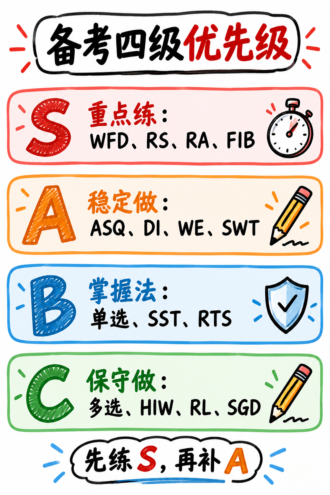

# 04. 题型战术优先级分级：哪些死磕、哪些达标、哪些果断战略放弃 (Priority Triage)

这是决定整个备考效率最高、能帮你省下数周无谓挣扎的战略核心章节。搞清楚精力往哪里投，剩下的只是按部就班的机械执行。

---

## 优先级评估模型 (The Evaluation Method)

我们对培生官方全部 22 种题型，从四个客观维度进行交叉加权计算：

1. **题量权重 (Volume)**：考场上出现的真实频次与题数（基于官方 2025 数据）。
2. **供分辐射力 (Reach)**：是仅给单项供分，还是跨两个核心单项“双向交叉供分”？
3. **短期提分杠杆 (Trainability)**：基础薄弱的初学者能否在两周内通过肌肉记忆和标准化训练取得立竿见影的突破？
4. **上限风险与倒扣分陷阱 (Ceiling Risk)**：是否极其依赖长期英语硬实力积累？是否设有负分倒扣机制？

培生官方从未对外公布各单题的绝对百分比权重（因为总分是由 IRT 概率模型根据考题难度动态拟合的）。本分级指南**严格依据官方题量分布、技能交叉流向以及数十万考生实战提分数据推导而成**，旨在为中国考生提供极其清晰的精力投入蓝图。



---

## S 级梯队 —— 绝对战略核心（超额回报，倾注全力的生命线）

这四类题型必须达到“近乎肌肉条件反射”的熟练度。它们是支撑你总分跨越的基本盘：

| 题型名称 | 考场题量 | 供分单项 (Feeds) | 为什么必须奉为 S 级战略核心？ |
|---|---|---|---|
| **听写句子 (WFD)**<br>Write from Dictation | 3–4 题 | 听力 **+** 写作 | 整场考试仅有 7–8 题直接决定写作分，而 WFD 就独占 3–4 题！**每拼对一个词得 1 分，写错或写多词绝不扣分**。这是纯粹的短期意群记忆与高频词拼写训练，基础较弱的考生每天坚持 15 分钟高频刷题，两周内正确率能从 40% 飙升至 90% 以上。**全场时间产出比最高的一道题！** → 详见 {doc}`../40-listening/01-write-from-dictation` |
| **复读句子 (RS)**<br>Repeat Sentence | **10–12 题** | 听力 **+** 口语 | **全场题量最大的单一题型**，同时向听力和口语两大单项大量输送分数。你**完全不需要听懂整句的深度含义**——只需在脑海中完成“语音意群回声（Echo）”复读。官方评分准则规定：**只要能把 50% 以上的词汇按原序顺畅说出，即可稳拿内容分 2/3 分**！说出半句话并保持绝对平稳流利，即可稳拿高分。 → 详见 {doc}`../10-speaking/02-repeat-sentence` |
| **朗读文本 (RA)**<br>Read Aloud | 6–7 题 | 口语 | **文本直接完整呈现在屏幕正中央**！零听力理解负担，零现场创作压力。这是最纯粹的声音交付训练。发音与流利度均由 AI 算法量化，极易通过意群节奏切分刷出高分，并能直接培养贯穿整个口语模块的流利度肌肉记忆。 → 详见 {doc}`../10-speaking/01-read-aloud` |
| **阅读完形填空 (两类 FIB)**<br>RW-FIB 下拉 + R-FIB 拖拽 | **合计 9–11 题** | 阅读 | 占阅读总题量的半壁江山！**每选对一空得 1 分，选错不倒扣分**，每一空都是免费尝试。阅读提分核心在于学术高频固定搭配与逻辑连接词，这些在核心词表中有非常有限的收敛范围，通过刷题能快速建立题感。 → 详见 {doc}`../30-reading/01-fill-in-the-blanks` |

---

## A 级梯队 —— 必拿基本盘（中等投入，稳定收获稳固分数）

在这一梯队，掌握标准化应对流程即可稳定拿分，不需要死磕极端难题：

| 题型名称 | 题量 | 供分单项 | 核心打法与战术意义 |
|---|---|---|---|
| **简答题 (ASQ)**<br>Answer Short Question | 5–6 题 | 听力 | 对/错 二元计分，题目多为常识性一词回答（如“水的冰冻形态叫什么？答：Ice”）。无需语言组织，听完 1 秒内直接报出单词，纯粹白送的 5–6 分听力基础分。 → 详见 {doc}`../10-speaking/05-answer-short-question` |
| **描述图像 (DI)**<br>Describe Image | 5–6 题 | 口语 | 题量可观。切记**坚决不用空洞的通用套话模板**（防 Content=0 惩罚），改用极简的“句式脚手架”，直接提取图表标题、极值与标签词，将现场脑力思考压缩至最低。 → 详见 {doc}`../10-speaking/03-describe-image` |
| **大作文 (WE)**<br>Write Essay | **1 题** | 写作 | 全场仅考 1 篇，但考核多达 7 个特质维度。考场独立倒计时 20 分钟。掌握标准四段式论证骨架与拼写核查清单，即可在 20 分钟内稳定产出 240–280 词的安全高分作文。 → 详见 {doc}`../20-writing/02-write-essay` |
| **概括文本 (SWT)**<br>Summarize Written Text | 2 题 | 阅读 **+** 写作 | 双向交叉供分，具有公式化解法：摘取主干核心从句，用逻辑连接词缝合成 25–40 词的标准单一复合句。严格守住单句格式红线即可稳赚分数。 → 详见 {doc}`../20-writing/01-summarize-written-text` |
| **听力填空 (L-FIB)**<br>Listening: Fill in Blanks | 2–3 题 | 听力 | 每拼对一词得 1 分，不倒扣分。本质是短语拼写速记，与 WFD 的训练逻辑完全互通，**练好 WFD 即可免费附赠此题的高分表现**。 → 详见 {doc}`../40-listening/03-fill-in-the-blanks` |
| **段落排序 (RO)**<br>Reorder Paragraph | 2–3 题 | 阅读 | 按“正确相邻段落对”给分。初学者只要掌握“寻找独立无指代首句”和“代词/时间逻辑链”两大机械规则，就能稳拿半数以上分数，绝不在单题上超时纠缠。 → 详见 {doc}`../30-reading/02-reorder-paragraphs` |

---

## B 级梯队 —— 合格即可（掌握规则，不追求精益求精）

不要在此类题型上耗费过多复习天数，考前熟悉界面规则即可：

| 题型名称 | 题量 | 供分单项 | 实战极简应对策略 |
|---|---|---|---|
| **单选题 (阅读/听力 MCSA)** | 4–6 题 | 阅读 / 听力 | 无倒扣分。先看题干问什么，带着问题定位，利用排除法迅速勾选一个答案，**决不在此浪费思考时间**。 |
| **匹配听力总结 (HCS)** | 2–3 题 | 听力 **+** 阅读 | 双向计分。选出“覆盖音频主旨范围”的选项，防范那些使用原词但偷换局部概念的陷阱选项。模考练习 5 题体会出题思路即可。 |
| **补全遗漏词 (SMW)** | 1–2 题 | 听力 | 题量极小。核心是听录音最后一两句的感情色彩和转折逻辑（but, however 还是 therefore）。 |
| **情境回应 (RTS)**<br>Respond to a Situation | 2–3 题 | 口语 | 2025 年官方新题型。本质是日常工作/学习场景下的礼貌得体回应。掌握常见社交礼貌用语（道歉、改期、致谢、请求协助）的得体表达即可。 → 详见 {doc}`../10-speaking/07-respond-to-a-situation` |
| **听力总结 (SST)**<br>Summarize Spoken Text | **1 题** | 听力 **+** 写作 | 虽有交叉给分，但整场考试仅考 1 篇，独立限时 10 分钟。复用 SWT 的核心句式架构，锁定 55–65 词目标区间，无需死记大段范文。 → 详见 {doc}`../40-listening/02-summarize-spoken-text` |

---

## C 级梯队 —— 果断战略放弃 / 极低防守策略（允许丢分，杜绝沉没成本）

初学者必须敢于“战略性止损”。以下题型难度极高、或设有惩罚性倒扣分规则，过度纠缠只会挤占高分题目的宝贵时间：

| 题型名称 | 题量 | 为什么建议初学者果断“战略放弃/低防守应对”？ |
|---|---|---|
| **复述讲座 (RL)**<br>Retell Lecture | 2–3 题 | 要求在 90 秒内完成高难度学术速记并现场组织语言，对初学者综合能力要求极高。但整场仅考 2–3 题。<br>**实战破局策略**：放弃搞懂全篇宏观脉络的执念，**只要听到并记下 2–3 个清晰关键词或短语，套入极简骨架平稳、不卡顿、匀速说满 40 秒**！哪怕内容分只拿 1 分，但靠平稳语流拿满流利度和发音的 5 分，总收益大幅超过犹豫卡顿的完美总结！ → 详见 {doc}`../10-speaking/04-retell-lecture` |
| **小组讨论总结 (SGD)**<br>Summarize Group Discussion | 2–3 题 | 2025 新题型。长达 3 分钟的 3 人混合音频，仅给 10 秒准备，**要求考生现场连续说满整整 2 分钟**！初学者很容易心态崩溃。<br>**实战破局策略**：将 2 分钟视为展现语音流利度的舞台。听出三个发言人各自的一句核心立场，用连接词把记下的零散要点串联起来，保持匀速输出，靠流利度与发音拿回大量基础分。 → 详见 {doc}`../10-speaking/06-summarize-group-discussion` |
| **多选题 (阅读/听力 MCMA)**<br>Multiple Answers | 4–6 题 | **设有严苛的 −1 倒扣分机制**！文本最长（350 词）或音频最长（120 秒），耗费大量脑力，一旦误选就前功尽弃。<br>**实战破局策略**：**坚决只选 1 个 100% 确认无误的选项，绝不贪选第二项！** 选完立刻点击 Next 跳过，为后面的完形填空和 WFD 节省宝贵的时间。 |
| **标出错误词 (HIW)**<br>Highlight Incorrect Words | 2–3 题 | **设有 −1 倒扣分机制**。音频语速飞快，要求考生视线与听觉高度同步。<br>**实战破局策略**：手指鼠标紧跟音频，**只点击 100% 确定读音与屏幕文字明显不符的词汇**。模棱两可或没听清的坚决不碰！两次确定的点击稳拿 +2 分，乱点四五下直接被扣成 0 分。 |

:::{admonition} 为什么战略放弃是科学制胜法宝而非懒惰？
:class: important
PTE 总分由 IRT 算法结算：它追求的是在广大基本面题目上的稳定性，而不是在极个别变态难题上的孤勇。

- **C 级题型** 仅占 9–15 题，却汇集了全场最长的阅读文本、最复杂的学术听力与最残酷的倒扣分规则；
- **S 级题型** 覆盖了 28–34 题，全是机械可训、规则明晰、能快速提分的“富矿”！

如果你把有限的 20 小时复习时间浪费在死抠讲座笔记和多选题排除上，你在难题上微弱的进步根本无法弥补因未练 WFD 和 RS 造成的巨大分数崩塌。**精通 S 级、守住 A 级、放平 C 级，你就已经稳稳锁定了 65–79 分的高分大门！**
:::

---

## 备考时间黄金切片分配图 (Effort Allocation)

对于 1–3 周极速冲刺的考生，建议将总学习时长严格按如下权重切分：

```
Write from Dictation 听写句子 + L-FIB 听力填空  ████████████████████  20%
Repeat Sentence 复读句子意群跟读                ██████████████████    18%
Read Aloud 朗读文本 / 机械流利度节拍练习        ████████████████      16%
Reading Fill in the Blanks 阅读完形填空         ██████████████        14%
Describe Image 描述图像句式脚手架               ██████████            10%
Write Essay 大作文 + SWT 摘要结构熟练度         ██████████            10%
Answer Short Question 听力常识简答速刷          ████                   4%
全真全模考实战抗干扰测试                        ██████                 6%
C 级梯队难题（仅做防守性试题体验）              ██                     2%
```

**清晰可见：超过 54% 的精力被直接投喂给 WFD、RS、RA、阅读 FIB 这四大题型！** 它们构成了你分数的半壁江山，且对真实英语文学功底要求最低。

---

## 四大单项瓶颈精准对症下药指南

如果你的自测模考发现某项单科出现短板，请严格按如下次序进行精准定向抢修：

| 若你的短板单项是… | 优先抢修题型次序（按提分杠杆由大到小） |
|---|---|
| **写作分 (Writing) 偏低** | **WFD (听写句子)** ➔ **WE (大作文)** ➔ **SWT (概括文本)** ➔ **SST (听力总结)**。<br>*写作全场仅有 7–8 题供分，拿下 WFD 的拼写，写作单项立刻暴涨！* |
| **听力分 (Listening) 偏低** | **RS (复读句子)** ➔ **WFD (听写句子)** ➔ **L-FIB (听力填空)** ➔ **ASQ (简答题)**。<br>*听力总分里口语题目贡献了近一半，死抓 RS 和 WFD 是拯救听力的不二法门。* |
| **口语分 (Speaking) 偏低** | **RA (朗读节拍流利度训练)** ➔ **RS (句子意群连读)** ➔ **DI (图表脚手架)**。<br>*口语评分宽容度最高，只要解决卡顿自我纠错，流利度立刻翻倍。* |
| **阅读分 (Reading) 偏低** | **完形下拉填空 (RW-FIB)** ➔ **拖拽填空 (R-FIB)** ➔ **段落排序 (RO)** ➔ **单选题**。<br>*彻底放弃多选题，把时间全留给完形填空！* |

:::{tip} 只有 7 天冲刺？极简生死战术单
如果你的考试就在 7 天之后，请**立刻封存其他所有杂项**，只练以下 6 件事：
1. **WFD**：每天精练 40 句高频母题，确保每个词拼写无误；
2. **RS**：每天跟读 40 句，练到不卡顿、顺畅说出后半句；
3. **RA**：每天精读 15 篇，用录音笔自测绝不中途纠错；
4. **阅读 FIB**：每天刷 20 空高频搭配词；
5. **ASQ**：考前刷一遍常识词汇；
6. **大作文**：背熟标准四段式框架，在电脑上打字掐表练 2 篇。
完整 7 天课表参见：{doc}`../60-toolkit/05-study-plans`。
:::

---

**下一章学习指南：** 请继续阅读 {doc}`05-glossary-and-banks`，揭秘备考圈黑话术语，破除关于“预测机经”的虚妄迷思。
