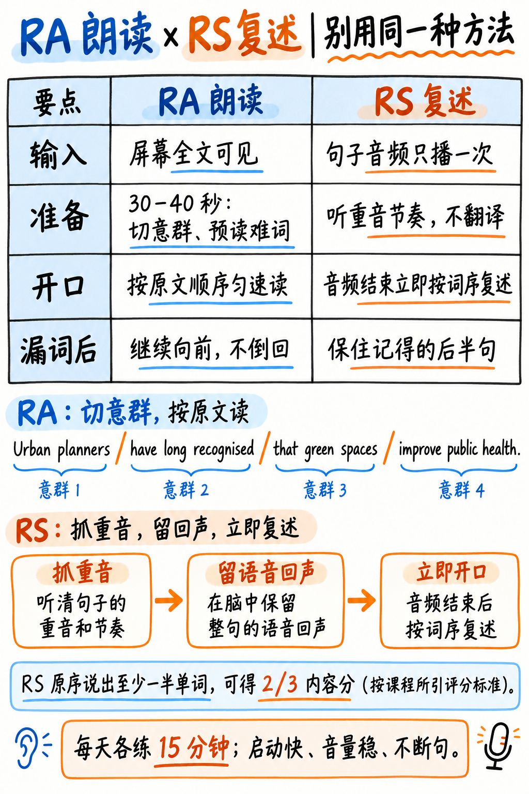

# 02. 复读句子 (Repeat Sentence, RS) 极速通关指南 —— S 级战略核心

:::{admonition} 题型核心参数一览 (At a Glance)
:class: tip
| 核心指标 | 官方标准参数 |
|---|---|
| **考场题量** | **10–12 题 —— 全场题量最大的单一题型** |
| **供分单项** | **听力 (Listening) + 口语 (Speaking)** 双向核心供分 |
| **音频输入** | 3–9 秒单句录音，仅播放 1 次 |
| **准备时长** | **0 秒** —— 录音播放完毕后麦克风瞬间自动开启 |
| **答题时长** | 15 秒录音窗口 |
| **官方考查特质** | Content (内容 0–3分), Pronunciation (发音 0–5分), Oral Fluency (流利度 0–5分) |
:::

---

## 为什么 RS 是必须誓死捍卫的 S 级大题？

整整 10–12 道题！这是全场题量最大、向听力和口语两大单项同时泵入巨额分值的题目。
最令人振奋的底层真相是：**你完全不需要真正听懂这句话在深层讲什么学术理论**。你不需要转述，不需要概括，不需要组织语法。你的大脑只需要扮演一个高精度的**回声音响 (Audio Echo)**，把听到的声学信号平稳复述出来。

而且，官方的 Content 评分准则比绝大多数国内初学者想象的要宽容得多！

---

## 官方 Content 评分细则拆解 —— 必须通读两遍的提分红利

培生官方 2025 指南白纸黑字公布的评分标准：

> **Content (内容分)**：错误仅包含替换 (replacements)、遗漏 (omissions) 与添加 (insertions)。
> **考生在作答时的犹豫 (hesitations)、带语气词的停顿、前置或后置的无关附带废话，在 Content 评分中一概忽略不计！**
> 
> | 得分档位 | 官方给分标准定义 |
> |---|---|
> | **3 分 (满分)** | 答出题目中的所有单词，且词序正确无误 |
> | **2 分** | **按正确词序答出原句中 50% 及以上 (≥50%) 的单词** |
> | **1 分** | 按正确词序答出原句中小于 50% (<50%) 的单词 |
> | **0 分** | 几乎没有说出原句中的任何有效词汇 |

:::{important} 官方标准释放的三大巨额战术红利
1. **只要顺畅说出半句话，就稳拿 2 分内容分（满分 3 分的 67%）！**
   如果你只抓住了前半句 "The department has announced that..." 后半句没听清，只要你能把前半句顺畅复述出来，你就已经拿到了三分之二的内容分，**并且成功解锁了流利度与发音的 0–5 分满分评审通道**！
2. **犹豫和短暂停顿不扣内容分**：虽然卡顿会伤流利度，但机器在算 Content 时完全忽略这些停顿。
3. **“前后无关废话”不扣内容分**：即使你前面带了一句 "um..."，或者最后加了一句 "...that's it"，这些附加词在 Content 维度被系统直接过滤。
:::

### 核心博弈启示：平稳流利度远胜追求 100% 完整度！

我们对比面对一句 12 个单词的长句时，两位考生的不同现场表现：

| 评估维度 | 考生 A（执着于 100% 还原） | 考生 B（贯彻“半句流利保底”策略） |
|---|---|---|
| **实际作答** | 艰难说出 12 词中的 11 词，但中途倒车重读了两次，中间卡壳停顿 2 秒 | 仅说出 12 词中的 7 个词，但语速极其平稳、毫无卡顿、一气呵成 |
| **Content (内容分)** | 3 分（基本全说出） | 2 分（超过 50% 门槛） |
| **Oral Fluency (流利度)** | ~1–2 分（语流破碎，中途长停顿） | **~4–5 分（声学波形平滑饱满）** |
| **Pronunciation (发音)** | ~2–3 分 | **~4–5 分** |
| **单题最终折算总分** | **大幅落后！** | **稳拿高分碾压！** |

**实战铁律：考生 B 才是真正的考场赢家！** 口语三大特质中有两个（流利度和发音）都在疯狂奖励声音的平稳流畅度，仅有内容分奖励完整度。宁可少说两个词，绝不卡壳半秒钟！

---

## 四步通关实战法 (The Four-Step Method)

如图 8 所示，RS 要把听到的句子按意群保留并迅速开口；图中与 RA 的对照帮助定位本题特有的记忆难点。

*图 8：RA 与 RS 的流程对照。阅读本节时重点看 RS 的分块记忆、顺序复述与流利度自查。*

### 第一步：音频播放前调整物理姿态（预备姿势）
录音音频播放完毕的瞬间麦克风立即自动开启，**完全没有思考准备时间**。
在音频播放倒计时的 3 秒内：**坐直身体，深吸一口气，嘴巴微张，舌位就位，保持蓄势待发的物理姿态。** 很多考生因为坐姿松懈，音频播完才慌忙凑近麦克风，直接丢掉了头两个词。

### 第二步：听声音节奏，绝不试图翻译含义
:::{warning} 严禁在脑海中翻译句意！
大脑的即时工作记忆容量极度有限。如果你在听音时开启“语义分析模式”（心里想：“等一下，这个 *isotope* 是什么意思来着…”），你的短时语音回声回路会被瞬间挤爆，整句话立刻烟消云散！

**把英文录音当作一串带有节奏旋律的音符旋律来听！** 你是在模仿一段旋律，而不是在做同声传译。
:::

将句子拆分为 2–4 个重音节拍组（Stress Groups）：
> *"The **DEADline** for sub**MISsions** | has been ex**TENded** | by **TWO WEEKS**."*

耳朵死死咬住加粗的重读实词，虚词如附庸般顺带带出。

### 第三步：录音开启 1 秒内果断开嗓
音频播放结束、提示音响起的瞬间，**1 秒内必须立即开口！** 人类的短时瞬时记忆在 2 秒后就会呈指数级衰减。不要等待想清楚了再开口，凭借口腔的第一反应立刻启动首单词。

### 第四步：匀速平稳滑过，坚决不倒车
模仿原声音频的起伏节奏。如果中间某一个词没听清：
- **绝不停下来苦思冥想**；
- 顺着惯性用你记住的词汇无缝衔接过去，平稳把后半句读完；
- 读完最后一个词立刻闭嘴，不要多嘴说 "sorry" 或 "thank you"，鼠标立刻点击 Next。

:::{tip} “发动机绝不熄火”铁律 (Keep the Engine Running)
如果在句中漏掉了一个词，**严禁停顿，坚决不倒车重说！**
直接说你脑海中下一个记住的词。一个带有局部词汇缺失、但平稳流畅的回答，流利度稳拿 4 分；而一个中间产生 2 秒大坑的停顿，流利度直接跌至 1 分。漏词只损耗零点几分的内容分，而停顿则会毁掉一整个特质维度！
:::

---

## 考场高频复现的十大经典句式架构 (Sentence Frames)

PTE 的 RS 语料高度来源于校园生活与学术通知，其底层语法骨架具有极高的重现率。熟练掌握这些骨架，考场上听到前半句就能自动补齐后半句的语法走向：

| 官方经典句式骨架 | 典型真题例句 | 中文释义参考 |
|---|---|---|
| The [名词] for [名词] has been [动词-ed]. | *The deadline for applications has been postponed.* | 申请的截止日期已经推迟。 |
| Students are required/advised to [动词]. | *Students are required to register before the end of term.* | 学生必须在学期结束前完成注册。 |
| You can/should find [名词] in/at [地点]. | *You can find the reading list on the department website.* | 你可以在系所网站上找到必读书单。 |
| [名词] will be held/take place in [地点/时间]. | *The seminar will take place in the main lecture theatre.* | 研讨会将在主演讲大厅举行。 |
| There is/are [数量词] [名词] available. | *There are several scholarships available for postgraduate students.* | 目前有数个针对研究生的奖学金名额。 |
| Please [动词] your [名词] before/by [时间]. | *Please submit your assignment before Friday afternoon.* | 请在周五下午之前提交你的作业。 |
| The [study/report] suggests/indicates that… | *The study indicates that attendance affects performance.* | 该研究表明，出勤率会显著影响考试表现。 |
| Many/Some researchers argue/believe that… | *Many researchers argue that the data is inconclusive.* | 许多研究人员认为该数据尚未得出定论。 |
| [学科] is one of the most [形容词] in [领域]. | *Economics is one of the most popular subjects in the faculty.* | 经济学是该学院中最受欢迎的学科之一。 |
| Make sure you [动词] / Don't forget to [动词]. | *Make sure you bring your identification to the examination.* | 请务必携带个人身份证件参加考试。 |

---

## 依句长定制的分级防御策略 (Length Management)

| 音频时长 | 词数规模 | 考场实战目标定位 |
|---|---|---|
| **短句 (3–4 秒)** | 6–9 词 | **100% 完整复述。** 这是考场白送的满分题，必须零失误全拿。 |
| **中句 (5–6 秒)** | 10–13 词 | **保底 80–100%。** 拆分为 2–3 个意群块，顺畅输出。 |
| **长句 (7–9 秒)** | 14–20 词 | **保底 50–70% 即为巨大成功！** 采取“首尾锁定法”，保住开头 4 词和结尾 4 词，中间平稳带过，稳拿 Content 2 分。 |

:::{note} 首尾效应在记忆中的实战应用
认知心理学中的“系列位置效应 (Serial-Position Effect)”表明：人类在瞬时记忆中对最开始的词（首因效应）和最后听到的词（近因效应）留存度最高，而最容易遗忘中间段。
遇到 16 词以上的变态长句时，**不要贪全**：死死抓住开头的意群和结尾的意群，中间哪怕丢掉两三个修饰词，合起来依然稳稳跨过 50% 的词量门槛，轻松斩获 Content 2 分！
:::

---

## 每日 15–20 分钟专项训练课表

| 阶段 | 天数规划 | 每日核心训练任务 |
|---|---|---|
| **第一阶段：秒开条件反射** | 第 1–3 天 | 练习 15 句短句（6–9 词）。**唯一目标：音频结束 1 秒内必须开嗓**，不许停顿。此阶段词汇准确率完全不重要，只练开嗓神经反射。 |
| **第二阶段：意群切分录音** | 第 4–7 天 | 练习 15 句中长句（10–13 词）。**必须用手机录音回放**，数一数自己中间卡壳了几次，倒车了几次，强制将卡壳次数清零。 |
| **第三阶段：长句首尾防御** | 第 8–11 天 | 练习 15 句高难度长句（14–20 词）。刻意执行首尾记忆战术，只要平稳说出 60% 词量且流利度满分即算达标。 |
| **第四阶段：抗疲劳连续模考** | 第 12–14 天 | 随机混搭，一次性不间断连续刷 20 句，完全复刻考场连续遭遇 10–12 题的心理高压状态。 |

---

## 新手必须坚决杜绝的失分坏习惯

| 常见坏习惯 | 导致严重后果 | 正确纠偏动作 |
|---|---|---|
| 想完全记清楚之后再开口 | 超过 2 秒瞬时记忆清空，整句彻底蒸发 | 1 秒内靠肌肉记忆直接起步发音 |
| 遇到不会的词说 "sorry" 或叹气 | 额外废话虽不扣内容分，但严重破坏流利度 | 读完立刻闭嘴，坚决不说任何场外废话 |
| 试图逐字翻译成中文来理解 | 语义处理严重挤占语音回路，导致完全记不住 | 当作一串旋律去模仿，只复述声音波形 |
| 遇到难句直接全程弃权沉默 | 判定为未作答，内容、流利度、发音三项全判 0 分 | 哪怕只说出 3 个词，也比沉默多拿数分 |
| 为了赶在时间前说完而超高速飙车 | 辅音爆破全无，算法完全无法识读 | 按照正常说话平缓语速，15 秒时间极其充裕 |
| 结尾气竭发虚 | 录音波形末端被系统判定为无效吞音 | 保持饱满声压直到最后一个词读完 |

---

**配套实战演练题库：** 立即前往 {doc}`../50-practice/02-repeat-sentence-bank`，包含 60 句按短、中、长分级编排的官方全真母题与逐句意群切分解析。
