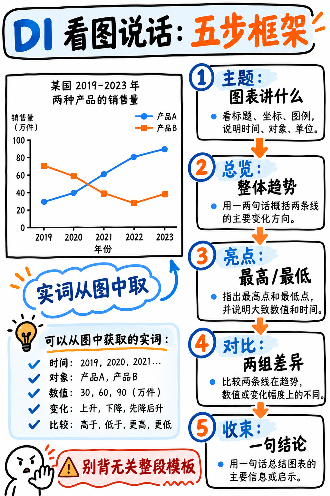

# 03. 描述图像 (Describe Image, DI) 极速通关指南 —— A 级骨干题型

:::{admonition} 题型核心参数一览 (At a Glance)
:class: tip
| 核心指标 | 官方标准参数 |
|---|---|
| **考场题量** | 5–6 题 |
| **供分单项** | **口语 (Speaking)** |
| **准备时长** | 25 秒（屏幕展示图表，麦克风关闭） |
| **答题时长** | 40 秒录音窗口 |
| **官方考查特质** | Content (内容), Pronunciation (发音 0–5分), Oral Fluency (流利度 0–5分) |
| **真人专家双评** | **是！** 2025 年改版后，Content 内容分由真人考务专家双重核对审查 |
:::

:::{danger} 彻底摒弃过时的万能套话模板！
过去数年间，国内许多备考资料教考生死记硬背一套万能模板：“The given image illustrates valuable information about the topic. It can be clearly seen that...”

**这种打法在当下的考试中等于直接送死！** 培生官方指南明确警告：*“未作答或答非所问判定 Content=0。凡包含预先准备的死背材料均直接判定为无关回答 (Content=0)！”* 且自 2025 年 8 月起，DI 的内容维度由**真人专家直接介入抽检复核**。真人考官一眼就能识破空洞的套话。

一旦 Content 被判定为 0 分，后面的流利度与发音评分通道将**彻底关闭，整题直接判 0 分**！
:::

---

## 句式脚手架 (Frames) 彻底取代死板模板

**死板模板 (Template)** 试图提前包办所有语义内容；而**句式脚手架 (Frame)** 仅提供语法骨架，句子中所有核心实词全部从眼前的图表中实时提取：

| ❌ 危险的万能套话 (Content=0 高危) | ✅ 安全合规的句式脚手架 (官方完全认可) |
|---|---|
| “The given image illustrates valuable information about the topic. It can be clearly seen that there are several elements. Overall, the image provides significant insight into the subject matter.”<br>*(套在全世界任何图表上都能说通，没有任何具体名词，判定为无关套话，Content=0)* | “This **[图表类型]** shows **[读图表标题/轴标签]**. The highest is **[读出最高项名称]** at about **[读出数值]**. The lowest is **[读出最低项名称]**. **[读出一项显著趋势或对比]**. So overall, **[读出一句总结结论]**.”<br>*(骨架只有大约 12 个固定连接词，而充实全句的所有血肉均来自眼前的真实图表)* |

**黄金自检法则**：你想说的这句话，**脱离了眼前这张特定的图表，套在另一张完全不同的图上还能直接说吗？** 
- 如果可以，立刻把它从你的脑海中删掉！
- 只有那些必须填入眼前图表特有名词的骨架，才是绝对安全的。

---

## 40 秒黄金五段式作答结构 (The Universal Five-Move Structure)



40 秒的答题时间大约需要输出 **85–110 个英文单词**。请严格按以下五步节奏推进：

```
┌─────────────────────────────────────────────────────────────────┐
│ 1. 识别图表 (IDENTIFY)  约 5 秒   这是什么图？主题是什么？       │
│ 2. 锁定极值 (HIGHEST)   约 8 秒   数值最高项（名称 + 具体数值）   │
│ 3. 锁定极小 (LOWEST)    约 8 秒   数值最低项（名称 + 具体数值）   │
│ 4. 描述特征 (PATTERN)   约 12 秒  一个明显的发展趋势、对比或归类  │
│ 5. 一句话收尾 (CLOSE)   约 5 秒   数据反映的整体宏观特征/总结     │
└─────────────────────────────────────────────────────────────────┘
                   说满 35–38 秒，干脆利落收尾，严禁提前大截停顿
```

:::{important} 为什么“抓最大值与最小值”是通解核心？
无论是柱状图、折线图、饼图、表格还是地图，**永远存在最大值和最小值**！这不需要任何深奥的数学统计推演，一眼就能看出来。并且它强制你读出具体的实体标签词和数字，这恰恰是机器算法与真人考官用来判定你给出了实质性内容（Content > 0）的关键凭证。
:::

---

## 25 秒准备时间的黄金分配切片

| 时间切片 | 强制执行动作 |
|---|---|
| **0–5 秒** | **读标题与坐标轴标签**。题干直接把词汇送到了你的眼前，抄写在草稿板上。 |
| **5–12 秒** | **一眼找出最高值与最低值**。记下名称和大概的数值。 |
| **12–20 秒** | **寻找一个明显的宏观特征**——上升、下降、某项占据绝对支配地位、或两组数据差异巨大。 |
| **20–25 秒** | **无声唇动试念开头第一句**，确保提示音一响立刻毫无卡顿地开嗓。 |

**可擦草稿板极简笔记示范（以能源消耗柱状图为例）：**
```
Title: energy use by source
High: coal 42%     Low: solar 3%
Pattern: coal down, renewables up
```
只要草稿板上有这三行词，40 秒的连续平稳输出就已经有了全部弹药！

---

## 常见图表类型的句式脚手架实操库

### 1. 折线图 / 历史趋势图 (Line Graph / Trend)
> “This line graph shows **[变量名称]** from **[起始年份]** to **[截止年份]**. **[变量A]** rose steadily from about **[数值]** to **[数值]**, while **[变量B]** fell over the same period. The sharpest change occurred in **[具体时间点]**. So overall, the general trend is **[upward/downward]**.”

- **趋势动词**：rose, increased, climbed, grew / fell, declined, dropped, decreased / remained stable, levelled off, fluctuated / peaked at (达到顶峰), bottomed out at (触底)
- **修饰副词**：sharply, steadily, gradually, slightly, dramatically

### 2. 柱状图 / 类别对比图 (Bar Chart / Comparison)
> “This bar chart compares **[对比主题]** across different **[分类名称]**. **[项目X]** is the highest at roughly **[数值]**, and **[项目Y]** is the lowest at about **[数值]**. **[项目X]** is nearly **[twice / three times]** as large as **[项目Y]**. The remaining categories cluster between **[数值]** and **[数值]**.”

- **对比表达**：considerably higher than, slightly lower than, roughly double, about half, the second largest, by far the largest

### 3. 饼图 / 占比构成图 (Pie Chart / Proportion)
> “This pie chart illustrates the breakdown of **[分析主题]**. The largest share belongs to **[项目X]** at **[数值]** percent, followed closely by **[项目Y]**. The smallest segment is **[项目Z]** with only **[数值]** percent. Together, **[项目X and Y]** make up over half the total.”

- **占比表达**：accounts for, makes up, represents, constitutes / roughly a quarter, just under a third, the vast majority of

### 4. 数据表格 (Table)
> “This table presents the data of **[表格标题]** across several categories. The highest value is **[数值]** for **[项目X]**, while the lowest is **[数值]** for **[项目Y]**. Looking across the figures, we can see a clear difference between different groups.”

### 5. 地图 / 地理分布图 (Map)
> “This map illustrates the distribution of **[主题]** across **[区域/国家]**. **[核心要素]** is mainly concentrated in the **[north/south/east/west]**, especially around **[地名]**. On the other hand, there is very little presence in the opposite region.”

### 6. 流程图 / 循环机制图 (Process Diagram / Flow Chart)
> “This diagram demonstrates the overall process of **[主题]**, which involves **[步骤数量]** main stages. It begins with **[阶段一]**. Next, **[阶段二]**. This directly leads to **[阶段三]**. Finally, it concludes with **[最终阶段]**, producing the final outcome.”

- **时序衔接**：begins with, first, next, then, after that, subsequently, this leads to, finally

### 7. 真实摄影照片或无数据示意图 (Photograph / Illustration)
> “This photograph shows **[核心主体人物/物体]**, who is currently **[核心动作描述]**. In the foreground, we can clearly see **[前景物体]**, while in the background there is **[背景环境]**. The overall setting appears to be **[具体场景：室内/办公室/自然环境]**.”

:::{tip} 临场看不懂图意时的终极救生圈
如果你在考场上遇到了一张极其晦涩难懂的示意图或艺术照片：**立刻放弃深度解读，直接描述物理肉眼所见的实体！**
说出你看到的颜色、物体、空间相对位置（in the foreground, on the left, at the center）以及图像中的文字标牌。**平稳流畅地说出看得见的物体就是合规的内容！** 哪怕解读浅显，也比卡壳沉默强百倍。
:::

---

## 本题专属流利度实战守则

:::{warning} 严禁在 20 秒时戛然而止，也切忌在 40 秒中途被掐断
本题最常见的两大失分惨案：
1. **只说了 20 秒就没话说了，坐在考位上干等麦克风关闭**：音频样本长度严重不足，系统无法充分评估流利度与发音，内容分也会被扣除。平时必须准备好备用的对比句或总结句，确保从容说至 35 秒以上。
2. **在 40 秒倒计时结束瞬间话只说了一半被强行截断**：虽无硬性违规扣分，但半截话会严重破坏句尾节奏感。**最佳收尾时间是 36–38 秒之间**，说完最后一句总结，鼠标从容点击 Next。
:::

- **数字模糊化读法 (Hedging)**：读数字时不必死抠精确小数点，善用模糊限定词：*"about forty percent"*, *"roughly two thousand"*, *"just under half"*。既符合纯正学术英语习惯，又极大降低了脑力核算负担。
- **念错词绝不自我纠正**：把标签读错了一个音，坚决不重念！倒车纠错对流利度的伤害是致命的。

---

## 每日专项强化训练建议

| 训练阶段 | 天数 | 任务重点 |
|---|---|---|
| **第一阶段：10 秒极限抓极值** | 第 1–2 天 | 随意在网上找 20 张统计图表，**强制自己在 10 秒内脱口而出最高项与最低项**，只练视觉抓取速度。 |
| **第二阶段：五段式脚手架连贯输出** | 第 3–5 天 | 精练 {doc}`../50-practice/04-describe-image-bank` 中的 12 道官方母题，掐表 25 秒看图、40 秒录音，检查自己是否说满 35 秒。 |
| **第三阶段：特异图表脱敏 (流程图/地图/照片)** | 第 6–9 天 | 专门挑初学者最害怕的非标准图表训练，建立“看图说物理实体”的从容心态。 |
| **第四阶段：全真盲测** | 第 10–14 天 | 随机刷图，一次录音过，杜绝重录。 |

---

## 初学者必须杜绝的失分误区

| 常见失分误区 | 为什么致命 | 纠偏动作 |
|---|---|---|
| 背诵空洞套话开头 | **Content 判 0，整题直接被判零分** | 采用句式脚手架，核心名词全部现场提取自图表 |
| 执着于把图上每个数字都念出来 | 耗尽时间，节奏破碎，像在报菜名 | 仅报出最大值、最小值和一个大趋势即可 |
| 说了 20 秒就提前停住 | 严重饥饿化音频样本，流利度评分受损 | 储备 1 句宏观总结作为备用缓冲带 |
| 准备时间发呆，倒计时完了才慌张 | 开头卡壳，前 3 秒致命停顿 | 准备期最后 5 秒必须心中无声试念首句 |
| 读错了标签词立刻倒回去重读 | 流利度声学波形产生严重断层 | 错读直接滑过，保持平稳语速往前走 |

---

**配套实战演练题库：** 立即前往 {doc}`../50-practice/04-describe-image-bank`，查看 12 套全真图表模型答案、准备期草稿示范与时间轴切片拆解。
