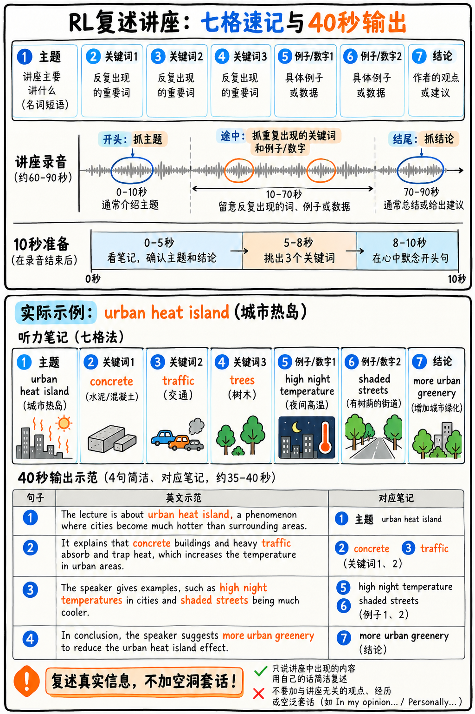

# 04. 复述讲座 (Retell Lecture, RL) 极速通关指南 —— C 级低防守实战技巧

如图 10 所示，把讲座压缩成主题、三关键词、两个细节和结论七格，再按笔记组织 40 秒复述。



*图 10：RL 七格笔记、10 秒准备与复述示例。示例中的内容词均应来自实际听到的讲座。*

:::{admonition} 题型核心参数一览 (At a Glance)
:class: tip
| 核心指标 | 官方标准参数 |
|---|---|
| **考场题量** | 2–3 题 |
| **供分单项** | **听力 (Listening) + 口语 (Speaking)** 双向供分 |
| **音频输入** | 长达 60–90 秒的学术讲座音频（可能配有讲座相关背景插图） |
| **准备时长** | **仅 10 秒** |
| **答题时长** | 40 秒录音窗口 |
| **官方考查特质** | Content (内容), Pronunciation (发音 0–5分), Oral Fluency (流利度 0–5分) |
| **真人专家双评** | **是！** 2025 年改版后内容分引入真人考务专家抽检复核 |
:::

---

## 为什么建议初学者将 RL 归入 C 级“低防守应对”？

对于初学者而言，Retell Lecture 是第一部分中难度最高的复合任务：
你必须连续听懂 90 秒陌生且晦涩的大学学术讲座，在草稿板上完成高强度的英文速记，并在仅有 10 秒的思考时间内迅速组织语言，完成 40 秒连贯口头转述。
同时面对听力理解、英文速记和即兴口语创作三重高压。

更重要的是：**整场考试仅考 2–3 题**。投入巨量时间死磕速记，性价比极低。

:::{important} C 级核心战术方针：不要追求当完美讲座速记员，要当匀速平稳的讲述者！
流利度和发音两大特质从不在意你记下的学术细节有多么精微。只要系统判定你的 Content 大于 0，流利度与发音的满分通道就全部开放。

我们看两类考生的真实得分对比：
- **考生 A（精准但卡顿）**：听懂了核心学术脉络，但因为想组织复杂语法，中途反复停顿纠错 ➔ Content 得 3 分，流利度得 2 分，发音得 3 分；
- **考生 B（粗放但平稳）**：只听懂了开头的主题和 3 个学术专有名词，套入极简骨架毫无卡顿、匀速说满 40 秒 ➔ Content 得 2 分，**流利度得 4–5 分，发音得 4–5 分**！

**考生 B 斩获的总分远远超越考生 A！** 
实战铁律：**抓几个听清的实词，用极平稳的节拍匀速说满 40 秒，靠流利度与发音赚取高分！**
:::

---

## 90 秒极简“七格速记法” (The Seven-Slot Note Method)

初学者最大的误区是在听讲座时试图在草稿纸上记录完整英文句子。人的手速永远跟不上 150 词/分钟的学术语速。你必须完全摒弃句子，**只在草稿纸上捕捉以下 7 个离散信息点**：

```
1. TOPIC (主题):       ____________________ (听录音开头的第 5–10 秒，必出主旨)
2. KEYWORD 1 (关键词1): ____________________ (中间高频重复出现的技术专有名词)
3. KEYWORD 2 (关键词2): ____________________
4. KEYWORD 3 (关键词3): ____________________
5. EXAMPLE 1 (举例1):  ____________________
6. EXAMPLE 2 (举例2):  ____________________
7. CONCLUSION (结论):  ____________________ (听录音最后的第 10 秒，必出收尾)
```

**缩写与符号化**：能写首字母就不写全词，能用箭头（↑, ↓, ➔）就不写介词。

:::{tip} 听力分数的大金矿：开头 10 秒与结尾 10 秒
学术讲座遵循严谨的学术论证模式：永远在最开头亮出命题，在最末尾总结结论。
**哪怕中间的论述部分你宛如听天书，只要你死死咬住录音最前面的主题句和最后一句结论，再在中间顺手打捞 2–3 个高频重复词，你就已经抓住了 80% 的核心采分点！**
在中间段，不要执着于理解复杂因果逻辑，只抓反复出现的重读名词即可。
:::

---

## 官方认可的安全句式脚手架 (Sentence Frame)

固定骨架词汇约 15 词，其余全部填入你速记下来的信息：

> “The lecture was mainly about **[填入主题 TOPIC]**. The speaker’s primary argument was that **[填入核心论述 KEYWORD 1]**. They further explained **[填入 KEYWORD 2]** and discussed **[填入 KEYWORD 3]**, providing the example of **[填入 EXAMPLE 1]**. In addition, they highlighted the importance of **[填入 EXAMPLE 2]**. Overall, the speaker concluded that **[填入末尾结论 CONCLUSION]**.”

### 如果中间彻底崩盘没听懂？极简保命脚手架：
> “The lecture was mainly about **[填入主题 TOPIC]**. The speaker focused heavily on **[填入 KEYWORD 1]** and **[填入 KEYWORD 2]**. One major point they made was that **[读出你听懂的任何词组]**. They also illustrated this with **[填入 KEYWORD 3]**. The overall conclusion was that **[填入主题 TOPIC]** is an essential and developing issue.”

:::{warning} 严禁套用空洞的无意义套话
千万不要说：“The speaker talked about many interesting things in the lecture.” 这种没有任何信息量的套话会被直接判定为无效废话。
如果你缺少材料，**把听到的同一个核心实词换一种说法再说一遍**：“The speaker repeatedly emphasized the role of **[核心词]** throughout the discussion.” 这依然是有效的内容（Content）！
:::

---

## 10 秒准备时间的微秒级规划

| 时间 | 强制执行动作 |
|---|---|
| **0–5 秒** | 扫视草稿板，圈出**开篇主题 (Topic)** 和**末尾结论 (Conclusion)**。 |
| **5–8 秒** | 明确三个关键词的口头念出顺序：一、二、三。 |
| **8–10 秒** | 嘴唇微动默念起手式：“*The lecture was mainly about...*”，确保提示音一响瞬间开口。 |

---

## 40 秒正式录音交付铁律

1. **开麦瞬间直接起步**：提示音响起的第 1 秒必须开嗓，绝不等待。
2. **充分利用全部 40 秒，绝不在 20 秒提前闭嘴**：如果草稿板上的词念完了，从容补充一句：“*This issue provides critical insights into the study of [主题词].*”
3. **遇到学术生词大胆自信念出**：听到如 “*mitochondrial efficiency*” 这类生涩词汇，不要卡壳，大胆顺畅念过，坚决不在发音上犹豫。
4. **保持与 Read Aloud 完全一致的平稳节拍器语速**。

---

## 每日 10 分钟低成本维护训练法

（请注意：只有在 S 级四项已完全巩固的前提下，才分配时间给本题）

- **第一阶段（听首尾）**：随便找一段 TED 演讲或学术公开课音频，只听前 15 秒和后 15 秒，快速写下主题和结论。
- **第二阶段（七格笔记）**：掐表 90 秒听音，草稿板只写 7 个离散信息点。
- **第三阶段（全真演练）**：90 秒听音 ➔ 10 秒准备 ➔ 40 秒平稳录音，检查自己是否中途卡顿超过 1 秒。

---

**下一章学习指南：** 请继续阅读口语中唯一一道白送听力基础分的题型：{doc}`05-answer-short-question`。
