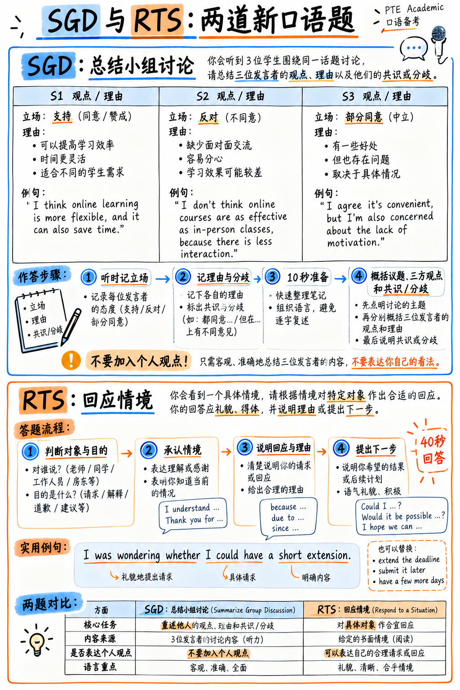

# 06. 小组讨论总结 (Summarize Group Discussion, SGD) —— C 级 · 2025 年 8 月全新题型

:::{admonition} 题型核心参数一览 (At a Glance)
:class: tip
| 核心指标 | 官方标准参数 |
|---|---|
| **考场题量** | 2–3 题 |
| **供分单项** | **听力 (Listening) + 口语 (Speaking)** 双向供分 |
| **音频输入** | 长达 **3 分钟** 的音频，包含 **3 位不同发言人** 围绕某一主题展开讨论 |
| **准备时长** | **仅 10 秒** |
| **答题时长** | **整整 2 分钟 (120 秒)** —— 全场作答时间最长的单道口语题！ |
| **官方考查特质** | Content (内容), Pronunciation (发音 0–5分), Oral Fluency (流利度 0–5分) |
| **真人专家双评** | **是！** 内容维度由真人考务专家进行复核抽检 |
:::

:::{warning} 2025 年新题型：切防被过时资料蒙蔽
Summarize Group Discussion 是培生在 **2025 年 8 月官方重大改版中全新加入** 的口语题型。网络上任何 2025 年 8 月之前出版的辅导教材中都完全没有收录本题型。本指南提供的应试策略基于培生官方考生手册与真实考场实战数据推导。
:::

---

## 为什么将其列入 C 级？2 分钟作答时间背后的战略生机

如图 12 所示，SGD 的核心是区分三位发言者的立场、理由与分歧；图中下半部分的 RTS 可帮助辨明两题的输出目标。



*图 12：SGD 与 RTS 两题对照。阅读本节时重点看 SGD 三列听力笔记和客观概括路径。*

客观来说，这道题对初学者的考验极大：
录音长达 3 分钟，有男有女共 3 个人七嘴八舌交替发言，听完后只有 10 秒钟准备，紧接着必须**对着麦克风连续讲满整整 2 分钟**！很多初学者往往说到 40 秒脑子就一片空白。

但请逆向思考：**这同时是展示语音流利度的最大舞台！**
整整 2 分钟的充沛录音窗口，为 AI 算法评估你的发音（Pronunciation）和流利度（Oral Fluency）提供了全场最宽裕的声学波形样本。

:::{important} 核心实战策略：粗线条抓住三人立场，靠匀速流利度说满 2 分钟！
你不需要在总结中做到“滴水不漏地还原所有讨论细节”。你只需要做到：
1. 听出这 3 个人分别持什么基本态度（赞成、反对、还是中立保留）；
2. 记下他们各自提出的 1 个核心理由；
3. **利用句式骨架平稳、不间断、匀速说满 1 分 45 秒至 2 分钟**！

在 2 分钟的长窗口中，哪怕内容分只拿到及格分，但凭借整整两分钟平滑均匀的声学波形，你能把流利度和发音的 4–5 分直接赚满！其总收益远远高于一段说了 45 秒就陷入 75 秒死寂的所谓“精准总结”。
:::

---

## 针对三位发言人的“三列九格草稿速记法”

听 3 个人讨论，最容易出现的混乱是“张冠李戴（搞混谁说了什么）”。
**在录音开始前的 3 秒倒计时内，立刻在可擦草稿板上划出三列网格**：

```
   发言人 1 (S1 - 男声1)      发言人 2 (S2 - 女声)      发言人 3 (S3 - 男声2)
   ───────────────────       ───────────────────       ───────────────────
   基本立场 (Position):       基本立场 (Position):       基本立场 (Position):
   核心论据 (Reason):         核心论据 (Reason):         核心论据 (Reason):
   赞同/反驳谁 (Attitude):    赞同/反驳谁 (Attitude):    赞同/反驳谁 (Attitude):
```

你只需要在 3 分钟内抓取这 9 个短语碎片，而不是去记一篇长篇速记。

:::{tip} 如何在听音时迅速区分发言人与捕获立场？
1. **用声音特征标记，不要管英文名字**：考试音频中的英文名容易记错，直接标记为 "S1"（先开口的男声）、"S2"（女声）、"S3"（后开口的男声）。答题时说 "The first speaker", "The second speaker" 完全合规！
2. **死死咬住“转折与立场交接信号词”**：
   - 表达反驳：*"I'm not sure I agree with that...", "That's a fair point, but look at..."*
   - 表达补充赞同：*"Exactly, and what's more...", "I completely support that idea because..."*
   - 表达中立折中：*"Well, from my perspective, it really depends on..."*
   听到这些信号词时，后面紧跟的一句话就是该发言人的核心采分立场！
:::

---

## 官方认可的 2 分钟高分句式脚手架 (Sentence Frame)

固定语法骨架约 30 词，总作答规模控制在 250–300 词左右：

> “The group discussion mainly focused on **[讨论核心议题 TOPIC]**.
> 
> The first speaker clearly argued that **[发言人1的核心立场 POSITION 1]**, primarily because **[论据 REASON 1]**. They emphasized that this approach would lead to significant benefits.
> 
> In contrast, another speaker expressed a different perspective, suggesting that **[发言人2的核心立场 POSITION 2]**. They pointed out that **[论据 REASON 2]**, which raised concerns regarding practical challenges.
> 
> The third speaker partially **[agreed with / questioned]** these arguments, adding that **[发言人3的核心观点 POSITION 3]**.
> 
> A key sub-topic they discussed in detail was **[讨论的具体子话题]**, where the participants debated whether **[双方争议焦点]**.
> 
> While there was broad agreement that **[三方达成共识的方面]**, they remained divided over **[分歧点]**.
> 
> Overall, the discussion illustrated that the issue of **[讨论议题 TOPIC]** is highly multifaceted and requires careful consideration.”

---

### 当笔记念完了、时间还剩 40 秒时，如何安全合规延展？

这是 2 分钟长题目最关键的救命技巧。合规的扩充动作（按优先级排序）：

1. **补充讲述他们给出的具体理由**：“*The main reason they provided for this concern was that...*”
2. **更具体地描述他们的担忧**：“*In particular, the speakers were worried about the long-term impact on...*”
3. **重新阐述核心分歧的本质**：“*The core disagreement between the participants ultimately came down to whether...*”
4. **指出讨论中尚未达成一致的悬案**：“*By the end of the conversation, they had not yet reached a final consensus on...*”

:::{danger} 严禁在超时空隙中夹带个人私货！
千万**不要**在时间不够时发表你自己的个人见解（如：“*In my personal opinion, I think the first speaker is right...*”），也**不要**说空洞的社交客套话（如：“*This was a very delightful discussion...*”）。
该题目的核心任务是**客观概括他们的对话**。夹带考生个人主观观点会被真人考务复核判定为跑题扣分。
如果实在没词了，**用不同的句式重新把双方的分歧点客观复述一遍**，永远比乱加主观观点安全得多！
:::

---

## 每日 10 分钟低成本维护训练法

（请注意：必须在 S 级四项完全巩固的前提下才进行本项训练）

- **第一阶段（三列辨识）**：找一段 3 人圆桌讨论播客或电视辩论录音，听 3 分钟，草稿纸上只做三列区分，记录每个人是支持还是反对。不开口，只练耳朵与草稿分类。
- **第二阶段（2分钟耐力脱敏）**：随意拿一个熟悉的话题（如“远程办公的优缺点”），用手机录音，**强制自己用英文连续讲满 2 分钟不中断**。先克服对 120 秒时间的心理恐惧。
- **第三阶段（全真演练）**：3 分钟听音 ➔ 10 秒草稿整合 ➔ 2 分钟录音输出。

---

**下一章学习指南：** 请继续阅读 2025 年官方改版加入的另一项全新生活化口语题型：{doc}`07-respond-to-a-situation`。
