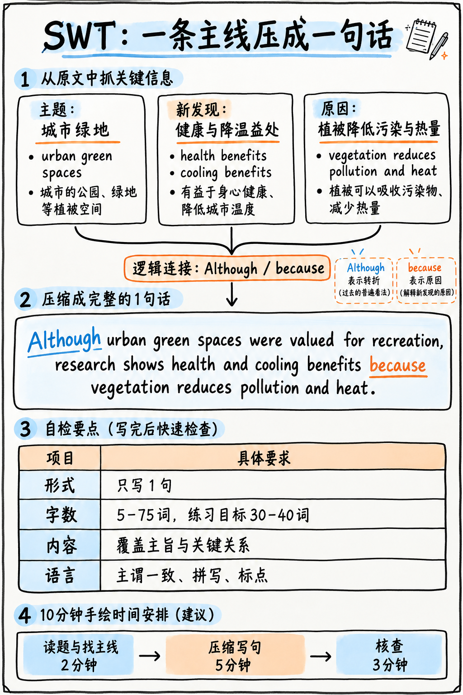

# 01. 概括文本 (Summarize Written Text, SWT) 极速通关指南 —— A 级骨干题型

:::{admonition} 题型核心参数一览 (At a Glance)
:class: tip
| 核心指标 | 官方标准参数 |
|---|---|
| **考场题量** | 2 题 |
| **供分单项** | **阅读 (Reading) + 写作 (Writing)** 双向核心交叉供分 |
| **阅读文本** | 最多 300 词的学术说明文或议论文短文 |
| **作答时间** | **每题独立计时 10 分钟**（上一题剩余时间不累加至下一题） |
| **格式限制** | **有且仅有 1 句话 (ONE single sentence)，严格限制在 5–75 词之间** |
| **官方考查特质** | Content (内容), Form (格式/单句), Grammar (语法), Vocabulary (词汇) |
| **真人专家双评** | **是！** 2025 年改版后 Content 维度引入真人考务专家抽检复核 |
:::

:::{danger} 触碰即直接判 0 分的 Form 格式死线规则
在整个 PTE 考试中，SWT 的格式红线是最机械但也最容易失误的致命雷区：
你的最终答案**必须是整整一段、由且仅由 1 个句号结尾的“单一英语句子”，字数严格卡在 5–75 词之间**。脱离该区间，该题直接判 0 分！

**考场三大高危禁忌：**
1. **全文只能在最末尾出现 1 个句号（Full stop）**。中间若手抖多打了一个句号，直接被判为两句话，Form 判 0！
2. **严禁使用分号（Semicolon `;`）**。分号在很多机评判定规则中会被误识别为独立句切分符号，切勿冒险。
3. **安全字数目标：锁定在 30–40 词之间**。这个区间既能从容装下两到三个核心论点，又不会因为句子拖得过长而产生语法车祸。
:::

---

## 为什么 SWT 是性价比极高的 A 级必争之地？

整场考试中，直接向写作单项贡献分数的题目仅有少得可怜的 7–8 题，而 SWT 自己就占了 2 题！同时它还向阅读单项大量输送分值。
每题给足整整 10 分钟，时间极其充裕。只要掌握了“**提炼 2–3 个主干论点 + 逻辑连接词复合缝合**”的公式化套路，就能稳稳拿下双向满分。

---

## 10 分钟黄金答题配速流程 (The 10-Minute Method)

如图 14 所示，先找主题、新发现和原因，再用一个逻辑关系串成完整单句；可用图中的英文示例检查连接词和标点。

*图 14：SWT 信息压缩流程、单句示范和形式自查表。*

| 阶段 | 建议时间 | 强制执行动作 |
|---|---|---|
| **第一步：主干略读** | 第 0–3 分钟 | **只读段落第一句与文章最后一句**。绝不要逐字死抠全篇细节，抓住中心论点。 |
| **第二步：信息碎片提炼** | 第 3–5 分钟 | 在草稿板上写下 2–3 个核心主旨碎片（以短语形式，不要写完整句子）。 |
| **第三步：缝合复合长句** | 第 5–8 分钟 | 套入下文三大高分句式之一，用连词将碎片串联为标准的单一句子。 |
| **第四步：语法九项全检** | 第 8–10 分钟 | 严格对照检查清单（句号、字数、主谓一致、拼写），从容提交。 |

:::{tip} 学术文章主旨藏在哪里？
西方学术文章遵循严谨的“首句主题句 (Topic Sentence)”结构：
- **每个自然段的第一句话，通常就是该段的核心观点**；
- **全篇最后一句话，通常是作者的结论与升华**。
一段 300 词的短文通常包含 2–4 个自然段。你只需要把各段首句和末尾结论句读懂，整篇文章的骨架就一览无余了！中间的大段举例、数据、引用细节可以彻底略过。
:::

---

## 官方认可的三大通用复合长句骨架 (The Three Reliable Sentence Patterns)

你不是在死记硬背现成内容，而是选择一个**优雅合规的复合句语法骨架**，把从文章中提取出来的真实论点自然倾倒进去：

### 句式一：“Although……, …… because……”（对立/转折/新旧发现类文章）

> “Although **[传统的普遍看法 / 先前的学术认知]**, **[文章提出的核心主张]**, because **[支撑该主张的核心论据或机理]**.”

*经典实战示范（城市绿化研究）：*
> "Although urban green spaces have long been valued mainly for recreation, recent research indicates that they also deliver measurable public health and cooling benefits, because vegetation reduces air pollution and lowers local temperatures during heatwaves."
> 
> *(精准 36 词，单一复合句，优雅涵盖全篇转折与因果，满分典范！)*

### 句式二：“While……, …… and ……”（两面性/利弊权衡类文章）

> “While **[方面 A 的现状或优势]**, **[方面 B 的代价或挑战]**, and **[因此引发的最终结论或应对举措]**.”

*经典实战示范（远程办公利弊）：*
> "While remote working has reduced commuting costs and increased flexibility for many employees, it has also weakened informal collaboration and made early-career training more difficult, and employers are therefore experimenting with hybrid arrangements that attempt to preserve both."
> 
> *(精准 38 词，单一句子，层次分明。)*

### 句式三：“[主题] ……, which ……, although ……”（科学机制阐述/客观描述类文章）

> “**[核心主题及其关键特征]**, which **[其产生的影响、机理或深远意义]**, although **[存在的局限性、例外或现实制约]**.”

*经典实战示范（珊瑚礁生态保护）：*
> "Coral reefs support roughly a quarter of all marine species despite covering a tiny fraction of the ocean floor, which makes their rapid decline from warming and acidification especially damaging, although some reefs have shown unexpected resilience where water quality remains high."
> 
> *(精准 41 词，定语从句与让步状语从句完美融合。)*

:::{important} 为什么这三大句式在机器算法中极受青睐？
它们每一个都是由“从句 + 主句 + 连词”构成的规范**主从复合句**：
1. **天然杜绝双句号风险**：完全不需要分号或并列句点，结构稳固；
2. **在语法与词汇广度上拿满高分**：从属从句、状语从句的运用直接证明了你的书面语篇驾驭能力；
3. **真正揭示了论点之间的内在逻辑**：这也正是真人复核考官在 Content 维度最看重的逻辑连接深度。
:::

---

## 改写 (Paraphrasing) 的安全红线与边界

官方评分标准中明确指出：最高档评价要求“*有效运用同义改写以传达清晰准确的总结*”，而中等档次会指出“*改写不连贯，夹杂无关细节*”。

改写的正确分寸：**改普通词，留专有名词！**

| 必须果断替换改写的普通词汇 | 坚决保留原词的专业术语与专有名词 |
|---|---|
| 普通动词：*shows ➔ indicates / reveals / demonstrates* | 专业学科名词：*photosynthesis (光合作用), inflation (通胀)* |
| 普通形容词：*big ➔ substantial / significant / considerable* | 专有名词与理论名称：*The Industrial Revolution* |
| 句式结构：拆解原句，用从句重新缝合 | 核心测量单位与关键统计年份 |

:::{warning} 严禁在摘要中夹带任何具体的例子或数据支流！
很多初学者常犯的错误是把原文中的举例（for example, such as...）原封不动抄进摘要里。
35 词的黄金空间极其宝贵，只能留给“宏观主张”。评分准则中明确将“Extraneous details (无关细节)”列为降分指标。**只要是论证中的佐证例子，一律坚决剔除！**
:::

---

## 点击 Submit 前的终极自检清单 (Checklist)

每次写完，留出 2 分钟逐项扫视核对：

- [ ] **全篇有且只有 1 个句号**（且位于整句话的最末尾）
- [ ] **绝无分号（`;`）**
- [ ] **字数严格落在 25–45 词的安全区间内**（看屏幕左下角实时字数计数器）
- [ ] 主句具备清晰的**主语和谓语动词**（严禁写成无谓语的从句碎片）
- [ ] **主谓单复数一致性**（第三人称单数 -s 检查）
- [ ] 时态前后一致（客观事实用一般现在时，研究成果用现在完成时）
- [ ] **首字母大写**
- [ ] 确保每个词拼写无误（对生词拼写没把握时，立刻换用更简单的词）
- [ ] 绝无整句照抄原文原句（有基本的语法结构重构）

---

**下一章学习指南：** 请继续阅读全场最重磅的书面语篇大题：{doc}`02-write-essay`。
