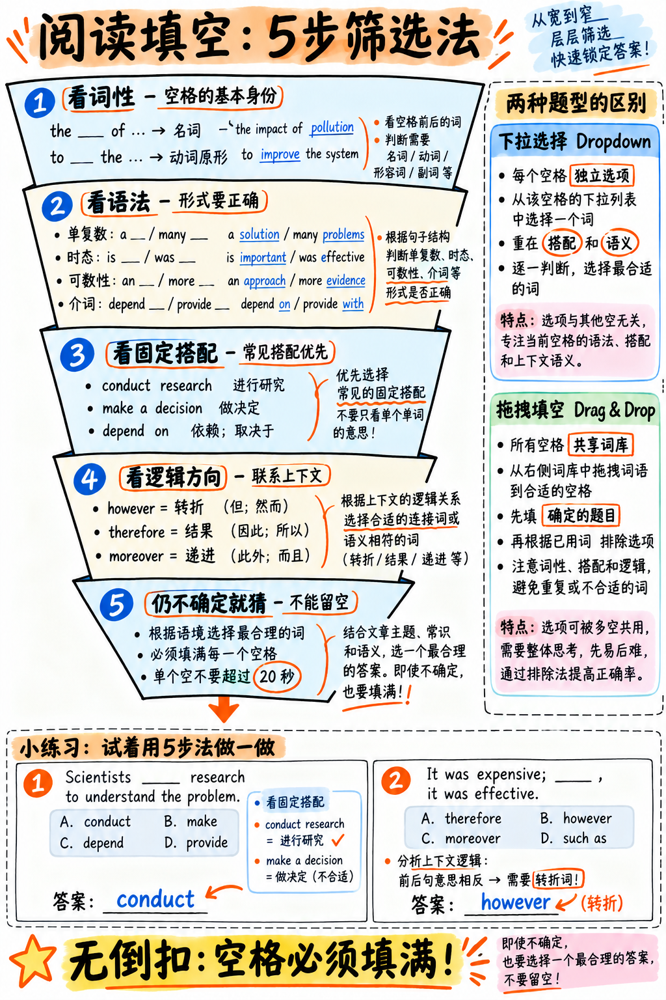

# 01. 阅读完形填空 (两类 FIB) 极速通关指南 —— S 级战略核心

:::{admonition} 题型核心参数一览 (At a Glance)
:class: tip
| 核心指标 | 下拉完形填空 (RW-FIB) | 拖拽选词填空 (R-FIB) |
|---|---|---|
| **考场题量** | 5–6 题 | 4–5 题 |
| **供分单项** | **阅读 (Reading)** | **阅读 (Reading)** |
| **篇幅规模** | 每篇 ≤ 200 词，含 4–5 个下拉空格 | 每篇 ≤ 80 词，含 3–5 个拖拽空格 |
| **交互形式** | 每个空格拥有独立的下拉菜单（约 4 个选项） | 底部共用一个选词候选池，拖拽单词填入空格 |
| **官方计分规则** | **每填对一空得 1 分**，最低 0 分 | **每填对一空得 1 分**，最低 0 分 |
| **倒扣分惩罚** | **零倒扣分！(NONE)** | **零倒扣分！(NONE)** |

**两类合计：9–11 题 —— 占据整个阅读模块半壁江山的超级得分洼地！**
:::

:::{important} 彻底粉碎谣言：本题绝无倒扣分，每空必填！
官方 2025 年评分指南明确规定：两类完形填空均为 *“Partial credit (for each correctly completed blank) — 1 Each correctly completed blank, 0 Minimum score”*。**计分规则中没有任何扣分项！**

国内部分备考机构宣称完形填空选错会倒扣分，这是严重的误传。
**考场绝对法则：所有空格必须百分之百填满！哪怕完全看不懂，也必须蒙一个最顺眼的词！** 蒙错 0 分，不扣任何已有分数；留白则保证得 0 分。
:::

---

## 两大完形填空的本质区别与应对思维

### 1. 下拉完形填空 (RW-FIB, 5–6 题) —— 语法、固定搭配与连接词测试
每个空格拥有独立的 4 个下拉选项。值得注意的是：**同一空格的 4 个选项通常属于相同的词性（全是动词、或全是形容词）**。纯靠基础词性往往无法排除，它核心考查的是：
- **学术固定搭配 (Collocation)**：该动词习惯与前后的哪个介词或名词连用？
- **语篇逻辑连接词**：*however / therefore / moreover / nevertheless* 的转折与因果转向；
- **词义辨析与细微色彩**：*considerable / considerate / considered / considering*。

### 2. 拖拽选词填空 (R-FIB, 4–5 题) —— 词性排查与“排除法”测试
屏幕下方提供一个全局词汇池（通常选项词数比空格多 2–3 个干扰项）。因为所有空格共享同一个词汇池，**你必须全面使用“排除法”**！

:::{tip} 拖拽填空做题铁律：按“把握度”做题，严禁从左到右硬啃！
进入题目后，扫视所有空格：
1. **优先填入你 100% 确定能做对的 1–2 个空格**；
2. 这直接将候选词从词汇池中消耗消除；
3. 原本不确定的难空，候选词直接从 6–8 个骤降为 2–3 个，甚至可能只剩 1 个在词性上符合语法！
仅这一项做题顺序的改变，每道题就能直接多捡 1–2 分！
:::

---

## 完形填空五步破题决策漏斗 (The Decision Procedure)

如图 16 所示，每个空依次检查词性、语法、搭配和逻辑；下拉与拖拽两类题在图中分别给出操作重点。



*图 16：阅读填空的五步筛选流程与两类题型对照，含搭配和逻辑词小练习。*

面对每一个空格，严格按如下漏斗逐层向下排查，一旦某一步锁定了答案即刻收工：

```
┌─ 第一步：词性语法槽位判定 (PART OF SPEECH) ───────────────┐
│  观察空格左右两边的紧邻单词，判断该槽位需要什么词性：       │
│  • "the ____ of"        ➔ 必须是【名词】                  │
│  • "to ____ the"        ➔ 必须是【动词原形】              │
│  • "a ____ increase"    ➔ 必须是【形容词】                │
│  • "____ , the results" ➔ 必须是【副词/句子连接词】       │
│  立刻排除所有词性不符的干扰项。                            │
└──────────────────────────────────────────────────────────┘
                          ↓ 仍剩 2 个以上候选项？
┌─ 第二步：语法一致性核验 (GRAMMAR AGREEMENT) ───────────────┐
│  • 单复数一致性？谓语动词是否需要加 -s？                   │
│  • 时态是过去式 (-ed) 还是分词 (-ing)？                    │
│  • 空格后是否有特定的介词？（如 depend 必接 on）           │
└──────────────────────────────────────────────────────────┘
                          ↓ 仍剩 2 个以上候选项？
┌─ 第三步：学术高频固定搭配排查 (COLLOCATION) ───────────────┐
│  哪个选项是学术英语中习惯性与前后名词/动词绑定的？         │
│  • "____ research"   ➔ conduct / carry out (绝不用 make)  │
│  • "____ a decision" ➔ make (绝不用 do)                   │
│  阅读下拉题 70% 的分值由固定搭配直接决定！                │
└──────────────────────────────────────────────────────────┘
                          ↓ 仍剩 2 个以上候选项？
┌─ 第四步：上下文逻辑转向核验 (LOGICAL DIRECTION) ───────────┐
│  精读空格所在句的前后两句话：                             │
│  • 顺承递进 ➔ moreover, furthermore, in addition          │
│  • 转折对立 ➔ however, nevertheless, by contrast          │
│  • 因果推导 ➔ therefore, consequently, thus               │
│  • 举例说明 ➔ for instance, such as                       │
└──────────────────────────────────────────────────────────┘
                          ↓ 依然无法确定？
┌─ 第五步：果断蒙一个最顺眼的，立刻跳下一题！ ───────────────┐
│  无倒扣分！单空思考绝不许超过 20 秒。                     │
└──────────────────────────────────────────────────────────┘
```

---

## 考场最高频学术固定搭配速查库 (Essential Collocations)

### 1. 动词 + 名词 黄金搭配表（考场出现频次最高！）

| 动词 | 习惯搭配的名词宾语 |
|---|---|
| **conduct / carry out / undertake** | research (做研究), a study, a survey (做调查), an experiment, an investigation |
| **make** | a decision (做决定), progress (取得进展), a contribution (做贡献), an effort, an attempt, a mistake |
| **do** | research (亦可用), damage (造成破坏), harm (造成伤害), an assignment |
| **take** | action (采取行动), place (发生), account of (考虑到), responsibility (承担责任), measures (采取措施) |
| **draw** | a conclusion (得出结论), a distinction (做出区分), attention to (吸引注意力), an inference |
| **reach / arrive at** | a conclusion (达成结论), an agreement (达成协议), a consensus (达成共识) |
| **play** | a role (扮演角色), a key part (发挥关键作用) |
| **pose** | a threat (构成威胁), a risk (带来风险), a challenge (构成挑战) |
| **raise** | awareness (提高意识), a question (提出疑问), concerns (引发担忧), funds (筹措资金) |
| **meet** | a requirement (满足要求), a deadline (赶上截止日期), a need (满足需求), criteria (符合标准) |
| **gain / acquire** | knowledge (获取知识), experience (获得经验), insight (获得洞见), access (获得访问权限) |
| **pay** | attention (注意), a visit (造访), a price (付出代价) |
| **provide / give** | evidence (提供证据), an explanation (给出解释), support (提供支持) |
| **hold** | a view (持有观点), a belief (抱有信念), a conference (举办会议) |
| **bear** | in mind (牢记), responsibility (承担责任), the cost (承担成本) |
| **address / tackle** | an issue (处理问题), a challenge (应对挑战), a problem |
| **shed** | light on (揭示/阐释……之奥秘) |
| **place / put** | emphasis on (强调……), pressure on (给……施压) |

### 2. 形容词 + 名词 黄金搭配表

| 修饰形容词 | 习惯修饰的名词 |
|---|---|
| **significant / substantial / considerable** | increase (大幅增长), difference (显著差异), impact (重大影响), evidence (大量证据) |
| **widespread** | belief (普遍信念), adoption (广泛采用), concern (普遍担忧), criticism (广泛批评) |
| **growing / increasing** | concern (日益加剧的担忧), demand (不断增长的需求), awareness (意识增强) |
| **compelling / conclusive** | evidence (令人信服的/决定性的证据), argument (有力论点) |
| **vital / crucial / essential** | role (核心角色), component (关键组成), factor (关键因素) |
| **marked / sharp / steep** | rise (急剧上升), decline (大幅下降), contrast (鲜明对比) |
| **viable / feasible** | alternative (可行替代方案), option, solution |
| **profound / far-reaching** | effect (深远效果), impact (深远影响), consequences (深远后果) |
| **inherent** | risk (固有风险), limitation (固有局限), bias (内在偏见) |
| **underlying** | cause (根本原因), assumption (潜在假设), mechanism (底层机制) |

### 3. 名词/形容词 + 介词 核心搭配（下拉题最致命考点！）

选错介词，哪怕你看懂了全句也会白白失分：

| 核心词汇 | 必须锁定的介词 | 经典搭配范例 |
|---|---|---|
| **increase / decrease / rise / decline** | **in** | a sharp increase **in** temperature |
| **impact / effect / influence** | **on** | have a profound impact **on** society |
| **cause / reason** | **of** / **for** | the underlying cause **of** the disease |
| **reliance / dependence** | **on** | heavy reliance **on** fossil fuels |
| **exception** | **to** | an exception **to** the general rule |
| **solution / approach** | **to** | a viable solution **to** this problem |
| **evidence / research** | **for / on / into** | research **into** renewable energy |
| **contribution** | **to** | make a significant contribution **to** science |
| **access** | **to** | direct access **to** the database |
| **demand / need** | **for** | high demand **for** skilled workers |
| **similar / identical** | **to** | identical **to** the previous sample |
| **responsible / accountable** | **for** | held accountable **for** their actions |
| **consistent / compatible** | **with** | consistent **with** empirical data |
| **attributable / due** | **to** | mainly attributable **to** climate change |
| **capable** | **of** | fully capable **of** handling the task |
| **subject / prone / susceptible** | **to** | prone **to** frequent errors |

---

## 逻辑连接词的“情感与方向分类法”

:::{note} 按逻辑关系成组记忆，绝不要按字母表死记
考试不是考你认不认识 *however*，而是考查你是否敏锐察觉到了**后一句话与前一句话的逻辑转向**。先看逻辑是顺承、转折还是因果，再直接去对应的词组里挑词：
:::

| 逻辑关系类别 | 核心高频逻辑连接词库 |
|---|---|
| **补充递进 (Adding)** | moreover, furthermore, in addition, additionally, besides, what is more |
| **转折对立 (Contrasting)** | however, nevertheless, nonetheless, by contrast, on the other hand, whereas, while, although, despite |
| **因果推导 (Resulting)** | therefore, thus, hence, consequently, as a result, accordingly |
| **成因解释 (Causing)** | because, since, as, due to, owing to, on account of |
| **举例佐证 (Exemplifying)** | for example, for instance, such as, namely, in particular |
| **承认让步 (Conceding)** | admittedly, granted, it is true that, while it may be |
| **进一步阐明 (Clarifying)**| that is, in other words, specifically, indeed |
| **时序先后 (Sequencing)** | initially, subsequently, thereafter, finally, meanwhile |

:::{warning} 语法地雷：Despite 与 Although 的本质语法区别
- **Despite / In spite of** 是介词短语，后接**名词或动名词 (-ing)**：*despite the severe delay*, *despite being delayed*。
- **Although / While** 是从属连词，后接**完整句子从句 (主谓齐全)**：*although the project was delayed*。
如果下拉选项中同时出现了 Despite 和 Although，系统就是在考查你看空格后面是不是一个完整主谓句子！
:::

---

## 阅读总时间预算与配速红线

阅读部分是整场考试共用一个单一倒计时的模块（约 23–30 分钟，完成 15–20 题）。
**这两大完形填空是阅读得分绝对主力，必须把 70% 的时间倾斜给它们！**

| 题目类型 | 建议单题用时 |
|---|---|
| **下拉完形填空 (RW-FIB)** | **1.5–2 分钟 / 题** |
| **拖拽选词填空 (R-FIB)** | **1.5–2 分钟 / 题** |

整个完形填空板块分配约 **18 分钟**，剩余约 7 分钟留给其余所有题目（单选、多选、排序）。具体时间分配战术详见：{doc}`04-section-tactics`。

---

## 初学者必须杜绝的失分误区

| 常见失分误区 | 产生后果 | 正确纠偏动作 |
|---|---|---|
| 遇到不会的空空着不选 | 纯粹白丢分（无负分惩罚） | **每空必填，猜一个完全免费！** |
| 做题前先把整篇文章一字不漏读完 | 浪费 3 分钟宝贵时间，后面题目严重超时 | 只读空格所在句以及前一句、后一句 |
| 做拖拽填空从左到右死啃 | 错失排除法红利，难空毫无头绪 | **先做最确定的空格，缩小词汇池后再做难空** |
| 在一个卡住的难空上纠结 90 秒 | 挤占后面 2–3 个简单空的拿分机会 | 单空耗时 20 秒未果，立刻选一个并跳过 |
| 只看空格前面，不看空格后面 | 漏掉关键介词搭配或单复数暗示 | 必须看空格后面 5 个词！ |

---

**配套实战演练题库：** 立即前往 {doc}`../50-practice/06-reading-practice-set`，获取精选全真完形填空解析与搭配批注。
