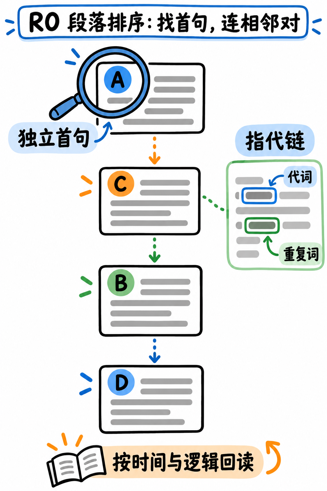

# 02. 段落重新排序 (Reorder Paragraph, RO) 极速通关指南 —— A 级骨干题型

:::{admonition} 题型核心参数一览 (At a Glance)
:class: tip
| 核心指标 | 官方标准参数 |
|---|---|
| **考场题量** | 2–3 题 |
| **供分单项** | **阅读 (Reading)** |
| **文本规模** | 最多 110 词，被打乱切割为 4–5 个独立的文本框 |
| **官方计分规则** | **按正确“相邻段落对 (Adjacent Pair)”给分，每排对一对得 1 分**，最低 0 分 |
| **倒扣分惩罚** | **零倒扣分！(NONE)** |
:::

---

## 彻底搞清给分底层：相邻对 (Pair) 计分机制

在开始做题之前，必须搞清官方计分机制：**系统从不要求你必须 100% 把整篇文章全部排对！**
官方算法是按**相邻段落对 (Adjacent Pairs)** 逐对判分的。

假设一道 5 个文本框的排序题，一共包含 **4 个相邻对**（1-2, 2-3, 3-4, 4-5）：
```
官方标准正确顺序：  A   B   C   D   E
考生答案一：        A   B   D   C   E
命中相邻对分析：    A-B ✓   B-D ✗   D-C ✗   C-E ✗   ➔  稳得 1 分！

考生答案二：        A   B   C   E   D
命中相邻对分析：    A-B ✓   B-C ✓   C-E ✗   E-D ✗   ➔  稳得 2 分！
```

:::{important} 相邻对机制带来的两大核心战术启示
1. **绝对不要放弃！即使完全排不准，也必须排出一个看起来合理的顺序！** 蒙对任意两段的前后顺序就能凭空捞到步骤分。
2. **只要锁定了前两个框（A-B 对），你就已经稳拿 1 分基础分**！因此，把 80% 的精力花在“找独立首句”和“找首对紧邻句”上，性价比最高。
:::

---

## 三步破题黄金法则 (The Three-Step Method)



### 第一步：秒杀独立首句（全题最高回报动作）

首句是整篇短文的独立起点，它必然具备鲜明的**“无前置依赖”特征**：
- **必须以完整的实体名词或专业概念破题**：比如说 "*The Industrial Revolution began in Britain...*"，绝不会开头就说 "*It began in Britain...*"；
- **绝不包含回指指代词**：绝不能以 *this, that, these, those, such, the former, the latter* 起头；
- **绝不包含承前逻辑连接词**：绝不能以 *however, therefore, moreover, in addition, as a result, for example* 起头；
- 通常是对某一现象、理论或历史事件的**最宽泛、最宏观的概括性陈述**。

:::{tip} 代词快速排查法 (The Pronoun Test)
扫视每个文本框的**前 3 个单词**：
凡是以 *It, They, This, These, Such, He, She, Another, The former* 起头的文本框，**100% 不可能是首句**！因为它们指代的具体实体此前根本没有出现过。
仅凭这一条机械法则，20 秒内就能直接把首句范围缩小到只剩 1 个候选框！
:::

---

### 第二步：顺藤摸瓜，追踪指代链与呼应信号

一旦抓出了独立首句，接下来寻找各个剩余文本框**向前呼应的线索链**：

| 文本框开头的信号词 | 它必定紧跟在哪个文本框之后？ |
|---|---|
| "**This process** can take decades..." | 前一个框必然刚刚具体介绍了某种“发展历程或演化过程 (process)” |
| "**These findings** were unexpected..." | 前一个框必然刚刚公布了某项具体的“研究发现或实验数据 (findings)” |
| "**Such approaches** have limitations..." | 前一个框必然刚刚列举了某种“应对方法或策略 (approaches)” |
| "**However**, the results were mixed..." | 前一个框必然刚刚陈述了一个“普遍积极或符合预期的结论” |
| "**For example**, in 1923..." | 前一个框必然刚刚抛出了一个“宏观的抽象论断” |
| "**As a result**, production doubled..." | 前一个框必然刚刚陈述了某种“导致生产力提高的原因” |
| "**The second** factor is..." | 前一个框必然阐述了“第一项因素 (first factor)” |
| "**Finally** / **In conclusion**..." | 通常处于全篇的末尾或倒数第二位 |

---

### 第三步：顺应时间轴与“由宏观到具体”的学术递进

- **时序递进链 (Chronological)**：寻找年代（1850s ➔ 1920s ➔ modern era）或时间过渡词（*initially ➔ subsequently ➔ eventually ➔ today*），严格按时间先后推进。
- **由宏观到具体再到引申 (General ➔ Specific ➔ Implication)**：学术写作的标准逻辑是“抛出宏观概念 ➔ 展开实验细节/举例 ➔ 引申出深远学术意义或影响”。

---

## 官方全真经典例题精析 (Worked Example)

以下为 5 个被打乱顺序的文本框：

> **(A)** *However, this interpretation has been challenged by more recent excavations, which suggest the settlement was occupied year-round.*
> 
> **(B)** *The site at Skara Brae, on the Orkney Islands, is among the best-preserved Neolithic villages in northern Europe.*
> 
> **(C)** *These revealed storage pits containing winter food stores, as well as hearths showing continuous use.*
> 
> **(D)** *It was first excavated in the 1850s, when archaeologists assumed it had been a seasonal camp.*
> 
> **(E)** *The question of permanent occupation therefore remains central to understanding how Neolithic communities in the region were organised.*

### 破题推导全程：
1. **排查首句**：(A) 以 *However* 起头排除；(C) 以 *These revealed* 起头排除；(D) 以 *It was* 起头排除；(E) 包含 *therefore* 排除。**唯一能作为独立首句的只有 (B)**，且完整给出了地点实体名词 "*The site at Skara Brae*" ➔ **第一位：B**。
2. **寻找紧邻对**：(D) 开头的 "*It was first excavated*" 中的 **It** 恰好指代 (B) 中的遗址 site，且给出了最早发掘时间（1850年代） ➔ **形成 B–D 相邻对**！
3. **寻找转折对**：(A) 开头的 "*However, this interpretation*" 指代 (D) 中考古学家的假设（认为它只是季节性营地 seasonal camp） ➔ **形成 D–A 相邻对**！
4. **寻找复数指代**：(C) 开头的 "*These revealed*" 指代 (A) 中提到的最新发掘活动（more recent excavations） ➔ **形成 A–C 相邻对**！
5. **收尾因果引申**：(E) 以 "*therefore remains central*" 总结常年定居问题的学术深远意义 ➔ **末位：E**。

**最终正确排序：B ➔ D ➔ A ➔ C ➔ E**（斩获满分 4 分！）。
请注意：**整个解题过程完全不需要你懂新石器时代考古学！纯靠首词指代信号就能破局。**

---

## 考场时间配速铁律：每题坚决限时 2 分钟！

段落排序是整场考试中“最容易让人产生沉迷解题强迫症”的陷阱题。大量考生在考场上为了排出一道难题的完美顺序，不知不觉耗费了 5–6 分钟，直接导致最后两道分值极高的完形填空甚至连看都没看就交卷了！

**实战止损铁律**：
- 单题耗时上限设为 **2 分钟**；
- 如果思考了 90 秒仍然觉得顺序摇摆不定：**立刻把你确定的首对（如 B-D）排在前面，其余文本框凭直觉迅速排好，果断点击 Next！**
- 拿走已锁定的相邻对分数，保住后面完形填空的黄金时间！

---

## 初学者必须杜绝的失分误区

| 常见失分误区 | 为什么致命 | 正确纠偏动作 |
|---|---|---|
| 试图读懂晦涩的学术专业理论 | 严重耗时，且容易陷入思维死胡同 | 依靠代词、指示词和逻辑连接词机械推导 |
| 单题死磕 4 分钟以上 | 导致后续完形填空直接空题崩盘 | 严格执行 2 分钟强制止损线 |
| 以为屏幕默认给出的顺序就是从上到下排的 | 考场初始顺序是完全随机打乱的 | 必须用代词排查法独立挑出首句 |
| 纠结全篇全局，放弃局部配对 | 丢失相邻对步骤分 | 锁定确定的相邻对，其余模糊项果断盲猜 |

---

**下一章学习指南：** 请继续阅读阅读模块中的单选与多选题解题策略：{doc}`03-multiple-choice`。
