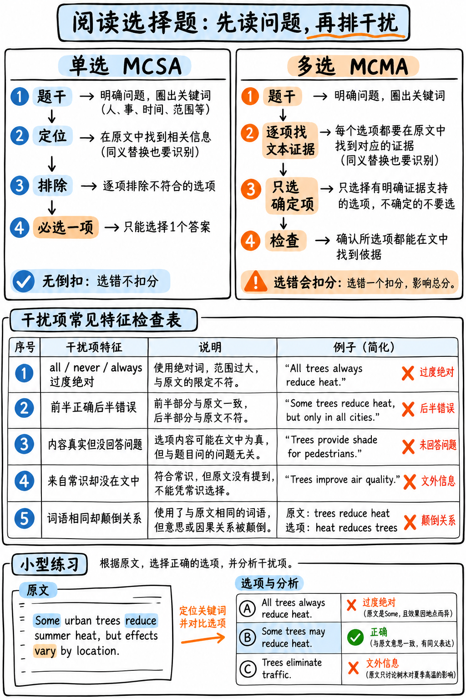

# 03. 阅读选择题 (单选与多选) 极速通关指南 —— B 级与 C 级应对战术

如图 18 所示，单选必须选一项，多选只选有原文证据的项；下方例题逐一演示绝对化、文外信息等干扰。

*图 18：阅读选择题的单选、多选作答流程与五类常见干扰项。*

阅读选择题包含两类机制截然相反的题型。彻底弄清两者的给分差异，能帮你省下数分钟宝贵时间并规避惨烈的负分陷阱。

---

## 题型一：阅读单选题 (R-MCSA) —— B 级常规题

:::{admonition} 题型核心参数一览 (At a Glance)
:class: tip
| 核心指标 | 官方标准参数 |
|---|---|
| **考场题量** | 2–3 题 |
| **供分单项** | **阅读 (Reading)** |
| **文本规模** | 最多 110 词的短小段落 |
| **官方计分规则** | **对/错 二元计分**：答对得 1 分，答错得 0 分 |
| **倒扣分惩罚** | **零倒扣分！(NONE)** |
:::

### 实战极速应答法则：先题后文，排除纠错，绝不留白

**单题耗时硬上限：90 秒！** 做完立刻点击 Next，绝不在单选题上纠缠。

1. **永远先读题目题干 (Question Stem)**：在看短文前先明确题干在问什么（主旨大意、特定事实细节、作者态度、还是推论），带着目的回文定位。
2. **正常语速扫读 110 词短文一遍**。
3. **识别并排除五大经典干扰项陷阱**：

| 官方高频干扰项陷阱类型 | 如何一眼识别并排除？ |
|---|---|
| **绝对化表述陷阱 (Too extreme)** | 含有 *all, never, always, only, must, impossible* 等极端词。学术英语极度讲究严谨保留，绝对化的选项 95% 以上都是错误选项！ |
| **半对半错陷阱 (Half right)** | 前半句与原文完全一致，后半句偷换核心概念。**必须把选项读完整！** |
| **原文真话但非本题答案 (Irrelevant truth)** | 选项在原文中确实提到过且属实，但根本没有回答当前题干提出的问题。 |
| **无中生有/常识绑架 (Outside the passage)** | 看起来非常符合现实常识，但原文文本中压根没有提到过。答案必须来自文本！ |
| **原词重现偷换逻辑 (Word-match trap)** | 充斥着原文中的高难度原词，但把主谓宾的因果或对比关系完全颠倒。 |

4. **犹豫不决时：优先选择语气温和、带有软化词 (Hedged) 的选项**：学术论文偏好 *tends to, may indicate, suggests, partially* 这类审慎表述。
5. **哪怕完全不会也必须立刻蒙一个！** 零倒扣分，猜错不扣分，留白必为 0 分。

---

## 题型二：阅读多选题 (R-MCMA) —— C 级高危题（必须克制，果断防守）

:::{admonition} 题型核心参数一览 (At a Glance)
:class: warning
| 核心指标 | 官方标准参数 |
|---|---|
| **考场题量** | 2–3 题 |
| **供分单项** | **阅读 (Reading)** |
| **文本规模** | **长达 350 词 —— 全场阅读篇幅最长的题目！** |
| **官方计分规则** | **选对一项得 +1 分，选错一项倒扣 −1 分！单题最低 0 分保底** |
:::

:::{danger} 为什么多选题是全场性价比最低的毒药题目？
本题汇集了全场最恶劣的答题条件：
1. **文本篇幅最长**（长达 350 词的大篇幅学术论文）；
2. **需要找出多个正确选项**；
3. **设有残酷的 −1 倒扣分机制**！

我们来看数学期望算术账（假设 5 个选项中有 3 个正确项）：

| 你的考场选择 | 选对项 | 选错项 | 最终该题净得分 |
|---|---|---|---|
| 贪心选满全部 5 项 | 3 项 (+3) | 2 项 (-2) | **仅得 +1 分！** |
| 选了 3 项（2 对 1 错） | 2 项 (+2) | 1 项 (-1) | **仅得 +1 分！** |
| **极度克制，只选 2 个 100% 确定的** | **2 项 (+2)** | **0 项 (0)** | **稳赚 +2 分！** |
| 选了 4 项（3 对 1 错） | 3 项 (+3) | 1 项 (-1) | **得 +2 分** |

**数学铁证：贪多全选净收益几乎为零！保持克制、只选绝对确定的选项，得分反而更高！**
:::

---

### 多选题核心生存战术：只选 1–2 个绝对确定的选项，绝不碰运气！

1. **先看题干问什么**；
2. **快速略读文本**（最多耗时 60 秒），抓段落首句与核心实词定位；
3. **选项核对金标准**：只有当你在原文中能**明确用手指出对应的句子支持它**时，才勾选该选项；如果心里在想“这似乎挺有道理的”，**坚决不选！**
4. **单题硬性耗时上限：2 分钟**。时间一到，选好确定的选项立刻点击 Next！

:::{tip} 必须刻意练习的反直觉法则：少做反而多分！
在倒扣分机制下，每一个不确定的点击都是一次“正面得 1 分、反面扣 1 分”的零和甚至负期望赌博。
**只选 1 个最有把握的选项，稳拿 +1 分净胜分，然后迅速抽身，把时间留给后面的完形填空！**
这是高分考生通行的经典避坑战术。
:::

---

## 初学者必须杜绝的失分误区

| 常见失分误区 | 产生后果 | 正确纠偏动作 |
|---|---|---|
| 多选题试图把所有选项都选上 | 倒扣分直接抵消，耗时 4 分钟只拿 0–1 分 | 坚决只选 1–2 个 100% 确定的选项 |
| 把 350 词的短文逐字精读 | 严重耗尽阅读总时间 | 略读抓主题，根据题干核心名词定位 |
| 单选题遇到生词空着不选 | 纯粹白扔分数 | 单选无负分，哪怕纯蒙也必须选一个提交 |
| 盲目勾选原文原词密集的选项 | 掉入偷换逻辑陷阱 | 核实主谓因果关系，不盲目迷信原词 |

---

**下一章学习指南：** 请继续阅读阅读全模块的时间统筹与配速战略：{doc}`04-section-tactics`。
