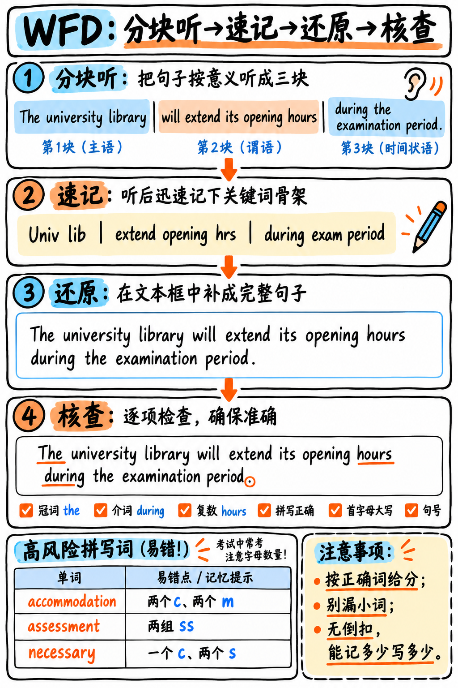

# 01. 听写句子 (Write from Dictation, WFD) —— S 级战略核心·全场第一提分神器

:::{admonition} 题型核心参数一览 (At a Glance)
:class: tip
| 核心指标 | 官方标准参数 |
|---|---|
| **考场题量** | 3–4 题 —— **整场考试的收尾压轴大题！** |
| **供分单项** | **听力 (Listening) + 写作 (Writing)** 双向巨额供分 |
| **音频输入** | 3–5 秒单句录音，仅播放 1 次（8–14 个英文单词） |
| **官方计分规则** | **每拼对一个单词得 1 分**；拼错或写错为 0 分 |
| **倒扣分惩罚** | **零倒扣分！(NONE)** 多写词、写错词绝不倒扣分 |
| **战略优先级** | **全场第一最高优先级！无论基础如何，必须从本题开始狂练！** |
:::

---

## 为什么说 WFD 是整场 PTE 考试投资回报率最高的绝杀武器？

三大考场真相叠加，奠定了它不可撼动的神级地位：

1. **直接决定写作分数的半壁江山**：全场直接向写作供分的题目仅有 7–8 题（SWT 2 题，大作文 1 题，SST 1 题，WFD 3–4 题）。**仅 WFD 这一道题就占据了写作直接给分题量的一半！**
2. **顶格交叉双向供分**：你写对的每一个单词，都**同时给听力单项和写作单项各加 1 分**！
3. **对英语文学功底要求极低，纯靠短期肌肉记忆即可变现**：你不需要理解高深的学术逻辑，不需要遣词造句，只要能把听到的 10 个词默写下来并拼写正确。

一个零基础、大作文写不顺畅、学术讲座听不懂的初学者，**只要集中两周时间每天攻克 WFD 拼写，就能在这道题上狂揽 90% 以上的分数**！这是雅思或托福绝对不可能提供的暴风式提分红利。

---

## 官方评分规则精准深度剖析

培生官方评分指南的标准表述为：
> *"1 Each correct word spelled correctly / 0 Each incorrect or misspelled word." (每拼对一个正确单词得 1 分；写错或拼写错误得 0 分。)*

由此衍生出三大考场战术红利：

:::{important} 必须刻入骨髓的三大规则红利
1. **多写词不倒扣分！(Extra words are free)**
   官方规则中**没有任何负分倒扣项**。如果你不确定录音中是单数还是复数（例如听到 "research" 还是 "researches"），原则上虽然不建议滥加胡乱堆砌，但在真正犹豫不决时，写下你认为最可能的形式，多写其他相关词汇绝不影响已拼对单词的得分！
2. **词序不设硬性连带惩罚**：得分是按单词命中率逐词结算的。先把所有能记住的单词写在屏幕上，远比因为排不准顺序而放弃写词强得多。
3. **拼写正确性是绝对的生死线**：如果把 "accommodation" 错拼成 "accomodation"，哪怕你听得一清二楚，该词得分也直接判 0！**练 WFD 的本质就是练学术高频词的无死角精准拼写！**
:::

---

## 独创四步通关法：切意群、脑回声、首字母速记、语法重构

如图 20 所示，同一句话从分块听、速记骨架到还原完整句子，再逐项检查小词与拼写；可照图操作后再做正文题库。



*图 20：WFD 分块、速记、还原和核查示例。*

一句 WFD 录音通常包含 8–14 个词，耗时仅 3–5 秒。人类的大脑工作记忆瞬时容量大约只能容纳 7 个离散信息项——但可以容纳 **7 个意群块 (Chunks)**！

### 第一步：录音播放前（物理就位）
右手握笔悬在可擦草稿板上方，视线放空，**严禁分心看屏幕**。你有且仅有一次听音机会。

### 第二步：录音播放时（纯听意群，严禁动笔！）
:::{warning} 听音过程中绝对不要动笔写字！
初学者最致命的习惯是在录音播放的同时试图在草稿纸上同步听写。人的手速永远跟不上 150 词/分钟的语速，写到第 3 个词录音就结束了，后面的内容彻底蒸发！
:::

将句子听成 3–4 个语法意群块：
> *"The university library | will extend its opening hours | during the examination period."*
> ➔ 意群 1 (主语 3 词) · 意群 2 (谓语动作 5 词) · 意群 3 (时间状语 4 词) = **仅 3 个意群块，而不是 12 个零散单词！**

### 第三步：录音刚结束（3 秒极速打捞首字母）
利用脑海中留存的 3–4 秒语音瞬时回声，**在草稿板上以极限手速写下核心实词的首字母或极简缩写**：
```
Un lib  |  ext open hrs  |  dur exam per
```
这个动作只需 3 秒钟，却把整句话的骨架 100% 封存在了纸上！

### 第四步：屏幕文本框语法重构与拼写终审
对着草稿板上的缩写骨架，从容在屏幕文本框中键入完整的英文字符，补齐冠词与介词，顺带做语法一致性核查：
> *The university library will extend its opening hours during the examination period.*

---

## 终极提分秘籍：语音回声循环技术 (The Phonological Loop)

认知心理学研究表明：人类的语音回路（Phonological Loop）在没有主动循环复述的情况下，声音信号会在 2 秒内消退；**但如果你在脑海中像复读机一样用原声音调持续无声默念，记忆留存时间可以延长至 15–20 秒！**

**实战动作**：录音播放的同时，嘴巴微动、在脑中同步跟读这串声音旋律；录音播完后，**脑海中的“内置复读机”不要停**，一边在纸上飞速写下首字母，脑海中一边循环循环播放刚才的声音！

---

## 考场最高危学术拼写易错词库 (High-Risk Spelling Bank)

以下为中国考生在 WFD 中失分率最高的 30 个高频词，请务必在草稿纸上反复默写：

| 正确拼写 | 常见致命错误 | 避坑记忆技巧 |
|---|---|---|
| **accommodation** | accomodation | **双 c，双 m**（两个房间两个室友） |
| **assessment** | assesment | **两组双 s**（asse-ss-ment） |
| **bibliography** | bibilography | biblio + graphy（参考书目） |
| **colleague** | collegue | collea + **gue**（同事） |
| **committee** | commitee | **双 m，双 t，双 e**（委员会人人成双） |
| **curriculum** | curiculum | cur + **r** + iculum（**双 r**，单 l） |
| **definitely** | definately | de + **finite** + ly（内含有限 finite） |
| **discipline** | disipline | dis + **ci** + pline（含 c） |
| **environment** | enviroment | environ + ment（**n 在 m 之前**） |
| **existence** | existance | exist + **ence**（以 -ence 结尾） |
| **government** | goverment | govern + ment（保留 **n**） |
| **independent** | independant | 以 **-ent** 结尾，非 -ant |
| **knowledge** | knowlege | know + **ledge**（知识就是壁架） |
| **laboratory** | labratory | labo + **ra** + tory（四个完整音节） |
| **maintenance** | maintainance | mainten + **ance**（保持 maintain 变 maintenance 去掉 ai） |
| **necessary** | neccessary | **单 c，双 s**（一件衬衫两条袖子） |
| **occurrence** | occurence | **双 c，双 r** |
| **parallel** | paralell | para + **ll** + el（两根平行线在中间） |
| **privilege** | priviledge | 中间**绝无字母 d**！ |
| **questionnaire** | questionaire | question + **naire**（**双 n**） |
| **recommend** | reccommend | **单 c，双 m** |
| **referred / referring** | refered | 重读闭音节**双写 r** |
| **relevant** | relevent | rele + **vant**（相关性） |
| **research** | reserch | re + **search** |
| **schedule** | schedual | sched + **ule** |
| **separate** | seperate | sep + **a** + rate（中间藏着一只老鼠 a rat） |
| **successful** | succesful | **双 c，双 s**，末尾单 l |
| **thorough** | thourough | thor + ough（彻底的） |
| **until** | untill | **单 l**（till 才是双 l） |
| **writing** | writting | 单 t（written 才是双 t） |

:::{tip} 隐形丢分大户：复数名词 -s 与第三人称单数 -s
音频中常有极细微的清辅音/浊辅音结尾（如 *the student submits* vs *the students submit*）。初学者常常因为没听清而丢掉 -s。
键入完毕后，必须问自己两个自检问题：
1. **主谓单复数一致吗？**
2. **名词是可数名词吗？如果是可数单数，前面有没有冠词 a/the？如果没有冠词，它大概率是复数 -s！**
仅凭语法推导，就能挽回至少 20% 遗漏的 -s 分数！
:::

---

## 每日 15 分钟专项强化训练课表

| 备考阶段 | 规划天数 | 每日核心训练任务 |
|---|---|---|
| **第一阶段：短时记忆拓宽** | 第 1–3 天 | 每天精练 15 句 {doc}`../50-practice/01-write-from-dictation-bank`。只听一遍，立刻默写，记录初始正确率。 |
| **第二阶段：意群切分与速记** | 第 4–7 天 | 强制执行“听音不写、听完写缩写”规范，训练大脑将长句压缩为 3 个意群。正确率应跃升至 80% 以上。 |
| **第三阶段：拼写地雷大排查** | 第 8–11 天 | 整理自己的**专属拼写错题本**（参见 {doc}`../60-toolkit/04-error-log-method`），每个写错的词强制默写 5 遍。 |
| **第四阶段：疲劳极限抗压模拟** | 第 12–14 天 | **强制将 WFD 训练安排在每天 2 小时高强度学习的最末尾**！模拟考场最后 10 分钟精力透支状态下的抗干扰答题。 |

---

**配套实战演练题库：** 立即前往 {doc}`../50-practice/01-write-from-dictation-bank`，包含 60 句官方高频学术真题母题、意群切分点与高危拼写深度精析！
