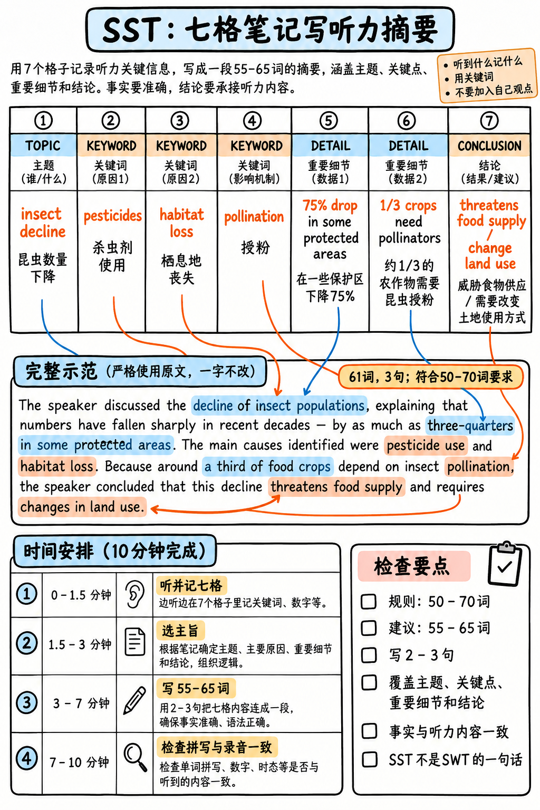

# 02. 听力文本概括 (Summarize Spoken Text, SST) 极速通关指南 —— B 级双向供分题

:::{admonition} 题型核心参数一览 (At a Glance)
:class: tip
| 核心指标 | 官方标准参数 |
|---|---|
| **考场题量** | **1 题**（整场听力考试永远只考 1 篇） |
| **供分单项** | **听力 (Listening) + 写作 (Writing)** 双向供分 |
| **音频输入** | 60–90 秒学术短讲座音频，**仅播放 1 次** |
| **作答时间** | **独立计时 10 分钟**（包含听音与打字撰写全过程） |
| **官方字数要求** | **50–70 词**（安全锁定区间：**55–65 词**） |
| **官方考查特质** | Content (内容), Form (字数格式), Grammar (语法), Vocabulary (词汇), Spelling (拼写) |
| **真人专家双评** | **是！** 2025 年改版后 Content 维度引入真人考务专家人工复核 |
:::

:::{danger} 触碰即直接判 0 分的 Form 字数红线
官方评分细则严格规定：**全文低于 40 词或超过 100 词，该题直接判 0 分！**

**最佳实战策略：将文章精准控制在 55–65 词之间！**
这个区间正好处于满分 50–70 词的正中央，前后各有充沛的安全余量。

**与阅读 SWT 的本质区别**：
- 阅读概括（SWT）强制要求**只能写 1 句话**；
- 听力概括（SST）**绝对允许且强烈建议写成 2 到 3 个标准英文句子**！用 2–3 句话表达，语法结构简单安全得多，极大降低长句语病风险。
:::

---

## 为什么将其列入 B 级？

整场考试仅考 **1 题**。虽然它同时跨界给听力和写作供分，但因为题量极小，不值得像 WFD 那样投入数周死磕。掌握标准 10 分钟应对流程，考前集中演练 3–5 篇即可稳定达标。

---

## 10 分钟答题黄金时间表 (The 10-Minute Method)

| 时间切片 | 强制执行动作 |
|---|---|
| **第 0–1.5 分钟** | **专注听音速记**。在可擦草稿板上按“七格速记法”捕捉词汇碎片，严禁在听音时写完整句子！ |
| **第 1.5–3 分钟** | **整理笔记线索**。圈出开篇主题 (Topic)、3 个核心实词与末尾结论句。 |
| **第 3–7 分钟** | **键入 55–65 词的书面总结**，通常由 2–3 个句子构成。 |
| **第 7–9 分钟** | **五项全能终检**：看实时字数统计、查单词拼写、核对主谓一致、检查时态。 |
| **第 9–10 分钟** | 通读最后一遍，从容点击 Next 提交。 |

---

## 听力速记：七格抓词模板

如图 21 所示，先记主题、关键词、数字和结论，再把它们改写成符合字数要求的摘要；图中保留完整示范便于逐项核对。



*图 21：SST 七格笔记、完整摘要示范和十分钟分配。*

与口语中的复述讲座（RL）完全共用一套听力捕捉逻辑 —— **一套技能，两处变现**：

```
1. TOPIC (主题):       __________________ (听音频开头的第 5–10 秒，必出主旨)
2. KEYWORD 1 (关键词1): __________________ (高频重复出现的学术实词)
3. KEYWORD 2 (关键词2): __________________
4. KEYWORD 3 (关键词3): __________________
5. DETAIL 1 (细节举例1): __________________ (数据、案例或现象)
6. DETAIL 2 (细节举例2): __________________
7. CONCLUSION (结论):  __________________ (听音频最后 10 秒，必出收尾)
```

:::{tip} 听力采分点永远藏在“首尾两头”
学术录音结构严谨：永远在最开始宣布议题，在最末尾给出总结。
**只要死死听懂录音最前面的 10 秒和最后面的 10 秒，你就已经掌握了本篇的核心灵魂！**
中间段不要试图去翻译长难句，只把注意力放在反复重读的专业名词上。
:::

---

## 官方认可的高分句式脚手架 (Sentence Frame)

固定骨架约 18 词，其余全部填入从录音中抓取的真实信息：

> “The speaker mainly discussed **[主题 TOPIC]**, explaining that **[核心论点 MAIN POINT]**. They specifically highlighted **[关键词1 KEYWORD 1]** and pointed out that **[关键词2 KEYWORD 2]**. In addition, the speaker mentioned the importance of **[细节 DETAIL]**. Ultimately, they concluded that **[末尾结论 CONCLUSION]**.”

### 官方真题实战示范（昆虫种群衰减讲座）

**草稿板速记碎片：**
- *Topic*: insect decline (昆虫衰减)
- *Keywords*: pesticides (杀虫剂), habitat loss (栖息地丧失), pollination (传粉)
- *Details*: 75% drop in reserves (保护区下降75%), 1/3 crops need pollinators (三分之一农作物依赖传粉)
- *Conclusion*: threatens food supply (威胁粮食安全), needs land-use change (需要调整土地利用)

**满分考场作答范文 (精准 61 词，3个标准句子)：**
> "The speaker discussed the sharp decline of insect populations, explaining that their numbers have fallen substantially in recent decades. The primary causes identified were excessive pesticide use and widespread habitat loss. Because approximately one-third of agricultural food crops rely directly on insect pollination, the speaker concluded that this ongoing trend threatens global food security and requires immediate policy changes."

---

## 提交前的语法与拼写自检清单

- [ ] **总字数是否严格落在 55–65 词之间？**（紧盯屏幕左下角字数统计）
- [ ] **是否写成了 2–3 个独立句子？**（每个句子均有清晰的大写首字母与结尾句号）
- [ ] 时态是否统一使用**一般过去时**（如 *the speaker discussed, they noted, the lecture explained*）？
- [ ] 主谓单复数是否核对无误？
- [ ] 关键技术专有名词拼写是否检查过？（若不确定拼写，换用更有把握的同义简单词）

---

**下一章学习指南：** 请继续阅读与 WFD 技能高度复用的听力大题：{doc}`03-fill-in-the-blanks`。
